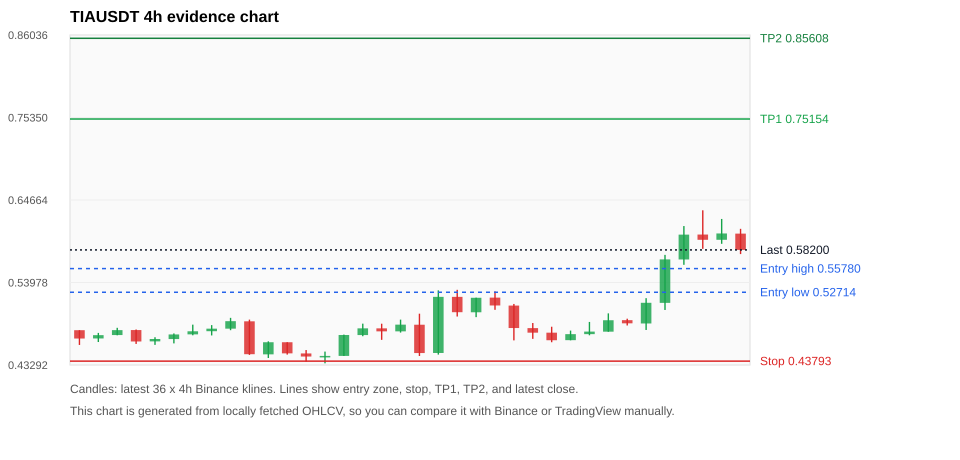
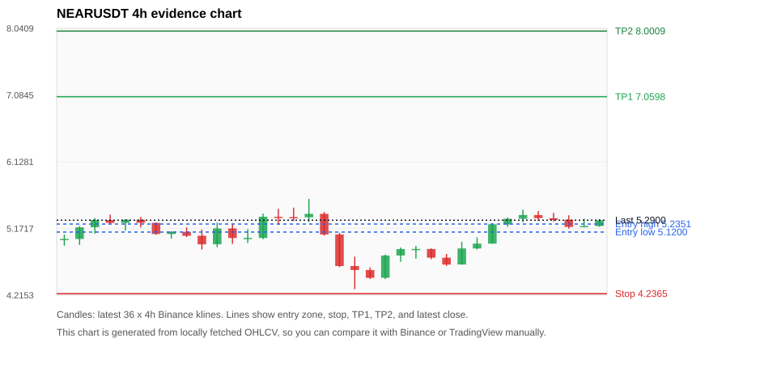
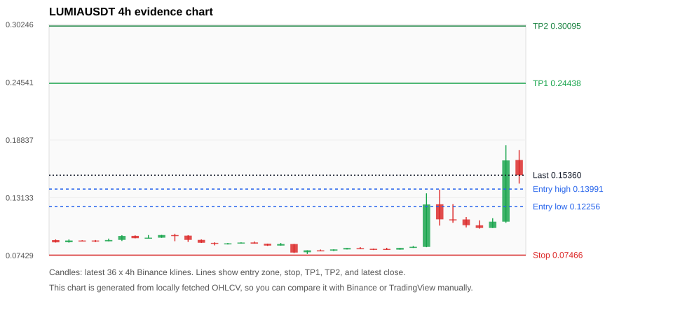
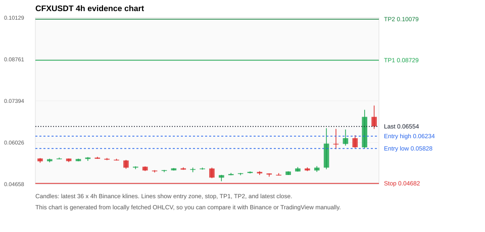
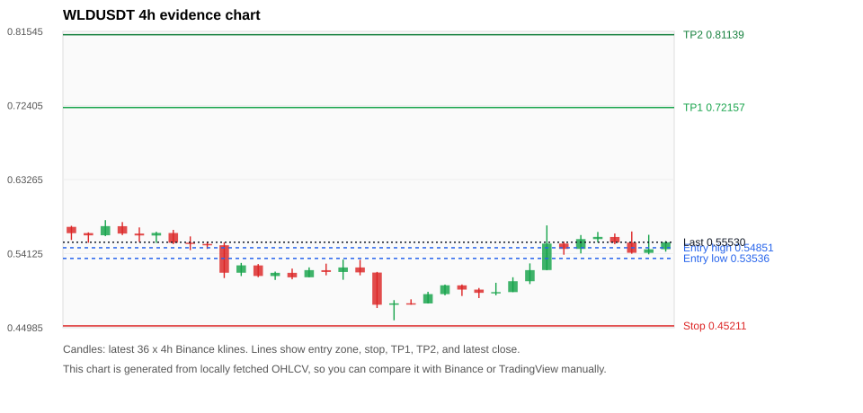

# Crypto 市场扫描报告 v1

- 报告时间：2026-10-11 20:06:07 CST
- Run ID：`20261011_120503_a98c8093`
- Run type：`daily_full`
- Data validation mode：`paper`
- 数据来源：SQLite
- 报告版本：v1
- 扫描 ID：c8bb844258e5
- 数据源：Binance public spot API + CoinGecko/CoinMarketCap cross-check
- 过滤条件：USDT spot; 24h quote volume >= 30,000,000; trades >= 30,000; exclude stables/leveraged tokens; analyze 1h/4h/1d klines
- 默认单笔风险：账户权益的 1.00%

## 限制说明

- 交易信号仍以 Binance 现货公开 K 线为主源；外部数据源用于一致性复核。
- 结果是研究和模拟盘计划，不是确定收益或实盘下单指令。
- 历史长度过滤：候选币至少需要 180 根 1d K 线。
- 数据质量验证池：先验证 score 排名前 min(top_n * 2, 10) 的候选，再按 action + score 补足最终名单。
- 指标截止：2026-10-11T12:05:07.045000+00:00；仅使用此前至少60秒已闭合K线，ticker为扫描时点观测。
- 大盘环境过滤：RISK_OFF; BTC/ETH 大盘偏弱，山寨币买入候选降级为观察。 BTC 7d=-2.082744370855927; ETH 7d=-6.724768627917966.
- Data cross-validation enabled: Binance primary source plus CoinGecko; CoinMarketCap is checked when an API key is configured.
- TIAUSDT validation state DEGRADED: DEGRADED: [EXTERNAL_IDENTITY_AMBIGUOUS] CoinGecko symbol mapping has 2 exact matches; selected highest market-cap rank
- LUMIAUSDT validation state BLOCKED: BLOCKED: [BINANCE_KLINE_EXTREME_RANGE] Binance candle range exceeds 40%.; [BINANCE_KLINE_EXTREME_RANGE] Binance candle range exceeds 40%.; [BINANCE_KLINE_EXTREME_RANGE] Binance candle range exceeds 40%.; [BINANCE_KLINE_EXTREME_RANGE] Binance candle range exceeds 40%.; [BINANCE_KLINE_EXTREME_RANGE] Binance candle range exceeds 40%.; [BINANCE_KLINE_EXTREME_RANGE] Binance candle range exceeds 40%.; [BINANCE_KLINE_EXTREME_RANGE] Binance candle range exceeds 40%.; [BINANCE_KLINE_EXTREME_RANGE] Binance candle range exceeds 40%.; [EXTERNAL_PRICE_DIFF_WARNING] price diff 1.08% exceeds warning threshold
- CFXUSDT validation state DEGRADED: DEGRADED: [EXTERNAL_IDENTITY_AMBIGUOUS] CoinGecko symbol mapping has 4 exact matches; selected highest market-cap rank; [EXTERNAL_IDENTITY_AMBIGUOUS] CoinMarketCap symbol mapping has 2 matches; selected lowest cmc_rank
- WLDUSDT validation state BLOCKED: BLOCKED: [BINANCE_KLINE_EXTREME_RANGE] Binance candle range exceeds 40%.; [EXTERNAL_IDENTITY_AMBIGUOUS] CoinMarketCap symbol mapping has 2 matches; selected lowest cmc_rank
- STRKUSDT validation state BLOCKED: BLOCKED: [BINANCE_KLINE_EXTREME_RANGE] Binance candle range exceeds 40%.; [BINANCE_KLINE_EXTREME_RANGE] Binance candle range exceeds 40%.; [EXTERNAL_PROVIDER_RATE_LIMITED] Provider rate limited request for https://api.coingecko.com/api/v3/coins/markets?vs_currency=usd&ids=starknet&price_change_percentage=24h&per_page=1&page=1: HTTP 429; [EXTERNAL_IDENTITY_AMBIGUOUS] CoinMarketCap symbol mapping has 2 matches; selected lowest cmc_rank
- BTCUSDT validation state DEGRADED: DEGRADED: [EXTERNAL_PROVIDER_RATE_LIMITED] Provider rate limited request for https://api.coingecko.com/api/v3/coins/markets?vs_currency=usd&ids=bitcoin&price_change_percentage=24h&per_page=1&page=1: HTTP 429; [EXTERNAL_IDENTITY_AMBIGUOUS] CoinMarketCap symbol mapping has 13 matches; selected lowest cmc_rank
- SUIUSDT validation state DEGRADED: DEGRADED: [EXTERNAL_PROVIDER_RATE_LIMITED] Provider rate limited request for https://api.coingecko.com/api/v3/coins/markets?vs_currency=usd&ids=sui&price_change_percentage=24h&per_page=1&page=1: HTTP 429; [EXTERNAL_IDENTITY_AMBIGUOUS] CoinMarketCap symbol mapping has 5 matches; selected lowest cmc_rank
- ZECUSDT validation state BLOCKED: BLOCKED: [BINANCE_KLINE_EXTREME_RANGE] Binance candle range exceeds 40%.; [BINANCE_KLINE_EXTREME_RANGE] Binance candle range exceeds 40%.; [EXTERNAL_PROVIDER_RATE_LIMITED] Provider rate limited request for https://api.coingecko.com/api/v3/coins/markets?vs_currency=usd&ids=zcash&price_change_percentage=24h&per_page=1&page=1: HTTP 429; [EXTERNAL_IDENTITY_AMBIGUOUS] CoinMarketCap symbol mapping has 2 matches; selected lowest cmc_rank
- ETHUSDT validation state DEGRADED: DEGRADED: [EXTERNAL_PROVIDER_RATE_LIMITED] Provider rate limited request for https://api.coingecko.com/api/v3/coins/markets?vs_currency=usd&ids=ethereum&price_change_percentage=24h&per_page=1&page=1: HTTP 429; [EXTERNAL_IDENTITY_AMBIGUOUS] CoinMarketCap symbol mapping has 6 matches; selected lowest cmc_rank

## 5 个候选交易计划

| Rank | Coin | Action | Setup | Entry Zone | Stop Loss | TP1 | TP2 / Exit Rule | R/R | Verdict |
|---:|---|---|---|---:|---:|---:|---|---:|---|
| 1 | `TIA` | `WATCH_ONLY` | 涨幅较远，只等深回调 | 0.52714 - 0.55780 | 0.43793 | 0.75154 | 0.85608 或跌破 4h 关键支撑 | 2.00-3.00 | 只等回调 |
| 2 | `NEAR` | `WATCH_ONLY` | 回踩支撑/4h EMA 附近 | 5.1200 - 5.2351 | 4.2365 | 7.0598 | 8.0009 或跌破 4h 关键支撑 | 2.00-3.00 | 只观察 |
| 3 | `LUMIA` | `WATCH_ONLY` | 涨幅较远，只等深回调 | 0.12256 - 0.13991 | 0.07466 | 0.24438 | 0.30095 或跌破 4h 关键支撑 | 2.00-3.00 | 只观察 |
| 4 | `CFX` | `WATCH_ONLY` | 涨幅较远，只等深回调 | 0.05828 - 0.06234 | 0.04682 | 0.08729 | 0.10079 或跌破 4h 关键支撑 | 2.00-3.00 | 只等回调 |
| 5 | `WLD` | `WATCH_ONLY` | 回踩支撑/4h EMA 附近 | 0.53536 - 0.54851 | 0.45211 | 0.72157 | 0.81139 或跌破 4h 关键支撑 | 2.00-3.00 | 只观察 |

## 数据交叉验证摘要

价格差异以 Binance 当前价为基准；成交量口径不同，Binance 是 USDT 现货成交额，CoinGecko/CoinMarketCap 通常是全市场成交量。

| Rank | Coin | State | Identity | Max Price Diff | Max 24h Diff | Issue Codes | Message |
|---:|---|---|---|---:|---:|---|---|
| 1 | `TIA` | DEGRADED (DATA_WARNING) | UNCONFIRMED | 0.44% | 0.33 pts | EXTERNAL_IDENTITY_AMBIGUOUS | DEGRADED: [EXTERNAL_IDENTITY_AMBIGUOUS] CoinGecko symbol mapping has 2 exact matches; selected highest market-cap rank |
| 2 | `NEAR` | CLEAN (DATA_OK) | CONFIRMED | 0.19% | 0.77 pts | none | CLEAN: External provider checks agree with Binance within configured thresholds. |
| 3 | `LUMIA` | BLOCKED (DATA_ERROR) | CONFIRMED | 1.08% | 1.60 pts | BINANCE_KLINE_EXTREME_RANGE, EXTERNAL_PRICE_DIFF_WARNING | BLOCKED: [BINANCE_KLINE_EXTREME_RANGE] Binance candle range exceeds 40%.; [BINANCE_KLINE_EXTREME_RANGE] Binance candle range exceeds 40%.; [BINANCE_KLINE_EXTREME_RANGE] Binance candle range exceeds 40%.; [BINANCE_KLINE_EXTREME_RANGE] Binance candle range exceeds 40%.; [BINANCE_KLINE_EXTREME_RANGE] Binance candle range exceeds 40%.; [BINANCE_KLINE_EXTREME_RANGE] Binance candle range exceeds 40%.; [BINANCE_KLINE_EXTREME_RANGE] Binance candle range exceeds 40%.; [BINANCE_KLINE_EXTREME_RANGE] Binance candle range exceeds 40%.; [EXTERNAL_PRICE_DIFF_WARNING] price diff 1.08% exceeds warning threshold |
| 4 | `CFX` | DEGRADED (DATA_WARNING) | UNCONFIRMED | 0.34% | 0.12 pts | EXTERNAL_IDENTITY_AMBIGUOUS | DEGRADED: [EXTERNAL_IDENTITY_AMBIGUOUS] CoinGecko symbol mapping has 4 exact matches; selected highest market-cap rank; [EXTERNAL_IDENTITY_AMBIGUOUS] CoinMarketCap symbol mapping has 2 matches; selected lowest cmc_rank |
| 5 | `WLD` | BLOCKED (DATA_ERROR) | UNCONFIRMED | 0.19% | 0.20 pts | BINANCE_KLINE_EXTREME_RANGE, EXTERNAL_IDENTITY_AMBIGUOUS | BLOCKED: [BINANCE_KLINE_EXTREME_RANGE] Binance candle range exceeds 40%.; [EXTERNAL_IDENTITY_AMBIGUOUS] CoinMarketCap symbol mapping has 2 matches; selected lowest cmc_rank |

## 候选币说明

### 1. TIA `TIAUSDT`



- 入选原因：涨幅较远，只等深回调；24h +20.05%，7d +23.44%，4h RSI 63.14，24h 成交额 $31.2M。
- 交易失效条件：跌破 0.437931 或 4h 收盘重新失守关键支撑。
- 主要风险：距离支撑偏远，不能追市价；24h 振幅较大，回撤风险高；成交量突增，可能是事件驱动；BTC/ETH 大盘环境未确认强势，山寨币买入信号降级；External validation is degraded; this candidate is not a clean data sample.；Paper mode allows degraded validation; candidate is excluded from clean-data samples.。
- 数据交叉验证：DEGRADED / DATA_WARNING；身份=UNCONFIRMED；DEGRADED: [EXTERNAL_IDENTITY_AMBIGUOUS] CoinGecko symbol mapping has 2 exact matches; selected highest market-cap rank

#### 可点击人工验证

- [Binance 交易页](https://www.binance.com/en/trade/TIA_USDT)
- [TradingView 图表](https://www.tradingview.com/chart/?symbol=BINANCE%3ATIAUSDT)
- [CoinGecko 搜索](https://www.coingecko.com/en/search?query=TIA)
- [CoinMarketCap 搜索](https://coinmarketcap.com/search/?q=TIA)

#### 多数据源对照

| Source | Status | Identity | Blocking | Asset ID | Price | 24h Change | 24h Volume | Price Diff | 24h Diff | Updated | Issue Codes | Message |
|---|---|---|---:|---|---:|---:|---:|---:|---:|---|---|---|
| Binance | DATA_OK | CONFIRMED | no | TIAUSDT | 0.58200 | +20.05% | $31.2M | 0.00% | 0.00 pts | 2026-10-11T12:05:25+00:00 | none | Primary market data source passed health checks. |
| CoinGecko | DATA_WARNING | UNCONFIRMED | no | celestia | 0.58454 | +20.21% | $223.4M | 0.44% | 0.16 pts | 2026-10-11T12:04:54.000Z | EXTERNAL_IDENTITY_AMBIGUOUS | [EXTERNAL_IDENTITY_AMBIGUOUS] CoinGecko symbol mapping has 2 exact matches; selected highest market-cap rank |
| CoinMarketCap | DATA_OK | CONFIRMED | no | 22861 | 0.58236 | +19.72% | $203.8M | 0.06% | 0.33 pts | 2026-10-11T12:04:02.000Z | none | External source agrees with Binance within thresholds. |

#### 指标证据

| 指标 | 数值 | 人工核对用途 |
|---|---:|---|
| 当前价 | 0.58200 | 与 Binance/TradingView 当前价格对照 |
| 24h 涨跌 | +20.05% | 与交易所 24h 涨跌对照 |
| 7d 涨跌 | +23.44% | 判断短线趋势是否延续 |
| 4h EMA20 | 0.52583 | 判断短期趋势支撑 |
| 4h EMA50 | 0.49666 | 判断中期趋势支撑 |
| 1d EMA20 | 0.47227 | 判断日线趋势 |
| 1d EMA50 | 0.42831 | 判断日线趋势 |
| 4h RSI14 | 63.14 | 判断是否过热/过弱 |
| 4h ATR14 | 0.03227 | 推导止损和入场缓冲 |
| 最近 18 根 4h 最低点 | 0.44460 | 支撑/止损参考 |
| 最近 36 根 4h 最高点 | 0.63330 | TP/压力参考 |
| 支撑位 | 0.52583 | 入场区间推导基础 |

#### 交易计划推导

- 支撑位 = 最近低点、4h EMA20、4h EMA50、1d EMA20 中不高于当前价的最高有效支撑 = `0.52583`。
- 入场区间 = 支撑位附近 + ATR 缓冲 = `0.52714 - 0.55780`。
- 止损 = min(最近 18 根 4h 最低点 * 0.985, 入场中位价 - 1.15 * ATR14) = `0.43793`。
- TP1 = max(最近 36 根 4h 最高点 * 0.995, 入场中位价 + 2R) = `0.75154`。
- TP2 = max(入场中位价 + 3R, TP1 * 1.04) = `0.85608`。

#### 最近 10 根 4h K线

| UTC 开盘时间 | Open | High | Low | Close | Quote Volume | Trades |
|---|---:|---:|---:|---:|---:|---:|
| 2026-10-09T20:00+00:00 | 0.46510 | 0.47750 | 0.46490 | 0.47290 | $858,942 | 12243 |
| 2026-10-10T00:00+00:00 | 0.47290 | 0.48870 | 0.47140 | 0.47620 | $789,401 | 14901 |
| 2026-10-10T04:00+00:00 | 0.47610 | 0.49980 | 0.47600 | 0.49090 | $961,172 | 17244 |
| 2026-10-10T08:00+00:00 | 0.49100 | 0.49290 | 0.48410 | 0.48690 | $586,395 | 10855 |
| 2026-10-10T12:00+00:00 | 0.48670 | 0.51950 | 0.47830 | 0.51350 | $2.4M | 27482 |
| 2026-10-10T16:00+00:00 | 0.51340 | 0.57560 | 0.50420 | 0.56970 | $6.1M | 97280 |
| 2026-10-10T20:00+00:00 | 0.56960 | 0.61290 | 0.56270 | 0.60180 | $9.5M | 133265 |
| 2026-10-11T00:00+00:00 | 0.60190 | 0.63330 | 0.58340 | 0.59510 | $5.9M | 106544 |
| 2026-10-11T04:00+00:00 | 0.59510 | 0.62210 | 0.58990 | 0.60330 | $4.2M | 77650 |
| 2026-10-11T08:00+00:00 | 0.60310 | 0.60930 | 0.57660 | 0.58200 | $3.1M | 51121 |

### 2. NEAR `NEARUSDT`



- 入选原因：回踩支撑/4h EMA 附近；24h +0.38%，7d +8.91%，4h RSI 69.49，24h 成交额 $97.4M。
- 交易失效条件：跌破 4.236485 或 4h 收盘重新失守关键支撑。
- 主要风险：BTC/ETH 大盘环境未确认强势，山寨币买入信号降级。
- 数据交叉验证：CLEAN / DATA_OK；身份=CONFIRMED；CLEAN: External provider checks agree with Binance within configured thresholds.

#### 可点击人工验证

- [Binance 交易页](https://www.binance.com/en/trade/NEAR_USDT)
- [TradingView 图表](https://www.tradingview.com/chart/?symbol=BINANCE%3ANEARUSDT)
- [CoinGecko 搜索](https://www.coingecko.com/en/search?query=NEAR)
- [CoinMarketCap 搜索](https://coinmarketcap.com/search/?q=NEAR)

#### 多数据源对照

| Source | Status | Identity | Blocking | Asset ID | Price | 24h Change | 24h Volume | Price Diff | 24h Diff | Updated | Issue Codes | Message |
|---|---|---|---:|---|---:|---:|---:|---:|---:|---|---|---|
| Binance | DATA_OK | CONFIRMED | no | NEARUSDT | 5.2900 | +0.38% | $97.4M | 0.00% | 0.00 pts | 2026-10-11T12:05:25+00:00 | none | Primary market data source passed health checks. |
| CoinGecko | DATA_OK | CONFIRMED | no | near | 5.3000 | -0.07% | $583.1M | 0.19% | 0.45 pts | 2026-10-11T12:04:54.000Z | none | External source agrees with Binance within thresholds. |
| CoinMarketCap | DATA_OK | CONFIRMED | no | 6535 | 5.2871 | -0.39% | $731.0M | 0.06% | 0.77 pts | 2026-10-11T12:04:02.000Z | none | External source agrees with Binance within thresholds. |

#### 指标证据

| 指标 | 数值 | 人工核对用途 |
|---|---:|---|
| 当前价 | 5.2900 | 与 Binance/TradingView 当前价格对照 |
| 24h 涨跌 | +0.38% | 与交易所 24h 涨跌对照 |
| 7d 涨跌 | +8.91% | 判断短线趋势是否延续 |
| 4h EMA20 | 5.1098 | 判断短期趋势支撑 |
| 4h EMA50 | 5.0305 | 判断中期趋势支撑 |
| 1d EMA20 | 4.6555 | 判断日线趋势 |
| 1d EMA50 | 3.7355 | 判断日线趋势 |
| 4h RSI14 | 69.49 | 判断是否过热/过弱 |
| 4h ATR14 | 0.17900 | 推导止损和入场缓冲 |
| 最近 18 根 4h 最低点 | 4.3010 | 支撑/止损参考 |
| 最近 36 根 4h 最高点 | 5.5950 | TP/压力参考 |
| 支撑位 | 5.1098 | 入场区间推导基础 |

#### 交易计划推导

- 支撑位 = 最近低点、4h EMA20、4h EMA50、1d EMA20 中不高于当前价的最高有效支撑 = `5.1098`。
- 入场区间 = 支撑位附近 + ATR 缓冲 = `5.1200 - 5.2351`。
- 止损 = min(最近 18 根 4h 最低点 * 0.985, 入场中位价 - 1.15 * ATR14) = `4.2365`。
- TP1 = max(最近 36 根 4h 最高点 * 0.995, 入场中位价 + 2R) = `7.0598`。
- TP2 = max(入场中位价 + 3R, TP1 * 1.04) = `8.0009`。

#### 最近 10 根 4h K线

| UTC 开盘时间 | Open | High | Low | Close | Quote Volume | Trades |
|---|---:|---:|---:|---:|---:|---:|
| 2026-10-09T20:00+00:00 | 4.6550 | 4.9800 | 4.6540 | 4.8850 | $23.8M | 91923 |
| 2026-10-10T00:00+00:00 | 4.8850 | 5.0430 | 4.8710 | 4.9540 | $17.4M | 84641 |
| 2026-10-10T04:00+00:00 | 4.9540 | 5.2430 | 4.9540 | 5.2310 | $31.0M | 122665 |
| 2026-10-10T08:00+00:00 | 5.2300 | 5.3300 | 5.1940 | 5.3110 | $24.5M | 90681 |
| 2026-10-10T12:00+00:00 | 5.3110 | 5.4400 | 5.2610 | 5.3650 | $35.2M | 121139 |
| 2026-10-10T16:00+00:00 | 5.3640 | 5.4220 | 5.2790 | 5.3200 | $17.2M | 67920 |
| 2026-10-10T20:00+00:00 | 5.3190 | 5.3960 | 5.2740 | 5.2950 | $10.8M | 48350 |
| 2026-10-11T00:00+00:00 | 5.2960 | 5.3610 | 5.1690 | 5.1930 | $14.8M | 59871 |
| 2026-10-11T04:00+00:00 | 5.1930 | 5.3130 | 5.1920 | 5.2060 | $10.4M | 48799 |
| 2026-10-11T08:00+00:00 | 5.2060 | 5.3080 | 5.1960 | 5.2900 | $9.7M | 48006 |

### 3. LUMIA `LUMIAUSDT`



- 入选原因：涨幅较远，只等深回调；24h +41.62%，7d +78.40%，4h RSI 74.03，24h 成交额 $30.0M。
- 交易失效条件：跌破 0.074663 或 4h 收盘重新失守关键支撑。
- 主要风险：距离支撑偏远，不能追市价；24h 振幅较大，回撤风险高；成交量突增，可能是事件驱动；BTC/ETH 大盘环境未确认强势，山寨币买入信号降级；Blocking data-quality issue detected; paper plan creation is not allowed.。
- 数据交叉验证：BLOCKED / DATA_ERROR；身份=CONFIRMED；BLOCKED: [BINANCE_KLINE_EXTREME_RANGE] Binance candle range exceeds 40%.; [BINANCE_KLINE_EXTREME_RANGE] Binance candle range exceeds 40%.; [BINANCE_KLINE_EXTREME_RANGE] Binance candle range exceeds 40%.; [BINANCE_KLINE_EXTREME_RANGE] Binance candle range exceeds 40%.; [BINANCE_KLINE_EXTREME_RANGE] Binance candle range exceeds 40%.; [BINANCE_KLINE_EXTREME_RANGE] Binance candle range exceeds 40%.; [BINANCE_KLINE_EXTREME_RANGE] Binance candle range exceeds 40%.; [BINANCE_KLINE_EXTREME_RANGE] Binance candle range exceeds 40%.; [EXTERNAL_PRICE_DIFF_WARNING] price diff 1.08% exceeds warning threshold

#### 可点击人工验证

- [Binance 交易页](https://www.binance.com/en/trade/LUMIA_USDT)
- [TradingView 图表](https://www.tradingview.com/chart/?symbol=BINANCE%3ALUMIAUSDT)
- [CoinGecko 搜索](https://www.coingecko.com/en/search?query=LUMIA)
- [CoinMarketCap 搜索](https://coinmarketcap.com/search/?q=LUMIA)

#### 多数据源对照

| Source | Status | Identity | Blocking | Asset ID | Price | 24h Change | 24h Volume | Price Diff | 24h Diff | Updated | Issue Codes | Message |
|---|---|---|---:|---|---:|---:|---:|---:|---:|---|---|---|
| Binance | DATA_ERROR | CONFIRMED | yes | LUMIAUSDT | 0.15360 | +41.62% | $30.0M | 0.00% | 0.00 pts | 2026-10-11T12:05:25+00:00 | BINANCE_KLINE_EXTREME_RANGE | [BINANCE_KLINE_EXTREME_RANGE] Binance candle range exceeds 40%.; [BINANCE_KLINE_EXTREME_RANGE] Binance candle range exceeds 40%.; [BINANCE_KLINE_EXTREME_RANGE] Binance candle range exceeds 40%.; [BINANCE_KLINE_EXTREME_RANGE] Binance candle range exceeds 40%.; [BINANCE_KLINE_EXTREME_RANGE] Binance candle range exceeds 40%.; [BINANCE_KLINE_EXTREME_RANGE] Binance candle range exceeds 40%.; [BINANCE_KLINE_EXTREME_RANGE] Binance candle range exceeds 40%.; [BINANCE_KLINE_EXTREME_RANGE] Binance candle range exceeds 40%. |
| CoinGecko | DATA_WARNING | CONFIRMED | yes | lumia | 0.15526 | +41.47% | $82.3M | 1.08% | 0.15 pts | 2026-10-11T12:04:54.000Z | EXTERNAL_PRICE_DIFF_WARNING | [EXTERNAL_PRICE_DIFF_WARNING] price diff 1.08% exceeds warning threshold |
| CoinMarketCap | DATA_OK | CONFIRMED | no | 33439 | 0.15433 | +40.02% | $92.5M | 0.48% | 1.60 pts | 2026-10-11T12:04:02.000Z | none | External source agrees with Binance within thresholds. |

#### 指标证据

| 指标 | 数值 | 人工核对用途 |
|---|---:|---|
| 当前价 | 0.15360 | 与 Binance/TradingView 当前价格对照 |
| 24h 涨跌 | +41.62% | 与交易所 24h 涨跌对照 |
| 7d 涨跌 | +78.40% | 判断短线趋势是否延续 |
| 4h EMA20 | 0.10672 | 判断短期趋势支撑 |
| 4h EMA50 | 0.09563 | 判断中期趋势支撑 |
| 1d EMA20 | 0.08626 | 判断日线趋势 |
| 1d EMA50 | 0.08453 | 判断日线趋势 |
| 4h RSI14 | 74.03 | 判断是否过热/过弱 |
| 4h ATR14 | 0.01826 | 推导止损和入场缓冲 |
| 最近 18 根 4h 最低点 | 0.07580 | 支撑/止损参考 |
| 最近 36 根 4h 最高点 | 0.18330 | TP/压力参考 |
| 支撑位 | 0.10672 | 入场区间推导基础 |

#### 交易计划推导

- 支撑位 = 最近低点、4h EMA20、4h EMA50、1d EMA20 中不高于当前价的最高有效支撑 = `0.10672`。
- 入场区间 = 支撑位附近 + ATR 缓冲 = `0.12256 - 0.13991`。
- 止损 = min(最近 18 根 4h 最低点 * 0.985, 入场中位价 - 1.15 * ATR14) = `0.07466`。
- TP1 = max(最近 36 根 4h 最高点 * 0.995, 入场中位价 + 2R) = `0.24438`。
- TP2 = max(入场中位价 + 3R, TP1 * 1.04) = `0.30095`。

#### 最近 10 根 4h K线

| UTC 开盘时间 | Open | High | Low | Close | Quote Volume | Trades |
|---|---:|---:|---:|---:|---:|---:|
| 2026-10-09T20:00+00:00 | 0.08010 | 0.08180 | 0.08010 | 0.08180 | $19,591 | 1188 |
| 2026-10-10T00:00+00:00 | 0.08180 | 0.08370 | 0.08180 | 0.08290 | $26,619 | 867 |
| 2026-10-10T04:00+00:00 | 0.08280 | 0.13570 | 0.08250 | 0.12470 | $6.8M | 161380 |
| 2026-10-10T08:00+00:00 | 0.12490 | 0.13940 | 0.10380 | 0.11000 | $9.1M | 137115 |
| 2026-10-10T12:00+00:00 | 0.11000 | 0.12500 | 0.10660 | 0.10990 | $5.1M | 119210 |
| 2026-10-10T16:00+00:00 | 0.10990 | 0.11230 | 0.10200 | 0.10420 | $2.0M | 52487 |
| 2026-10-10T20:00+00:00 | 0.10410 | 0.10900 | 0.10080 | 0.10150 | $828,807 | 21830 |
| 2026-10-11T00:00+00:00 | 0.10150 | 0.11110 | 0.10150 | 0.10770 | $1.3M | 36629 |
| 2026-10-11T04:00+00:00 | 0.10770 | 0.18330 | 0.10650 | 0.16820 | $14.3M | 359631 |
| 2026-10-11T08:00+00:00 | 0.16860 | 0.17850 | 0.14530 | 0.15360 | $6.4M | 154094 |

### 4. CFX `CFXUSDT`



- 入选原因：涨幅较远，只等深回调；24h +26.90%，7d +21.73%，4h RSI 74.60，24h 成交额 $46.4M。
- 交易失效条件：跌破 0.04681705 或 4h 收盘重新失守关键支撑。
- 主要风险：距离支撑偏远，不能追市价；24h 振幅较大，回撤风险高；成交量突增，可能是事件驱动；BTC/ETH 大盘环境未确认强势，山寨币买入信号降级；External validation is degraded; this candidate is not a clean data sample.；Paper mode allows degraded validation; candidate is excluded from clean-data samples.。
- 数据交叉验证：DEGRADED / DATA_WARNING；身份=UNCONFIRMED；DEGRADED: [EXTERNAL_IDENTITY_AMBIGUOUS] CoinGecko symbol mapping has 4 exact matches; selected highest market-cap rank; [EXTERNAL_IDENTITY_AMBIGUOUS] CoinMarketCap symbol mapping has 2 matches; selected lowest cmc_rank

#### 可点击人工验证

- [Binance 交易页](https://www.binance.com/en/trade/CFX_USDT)
- [TradingView 图表](https://www.tradingview.com/chart/?symbol=BINANCE%3ACFXUSDT)
- [CoinGecko 搜索](https://www.coingecko.com/en/search?query=CFX)
- [CoinMarketCap 搜索](https://coinmarketcap.com/search/?q=CFX)

#### 多数据源对照

| Source | Status | Identity | Blocking | Asset ID | Price | 24h Change | 24h Volume | Price Diff | 24h Diff | Updated | Issue Codes | Message |
|---|---|---|---:|---|---:|---:|---:|---:|---:|---|---|---|
| Binance | DATA_OK | CONFIRMED | no | CFXUSDT | 0.06554 | +26.90% | $46.4M | 0.00% | 0.00 pts | 2026-10-11T12:05:25+00:00 | none | Primary market data source passed health checks. |
| CoinGecko | DATA_WARNING | UNCONFIRMED | no | conflux-token | 0.06572 | +26.78% | $146.8M | 0.28% | 0.12 pts | 2026-10-11T12:04:54.000Z | EXTERNAL_IDENTITY_AMBIGUOUS | [EXTERNAL_IDENTITY_AMBIGUOUS] CoinGecko symbol mapping has 4 exact matches; selected highest market-cap rank |
| CoinMarketCap | DATA_WARNING | UNCONFIRMED | no | 7334 | 0.06576 | +26.89% | $245.4M | 0.34% | 0.01 pts | 2026-10-11T12:04:02.000Z | EXTERNAL_IDENTITY_AMBIGUOUS | [EXTERNAL_IDENTITY_AMBIGUOUS] CoinMarketCap symbol mapping has 2 matches; selected lowest cmc_rank |

#### 指标证据

| 指标 | 数值 | 人工核对用途 |
|---|---:|---|
| 当前价 | 0.06554 | 与 Binance/TradingView 当前价格对照 |
| 24h 涨跌 | +26.90% | 与交易所 24h 涨跌对照 |
| 7d 涨跌 | +21.73% | 判断短线趋势是否延续 |
| 4h EMA20 | 0.05646 | 判断短期趋势支撑 |
| 4h EMA50 | 0.05452 | 判断中期趋势支撑 |
| 1d EMA20 | 0.05341 | 判断日线趋势 |
| 1d EMA50 | 0.05086 | 判断日线趋势 |
| 4h RSI14 | 74.60 | 判断是否过热/过弱 |
| 4h ATR14 | 0.00427 | 推导止损和入场缓冲 |
| 最近 18 根 4h 最低点 | 0.04753 | 支撑/止损参考 |
| 最近 36 根 4h 最高点 | 0.07240 | TP/压力参考 |
| 支撑位 | 0.05646 | 入场区间推导基础 |

#### 交易计划推导

- 支撑位 = 最近低点、4h EMA20、4h EMA50、1d EMA20 中不高于当前价的最高有效支撑 = `0.05646`。
- 入场区间 = 支撑位附近 + ATR 缓冲 = `0.05828 - 0.06234`。
- 止损 = min(最近 18 根 4h 最低点 * 0.985, 入场中位价 - 1.15 * ATR14) = `0.04682`。
- TP1 = max(最近 36 根 4h 最高点 * 0.995, 入场中位价 + 2R) = `0.08729`。
- TP2 = max(入场中位价 + 3R, TP1 * 1.04) = `0.10079`。

#### 最近 10 根 4h K线

| UTC 开盘时间 | Open | High | Low | Close | Quote Volume | Trades |
|---|---:|---:|---:|---:|---:|---:|
| 2026-10-09T20:00+00:00 | 0.04958 | 0.05079 | 0.04958 | 0.05072 | $127,522 | 2138 |
| 2026-10-10T00:00+00:00 | 0.05073 | 0.05219 | 0.05068 | 0.05173 | $476,997 | 5126 |
| 2026-10-10T04:00+00:00 | 0.05172 | 0.05208 | 0.05085 | 0.05106 | $201,929 | 2780 |
| 2026-10-10T08:00+00:00 | 0.05106 | 0.05250 | 0.05058 | 0.05199 | $234,393 | 2926 |
| 2026-10-10T12:00+00:00 | 0.05199 | 0.06494 | 0.05147 | 0.05990 | $15.2M | 234531 |
| 2026-10-10T16:00+00:00 | 0.05985 | 0.06473 | 0.05809 | 0.05979 | $6.5M | 73349 |
| 2026-10-10T20:00+00:00 | 0.05977 | 0.06452 | 0.05922 | 0.06168 | $3.8M | 43678 |
| 2026-10-11T00:00+00:00 | 0.06167 | 0.06266 | 0.05840 | 0.05869 | $3.3M | 33040 |
| 2026-10-11T04:00+00:00 | 0.05866 | 0.07100 | 0.05820 | 0.06868 | $10.8M | 111621 |
| 2026-10-11T08:00+00:00 | 0.06868 | 0.07240 | 0.06472 | 0.06554 | $6.6M | 54570 |

### 5. WLD `WLDUSDT`



- 入选原因：回踩支撑/4h EMA 附近；24h +1.75%，7d -4.75%，4h RSI 73.70，24h 成交额 $33.4M。
- 交易失效条件：跌破 0.452115 或 4h 收盘重新失守关键支撑。
- 主要风险：BTC/ETH 大盘环境未确认强势，山寨币买入信号降级；7d 趋势未确认；Blocking data-quality issue detected; paper plan creation is not allowed.。
- 数据交叉验证：BLOCKED / DATA_ERROR；身份=UNCONFIRMED；BLOCKED: [BINANCE_KLINE_EXTREME_RANGE] Binance candle range exceeds 40%.; [EXTERNAL_IDENTITY_AMBIGUOUS] CoinMarketCap symbol mapping has 2 matches; selected lowest cmc_rank

#### 可点击人工验证

- [Binance 交易页](https://www.binance.com/en/trade/WLD_USDT)
- [TradingView 图表](https://www.tradingview.com/chart/?symbol=BINANCE%3AWLDUSDT)
- [CoinGecko 搜索](https://www.coingecko.com/en/search?query=WLD)
- [CoinMarketCap 搜索](https://coinmarketcap.com/search/?q=WLD)

#### 多数据源对照

| Source | Status | Identity | Blocking | Asset ID | Price | 24h Change | 24h Volume | Price Diff | 24h Diff | Updated | Issue Codes | Message |
|---|---|---|---:|---|---:|---:|---:|---:|---:|---|---|---|
| Binance | DATA_ERROR | CONFIRMED | yes | WLDUSDT | 0.55530 | +1.75% | $33.4M | 0.00% | 0.00 pts | 2026-10-11T12:05:25+00:00 | BINANCE_KLINE_EXTREME_RANGE | [BINANCE_KLINE_EXTREME_RANGE] Binance candle range exceeds 40%. |
| CoinGecko | DATA_OK | CONFIRMED | no | worldcoin-wld | 0.55633 | +1.58% | $229.8M | 0.19% | 0.17 pts | 2026-10-11T12:04:54.000Z | none | External source agrees with Binance within thresholds. |
| CoinMarketCap | DATA_WARNING | UNCONFIRMED | no | 13502 | 0.55550 | +1.55% | $266.9M | 0.04% | 0.20 pts | 2026-10-11T12:04:02.000Z | EXTERNAL_IDENTITY_AMBIGUOUS | [EXTERNAL_IDENTITY_AMBIGUOUS] CoinMarketCap symbol mapping has 2 matches; selected lowest cmc_rank |

#### 指标证据

| 指标 | 数值 | 人工核对用途 |
|---|---:|---|
| 当前价 | 0.55530 | 与 Binance/TradingView 当前价格对照 |
| 24h 涨跌 | +1.75% | 与交易所 24h 涨跌对照 |
| 7d 涨跌 | -4.75% | 判断短线趋势是否延续 |
| 4h EMA20 | 0.53429 | 判断短期趋势支撑 |
| 4h EMA50 | 0.53166 | 判断中期趋势支撑 |
| 1d EMA20 | 0.50980 | 判断日线趋势 |
| 1d EMA50 | 0.46079 | 判断日线趋势 |
| 4h RSI14 | 73.70 | 判断是否过热/过弱 |
| 4h ATR14 | 0.02032 | 推导止损和入场缓冲 |
| 最近 18 根 4h 最低点 | 0.45900 | 支撑/止损参考 |
| 最近 36 根 4h 最高点 | 0.58260 | TP/压力参考 |
| 支撑位 | 0.53429 | 入场区间推导基础 |

#### 交易计划推导

- 支撑位 = 最近低点、4h EMA20、4h EMA50、1d EMA20 中不高于当前价的最高有效支撑 = `0.53429`。
- 入场区间 = 支撑位附近 + ATR 缓冲 = `0.53536 - 0.54851`。
- 止损 = min(最近 18 根 4h 最低点 * 0.985, 入场中位价 - 1.15 * ATR14) = `0.45211`。
- TP1 = max(最近 36 根 4h 最高点 * 0.995, 入场中位价 + 2R) = `0.72157`。
- TP2 = max(入场中位价 + 3R, TP1 * 1.04) = `0.81139`。

#### 最近 10 根 4h K线

| UTC 开盘时间 | Open | High | Low | Close | Quote Volume | Trades |
|---|---:|---:|---:|---:|---:|---:|
| 2026-10-09T20:00+00:00 | 0.49380 | 0.51210 | 0.49380 | 0.50720 | $2.8M | 20391 |
| 2026-10-10T00:00+00:00 | 0.50720 | 0.52920 | 0.50370 | 0.52090 | $5.6M | 37013 |
| 2026-10-10T04:00+00:00 | 0.52100 | 0.57610 | 0.52080 | 0.55370 | $19.0M | 153862 |
| 2026-10-10T08:00+00:00 | 0.55370 | 0.55610 | 0.53990 | 0.54710 | $6.6M | 54565 |
| 2026-10-10T12:00+00:00 | 0.54710 | 0.56420 | 0.54150 | 0.55920 | $7.7M | 61597 |
| 2026-10-10T16:00+00:00 | 0.55920 | 0.56800 | 0.55500 | 0.56190 | $6.1M | 48421 |
| 2026-10-10T20:00+00:00 | 0.56180 | 0.56610 | 0.55290 | 0.55490 | $2.9M | 26045 |
| 2026-10-11T00:00+00:00 | 0.55490 | 0.56860 | 0.54110 | 0.54230 | $7.3M | 44962 |
| 2026-10-11T04:00+00:00 | 0.54220 | 0.56450 | 0.54040 | 0.54660 | $6.4M | 39136 |
| 2026-10-11T08:00+00:00 | 0.54670 | 0.55690 | 0.54370 | 0.55530 | $2.8M | 21163 |

## 组合风控

- 不要 5 个候选全部满仓买入。
- 同时持仓总风险建议控制在账户权益的 3% - 5% 以内。
- 如果 BTC/ETH 同时破位，暂停山寨币多头计划或降低仓位。
- 第一版报告用于模拟盘和人工复核，不自动下单。

## 原始数据

```json
[
  {
    "rank": 1,
    "symbol": "TIAUSDT",
    "base_asset": "TIA",
    "price": 0.582,
    "score": 63.33176611118729,
    "setup": "涨幅较远，只等深回调",
    "verdict": "只等回调",
    "entry_low": 0.5271385714285713,
    "entry_high": 0.5577964285714285,
    "stop_loss": 0.437931,
    "take_profit_1": 0.7515404999999996,
    "take_profit_2": 0.8560769999999995,
    "risk_reward_1": 2.0,
    "risk_reward_2": 3.0000000000000004,
    "pct_24h": 20.049,
    "pct_3d": 20.02474737059188,
    "pct_7d": 23.435843054082707,
    "quote_volume_24h": 31178217.911649,
    "trades_24h": 494018,
    "high_low_range_24h": 32.40643947313402,
    "rsi_1h": 52.12234706616726,
    "rsi_4h": 63.13559322033897,
    "ema20_4h": 0.5258274959702828,
    "ema50_4h": 0.49666358371827757,
    "ema20_1d": 0.47227086787104733,
    "ema50_1d": 0.4283052891960019,
    "atr_4h": 0.032271428571428576,
    "macd_hist_4h": 0.011573841666269399,
    "volume_ratio_24h": 3.3367418210566164,
    "support_level": 0.5258274959702828,
    "recent_low_4h_18": 0.4446,
    "recent_high_4h_36": 0.6333,
    "distance_to_support_pct": 10.682686710033096,
    "binance_trade_url": "https://www.binance.com/en/trade/TIA_USDT",
    "tradingview_url": "https://www.tradingview.com/chart/?symbol=BINANCE%3ATIAUSDT",
    "coingecko_search_url": "https://www.coingecko.com/en/search?query=TIA",
    "coinmarketcap_search_url": "https://coinmarketcap.com/search/?q=TIA",
    "invalidation": "跌破 0.437931 或 4h 收盘重新失守关键支撑",
    "recent_4h_klines": [
      {
        "open_time_utc": "2026-10-05T12:00+00:00",
        "open": 0.478,
        "high": 0.478,
        "low": 0.4589,
        "close": 0.4672,
        "quote_volume": 1090775.655939,
        "trades": 19803
      },
      {
        "open_time_utc": "2026-10-05T16:00+00:00",
        "open": 0.4673,
        "high": 0.4745,
        "low": 0.4627,
        "close": 0.4716,
        "quote_volume": 650721.363682,
        "trades": 12166
      },
      {
        "open_time_utc": "2026-10-05T20:00+00:00",
        "open": 0.4717,
        "high": 0.4811,
        "low": 0.4714,
        "close": 0.4781,
        "quote_volume": 366788.420588,
        "trades": 6584
      },
      {
        "open_time_utc": "2026-10-06T00:00+00:00",
        "open": 0.4782,
        "high": 0.4789,
        "low": 0.4602,
        "close": 0.4634,
        "quote_volume": 656220.449601,
        "trades": 10820
      },
      {
        "open_time_utc": "2026-10-06T04:00+00:00",
        "open": 0.4635,
        "high": 0.4689,
        "low": 0.459,
        "close": 0.4666,
        "quote_volume": 661090.086032,
        "trades": 9817
      },
      {
        "open_time_utc": "2026-10-06T08:00+00:00",
        "open": 0.4665,
        "high": 0.4738,
        "low": 0.4609,
        "close": 0.4725,
        "quote_volume": 758190.939709,
        "trades": 15115
      },
      {
        "open_time_utc": "2026-10-06T12:00+00:00",
        "open": 0.4726,
        "high": 0.4852,
        "low": 0.4714,
        "close": 0.4766,
        "quote_volume": 1028568.999507,
        "trades": 18598
      },
      {
        "open_time_utc": "2026-10-06T16:00+00:00",
        "open": 0.4767,
        "high": 0.4846,
        "low": 0.4712,
        "close": 0.48,
        "quote_volume": 1014900.653112,
        "trades": 21896
      },
      {
        "open_time_utc": "2026-10-06T20:00+00:00",
        "open": 0.48,
        "high": 0.494,
        "low": 0.478,
        "close": 0.4897,
        "quote_volume": 1486048.531639,
        "trades": 23218
      },
      {
        "open_time_utc": "2026-10-07T00:00+00:00",
        "open": 0.4895,
        "high": 0.4917,
        "low": 0.446,
        "close": 0.4469,
        "quote_volume": 2156857.67847,
        "trades": 39207
      },
      {
        "open_time_utc": "2026-10-07T04:00+00:00",
        "open": 0.4467,
        "high": 0.4636,
        "low": 0.442,
        "close": 0.4624,
        "quote_volume": 1238361.961341,
        "trades": 21054
      },
      {
        "open_time_utc": "2026-10-07T08:00+00:00",
        "open": 0.4624,
        "high": 0.4624,
        "low": 0.4464,
        "close": 0.448,
        "quote_volume": 1179230.769555,
        "trades": 20623
      },
      {
        "open_time_utc": "2026-10-07T12:00+00:00",
        "open": 0.4479,
        "high": 0.4523,
        "low": 0.4373,
        "close": 0.4439,
        "quote_volume": 1255833.420981,
        "trades": 22802
      },
      {
        "open_time_utc": "2026-10-07T16:00+00:00",
        "open": 0.4438,
        "high": 0.4503,
        "low": 0.4351,
        "close": 0.4447,
        "quote_volume": 782291.574225,
        "trades": 18419
      },
      {
        "open_time_utc": "2026-10-07T20:00+00:00",
        "open": 0.4447,
        "high": 0.4723,
        "low": 0.4446,
        "close": 0.4718,
        "quote_volume": 1009356.214288,
        "trades": 18735
      },
      {
        "open_time_utc": "2026-10-08T00:00+00:00",
        "open": 0.4717,
        "high": 0.4865,
        "low": 0.4702,
        "close": 0.4804,
        "quote_volume": 1192644.367892,
        "trades": 22365
      },
      {
        "open_time_utc": "2026-10-08T04:00+00:00",
        "open": 0.4804,
        "high": 0.4864,
        "low": 0.4655,
        "close": 0.4765,
        "quote_volume": 2049451.408113,
        "trades": 39459
      },
      {
        "open_time_utc": "2026-10-08T08:00+00:00",
        "open": 0.4765,
        "high": 0.4917,
        "low": 0.4749,
        "close": 0.4852,
        "quote_volume": 1689713.120613,
        "trades": 32171
      },
      {
        "open_time_utc": "2026-10-08T12:00+00:00",
        "open": 0.4851,
        "high": 0.4994,
        "low": 0.4446,
        "close": 0.4484,
        "quote_volume": 5161351.835448,
        "trades": 86986
      },
      {
        "open_time_utc": "2026-10-08T16:00+00:00",
        "open": 0.4485,
        "high": 0.5296,
        "low": 0.4464,
        "close": 0.5212,
        "quote_volume": 8109223.115891,
        "trades": 126877
      },
      {
        "open_time_utc": "2026-10-08T20:00+00:00",
        "open": 0.5212,
        "high": 0.5303,
        "low": 0.4957,
        "close": 0.5013,
        "quote_volume": 3903029.741699,
        "trades": 46197
      },
      {
        "open_time_utc": "2026-10-09T00:00+00:00",
        "open": 0.5012,
        "high": 0.5201,
        "low": 0.4949,
        "close": 0.52,
        "quote_volume": 2124110.15291,
        "trades": 32857
      },
      {
        "open_time_utc": "2026-10-09T04:00+00:00",
        "open": 0.5202,
        "high": 0.5283,
        "low": 0.5044,
        "close": 0.51,
        "quote_volume": 2432126.734599,
        "trades": 32102
      },
      {
        "open_time_utc": "2026-10-09T08:00+00:00",
        "open": 0.5099,
        "high": 0.512,
        "low": 0.4648,
        "close": 0.4808,
        "quote_volume": 3156111.751204,
        "trades": 41504
      },
      {
        "open_time_utc": "2026-10-09T12:00+00:00",
        "open": 0.4807,
        "high": 0.4873,
        "low": 0.4668,
        "close": 0.4748,
        "quote_volume": 1306608.398251,
        "trades": 25399
      },
      {
        "open_time_utc": "2026-10-09T16:00+00:00",
        "open": 0.4748,
        "high": 0.4825,
        "low": 0.4624,
        "close": 0.465,
        "quote_volume": 1505525.413322,
        "trades": 21904
      },
      {
        "open_time_utc": "2026-10-09T20:00+00:00",
        "open": 0.4651,
        "high": 0.4775,
        "low": 0.4649,
        "close": 0.4729,
        "quote_volume": 858942.223754,
        "trades": 12243
      },
      {
        "open_time_utc": "2026-10-10T00:00+00:00",
        "open": 0.4729,
        "high": 0.4887,
        "low": 0.4714,
        "close": 0.4762,
        "quote_volume": 789401.251642,
        "trades": 14901
      },
      {
        "open_time_utc": "2026-10-10T04:00+00:00",
        "open": 0.4761,
        "high": 0.4998,
        "low": 0.476,
        "close": 0.4909,
        "quote_volume": 961171.642149,
        "trades": 17244
      },
      {
        "open_time_utc": "2026-10-10T08:00+00:00",
        "open": 0.491,
        "high": 0.4929,
        "low": 0.4841,
        "close": 0.4869,
        "quote_volume": 586394.679975,
        "trades": 10855
      },
      {
        "open_time_utc": "2026-10-10T12:00+00:00",
        "open": 0.4867,
        "high": 0.5195,
        "low": 0.4783,
        "close": 0.5135,
        "quote_volume": 2378247.566985,
        "trades": 27482
      },
      {
        "open_time_utc": "2026-10-10T16:00+00:00",
        "open": 0.5134,
        "high": 0.5756,
        "low": 0.5042,
        "close": 0.5697,
        "quote_volume": 6100641.973344,
        "trades": 97280
      },
      {
        "open_time_utc": "2026-10-10T20:00+00:00",
        "open": 0.5696,
        "high": 0.6129,
        "low": 0.5627,
        "close": 0.6018,
        "quote_volume": 9510378.136246,
        "trades": 133265
      },
      {
        "open_time_utc": "2026-10-11T00:00+00:00",
        "open": 0.6019,
        "high": 0.6333,
        "low": 0.5834,
        "close": 0.5951,
        "quote_volume": 5887049.291723,
        "trades": 106544
      },
      {
        "open_time_utc": "2026-10-11T04:00+00:00",
        "open": 0.5951,
        "high": 0.6221,
        "low": 0.5899,
        "close": 0.6033,
        "quote_volume": 4202397.057312,
        "trades": 77650
      },
      {
        "open_time_utc": "2026-10-11T08:00+00:00",
        "open": 0.6031,
        "high": 0.6093,
        "low": 0.5766,
        "close": 0.582,
        "quote_volume": 3079773.311305,
        "trades": 51121
      }
    ],
    "risks": [
      "距离支撑偏远，不能追市价",
      "24h 振幅较大，回撤风险高",
      "成交量突增，可能是事件驱动",
      "BTC/ETH 大盘环境未确认强势，山寨币买入信号降级",
      "External validation is degraded; this candidate is not a clean data sample.",
      "Paper mode allows degraded validation; candidate is excluded from clean-data samples."
    ],
    "data_quality_status": "DATA_WARNING",
    "data_quality_message": "DEGRADED: [EXTERNAL_IDENTITY_AMBIGUOUS] CoinGecko symbol mapping has 2 exact matches; selected highest market-cap rank",
    "data_checks": [
      {
        "provider": "Binance",
        "status": "DATA_OK",
        "provider_asset_id": "TIAUSDT",
        "provider_symbol": "TIAUSDT",
        "price_usd": 0.582,
        "pct_24h": 20.049,
        "volume_24h": 31178217.911649,
        "last_updated": null,
        "fetched_at_utc": "2026-10-11T12:05:25+00:00",
        "price_diff_pct": 0.0,
        "pct_24h_diff": 0.0,
        "volume_note": "Binance USDT spot 24h quoteVolume.",
        "message": "Primary market data source passed health checks.",
        "blocking": false,
        "identity_status": "CONFIRMED",
        "issues": []
      },
      {
        "provider": "CoinGecko",
        "status": "DATA_WARNING",
        "provider_asset_id": "celestia",
        "provider_symbol": "TIA",
        "price_usd": 0.584544,
        "pct_24h": 20.20871,
        "volume_24h": 223351859.0,
        "last_updated": "2026-10-11T12:04:54.000Z",
        "fetched_at_utc": "2026-10-11T12:05:25+00:00",
        "price_diff_pct": 0.4371134020618541,
        "pct_24h_diff": 0.15971000000000046,
        "volume_note": "CoinGecko total market volume; not the same venue scope as Binance quoteVolume.",
        "message": "[EXTERNAL_IDENTITY_AMBIGUOUS] CoinGecko symbol mapping has 2 exact matches; selected highest market-cap rank",
        "blocking": false,
        "identity_status": "UNCONFIRMED",
        "issues": [
          {
            "provider": "CoinGecko",
            "code": "EXTERNAL_IDENTITY_AMBIGUOUS",
            "severity": "WARNING",
            "blocking": false,
            "message": "CoinGecko symbol mapping has 2 exact matches; selected highest market-cap rank",
            "context": {}
          }
        ]
      },
      {
        "provider": "CoinMarketCap",
        "status": "DATA_OK",
        "provider_asset_id": "22861",
        "provider_symbol": "TIA",
        "price_usd": 0.5823590516339688,
        "pct_24h": 19.71933756,
        "volume_24h": 203808616.10995048,
        "last_updated": "2026-10-11T12:04:02.000Z",
        "fetched_at_utc": "2026-10-11T12:05:25+00:00",
        "price_diff_pct": 0.06169272061320903,
        "pct_24h_diff": 0.3296624399999999,
        "volume_note": "CoinMarketCap total market volume; not the same venue scope as Binance quoteVolume.",
        "message": "External source agrees with Binance within thresholds.",
        "blocking": false,
        "identity_status": "CONFIRMED",
        "issues": []
      }
    ],
    "action": "WATCH_ONLY",
    "data_quality_state": "DEGRADED",
    "data_quality_issues": [
      {
        "provider": "CoinGecko",
        "code": "EXTERNAL_IDENTITY_AMBIGUOUS",
        "severity": "WARNING",
        "blocking": false,
        "message": "CoinGecko symbol mapping has 2 exact matches; selected highest market-cap rank",
        "context": {}
      }
    ],
    "external_identity_status": "UNCONFIRMED"
  },
  {
    "rank": 2,
    "symbol": "NEARUSDT",
    "base_asset": "NEAR",
    "price": 5.29,
    "score": 54.39640487266952,
    "setup": "回踩支撑/4h EMA 附近",
    "verdict": "只观察",
    "entry_low": 5.120044923184515,
    "entry_high": 5.2351252726392365,
    "stop_loss": 4.236485,
    "take_profit_1": 7.059785293735627,
    "take_profit_2": 8.000885391647502,
    "risk_reward_1": 2.0,
    "risk_reward_2": 3.0,
    "pct_24h": 0.377,
    "pct_3d": 4.25699645250297,
    "pct_7d": 8.914968087296682,
    "quote_volume_24h": 97366463.3911,
    "trades_24h": 393594,
    "high_low_range_24h": 5.242793577094229,
    "rsi_1h": 46.05734767025092,
    "rsi_4h": 69.4915254237288,
    "ema20_4h": 5.109825272639236,
    "ema50_4h": 5.0305038022546364,
    "ema20_1d": 4.655541036456642,
    "ema50_1d": 3.735542349496153,
    "atr_4h": 0.17900000000000008,
    "macd_hist_4h": 0.03702878906868224,
    "volume_ratio_24h": 0.5897956822895415,
    "support_level": 5.109825272639236,
    "recent_low_4h_18": 4.301,
    "recent_high_4h_36": 5.595,
    "distance_to_support_pct": 3.52604478132581,
    "binance_trade_url": "https://www.binance.com/en/trade/NEAR_USDT",
    "tradingview_url": "https://www.tradingview.com/chart/?symbol=BINANCE%3ANEARUSDT",
    "coingecko_search_url": "https://www.coingecko.com/en/search?query=NEAR",
    "coinmarketcap_search_url": "https://coinmarketcap.com/search/?q=NEAR",
    "invalidation": "跌破 4.236485 或 4h 收盘重新失守关键支撑",
    "recent_4h_klines": [
      {
        "open_time_utc": "2026-10-05T12:00+00:00",
        "open": 5.015,
        "high": 5.086,
        "low": 4.923,
        "close": 5.022,
        "quote_volume": 20077614.0652,
        "trades": 93610
      },
      {
        "open_time_utc": "2026-10-05T16:00+00:00",
        "open": 5.021,
        "high": 5.206,
        "low": 4.937,
        "close": 5.188,
        "quote_volume": 22696956.1255,
        "trades": 89109
      },
      {
        "open_time_utc": "2026-10-05T20:00+00:00",
        "open": 5.189,
        "high": 5.321,
        "low": 5.097,
        "close": 5.294,
        "quote_volume": 34068129.5047,
        "trades": 118445
      },
      {
        "open_time_utc": "2026-10-06T00:00+00:00",
        "open": 5.293,
        "high": 5.37,
        "low": 5.225,
        "close": 5.251,
        "quote_volume": 25936161.1932,
        "trades": 125011
      },
      {
        "open_time_utc": "2026-10-06T04:00+00:00",
        "open": 5.252,
        "high": 5.306,
        "low": 5.141,
        "close": 5.298,
        "quote_volume": 13795171.31,
        "trades": 64657
      },
      {
        "open_time_utc": "2026-10-06T08:00+00:00",
        "open": 5.297,
        "high": 5.337,
        "low": 5.186,
        "close": 5.252,
        "quote_volume": 14969714.7365,
        "trades": 70327
      },
      {
        "open_time_utc": "2026-10-06T12:00+00:00",
        "open": 5.252,
        "high": 5.257,
        "low": 5.08,
        "close": 5.092,
        "quote_volume": 20006218.3754,
        "trades": 78763
      },
      {
        "open_time_utc": "2026-10-06T16:00+00:00",
        "open": 5.092,
        "high": 5.132,
        "low": 5.025,
        "close": 5.125,
        "quote_volume": 16966696.6862,
        "trades": 57441
      },
      {
        "open_time_utc": "2026-10-06T20:00+00:00",
        "open": 5.124,
        "high": 5.188,
        "low": 5.048,
        "close": 5.066,
        "quote_volume": 10079079.5868,
        "trades": 39662
      },
      {
        "open_time_utc": "2026-10-07T00:00+00:00",
        "open": 5.067,
        "high": 5.156,
        "low": 4.868,
        "close": 4.944,
        "quote_volume": 29960715.2458,
        "trades": 118321
      },
      {
        "open_time_utc": "2026-10-07T04:00+00:00",
        "open": 4.945,
        "high": 5.255,
        "low": 4.903,
        "close": 5.172,
        "quote_volume": 22342095.3878,
        "trades": 86693
      },
      {
        "open_time_utc": "2026-10-07T08:00+00:00",
        "open": 5.172,
        "high": 5.24,
        "low": 4.951,
        "close": 5.035,
        "quote_volume": 28539475.4193,
        "trades": 119076
      },
      {
        "open_time_utc": "2026-10-07T12:00+00:00",
        "open": 5.035,
        "high": 5.163,
        "low": 4.963,
        "close": 5.036,
        "quote_volume": 30283781.2387,
        "trades": 145919
      },
      {
        "open_time_utc": "2026-10-07T16:00+00:00",
        "open": 5.035,
        "high": 5.385,
        "low": 5.018,
        "close": 5.34,
        "quote_volume": 40303775.1993,
        "trades": 168554
      },
      {
        "open_time_utc": "2026-10-07T20:00+00:00",
        "open": 5.339,
        "high": 5.454,
        "low": 5.225,
        "close": 5.335,
        "quote_volume": 33911433.9351,
        "trades": 139957
      },
      {
        "open_time_utc": "2026-10-08T00:00+00:00",
        "open": 5.335,
        "high": 5.47,
        "low": 5.278,
        "close": 5.332,
        "quote_volume": 23244871.7434,
        "trades": 116312
      },
      {
        "open_time_utc": "2026-10-08T04:00+00:00",
        "open": 5.332,
        "high": 5.595,
        "low": 5.266,
        "close": 5.381,
        "quote_volume": 58496121.7612,
        "trades": 221843
      },
      {
        "open_time_utc": "2026-10-08T08:00+00:00",
        "open": 5.381,
        "high": 5.408,
        "low": 5.068,
        "close": 5.085,
        "quote_volume": 46938078.0577,
        "trades": 158112
      },
      {
        "open_time_utc": "2026-10-08T12:00+00:00",
        "open": 5.086,
        "high": 5.11,
        "low": 4.619,
        "close": 4.633,
        "quote_volume": 76642546.7666,
        "trades": 254630
      },
      {
        "open_time_utc": "2026-10-08T16:00+00:00",
        "open": 4.633,
        "high": 4.767,
        "low": 4.301,
        "close": 4.576,
        "quote_volume": 76633839.4387,
        "trades": 309447
      },
      {
        "open_time_utc": "2026-10-08T20:00+00:00",
        "open": 4.576,
        "high": 4.614,
        "low": 4.449,
        "close": 4.464,
        "quote_volume": 21882135.7617,
        "trades": 94909
      },
      {
        "open_time_utc": "2026-10-09T00:00+00:00",
        "open": 4.465,
        "high": 4.798,
        "low": 4.445,
        "close": 4.784,
        "quote_volume": 35763386.9084,
        "trades": 144292
      },
      {
        "open_time_utc": "2026-10-09T04:00+00:00",
        "open": 4.784,
        "high": 4.899,
        "low": 4.695,
        "close": 4.876,
        "quote_volume": 27830389.7114,
        "trades": 105892
      },
      {
        "open_time_utc": "2026-10-09T08:00+00:00",
        "open": 4.875,
        "high": 4.922,
        "low": 4.739,
        "close": 4.878,
        "quote_volume": 19766528.1546,
        "trades": 84148
      },
      {
        "open_time_utc": "2026-10-09T12:00+00:00",
        "open": 4.877,
        "high": 4.886,
        "low": 4.731,
        "close": 4.753,
        "quote_volume": 16201243.4816,
        "trades": 82251
      },
      {
        "open_time_utc": "2026-10-09T16:00+00:00",
        "open": 4.753,
        "high": 4.807,
        "low": 4.635,
        "close": 4.654,
        "quote_volume": 17288935.126,
        "trades": 68771
      },
      {
        "open_time_utc": "2026-10-09T20:00+00:00",
        "open": 4.655,
        "high": 4.98,
        "low": 4.654,
        "close": 4.885,
        "quote_volume": 23758258.7552,
        "trades": 91923
      },
      {
        "open_time_utc": "2026-10-10T00:00+00:00",
        "open": 4.885,
        "high": 5.043,
        "low": 4.871,
        "close": 4.954,
        "quote_volume": 17369888.0452,
        "trades": 84641
      },
      {
        "open_time_utc": "2026-10-10T04:00+00:00",
        "open": 4.954,
        "high": 5.243,
        "low": 4.954,
        "close": 5.231,
        "quote_volume": 30968996.1186,
        "trades": 122665
      },
      {
        "open_time_utc": "2026-10-10T08:00+00:00",
        "open": 5.23,
        "high": 5.33,
        "low": 5.194,
        "close": 5.311,
        "quote_volume": 24496974.3681,
        "trades": 90681
      },
      {
        "open_time_utc": "2026-10-10T12:00+00:00",
        "open": 5.311,
        "high": 5.44,
        "low": 5.261,
        "close": 5.365,
        "quote_volume": 35154537.4862,
        "trades": 121139
      },
      {
        "open_time_utc": "2026-10-10T16:00+00:00",
        "open": 5.364,
        "high": 5.422,
        "low": 5.279,
        "close": 5.32,
        "quote_volume": 17154486.3437,
        "trades": 67920
      },
      {
        "open_time_utc": "2026-10-10T20:00+00:00",
        "open": 5.319,
        "high": 5.396,
        "low": 5.274,
        "close": 5.295,
        "quote_volume": 10780099.0527,
        "trades": 48350
      },
      {
        "open_time_utc": "2026-10-11T00:00+00:00",
        "open": 5.296,
        "high": 5.361,
        "low": 5.169,
        "close": 5.193,
        "quote_volume": 14849267.2924,
        "trades": 59871
      },
      {
        "open_time_utc": "2026-10-11T04:00+00:00",
        "open": 5.193,
        "high": 5.313,
        "low": 5.192,
        "close": 5.206,
        "quote_volume": 10436211.284,
        "trades": 48799
      },
      {
        "open_time_utc": "2026-10-11T08:00+00:00",
        "open": 5.206,
        "high": 5.308,
        "low": 5.196,
        "close": 5.29,
        "quote_volume": 9712496.5988,
        "trades": 48006
      }
    ],
    "risks": [
      "BTC/ETH 大盘环境未确认强势，山寨币买入信号降级"
    ],
    "data_quality_status": "DATA_OK",
    "data_quality_message": "CLEAN: External provider checks agree with Binance within configured thresholds.",
    "data_checks": [
      {
        "provider": "Binance",
        "status": "DATA_OK",
        "provider_asset_id": "NEARUSDT",
        "provider_symbol": "NEARUSDT",
        "price_usd": 5.29,
        "pct_24h": 0.377,
        "volume_24h": 97366463.3911,
        "last_updated": null,
        "fetched_at_utc": "2026-10-11T12:05:25+00:00",
        "price_diff_pct": 0.0,
        "pct_24h_diff": 0.0,
        "volume_note": "Binance USDT spot 24h quoteVolume.",
        "message": "Primary market data source passed health checks.",
        "blocking": false,
        "identity_status": "CONFIRMED",
        "issues": []
      },
      {
        "provider": "CoinGecko",
        "status": "DATA_OK",
        "provider_asset_id": "near",
        "provider_symbol": "NEAR",
        "price_usd": 5.3,
        "pct_24h": -0.07093,
        "volume_24h": 583118756.0,
        "last_updated": "2026-10-11T12:04:54.000Z",
        "fetched_at_utc": "2026-10-11T12:05:25+00:00",
        "price_diff_pct": 0.18903591682419257,
        "pct_24h_diff": 0.44793,
        "volume_note": "CoinGecko total market volume; not the same venue scope as Binance quoteVolume.",
        "message": "External source agrees with Binance within thresholds.",
        "blocking": false,
        "identity_status": "CONFIRMED",
        "issues": []
      },
      {
        "provider": "CoinMarketCap",
        "status": "DATA_OK",
        "provider_asset_id": "6535",
        "provider_symbol": "NEAR",
        "price_usd": 5.2870769615113105,
        "pct_24h": -0.38968936,
        "volume_24h": 730997935.3402817,
        "last_updated": "2026-10-11T12:04:02.000Z",
        "fetched_at_utc": "2026-10-11T12:05:25+00:00",
        "price_diff_pct": 0.05525592606218483,
        "pct_24h_diff": 0.76668936,
        "volume_note": "CoinMarketCap total market volume; not the same venue scope as Binance quoteVolume.",
        "message": "External source agrees with Binance within thresholds.",
        "blocking": false,
        "identity_status": "CONFIRMED",
        "issues": []
      }
    ],
    "action": "WATCH_ONLY",
    "data_quality_state": "CLEAN",
    "data_quality_issues": [],
    "external_identity_status": "CONFIRMED"
  },
  {
    "rank": 3,
    "symbol": "LUMIAUSDT",
    "base_asset": "LUMIA",
    "price": 0.1536,
    "score": 47.14354622437864,
    "setup": "涨幅较远，只等深回调",
    "verdict": "只观察",
    "entry_low": 0.12256285714285714,
    "entry_high": 0.13990714285714284,
    "stop_loss": 0.07466300000000001,
    "take_profit_1": 0.24437899999999996,
    "take_profit_2": 0.30095099999999997,
    "risk_reward_1": 2.0,
    "risk_reward_2": 3.0000000000000004,
    "pct_24h": 41.621,
    "pct_3d": 81.34592680047223,
    "pct_7d": 78.397212543554,
    "quote_volume_24h": 30020539.296437,
    "trades_24h": 743084,
    "high_low_range_24h": 81.84523809523809,
    "rsi_1h": 71.28532360984504,
    "rsi_4h": 74.03278688524591,
    "ema20_4h": 0.10671558092548104,
    "ema50_4h": 0.09563008814990781,
    "ema20_1d": 0.08626306342689347,
    "ema50_1d": 0.08452533148767415,
    "atr_4h": 0.018257142857142854,
    "macd_hist_4h": 0.0071118259366001815,
    "volume_ratio_24h": 9.609274480516536,
    "support_level": 0.10671558092548104,
    "recent_low_4h_18": 0.0758,
    "recent_high_4h_36": 0.1833,
    "distance_to_support_pct": 43.9339960181242,
    "binance_trade_url": "https://www.binance.com/en/trade/LUMIA_USDT",
    "tradingview_url": "https://www.tradingview.com/chart/?symbol=BINANCE%3ALUMIAUSDT",
    "coingecko_search_url": "https://www.coingecko.com/en/search?query=LUMIA",
    "coinmarketcap_search_url": "https://coinmarketcap.com/search/?q=LUMIA",
    "invalidation": "跌破 0.074663 或 4h 收盘重新失守关键支撑",
    "recent_4h_klines": [
      {
        "open_time_utc": "2026-10-05T12:00+00:00",
        "open": 0.0895,
        "high": 0.0902,
        "low": 0.0871,
        "close": 0.0873,
        "quote_volume": 57227.56343,
        "trades": 1431
      },
      {
        "open_time_utc": "2026-10-05T16:00+00:00",
        "open": 0.0874,
        "high": 0.0902,
        "low": 0.087,
        "close": 0.0891,
        "quote_volume": 45356.955606,
        "trades": 1038
      },
      {
        "open_time_utc": "2026-10-05T20:00+00:00",
        "open": 0.0891,
        "high": 0.0894,
        "low": 0.0885,
        "close": 0.089,
        "quote_volume": 35313.139111,
        "trades": 529
      },
      {
        "open_time_utc": "2026-10-06T00:00+00:00",
        "open": 0.0891,
        "high": 0.0896,
        "low": 0.0875,
        "close": 0.0882,
        "quote_volume": 71786.23041,
        "trades": 991
      },
      {
        "open_time_utc": "2026-10-06T04:00+00:00",
        "open": 0.0883,
        "high": 0.091,
        "low": 0.0883,
        "close": 0.0896,
        "quote_volume": 96342.425604,
        "trades": 1760
      },
      {
        "open_time_utc": "2026-10-06T08:00+00:00",
        "open": 0.0897,
        "high": 0.0944,
        "low": 0.0886,
        "close": 0.0936,
        "quote_volume": 260672.843104,
        "trades": 4542
      },
      {
        "open_time_utc": "2026-10-06T12:00+00:00",
        "open": 0.0937,
        "high": 0.0942,
        "low": 0.0913,
        "close": 0.0914,
        "quote_volume": 194604.995112,
        "trades": 2821
      },
      {
        "open_time_utc": "2026-10-06T16:00+00:00",
        "open": 0.0913,
        "high": 0.0945,
        "low": 0.0913,
        "close": 0.0919,
        "quote_volume": 119963.368563,
        "trades": 2692
      },
      {
        "open_time_utc": "2026-10-06T20:00+00:00",
        "open": 0.0919,
        "high": 0.0946,
        "low": 0.0918,
        "close": 0.0945,
        "quote_volume": 43267.096264,
        "trades": 1167
      },
      {
        "open_time_utc": "2026-10-07T00:00+00:00",
        "open": 0.0945,
        "high": 0.0958,
        "low": 0.0884,
        "close": 0.0941,
        "quote_volume": 270435.551748,
        "trades": 7322
      },
      {
        "open_time_utc": "2026-10-07T04:00+00:00",
        "open": 0.0939,
        "high": 0.0944,
        "low": 0.0877,
        "close": 0.0897,
        "quote_volume": 246119.493109,
        "trades": 6069
      },
      {
        "open_time_utc": "2026-10-07T08:00+00:00",
        "open": 0.0897,
        "high": 0.0902,
        "low": 0.0867,
        "close": 0.0869,
        "quote_volume": 109878.502393,
        "trades": 3058
      },
      {
        "open_time_utc": "2026-10-07T12:00+00:00",
        "open": 0.0868,
        "high": 0.0873,
        "low": 0.0843,
        "close": 0.0859,
        "quote_volume": 107538.304598,
        "trades": 2212
      },
      {
        "open_time_utc": "2026-10-07T16:00+00:00",
        "open": 0.0858,
        "high": 0.0867,
        "low": 0.0852,
        "close": 0.0863,
        "quote_volume": 46667.669868,
        "trades": 1406
      },
      {
        "open_time_utc": "2026-10-07T20:00+00:00",
        "open": 0.0863,
        "high": 0.0873,
        "low": 0.0861,
        "close": 0.0871,
        "quote_volume": 25616.217953,
        "trades": 861
      },
      {
        "open_time_utc": "2026-10-08T00:00+00:00",
        "open": 0.0872,
        "high": 0.0881,
        "low": 0.086,
        "close": 0.086,
        "quote_volume": 25748.123034,
        "trades": 762
      },
      {
        "open_time_utc": "2026-10-08T04:00+00:00",
        "open": 0.0859,
        "high": 0.0859,
        "low": 0.0838,
        "close": 0.0841,
        "quote_volume": 90461.89506,
        "trades": 2164
      },
      {
        "open_time_utc": "2026-10-08T08:00+00:00",
        "open": 0.0841,
        "high": 0.0867,
        "low": 0.0841,
        "close": 0.0856,
        "quote_volume": 44228.678232,
        "trades": 895
      },
      {
        "open_time_utc": "2026-10-08T12:00+00:00",
        "open": 0.0856,
        "high": 0.0856,
        "low": 0.0767,
        "close": 0.0772,
        "quote_volume": 192141.240231,
        "trades": 5330
      },
      {
        "open_time_utc": "2026-10-08T16:00+00:00",
        "open": 0.0775,
        "high": 0.0794,
        "low": 0.0758,
        "close": 0.0794,
        "quote_volume": 94990.376874,
        "trades": 3406
      },
      {
        "open_time_utc": "2026-10-08T20:00+00:00",
        "open": 0.0794,
        "high": 0.0802,
        "low": 0.079,
        "close": 0.079,
        "quote_volume": 20705.573015,
        "trades": 871
      },
      {
        "open_time_utc": "2026-10-09T00:00+00:00",
        "open": 0.0791,
        "high": 0.0804,
        "low": 0.0786,
        "close": 0.0803,
        "quote_volume": 37125.553247,
        "trades": 1057
      },
      {
        "open_time_utc": "2026-10-09T04:00+00:00",
        "open": 0.0803,
        "high": 0.0817,
        "low": 0.0803,
        "close": 0.0817,
        "quote_volume": 16340.51965,
        "trades": 607
      },
      {
        "open_time_utc": "2026-10-09T08:00+00:00",
        "open": 0.0815,
        "high": 0.0826,
        "low": 0.0806,
        "close": 0.0807,
        "quote_volume": 79086.30004,
        "trades": 1912
      },
      {
        "open_time_utc": "2026-10-09T12:00+00:00",
        "open": 0.0809,
        "high": 0.081,
        "low": 0.0797,
        "close": 0.0808,
        "quote_volume": 28859.686023,
        "trades": 1573
      },
      {
        "open_time_utc": "2026-10-09T16:00+00:00",
        "open": 0.0808,
        "high": 0.0819,
        "low": 0.08,
        "close": 0.08,
        "quote_volume": 47153.059678,
        "trades": 886
      },
      {
        "open_time_utc": "2026-10-09T20:00+00:00",
        "open": 0.0801,
        "high": 0.0818,
        "low": 0.0801,
        "close": 0.0818,
        "quote_volume": 19590.529858,
        "trades": 1188
      },
      {
        "open_time_utc": "2026-10-10T00:00+00:00",
        "open": 0.0818,
        "high": 0.0837,
        "low": 0.0818,
        "close": 0.0829,
        "quote_volume": 26619.038943,
        "trades": 867
      },
      {
        "open_time_utc": "2026-10-10T04:00+00:00",
        "open": 0.0828,
        "high": 0.1357,
        "low": 0.0825,
        "close": 0.1247,
        "quote_volume": 6817988.262438,
        "trades": 161380
      },
      {
        "open_time_utc": "2026-10-10T08:00+00:00",
        "open": 0.1249,
        "high": 0.1394,
        "low": 0.1038,
        "close": 0.11,
        "quote_volume": 9123719.399609,
        "trades": 137115
      },
      {
        "open_time_utc": "2026-10-10T12:00+00:00",
        "open": 0.11,
        "high": 0.125,
        "low": 0.1066,
        "close": 0.1099,
        "quote_volume": 5073102.51556,
        "trades": 119210
      },
      {
        "open_time_utc": "2026-10-10T16:00+00:00",
        "open": 0.1099,
        "high": 0.1123,
        "low": 0.102,
        "close": 0.1042,
        "quote_volume": 2028085.910892,
        "trades": 52487
      },
      {
        "open_time_utc": "2026-10-10T20:00+00:00",
        "open": 0.1041,
        "high": 0.109,
        "low": 0.1008,
        "close": 0.1015,
        "quote_volume": 828806.796276,
        "trades": 21830
      },
      {
        "open_time_utc": "2026-10-11T00:00+00:00",
        "open": 0.1015,
        "high": 0.1111,
        "low": 0.1015,
        "close": 0.1077,
        "quote_volume": 1346868.524956,
        "trades": 36629
      },
      {
        "open_time_utc": "2026-10-11T04:00+00:00",
        "open": 0.1077,
        "high": 0.1833,
        "low": 0.1065,
        "close": 0.1682,
        "quote_volume": 14327262.016162,
        "trades": 359631
      },
      {
        "open_time_utc": "2026-10-11T08:00+00:00",
        "open": 0.1686,
        "high": 0.1785,
        "low": 0.1453,
        "close": 0.1536,
        "quote_volume": 6438670.096327,
        "trades": 154094
      }
    ],
    "risks": [
      "距离支撑偏远，不能追市价",
      "24h 振幅较大，回撤风险高",
      "成交量突增，可能是事件驱动",
      "BTC/ETH 大盘环境未确认强势，山寨币买入信号降级",
      "Blocking data-quality issue detected; paper plan creation is not allowed."
    ],
    "data_quality_status": "DATA_ERROR",
    "data_quality_message": "BLOCKED: [BINANCE_KLINE_EXTREME_RANGE] Binance candle range exceeds 40%.; [BINANCE_KLINE_EXTREME_RANGE] Binance candle range exceeds 40%.; [BINANCE_KLINE_EXTREME_RANGE] Binance candle range exceeds 40%.; [BINANCE_KLINE_EXTREME_RANGE] Binance candle range exceeds 40%.; [BINANCE_KLINE_EXTREME_RANGE] Binance candle range exceeds 40%.; [BINANCE_KLINE_EXTREME_RANGE] Binance candle range exceeds 40%.; [BINANCE_KLINE_EXTREME_RANGE] Binance candle range exceeds 40%.; [BINANCE_KLINE_EXTREME_RANGE] Binance candle range exceeds 40%.; [EXTERNAL_PRICE_DIFF_WARNING] price diff 1.08% exceeds warning threshold",
    "data_checks": [
      {
        "provider": "Binance",
        "status": "DATA_ERROR",
        "provider_asset_id": "LUMIAUSDT",
        "provider_symbol": "LUMIAUSDT",
        "price_usd": 0.1536,
        "pct_24h": 41.621,
        "volume_24h": 30020539.296437,
        "last_updated": null,
        "fetched_at_utc": "2026-10-11T12:05:25+00:00",
        "price_diff_pct": 0.0,
        "pct_24h_diff": 0.0,
        "volume_note": "Binance USDT spot 24h quoteVolume.",
        "message": "[BINANCE_KLINE_EXTREME_RANGE] Binance candle range exceeds 40%.; [BINANCE_KLINE_EXTREME_RANGE] Binance candle range exceeds 40%.; [BINANCE_KLINE_EXTREME_RANGE] Binance candle range exceeds 40%.; [BINANCE_KLINE_EXTREME_RANGE] Binance candle range exceeds 40%.; [BINANCE_KLINE_EXTREME_RANGE] Binance candle range exceeds 40%.; [BINANCE_KLINE_EXTREME_RANGE] Binance candle range exceeds 40%.; [BINANCE_KLINE_EXTREME_RANGE] Binance candle range exceeds 40%.; [BINANCE_KLINE_EXTREME_RANGE] Binance candle range exceeds 40%.",
        "blocking": true,
        "identity_status": "CONFIRMED",
        "issues": [
          {
            "provider": "Binance",
            "code": "BINANCE_KLINE_EXTREME_RANGE",
            "severity": "ERROR",
            "blocking": true,
            "message": "Binance candle range exceeds 40%.",
            "context": {
              "symbol": "LUMIAUSDT",
              "interval": "1h",
              "row_index": 139,
              "open_time": 1791615600000,
              "range_pct": 56.33640552995389
            }
          },
          {
            "provider": "Binance",
            "code": "BINANCE_KLINE_EXTREME_RANGE",
            "severity": "ERROR",
            "blocking": true,
            "message": "Binance candle range exceeds 40%.",
            "context": {
              "symbol": "LUMIAUSDT",
              "interval": "1h",
              "row_index": 160,
              "open_time": 1791691200000,
              "range_pct": 49.483568075117375
            }
          },
          {
            "provider": "Binance",
            "code": "BINANCE_KLINE_EXTREME_RANGE",
            "severity": "ERROR",
            "blocking": true,
            "message": "Binance candle range exceeds 40%.",
            "context": {
              "symbol": "LUMIAUSDT",
              "interval": "4h",
              "row_index": 112,
              "open_time": 1791604800000,
              "range_pct": 64.48484848484846
            }
          },
          {
            "provider": "Binance",
            "code": "BINANCE_KLINE_EXTREME_RANGE",
            "severity": "ERROR",
            "blocking": true,
            "message": "Binance candle range exceeds 40%.",
            "context": {
              "symbol": "LUMIAUSDT",
              "interval": "4h",
              "row_index": 118,
              "open_time": 1791691200000,
              "range_pct": 72.11267605633802
            }
          },
          {
            "provider": "Binance",
            "code": "BINANCE_KLINE_EXTREME_RANGE",
            "severity": "ERROR",
            "blocking": true,
            "message": "Binance candle range exceeds 40%.",
            "context": {
              "symbol": "LUMIAUSDT",
              "interval": "1d",
              "row_index": 18,
              "open_time": 1777680000000,
              "range_pct": 48.492462311557794
            }
          },
          {
            "provider": "Binance",
            "code": "BINANCE_KLINE_EXTREME_RANGE",
            "severity": "ERROR",
            "blocking": true,
            "message": "Binance candle range exceeds 40%.",
            "context": {
              "symbol": "LUMIAUSDT",
              "interval": "1d",
              "row_index": 58,
              "open_time": 1781136000000,
              "range_pct": 56.04681404421326
            }
          },
          {
            "provider": "Binance",
            "code": "BINANCE_KLINE_EXTREME_RANGE",
            "severity": "ERROR",
            "blocking": true,
            "message": "Binance candle range exceeds 40%.",
            "context": {
              "symbol": "LUMIAUSDT",
              "interval": "1d",
              "row_index": 90,
              "open_time": 1783900800000,
              "range_pct": 76.10241820768135
            }
          },
          {
            "provider": "Binance",
            "code": "BINANCE_KLINE_EXTREME_RANGE",
            "severity": "ERROR",
            "blocking": true,
            "message": "Binance candle range exceeds 40%.",
            "context": {
              "symbol": "LUMIAUSDT",
              "interval": "1d",
              "row_index": 179,
              "open_time": 1791590400000,
              "range_pct": 70.41564792176038
            }
          }
        ]
      },
      {
        "provider": "CoinGecko",
        "status": "DATA_WARNING",
        "provider_asset_id": "lumia",
        "provider_symbol": "LUMIA",
        "price_usd": 0.155258,
        "pct_24h": 41.46801,
        "volume_24h": 82302200.0,
        "last_updated": "2026-10-11T12:04:54.000Z",
        "fetched_at_utc": "2026-10-11T12:05:25+00:00",
        "price_diff_pct": 1.0794270833333468,
        "pct_24h_diff": 0.15299000000000262,
        "volume_note": "CoinGecko total market volume; not the same venue scope as Binance quoteVolume.",
        "message": "[EXTERNAL_PRICE_DIFF_WARNING] price diff 1.08% exceeds warning threshold",
        "blocking": true,
        "identity_status": "CONFIRMED",
        "issues": [
          {
            "provider": "CoinGecko",
            "code": "EXTERNAL_PRICE_DIFF_WARNING",
            "severity": "WARNING",
            "blocking": true,
            "message": "price diff 1.08% exceeds warning threshold",
            "context": {
              "price_diff_pct": 1.0794270833333468
            }
          }
        ]
      },
      {
        "provider": "CoinMarketCap",
        "status": "DATA_OK",
        "provider_asset_id": "33439",
        "provider_symbol": "LUMIA",
        "price_usd": 0.15433429114700623,
        "pct_24h": 40.02455228,
        "volume_24h": 92458502.61156847,
        "last_updated": "2026-10-11T12:04:02.000Z",
        "fetched_at_utc": "2026-10-11T12:05:25+00:00",
        "price_diff_pct": 0.4780541321655199,
        "pct_24h_diff": 1.5964477200000005,
        "volume_note": "CoinMarketCap total market volume; not the same venue scope as Binance quoteVolume.",
        "message": "External source agrees with Binance within thresholds.",
        "blocking": false,
        "identity_status": "CONFIRMED",
        "issues": []
      }
    ],
    "action": "WATCH_ONLY",
    "data_quality_state": "BLOCKED",
    "data_quality_issues": [
      {
        "provider": "Binance",
        "code": "BINANCE_KLINE_EXTREME_RANGE",
        "severity": "ERROR",
        "blocking": true,
        "message": "Binance candle range exceeds 40%.",
        "context": {
          "symbol": "LUMIAUSDT",
          "interval": "1h",
          "row_index": 139,
          "open_time": 1791615600000,
          "range_pct": 56.33640552995389
        }
      },
      {
        "provider": "Binance",
        "code": "BINANCE_KLINE_EXTREME_RANGE",
        "severity": "ERROR",
        "blocking": true,
        "message": "Binance candle range exceeds 40%.",
        "context": {
          "symbol": "LUMIAUSDT",
          "interval": "1h",
          "row_index": 160,
          "open_time": 1791691200000,
          "range_pct": 49.483568075117375
        }
      },
      {
        "provider": "Binance",
        "code": "BINANCE_KLINE_EXTREME_RANGE",
        "severity": "ERROR",
        "blocking": true,
        "message": "Binance candle range exceeds 40%.",
        "context": {
          "symbol": "LUMIAUSDT",
          "interval": "4h",
          "row_index": 112,
          "open_time": 1791604800000,
          "range_pct": 64.48484848484846
        }
      },
      {
        "provider": "Binance",
        "code": "BINANCE_KLINE_EXTREME_RANGE",
        "severity": "ERROR",
        "blocking": true,
        "message": "Binance candle range exceeds 40%.",
        "context": {
          "symbol": "LUMIAUSDT",
          "interval": "4h",
          "row_index": 118,
          "open_time": 1791691200000,
          "range_pct": 72.11267605633802
        }
      },
      {
        "provider": "Binance",
        "code": "BINANCE_KLINE_EXTREME_RANGE",
        "severity": "ERROR",
        "blocking": true,
        "message": "Binance candle range exceeds 40%.",
        "context": {
          "symbol": "LUMIAUSDT",
          "interval": "1d",
          "row_index": 18,
          "open_time": 1777680000000,
          "range_pct": 48.492462311557794
        }
      },
      {
        "provider": "Binance",
        "code": "BINANCE_KLINE_EXTREME_RANGE",
        "severity": "ERROR",
        "blocking": true,
        "message": "Binance candle range exceeds 40%.",
        "context": {
          "symbol": "LUMIAUSDT",
          "interval": "1d",
          "row_index": 58,
          "open_time": 1781136000000,
          "range_pct": 56.04681404421326
        }
      },
      {
        "provider": "Binance",
        "code": "BINANCE_KLINE_EXTREME_RANGE",
        "severity": "ERROR",
        "blocking": true,
        "message": "Binance candle range exceeds 40%.",
        "context": {
          "symbol": "LUMIAUSDT",
          "interval": "1d",
          "row_index": 90,
          "open_time": 1783900800000,
          "range_pct": 76.10241820768135
        }
      },
      {
        "provider": "Binance",
        "code": "BINANCE_KLINE_EXTREME_RANGE",
        "severity": "ERROR",
        "blocking": true,
        "message": "Binance candle range exceeds 40%.",
        "context": {
          "symbol": "LUMIAUSDT",
          "interval": "1d",
          "row_index": 179,
          "open_time": 1791590400000,
          "range_pct": 70.41564792176038
        }
      },
      {
        "provider": "CoinGecko",
        "code": "EXTERNAL_PRICE_DIFF_WARNING",
        "severity": "WARNING",
        "blocking": true,
        "message": "price diff 1.08% exceeds warning threshold",
        "context": {
          "price_diff_pct": 1.0794270833333468
        }
      }
    ],
    "external_identity_status": "CONFIRMED"
  },
  {
    "rank": 4,
    "symbol": "CFXUSDT",
    "base_asset": "CFX",
    "price": 0.06554,
    "score": 40.317323473349035,
    "setup": "涨幅较远，只等深回调",
    "verdict": "只等回调",
    "entry_low": 0.058281000000000006,
    "entry_high": 0.062337500000000004,
    "stop_loss": 0.04681705,
    "take_profit_1": 0.08729365000000003,
    "take_profit_2": 0.10078585000000004,
    "risk_reward_1": 2.0,
    "risk_reward_2": 3.0,
    "pct_24h": 26.897,
    "pct_3d": 26.647342995169087,
    "pct_7d": 21.73105497771175,
    "quote_volume_24h": 46355075.65804,
    "trades_24h": 551140,
    "high_low_range_24h": 40.66446473673986,
    "rsi_1h": 58.439024390243894,
    "rsi_4h": 74.60063897763578,
    "ema20_4h": 0.05645634902051825,
    "ema50_4h": 0.05451722480551806,
    "ema20_1d": 0.05340517946915355,
    "ema50_1d": 0.050858596909527216,
    "atr_4h": 0.004269999999999998,
    "macd_hist_4h": 0.0017914439946509018,
    "volume_ratio_24h": 41.37277007774721,
    "support_level": 0.05645634902051825,
    "recent_low_4h_18": 0.04753,
    "recent_high_4h_36": 0.0724,
    "distance_to_support_pct": 16.089689002348393,
    "binance_trade_url": "https://www.binance.com/en/trade/CFX_USDT",
    "tradingview_url": "https://www.tradingview.com/chart/?symbol=BINANCE%3ACFXUSDT",
    "coingecko_search_url": "https://www.coingecko.com/en/search?query=CFX",
    "coinmarketcap_search_url": "https://coinmarketcap.com/search/?q=CFX",
    "invalidation": "跌破 0.04681705 或 4h 收盘重新失守关键支撑",
    "recent_4h_klines": [
      {
        "open_time_utc": "2026-10-05T12:00+00:00",
        "open": 0.055,
        "high": 0.05513,
        "low": 0.05359,
        "close": 0.05407,
        "quote_volume": 246494.93525,
        "trades": 4773
      },
      {
        "open_time_utc": "2026-10-05T16:00+00:00",
        "open": 0.0541,
        "high": 0.05494,
        "low": 0.05375,
        "close": 0.05476,
        "quote_volume": 150991.38654,
        "trades": 2057
      },
      {
        "open_time_utc": "2026-10-05T20:00+00:00",
        "open": 0.05478,
        "high": 0.0553,
        "low": 0.05475,
        "close": 0.05499,
        "quote_volume": 114865.57627,
        "trades": 1601
      },
      {
        "open_time_utc": "2026-10-06T00:00+00:00",
        "open": 0.05497,
        "high": 0.05498,
        "low": 0.05382,
        "close": 0.05413,
        "quote_volume": 106356.84403,
        "trades": 1160
      },
      {
        "open_time_utc": "2026-10-06T04:00+00:00",
        "open": 0.05413,
        "high": 0.05495,
        "low": 0.0541,
        "close": 0.05482,
        "quote_volume": 104793.50439,
        "trades": 1659
      },
      {
        "open_time_utc": "2026-10-06T08:00+00:00",
        "open": 0.05484,
        "high": 0.05546,
        "low": 0.05421,
        "close": 0.05531,
        "quote_volume": 164740.07321,
        "trades": 1542
      },
      {
        "open_time_utc": "2026-10-06T12:00+00:00",
        "open": 0.05528,
        "high": 0.05555,
        "low": 0.0549,
        "close": 0.0549,
        "quote_volume": 182061.8754,
        "trades": 2043
      },
      {
        "open_time_utc": "2026-10-06T16:00+00:00",
        "open": 0.05491,
        "high": 0.05516,
        "low": 0.05445,
        "close": 0.05461,
        "quote_volume": 148450.00605,
        "trades": 1274
      },
      {
        "open_time_utc": "2026-10-06T20:00+00:00",
        "open": 0.05459,
        "high": 0.05491,
        "low": 0.05434,
        "close": 0.05435,
        "quote_volume": 64745.32606,
        "trades": 732
      },
      {
        "open_time_utc": "2026-10-07T00:00+00:00",
        "open": 0.05434,
        "high": 0.05454,
        "low": 0.05161,
        "close": 0.05198,
        "quote_volume": 382326.35535,
        "trades": 7826
      },
      {
        "open_time_utc": "2026-10-07T04:00+00:00",
        "open": 0.05199,
        "high": 0.05242,
        "low": 0.05149,
        "close": 0.0523,
        "quote_volume": 163703.36384,
        "trades": 4607
      },
      {
        "open_time_utc": "2026-10-07T08:00+00:00",
        "open": 0.05229,
        "high": 0.0524,
        "low": 0.05087,
        "close": 0.05106,
        "quote_volume": 234484.94868,
        "trades": 3528
      },
      {
        "open_time_utc": "2026-10-07T12:00+00:00",
        "open": 0.05103,
        "high": 0.05116,
        "low": 0.0504,
        "close": 0.0509,
        "quote_volume": 173709.60169,
        "trades": 2915
      },
      {
        "open_time_utc": "2026-10-07T16:00+00:00",
        "open": 0.05093,
        "high": 0.05124,
        "low": 0.05051,
        "close": 0.05115,
        "quote_volume": 105771.54538,
        "trades": 1779
      },
      {
        "open_time_utc": "2026-10-07T20:00+00:00",
        "open": 0.0511,
        "high": 0.05185,
        "low": 0.05103,
        "close": 0.05176,
        "quote_volume": 51886.80612,
        "trades": 884
      },
      {
        "open_time_utc": "2026-10-08T00:00+00:00",
        "open": 0.05176,
        "high": 0.05208,
        "low": 0.05131,
        "close": 0.05134,
        "quote_volume": 55036.52199,
        "trades": 989
      },
      {
        "open_time_utc": "2026-10-08T04:00+00:00",
        "open": 0.05138,
        "high": 0.052,
        "low": 0.05049,
        "close": 0.05151,
        "quote_volume": 185499.85309,
        "trades": 3392
      },
      {
        "open_time_utc": "2026-10-08T08:00+00:00",
        "open": 0.05151,
        "high": 0.052,
        "low": 0.05132,
        "close": 0.05172,
        "quote_volume": 179613.51551,
        "trades": 3551
      },
      {
        "open_time_utc": "2026-10-08T12:00+00:00",
        "open": 0.0517,
        "high": 0.05199,
        "low": 0.04853,
        "close": 0.04872,
        "quote_volume": 653207.6986,
        "trades": 11862
      },
      {
        "open_time_utc": "2026-10-08T16:00+00:00",
        "open": 0.0487,
        "high": 0.04961,
        "low": 0.04753,
        "close": 0.04952,
        "quote_volume": 371749.60406,
        "trades": 7714
      },
      {
        "open_time_utc": "2026-10-08T20:00+00:00",
        "open": 0.04952,
        "high": 0.05025,
        "low": 0.0495,
        "close": 0.04989,
        "quote_volume": 196634.79905,
        "trades": 3037
      },
      {
        "open_time_utc": "2026-10-09T00:00+00:00",
        "open": 0.04991,
        "high": 0.05024,
        "low": 0.0495,
        "close": 0.05014,
        "quote_volume": 95510.37995,
        "trades": 1266
      },
      {
        "open_time_utc": "2026-10-09T04:00+00:00",
        "open": 0.05022,
        "high": 0.05076,
        "low": 0.05009,
        "close": 0.0506,
        "quote_volume": 116071.54321,
        "trades": 1403
      },
      {
        "open_time_utc": "2026-10-09T08:00+00:00",
        "open": 0.05058,
        "high": 0.05083,
        "low": 0.04958,
        "close": 0.0501,
        "quote_volume": 175353.13514,
        "trades": 2483
      },
      {
        "open_time_utc": "2026-10-09T12:00+00:00",
        "open": 0.05009,
        "high": 0.0501,
        "low": 0.04902,
        "close": 0.04971,
        "quote_volume": 206224.51952,
        "trades": 2968
      },
      {
        "open_time_utc": "2026-10-09T16:00+00:00",
        "open": 0.04964,
        "high": 0.05018,
        "low": 0.04944,
        "close": 0.04956,
        "quote_volume": 119042.53435,
        "trades": 1453
      },
      {
        "open_time_utc": "2026-10-09T20:00+00:00",
        "open": 0.04958,
        "high": 0.05079,
        "low": 0.04958,
        "close": 0.05072,
        "quote_volume": 127522.3592,
        "trades": 2138
      },
      {
        "open_time_utc": "2026-10-10T00:00+00:00",
        "open": 0.05073,
        "high": 0.05219,
        "low": 0.05068,
        "close": 0.05173,
        "quote_volume": 476997.27952,
        "trades": 5126
      },
      {
        "open_time_utc": "2026-10-10T04:00+00:00",
        "open": 0.05172,
        "high": 0.05208,
        "low": 0.05085,
        "close": 0.05106,
        "quote_volume": 201929.02301,
        "trades": 2780
      },
      {
        "open_time_utc": "2026-10-10T08:00+00:00",
        "open": 0.05106,
        "high": 0.0525,
        "low": 0.05058,
        "close": 0.05199,
        "quote_volume": 234392.6709,
        "trades": 2926
      },
      {
        "open_time_utc": "2026-10-10T12:00+00:00",
        "open": 0.05199,
        "high": 0.06494,
        "low": 0.05147,
        "close": 0.0599,
        "quote_volume": 15237823.75109,
        "trades": 234531
      },
      {
        "open_time_utc": "2026-10-10T16:00+00:00",
        "open": 0.05985,
        "high": 0.06473,
        "low": 0.05809,
        "close": 0.05979,
        "quote_volume": 6532440.94377,
        "trades": 73349
      },
      {
        "open_time_utc": "2026-10-10T20:00+00:00",
        "open": 0.05977,
        "high": 0.06452,
        "low": 0.05922,
        "close": 0.06168,
        "quote_volume": 3775260.1598,
        "trades": 43678
      },
      {
        "open_time_utc": "2026-10-11T00:00+00:00",
        "open": 0.06167,
        "high": 0.06266,
        "low": 0.0584,
        "close": 0.05869,
        "quote_volume": 3256031.71008,
        "trades": 33040
      },
      {
        "open_time_utc": "2026-10-11T04:00+00:00",
        "open": 0.05866,
        "high": 0.071,
        "low": 0.0582,
        "close": 0.06868,
        "quote_volume": 10848860.43018,
        "trades": 111621
      },
      {
        "open_time_utc": "2026-10-11T08:00+00:00",
        "open": 0.06868,
        "high": 0.0724,
        "low": 0.06472,
        "close": 0.06554,
        "quote_volume": 6618564.54715,
        "trades": 54570
      }
    ],
    "risks": [
      "距离支撑偏远，不能追市价",
      "24h 振幅较大，回撤风险高",
      "成交量突增，可能是事件驱动",
      "BTC/ETH 大盘环境未确认强势，山寨币买入信号降级",
      "External validation is degraded; this candidate is not a clean data sample.",
      "Paper mode allows degraded validation; candidate is excluded from clean-data samples."
    ],
    "data_quality_status": "DATA_WARNING",
    "data_quality_message": "DEGRADED: [EXTERNAL_IDENTITY_AMBIGUOUS] CoinGecko symbol mapping has 4 exact matches; selected highest market-cap rank; [EXTERNAL_IDENTITY_AMBIGUOUS] CoinMarketCap symbol mapping has 2 matches; selected lowest cmc_rank",
    "data_checks": [
      {
        "provider": "Binance",
        "status": "DATA_OK",
        "provider_asset_id": "CFXUSDT",
        "provider_symbol": "CFXUSDT",
        "price_usd": 0.06554,
        "pct_24h": 26.897,
        "volume_24h": 46355075.65804,
        "last_updated": null,
        "fetched_at_utc": "2026-10-11T12:05:25+00:00",
        "price_diff_pct": 0.0,
        "pct_24h_diff": 0.0,
        "volume_note": "Binance USDT spot 24h quoteVolume.",
        "message": "Primary market data source passed health checks.",
        "blocking": false,
        "identity_status": "CONFIRMED",
        "issues": []
      },
      {
        "provider": "CoinGecko",
        "status": "DATA_WARNING",
        "provider_asset_id": "conflux-token",
        "provider_symbol": "CFX",
        "price_usd": 0.065722,
        "pct_24h": 26.7801,
        "volume_24h": 146845301.0,
        "last_updated": "2026-10-11T12:04:54.000Z",
        "fetched_at_utc": "2026-10-11T12:05:25+00:00",
        "price_diff_pct": 0.2776930119011315,
        "pct_24h_diff": 0.11689999999999756,
        "volume_note": "CoinGecko total market volume; not the same venue scope as Binance quoteVolume.",
        "message": "[EXTERNAL_IDENTITY_AMBIGUOUS] CoinGecko symbol mapping has 4 exact matches; selected highest market-cap rank",
        "blocking": false,
        "identity_status": "UNCONFIRMED",
        "issues": [
          {
            "provider": "CoinGecko",
            "code": "EXTERNAL_IDENTITY_AMBIGUOUS",
            "severity": "WARNING",
            "blocking": false,
            "message": "CoinGecko symbol mapping has 4 exact matches; selected highest market-cap rank",
            "context": {}
          }
        ]
      },
      {
        "provider": "CoinMarketCap",
        "status": "DATA_WARNING",
        "provider_asset_id": "7334",
        "provider_symbol": "CFX",
        "price_usd": 0.06576025619592303,
        "pct_24h": 26.88554774,
        "volume_24h": 245404772.6761447,
        "last_updated": "2026-10-11T12:04:02.000Z",
        "fetched_at_utc": "2026-10-11T12:05:25+00:00",
        "price_diff_pct": 0.33606377162500733,
        "pct_24h_diff": 0.01145225999999866,
        "volume_note": "CoinMarketCap total market volume; not the same venue scope as Binance quoteVolume.",
        "message": "[EXTERNAL_IDENTITY_AMBIGUOUS] CoinMarketCap symbol mapping has 2 matches; selected lowest cmc_rank",
        "blocking": false,
        "identity_status": "UNCONFIRMED",
        "issues": [
          {
            "provider": "CoinMarketCap",
            "code": "EXTERNAL_IDENTITY_AMBIGUOUS",
            "severity": "WARNING",
            "blocking": false,
            "message": "CoinMarketCap symbol mapping has 2 matches; selected lowest cmc_rank",
            "context": {}
          }
        ]
      }
    ],
    "action": "WATCH_ONLY",
    "data_quality_state": "DEGRADED",
    "data_quality_issues": [
      {
        "provider": "CoinGecko",
        "code": "EXTERNAL_IDENTITY_AMBIGUOUS",
        "severity": "WARNING",
        "blocking": false,
        "message": "CoinGecko symbol mapping has 4 exact matches; selected highest market-cap rank",
        "context": {}
      },
      {
        "provider": "CoinMarketCap",
        "code": "EXTERNAL_IDENTITY_AMBIGUOUS",
        "severity": "WARNING",
        "blocking": false,
        "message": "CoinMarketCap symbol mapping has 2 matches; selected lowest cmc_rank",
        "context": {}
      }
    ],
    "external_identity_status": "UNCONFIRMED"
  },
  {
    "rank": 5,
    "symbol": "WLDUSDT",
    "base_asset": "WLD",
    "price": 0.5553,
    "score": 38.63482473913879,
    "setup": "回踩支撑/4h EMA 附近",
    "verdict": "只观察",
    "entry_low": 0.53535668581919,
    "entry_high": 0.54851310959999,
    "stop_loss": 0.452115,
    "take_profit_1": 0.7215746931287701,
    "take_profit_2": 0.8113945908383602,
    "risk_reward_1": 2.0,
    "risk_reward_2": 3.0000000000000004,
    "pct_24h": 1.751,
    "pct_3d": 8.308952603861908,
    "pct_7d": -4.75128644939965,
    "quote_volume_24h": 33434623.99365,
    "trades_24h": 242314,
    "high_low_range_24h": 5.218356772760924,
    "rsi_1h": 48.964677222898885,
    "rsi_4h": 73.70370370370375,
    "ema20_4h": 0.5342881095999901,
    "ema50_4h": 0.5316631398756257,
    "ema20_1d": 0.5098045641994522,
    "ema50_1d": 0.46079395227033776,
    "atr_4h": 0.020321428571428556,
    "macd_hist_4h": 0.005971786369833735,
    "volume_ratio_24h": 0.9033526982246987,
    "support_level": 0.5342881095999901,
    "recent_low_4h_18": 0.459,
    "recent_high_4h_36": 0.5826,
    "distance_to_support_pct": 3.932689128294675,
    "binance_trade_url": "https://www.binance.com/en/trade/WLD_USDT",
    "tradingview_url": "https://www.tradingview.com/chart/?symbol=BINANCE%3AWLDUSDT",
    "coingecko_search_url": "https://www.coingecko.com/en/search?query=WLD",
    "coinmarketcap_search_url": "https://coinmarketcap.com/search/?q=WLD",
    "invalidation": "跌破 0.452115 或 4h 收盘重新失守关键支撑",
    "recent_4h_klines": [
      {
        "open_time_utc": "2026-10-05T12:00+00:00",
        "open": 0.5743,
        "high": 0.5756,
        "low": 0.5581,
        "close": 0.5665,
        "quote_volume": 6686616.22312,
        "trades": 45436
      },
      {
        "open_time_utc": "2026-10-05T16:00+00:00",
        "open": 0.5666,
        "high": 0.5675,
        "low": 0.5547,
        "close": 0.5638,
        "quote_volume": 4706531.47733,
        "trades": 32039
      },
      {
        "open_time_utc": "2026-10-05T20:00+00:00",
        "open": 0.5639,
        "high": 0.5826,
        "low": 0.5628,
        "close": 0.5752,
        "quote_volume": 4001613.25123,
        "trades": 30744
      },
      {
        "open_time_utc": "2026-10-06T00:00+00:00",
        "open": 0.5751,
        "high": 0.5802,
        "low": 0.5641,
        "close": 0.566,
        "quote_volume": 3606028.9308,
        "trades": 24937
      },
      {
        "open_time_utc": "2026-10-06T04:00+00:00",
        "open": 0.566,
        "high": 0.5736,
        "low": 0.5556,
        "close": 0.5637,
        "quote_volume": 3774752.31237,
        "trades": 26028
      },
      {
        "open_time_utc": "2026-10-06T08:00+00:00",
        "open": 0.5636,
        "high": 0.5683,
        "low": 0.5544,
        "close": 0.5668,
        "quote_volume": 3952185.76379,
        "trades": 29529
      },
      {
        "open_time_utc": "2026-10-06T12:00+00:00",
        "open": 0.5667,
        "high": 0.5706,
        "low": 0.553,
        "close": 0.5547,
        "quote_volume": 5869313.51624,
        "trades": 41965
      },
      {
        "open_time_utc": "2026-10-06T16:00+00:00",
        "open": 0.5548,
        "high": 0.5625,
        "low": 0.5456,
        "close": 0.5533,
        "quote_volume": 4725830.10806,
        "trades": 32927
      },
      {
        "open_time_utc": "2026-10-06T20:00+00:00",
        "open": 0.5532,
        "high": 0.5557,
        "low": 0.5471,
        "close": 0.5515,
        "quote_volume": 1860528.605,
        "trades": 16062
      },
      {
        "open_time_utc": "2026-10-07T00:00+00:00",
        "open": 0.5516,
        "high": 0.5551,
        "low": 0.5111,
        "close": 0.5177,
        "quote_volume": 15240695.39547,
        "trades": 72332
      },
      {
        "open_time_utc": "2026-10-07T04:00+00:00",
        "open": 0.5177,
        "high": 0.5298,
        "low": 0.5136,
        "close": 0.5268,
        "quote_volume": 7243258.27423,
        "trades": 46258
      },
      {
        "open_time_utc": "2026-10-07T08:00+00:00",
        "open": 0.5267,
        "high": 0.5284,
        "low": 0.5122,
        "close": 0.5137,
        "quote_volume": 4788301.67617,
        "trades": 31678
      },
      {
        "open_time_utc": "2026-10-07T12:00+00:00",
        "open": 0.5136,
        "high": 0.5191,
        "low": 0.5088,
        "close": 0.5176,
        "quote_volume": 5429641.22829,
        "trades": 38590
      },
      {
        "open_time_utc": "2026-10-07T16:00+00:00",
        "open": 0.5176,
        "high": 0.5228,
        "low": 0.5096,
        "close": 0.512,
        "quote_volume": 4906881.22351,
        "trades": 32127
      },
      {
        "open_time_utc": "2026-10-07T20:00+00:00",
        "open": 0.5121,
        "high": 0.5243,
        "low": 0.5121,
        "close": 0.5209,
        "quote_volume": 3814828.23934,
        "trades": 25115
      },
      {
        "open_time_utc": "2026-10-08T00:00+00:00",
        "open": 0.5208,
        "high": 0.5289,
        "low": 0.5145,
        "close": 0.5186,
        "quote_volume": 5051201.68909,
        "trades": 31702
      },
      {
        "open_time_utc": "2026-10-08T04:00+00:00",
        "open": 0.5186,
        "high": 0.5339,
        "low": 0.509,
        "close": 0.5242,
        "quote_volume": 6724753.89348,
        "trades": 53473
      },
      {
        "open_time_utc": "2026-10-08T08:00+00:00",
        "open": 0.5242,
        "high": 0.5337,
        "low": 0.5145,
        "close": 0.5181,
        "quote_volume": 6762586.11473,
        "trades": 48879
      },
      {
        "open_time_utc": "2026-10-08T12:00+00:00",
        "open": 0.5179,
        "high": 0.5187,
        "low": 0.4742,
        "close": 0.4782,
        "quote_volume": 15011263.76355,
        "trades": 96065
      },
      {
        "open_time_utc": "2026-10-08T16:00+00:00",
        "open": 0.4781,
        "high": 0.4839,
        "low": 0.459,
        "close": 0.4799,
        "quote_volume": 11056770.18625,
        "trades": 79890
      },
      {
        "open_time_utc": "2026-10-08T20:00+00:00",
        "open": 0.48,
        "high": 0.4849,
        "low": 0.4783,
        "close": 0.4797,
        "quote_volume": 3043337.26857,
        "trades": 28544
      },
      {
        "open_time_utc": "2026-10-09T00:00+00:00",
        "open": 0.4798,
        "high": 0.4942,
        "low": 0.4797,
        "close": 0.4913,
        "quote_volume": 4160292.10955,
        "trades": 25588
      },
      {
        "open_time_utc": "2026-10-09T04:00+00:00",
        "open": 0.4913,
        "high": 0.5031,
        "low": 0.4898,
        "close": 0.5022,
        "quote_volume": 3635319.69648,
        "trades": 21928
      },
      {
        "open_time_utc": "2026-10-09T08:00+00:00",
        "open": 0.5021,
        "high": 0.5032,
        "low": 0.489,
        "close": 0.4969,
        "quote_volume": 3698703.64926,
        "trades": 24610
      },
      {
        "open_time_utc": "2026-10-09T12:00+00:00",
        "open": 0.4969,
        "high": 0.4989,
        "low": 0.4864,
        "close": 0.4929,
        "quote_volume": 3470228.25431,
        "trades": 26925
      },
      {
        "open_time_utc": "2026-10-09T16:00+00:00",
        "open": 0.4929,
        "high": 0.5053,
        "low": 0.4898,
        "close": 0.4938,
        "quote_volume": 3452389.27231,
        "trades": 25906
      },
      {
        "open_time_utc": "2026-10-09T20:00+00:00",
        "open": 0.4938,
        "high": 0.5121,
        "low": 0.4938,
        "close": 0.5072,
        "quote_volume": 2751297.70641,
        "trades": 20391
      },
      {
        "open_time_utc": "2026-10-10T00:00+00:00",
        "open": 0.5072,
        "high": 0.5292,
        "low": 0.5037,
        "close": 0.5209,
        "quote_volume": 5586806.32944,
        "trades": 37013
      },
      {
        "open_time_utc": "2026-10-10T04:00+00:00",
        "open": 0.521,
        "high": 0.5761,
        "low": 0.5208,
        "close": 0.5537,
        "quote_volume": 19041323.95776,
        "trades": 153862
      },
      {
        "open_time_utc": "2026-10-10T08:00+00:00",
        "open": 0.5537,
        "high": 0.5561,
        "low": 0.5399,
        "close": 0.5471,
        "quote_volume": 6577118.575,
        "trades": 54565
      },
      {
        "open_time_utc": "2026-10-10T12:00+00:00",
        "open": 0.5471,
        "high": 0.5642,
        "low": 0.5415,
        "close": 0.5592,
        "quote_volume": 7721187.71353,
        "trades": 61597
      },
      {
        "open_time_utc": "2026-10-10T16:00+00:00",
        "open": 0.5592,
        "high": 0.568,
        "low": 0.555,
        "close": 0.5619,
        "quote_volume": 6105535.63505,
        "trades": 48421
      },
      {
        "open_time_utc": "2026-10-10T20:00+00:00",
        "open": 0.5618,
        "high": 0.5661,
        "low": 0.5529,
        "close": 0.5549,
        "quote_volume": 2896233.74362,
        "trades": 26045
      },
      {
        "open_time_utc": "2026-10-11T00:00+00:00",
        "open": 0.5549,
        "high": 0.5686,
        "low": 0.5411,
        "close": 0.5423,
        "quote_volume": 7255793.50533,
        "trades": 44962
      },
      {
        "open_time_utc": "2026-10-11T04:00+00:00",
        "open": 0.5422,
        "high": 0.5645,
        "low": 0.5404,
        "close": 0.5466,
        "quote_volume": 6386283.32492,
        "trades": 39136
      },
      {
        "open_time_utc": "2026-10-11T08:00+00:00",
        "open": 0.5467,
        "high": 0.5569,
        "low": 0.5437,
        "close": 0.5553,
        "quote_volume": 2793309.21884,
        "trades": 21163
      }
    ],
    "risks": [
      "BTC/ETH 大盘环境未确认强势，山寨币买入信号降级",
      "7d 趋势未确认",
      "Blocking data-quality issue detected; paper plan creation is not allowed."
    ],
    "data_quality_status": "DATA_ERROR",
    "data_quality_message": "BLOCKED: [BINANCE_KLINE_EXTREME_RANGE] Binance candle range exceeds 40%.; [EXTERNAL_IDENTITY_AMBIGUOUS] CoinMarketCap symbol mapping has 2 matches; selected lowest cmc_rank",
    "data_checks": [
      {
        "provider": "Binance",
        "status": "DATA_ERROR",
        "provider_asset_id": "WLDUSDT",
        "provider_symbol": "WLDUSDT",
        "price_usd": 0.5553,
        "pct_24h": 1.751,
        "volume_24h": 33434623.99365,
        "last_updated": null,
        "fetched_at_utc": "2026-10-11T12:05:25+00:00",
        "price_diff_pct": 0.0,
        "pct_24h_diff": 0.0,
        "volume_note": "Binance USDT spot 24h quoteVolume.",
        "message": "[BINANCE_KLINE_EXTREME_RANGE] Binance candle range exceeds 40%.",
        "blocking": true,
        "identity_status": "CONFIRMED",
        "issues": [
          {
            "provider": "Binance",
            "code": "BINANCE_KLINE_EXTREME_RANGE",
            "severity": "ERROR",
            "blocking": true,
            "message": "Binance candle range exceeds 40%.",
            "context": {
              "symbol": "WLDUSDT",
              "interval": "1d",
              "row_index": 50,
              "open_time": 1780444800000,
              "range_pct": 48.543689320388374
            }
          }
        ]
      },
      {
        "provider": "CoinGecko",
        "status": "DATA_OK",
        "provider_asset_id": "worldcoin-wld",
        "provider_symbol": "WLD",
        "price_usd": 0.556332,
        "pct_24h": 1.58079,
        "volume_24h": 229810306.0,
        "last_updated": "2026-10-11T12:04:54.000Z",
        "fetched_at_utc": "2026-10-11T12:05:25+00:00",
        "price_diff_pct": 0.18584548892491137,
        "pct_24h_diff": 0.17020999999999997,
        "volume_note": "CoinGecko total market volume; not the same venue scope as Binance quoteVolume.",
        "message": "External source agrees with Binance within thresholds.",
        "blocking": false,
        "identity_status": "CONFIRMED",
        "issues": []
      },
      {
        "provider": "CoinMarketCap",
        "status": "DATA_WARNING",
        "provider_asset_id": "13502",
        "provider_symbol": "WLD",
        "price_usd": 0.5554952272568927,
        "pct_24h": 1.55326045,
        "volume_24h": 266903347.8640496,
        "last_updated": "2026-10-11T12:04:02.000Z",
        "fetched_at_utc": "2026-10-11T12:05:25+00:00",
        "price_diff_pct": 0.03515707849679341,
        "pct_24h_diff": 0.19773954999999988,
        "volume_note": "CoinMarketCap total market volume; not the same venue scope as Binance quoteVolume.",
        "message": "[EXTERNAL_IDENTITY_AMBIGUOUS] CoinMarketCap symbol mapping has 2 matches; selected lowest cmc_rank",
        "blocking": false,
        "identity_status": "UNCONFIRMED",
        "issues": [
          {
            "provider": "CoinMarketCap",
            "code": "EXTERNAL_IDENTITY_AMBIGUOUS",
            "severity": "WARNING",
            "blocking": false,
            "message": "CoinMarketCap symbol mapping has 2 matches; selected lowest cmc_rank",
            "context": {}
          }
        ]
      }
    ],
    "action": "WATCH_ONLY",
    "data_quality_state": "BLOCKED",
    "data_quality_issues": [
      {
        "provider": "Binance",
        "code": "BINANCE_KLINE_EXTREME_RANGE",
        "severity": "ERROR",
        "blocking": true,
        "message": "Binance candle range exceeds 40%.",
        "context": {
          "symbol": "WLDUSDT",
          "interval": "1d",
          "row_index": 50,
          "open_time": 1780444800000,
          "range_pct": 48.543689320388374
        }
      },
      {
        "provider": "CoinMarketCap",
        "code": "EXTERNAL_IDENTITY_AMBIGUOUS",
        "severity": "WARNING",
        "blocking": false,
        "message": "CoinMarketCap symbol mapping has 2 matches; selected lowest cmc_rank",
        "context": {}
      }
    ],
    "external_identity_status": "UNCONFIRMED"
  }
]
```
