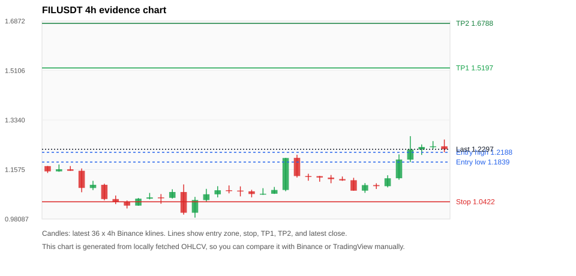
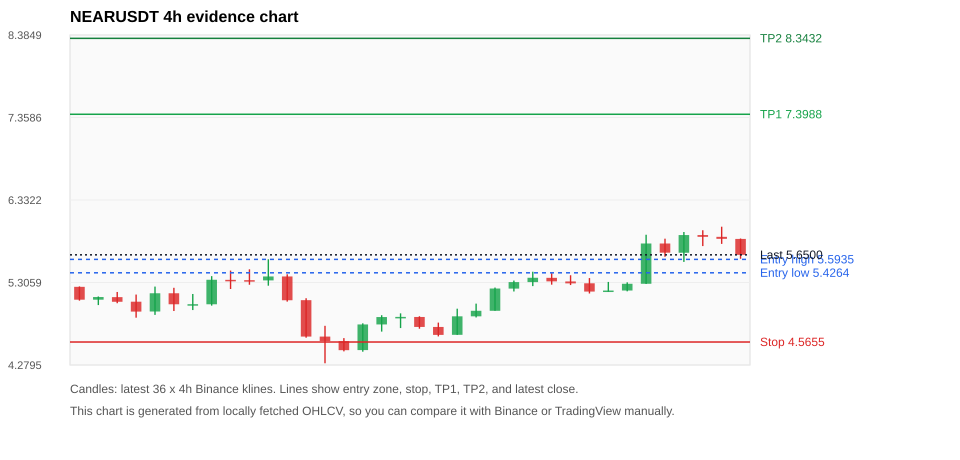
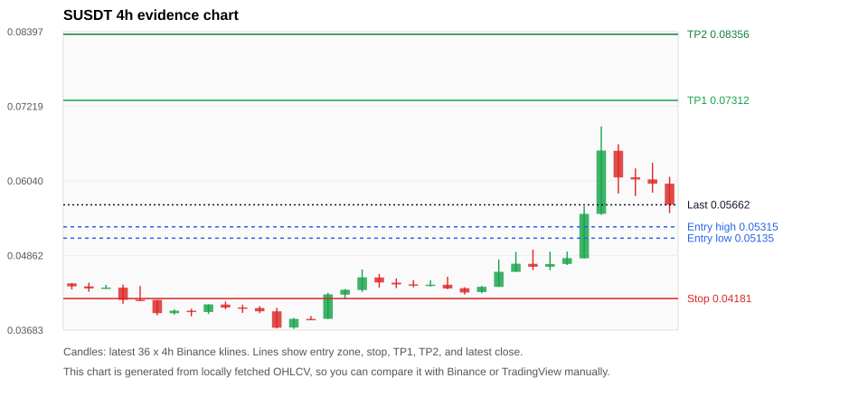
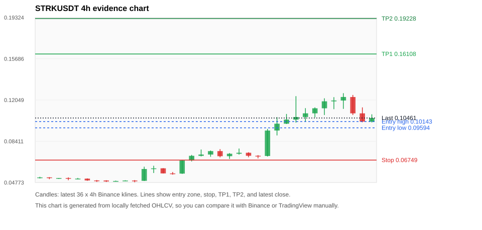
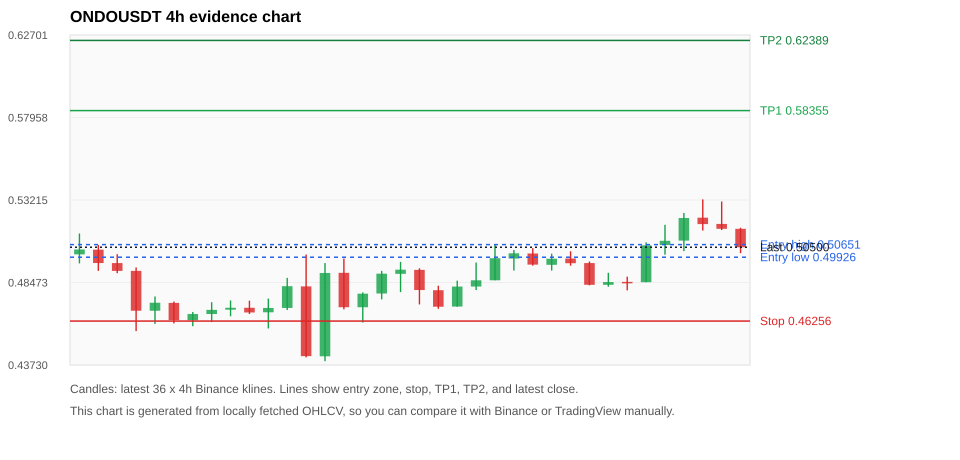

# Crypto 市场扫描报告 v1

- 报告时间：2026-10-12 20:06:11 CST
- Run ID：`20261012_120503_c89348b9`
- Run type：`daily_full`
- Data validation mode：`paper`
- 数据来源：SQLite
- 报告版本：v1
- 扫描 ID：14a023b87daa
- 数据源：Binance public spot API + CoinGecko/CoinMarketCap cross-check
- 过滤条件：USDT spot; 24h quote volume >= 30,000,000; trades >= 30,000; exclude stables/leveraged tokens; analyze 1h/4h/1d klines
- 默认单笔风险：账户权益的 1.00%

## 限制说明

- 交易信号仍以 Binance 现货公开 K 线为主源；外部数据源用于一致性复核。
- 结果是研究和模拟盘计划，不是确定收益或实盘下单指令。
- 历史长度过滤：候选币至少需要 180 根 1d K 线。
- 数据质量验证池：先验证 score 排名前 min(top_n * 2, 10) 的候选，再按 action + score 补足最终名单。
- 指标截止：2026-10-12T12:05:06.684000+00:00；仅使用此前至少60秒已闭合K线，ticker为扫描时点观测。
- 大盘环境过滤：RISK_OFF; BTC/ETH 大盘偏弱，山寨币买入候选降级为观察。 BTC 7d=-3.186039523864559; ETH 7d=-6.967516703704524.
- Data cross-validation enabled: Binance primary source plus CoinGecko; CoinMarketCap is checked when an API key is configured.
- SUSDT validation state BLOCKED: BLOCKED: [BINANCE_KLINE_EXTREME_RANGE] Binance candle range exceeds 40%.; [EXTERNAL_IDENTITY_NOT_FOUND] CoinGecko could not map symbol S to a unique coin id; [EXTERNAL_IDENTITY_AMBIGUOUS] CoinMarketCap symbol mapping has 5 matches; selected lowest cmc_rank
- FILUSDT validation state DEGRADED: DEGRADED: [EXTERNAL_IDENTITY_AMBIGUOUS] CoinGecko symbol mapping has 2 exact matches; selected highest market-cap rank
- STRKUSDT validation state BLOCKED: BLOCKED: [BINANCE_KLINE_EXTREME_RANGE] Binance candle range exceeds 40%.; [BINANCE_KLINE_EXTREME_RANGE] Binance candle range exceeds 40%.; [EXTERNAL_IDENTITY_AMBIGUOUS] CoinGecko symbol mapping has 2 exact matches; selected highest market-cap rank; [EXTERNAL_IDENTITY_AMBIGUOUS] CoinMarketCap symbol mapping has 2 matches; selected lowest cmc_rank
- WUSDT validation state DEGRADED: DEGRADED: [EXTERNAL_IDENTITY_AMBIGUOUS] CoinMarketCap symbol mapping has 3 matches; selected lowest cmc_rank
- AVAXUSDT validation state DEGRADED: DEGRADED: [EXTERNAL_PROVIDER_RATE_LIMITED] Provider rate limited request for https://api.coingecko.com/api/v3/coins/markets?vs_currency=usd&ids=avalanche-2&price_change_percentage=24h&per_page=1&page=1: HTTP 429
- TAOUSDT validation state DEGRADED: DEGRADED: [EXTERNAL_PROVIDER_RATE_LIMITED] Provider rate limited request for https://api.coingecko.com/api/v3/coins/markets?vs_currency=usd&ids=bittensor&price_change_percentage=24h&per_page=1&page=1: HTTP 429; [EXTERNAL_IDENTITY_AMBIGUOUS] CoinMarketCap symbol mapping has 5 matches; selected lowest cmc_rank
- BTCUSDT validation state DEGRADED: DEGRADED: [EXTERNAL_PROVIDER_RATE_LIMITED] Provider rate limited request for https://api.coingecko.com/api/v3/coins/markets?vs_currency=usd&ids=bitcoin&price_change_percentage=24h&per_page=1&page=1: HTTP 429; [EXTERNAL_IDENTITY_AMBIGUOUS] CoinMarketCap symbol mapping has 13 matches; selected lowest cmc_rank
- ENAUSDT validation state DEGRADED: DEGRADED: [EXTERNAL_PROVIDER_RATE_LIMITED] Provider rate limited request for https://api.coingecko.com/api/v3/coins/markets?vs_currency=usd&ids=ethena&price_change_percentage=24h&per_page=1&page=1: HTTP 429; [EXTERNAL_IDENTITY_AMBIGUOUS] CoinMarketCap symbol mapping has 2 matches; selected lowest cmc_rank

## 5 个候选交易计划

| Rank | Coin | Action | Setup | Entry Zone | Stop Loss | TP1 | TP2 / Exit Rule | R/R | Verdict |
|---:|---|---|---|---:|---:|---:|---|---:|---|
| 1 | `FIL` | `WAIT_PULLBACK` | 趋势中，等回调入场 | 1.1839 - 1.2188 | 1.0422 | 1.5197 | 1.6788 或跌破 4h 关键支撑 | 2.00-3.00 | 只等回调 |
| 2 | `NEAR` | `WAIT_PULLBACK` | 趋势中，等回调入场 | 5.4264 - 5.5935 | 4.5655 | 7.3988 | 8.3432 或跌破 4h 关键支撑 | 2.00-3.00 | 只等回调 |
| 3 | `S` | `WATCH_ONLY` | 涨幅较远，只等深回调 | 0.05135 - 0.05315 | 0.04181 | 0.07312 | 0.08356 或跌破 4h 关键支撑 | 2.00-3.00 | 只观察 |
| 4 | `STRK` | `WATCH_ONLY` | 趋势中，等回调入场 | 0.09594 - 0.10143 | 0.06749 | 0.16108 | 0.19228 或跌破 4h 关键支撑 | 2.00-3.00 | 只观察 |
| 5 | `ONDO` | `WATCH_ONLY` | 回踩支撑/4h EMA 附近 | 0.49926 - 0.50651 | 0.46256 | 0.58355 | 0.62389 或跌破 4h 关键支撑 | 2.00-3.00 | 只观察 |

## 数据交叉验证摘要

价格差异以 Binance 当前价为基准；成交量口径不同，Binance 是 USDT 现货成交额，CoinGecko/CoinMarketCap 通常是全市场成交量。

| Rank | Coin | State | Identity | Max Price Diff | Max 24h Diff | Issue Codes | Message |
|---:|---|---|---|---:|---:|---|---|
| 1 | `FIL` | DEGRADED (DATA_WARNING) | UNCONFIRMED | 0.02% | 0.54 pts | EXTERNAL_IDENTITY_AMBIGUOUS | DEGRADED: [EXTERNAL_IDENTITY_AMBIGUOUS] CoinGecko symbol mapping has 2 exact matches; selected highest market-cap rank |
| 2 | `NEAR` | CLEAN (DATA_OK) | CONFIRMED | 0.10% | 0.75 pts | none | CLEAN: External provider checks agree with Binance within configured thresholds. |
| 3 | `S` | BLOCKED (DATA_ERROR) | UNCONFIRMED | 0.17% | 0.38 pts | BINANCE_KLINE_EXTREME_RANGE, EXTERNAL_IDENTITY_AMBIGUOUS, EXTERNAL_IDENTITY_NOT_FOUND | BLOCKED: [BINANCE_KLINE_EXTREME_RANGE] Binance candle range exceeds 40%.; [EXTERNAL_IDENTITY_NOT_FOUND] CoinGecko could not map symbol S to a unique coin id; [EXTERNAL_IDENTITY_AMBIGUOUS] CoinMarketCap symbol mapping has 5 matches; selected lowest cmc_rank |
| 4 | `STRK` | BLOCKED (DATA_ERROR) | UNCONFIRMED | 0.10% | 1.34 pts | BINANCE_KLINE_EXTREME_RANGE, EXTERNAL_IDENTITY_AMBIGUOUS | BLOCKED: [BINANCE_KLINE_EXTREME_RANGE] Binance candle range exceeds 40%.; [BINANCE_KLINE_EXTREME_RANGE] Binance candle range exceeds 40%.; [EXTERNAL_IDENTITY_AMBIGUOUS] CoinGecko symbol mapping has 2 exact matches; selected highest market-cap rank; [EXTERNAL_IDENTITY_AMBIGUOUS] CoinMarketCap symbol mapping has 2 matches; selected lowest cmc_rank |
| 5 | `ONDO` | CLEAN (DATA_OK) | CONFIRMED | 0.13% | 0.23 pts | none | CLEAN: External provider checks agree with Binance within configured thresholds. |

## 候选币说明

### 1. FIL `FILUSDT`



- 入选原因：趋势中，等回调入场；24h +12.56%，7d +12.71%，4h RSI 55.33，24h 成交额 $32.3M。
- 交易失效条件：跌破 1.0422285 或 4h 收盘重新失守关键支撑。
- 主要风险：BTC/ETH 大盘环境未确认强势，山寨币买入信号降级；External validation is degraded; this candidate is not a clean data sample.；Paper mode allows degraded validation; candidate is excluded from clean-data samples.。
- 数据交叉验证：DEGRADED / DATA_WARNING；身份=UNCONFIRMED；DEGRADED: [EXTERNAL_IDENTITY_AMBIGUOUS] CoinGecko symbol mapping has 2 exact matches; selected highest market-cap rank

#### 可点击人工验证

- [Binance 交易页](https://www.binance.com/en/trade/FIL_USDT)
- [TradingView 图表](https://www.tradingview.com/chart/?symbol=BINANCE%3AFILUSDT)
- [CoinGecko 搜索](https://www.coingecko.com/en/search?query=FIL)
- [CoinMarketCap 搜索](https://coinmarketcap.com/search/?q=FIL)

#### 多数据源对照

| Source | Status | Identity | Blocking | Asset ID | Price | 24h Change | 24h Volume | Price Diff | 24h Diff | Updated | Issue Codes | Message |
|---|---|---|---:|---|---:|---:|---:|---:|---:|---|---|---|
| Binance | DATA_OK | CONFIRMED | no | FILUSDT | 1.2297 | +12.56% | $32.3M | 0.00% | 0.00 pts | 2026-10-12T12:05:36+00:00 | none | Primary market data source passed health checks. |
| CoinGecko | DATA_WARNING | UNCONFIRMED | no | filecoin | 1.2300 | +12.35% | $294.4M | 0.02% | 0.21 pts | 2026-10-12T12:04:46.000Z | EXTERNAL_IDENTITY_AMBIGUOUS | [EXTERNAL_IDENTITY_AMBIGUOUS] CoinGecko symbol mapping has 2 exact matches; selected highest market-cap rank |
| CoinMarketCap | DATA_OK | CONFIRMED | no | 2280 | 1.2294 | +12.02% | $293.9M | 0.02% | 0.54 pts | 2026-10-12T12:04:01.000Z | none | External source agrees with Binance within thresholds. |

#### 指标证据

| 指标 | 数值 | 人工核对用途 |
|---|---:|---|
| 当前价 | 1.2297 | 与 Binance/TradingView 当前价格对照 |
| 24h 涨跌 | +12.56% | 与交易所 24h 涨跌对照 |
| 7d 涨跌 | +12.71% | 判断短线趋势是否延续 |
| 4h EMA20 | 1.1521 | 判断短期趋势支撑 |
| 4h EMA50 | 1.1146 | 判断中期趋势支撑 |
| 1d EMA20 | 1.0651 | 判断日线趋势 |
| 1d EMA50 | 0.95749 | 判断日线趋势 |
| 4h RSI14 | 55.33 | 判断是否过热/过弱 |
| 4h ATR14 | 0.04358 | 推导止损和入场缓冲 |
| 最近 18 根 4h 最低点 | 1.0581 | 支撑/止损参考 |
| 最近 36 根 4h 最高点 | 1.2764 | TP/压力参考 |
| 支撑位 | 1.1521 | 入场区间推导基础 |

#### 交易计划推导

- 支撑位 = 最近低点、4h EMA20、4h EMA50、1d EMA20 中不高于当前价的最高有效支撑 = `1.1521`。
- 入场区间 = 支撑位附近 + ATR 缓冲 = `1.1839 - 1.2188`。
- 止损 = min(最近 18 根 4h 最低点 * 0.985, 入场中位价 - 1.15 * ATR14) = `1.0422`。
- TP1 = max(最近 36 根 4h 最高点 * 0.995, 入场中位价 + 2R) = `1.5197`。
- TP2 = max(入场中位价 + 3R, TP1 * 1.04) = `1.6788`。

#### 最近 10 根 4h K线

| UTC 开盘时间 | Open | High | Low | Close | Quote Volume | Trades |
|---|---:|---:|---:|---:|---:|---:|
| 2026-10-10T20:00+00:00 | 1.1232 | 1.1325 | 1.1170 | 1.1185 | $474,026 | 6536 |
| 2026-10-11T00:00+00:00 | 1.1192 | 1.1278 | 1.0819 | 1.0819 | $2.6M | 19596 |
| 2026-10-11T04:00+00:00 | 1.0820 | 1.1090 | 1.0742 | 1.1018 | $2.0M | 20010 |
| 2026-10-11T08:00+00:00 | 1.1018 | 1.1083 | 1.0880 | 1.0981 | $1.0M | 13031 |
| 2026-10-11T12:00+00:00 | 1.0980 | 1.1369 | 1.0936 | 1.1261 | $2.2M | 22612 |
| 2026-10-11T16:00+00:00 | 1.1263 | 1.2114 | 1.1210 | 1.1931 | $7.1M | 64950 |
| 2026-10-11T20:00+00:00 | 1.1927 | 1.2764 | 1.1838 | 1.2287 | $10.2M | 147117 |
| 2026-10-12T00:00+00:00 | 1.2288 | 1.2469 | 1.2095 | 1.2377 | $4.7M | 70300 |
| 2026-10-12T04:00+00:00 | 1.2379 | 1.2587 | 1.2304 | 1.2402 | $4.4M | 46044 |
| 2026-10-12T08:00+00:00 | 1.2402 | 1.2644 | 1.2190 | 1.2297 | $3.6M | 48488 |

### 2. NEAR `NEARUSDT`



- 入选原因：趋势中，等回调入场；24h +6.01%，7d +12.35%，4h RSI 69.77，24h 成交额 $248.4M。
- 交易失效条件：跌破 4.565475 或 4h 收盘重新失守关键支撑。
- 主要风险：BTC/ETH 大盘环境未确认强势，山寨币买入信号降级。
- 数据交叉验证：CLEAN / DATA_OK；身份=CONFIRMED；CLEAN: External provider checks agree with Binance within configured thresholds.

#### 可点击人工验证

- [Binance 交易页](https://www.binance.com/en/trade/NEAR_USDT)
- [TradingView 图表](https://www.tradingview.com/chart/?symbol=BINANCE%3ANEARUSDT)
- [CoinGecko 搜索](https://www.coingecko.com/en/search?query=NEAR)
- [CoinMarketCap 搜索](https://coinmarketcap.com/search/?q=NEAR)

#### 多数据源对照

| Source | Status | Identity | Blocking | Asset ID | Price | 24h Change | 24h Volume | Price Diff | 24h Diff | Updated | Issue Codes | Message |
|---|---|---|---:|---|---:|---:|---:|---:|---:|---|---|---|
| Binance | DATA_OK | CONFIRMED | no | NEARUSDT | 5.6500 | +6.01% | $248.4M | 0.00% | 0.00 pts | 2026-10-12T12:05:36+00:00 | none | Primary market data source passed health checks. |
| CoinGecko | DATA_OK | CONFIRMED | no | near | 5.6500 | +5.97% | $1.29B | 0.00% | 0.04 pts | 2026-10-12T12:04:46.000Z | none | External source agrees with Binance within thresholds. |
| CoinMarketCap | DATA_OK | CONFIRMED | no | 6535 | 5.6442 | +6.75% | $1.55B | 0.10% | 0.75 pts | 2026-10-12T12:04:01.000Z | none | External source agrees with Binance within thresholds. |

#### 指标证据

| 指标 | 数值 | 人工核对用途 |
|---|---:|---|
| 当前价 | 5.6500 | 与 Binance/TradingView 当前价格对照 |
| 24h 涨跌 | +6.01% | 与交易所 24h 涨跌对照 |
| 7d 涨跌 | +12.35% | 判断短线趋势是否延续 |
| 4h EMA20 | 5.4155 | 判断短期趋势支撑 |
| 4h EMA50 | 5.1931 | 判断中期趋势支撑 |
| 1d EMA20 | 4.7737 | 判断日线趋势 |
| 1d EMA50 | 3.8202 | 判断日线趋势 |
| 4h RSI14 | 69.77 | 判断是否过热/过弱 |
| 4h ATR14 | 0.22614 | 推导止损和入场缓冲 |
| 最近 18 根 4h 最低点 | 4.6350 | 支撑/止损参考 |
| 最近 36 根 4h 最高点 | 6.0000 | TP/压力参考 |
| 支撑位 | 5.4155 | 入场区间推导基础 |

#### 交易计划推导

- 支撑位 = 最近低点、4h EMA20、4h EMA50、1d EMA20 中不高于当前价的最高有效支撑 = `5.4155`。
- 入场区间 = 支撑位附近 + ATR 缓冲 = `5.4264 - 5.5935`。
- 止损 = min(最近 18 根 4h 最低点 * 0.985, 入场中位价 - 1.15 * ATR14) = `4.5655`。
- TP1 = max(最近 36 根 4h 最高点 * 0.995, 入场中位价 + 2R) = `7.3988`。
- TP2 = max(入场中位价 + 3R, TP1 * 1.04) = `8.3432`。

#### 最近 10 根 4h K线

| UTC 开盘时间 | Open | High | Low | Close | Quote Volume | Trades |
|---|---:|---:|---:|---:|---:|---:|
| 2026-10-10T20:00+00:00 | 5.3190 | 5.3960 | 5.2740 | 5.2950 | $10.8M | 48350 |
| 2026-10-11T00:00+00:00 | 5.2960 | 5.3610 | 5.1690 | 5.1930 | $14.8M | 59871 |
| 2026-10-11T04:00+00:00 | 5.1930 | 5.3130 | 5.1920 | 5.2060 | $10.4M | 48799 |
| 2026-10-11T08:00+00:00 | 5.2060 | 5.3080 | 5.1960 | 5.2900 | $9.7M | 48006 |
| 2026-10-11T12:00+00:00 | 5.2900 | 5.9000 | 5.2880 | 5.7910 | $62.5M | 198847 |
| 2026-10-11T16:00+00:00 | 5.7910 | 5.8510 | 5.6260 | 5.6770 | $50.8M | 180476 |
| 2026-10-11T20:00+00:00 | 5.6760 | 5.9340 | 5.5620 | 5.8960 | $27.8M | 101739 |
| 2026-10-12T00:00+00:00 | 5.8960 | 5.9560 | 5.7590 | 5.8740 | $36.4M | 141218 |
| 2026-10-12T04:00+00:00 | 5.8740 | 6.0000 | 5.7860 | 5.8490 | $34.9M | 148564 |
| 2026-10-12T08:00+00:00 | 5.8480 | 5.8530 | 5.6010 | 5.6500 | $36.2M | 118745 |

### 3. S `SUSDT`



- 入选原因：涨幅较远，只等深回调；24h +16.61%，7d +34.39%，4h RSI 68.99，24h 成交额 $47.7M。
- 交易失效条件：跌破 0.04181325 或 4h 收盘重新失守关键支撑。
- 主要风险：距离支撑偏远，不能追市价；24h 振幅较大，回撤风险高；成交量突增，可能是事件驱动；BTC/ETH 大盘环境未确认强势，山寨币买入信号降级；Blocking data-quality issue detected; paper plan creation is not allowed.。
- 数据交叉验证：BLOCKED / DATA_ERROR；身份=UNCONFIRMED；BLOCKED: [BINANCE_KLINE_EXTREME_RANGE] Binance candle range exceeds 40%.; [EXTERNAL_IDENTITY_NOT_FOUND] CoinGecko could not map symbol S to a unique coin id; [EXTERNAL_IDENTITY_AMBIGUOUS] CoinMarketCap symbol mapping has 5 matches; selected lowest cmc_rank

#### 可点击人工验证

- [Binance 交易页](https://www.binance.com/en/trade/S_USDT)
- [TradingView 图表](https://www.tradingview.com/chart/?symbol=BINANCE%3ASUSDT)
- [CoinGecko 搜索](https://www.coingecko.com/en/search?query=S)
- [CoinMarketCap 搜索](https://coinmarketcap.com/search/?q=S)

#### 多数据源对照

| Source | Status | Identity | Blocking | Asset ID | Price | 24h Change | 24h Volume | Price Diff | 24h Diff | Updated | Issue Codes | Message |
|---|---|---|---:|---|---:|---:|---:|---:|---:|---|---|---|
| Binance | DATA_ERROR | CONFIRMED | yes | SUSDT | 0.05662 | +16.61% | $47.7M | 0.00% | 0.00 pts | 2026-10-12T12:05:36+00:00 | BINANCE_KLINE_EXTREME_RANGE | [BINANCE_KLINE_EXTREME_RANGE] Binance candle range exceeds 40%. |
| CoinGecko | DATA_ERROR | UNCONFIRMED | yes | n/a | n/a | n/a | n/a | n/a | n/a | 2026-10-12T12:05:36+00:00 | EXTERNAL_IDENTITY_NOT_FOUND | CoinGecko could not map symbol S to a unique coin id |
| CoinMarketCap | DATA_WARNING | UNCONFIRMED | no | 32684 | 0.05652 | +16.98% | $280.5M | 0.17% | 0.38 pts | 2026-10-12T12:04:01.000Z | EXTERNAL_IDENTITY_AMBIGUOUS | [EXTERNAL_IDENTITY_AMBIGUOUS] CoinMarketCap symbol mapping has 5 matches; selected lowest cmc_rank |

#### 指标证据

| 指标 | 数值 | 人工核对用途 |
|---|---:|---|
| 当前价 | 0.05662 | 与 Binance/TradingView 当前价格对照 |
| 24h 涨跌 | +16.61% | 与交易所 24h 涨跌对照 |
| 7d 涨跌 | +34.39% | 判断短线趋势是否延续 |
| 4h EMA20 | 0.05125 | 判断短期趋势支撑 |
| 4h EMA50 | 0.04628 | 判断中期趋势支撑 |
| 1d EMA20 | 0.04208 | 判断日线趋势 |
| 1d EMA50 | 0.03626 | 判断日线趋势 |
| 4h RSI14 | 68.99 | 判断是否过热/过弱 |
| 4h ATR14 | 0.0046328571 | 推导止损和入场缓冲 |
| 最近 18 根 4h 最低点 | 0.04245 | 支撑/止损参考 |
| 最近 36 根 4h 最高点 | 0.06901 | TP/压力参考 |
| 支撑位 | 0.05125 | 入场区间推导基础 |

#### 交易计划推导

- 支撑位 = 最近低点、4h EMA20、4h EMA50、1d EMA20 中不高于当前价的最高有效支撑 = `0.05125`。
- 入场区间 = 支撑位附近 + ATR 缓冲 = `0.05135 - 0.05315`。
- 止损 = min(最近 18 根 4h 最低点 * 0.985, 入场中位价 - 1.15 * ATR14) = `0.04181`。
- TP1 = max(最近 36 根 4h 最高点 * 0.995, 入场中位价 + 2R) = `0.07312`。
- TP2 = max(入场中位价 + 3R, TP1 * 1.04) = `0.08356`。

#### 最近 10 根 4h K线

| UTC 开盘时间 | Open | High | Low | Close | Quote Volume | Trades |
|---|---:|---:|---:|---:|---:|---:|
| 2026-10-10T20:00+00:00 | 0.04604 | 0.04920 | 0.04604 | 0.04732 | $1.4M | 15970 |
| 2026-10-11T00:00+00:00 | 0.04730 | 0.04955 | 0.04633 | 0.04684 | $1.7M | 22142 |
| 2026-10-11T04:00+00:00 | 0.04684 | 0.04923 | 0.04630 | 0.04727 | $1.3M | 14571 |
| 2026-10-11T08:00+00:00 | 0.04728 | 0.04925 | 0.04712 | 0.04820 | $964,922 | 15489 |
| 2026-10-11T12:00+00:00 | 0.04817 | 0.05640 | 0.04816 | 0.05519 | $6.0M | 73129 |
| 2026-10-11T16:00+00:00 | 0.05519 | 0.06901 | 0.05504 | 0.06520 | $22.6M | 257783 |
| 2026-10-11T20:00+00:00 | 0.06516 | 0.06619 | 0.05840 | 0.06094 | $6.7M | 84521 |
| 2026-10-12T00:00+00:00 | 0.06097 | 0.06236 | 0.05799 | 0.06063 | $3.8M | 45334 |
| 2026-10-12T04:00+00:00 | 0.06064 | 0.06326 | 0.05855 | 0.05996 | $4.5M | 62390 |
| 2026-10-12T08:00+00:00 | 0.05997 | 0.06105 | 0.05532 | 0.05662 | $4.0M | 56413 |

### 4. STRK `STRKUSDT`



- 入选原因：趋势中，等回调入场；24h -9.21%，7d +91.63%，4h RSI 69.21，24h 成交额 $78.7M。
- 交易失效条件：跌破 0.0674922 或 4h 收盘重新失守关键支撑。
- 主要风险：距离支撑偏远，不能追市价；24h 振幅较大，回撤风险高；BTC/ETH 大盘环境未确认强势，山寨币买入信号降级；24h 动量未确认；Blocking data-quality issue detected; paper plan creation is not allowed.。
- 数据交叉验证：BLOCKED / DATA_ERROR；身份=UNCONFIRMED；BLOCKED: [BINANCE_KLINE_EXTREME_RANGE] Binance candle range exceeds 40%.; [BINANCE_KLINE_EXTREME_RANGE] Binance candle range exceeds 40%.; [EXTERNAL_IDENTITY_AMBIGUOUS] CoinGecko symbol mapping has 2 exact matches; selected highest market-cap rank; [EXTERNAL_IDENTITY_AMBIGUOUS] CoinMarketCap symbol mapping has 2 matches; selected lowest cmc_rank

#### 可点击人工验证

- [Binance 交易页](https://www.binance.com/en/trade/STRK_USDT)
- [TradingView 图表](https://www.tradingview.com/chart/?symbol=BINANCE%3ASTRKUSDT)
- [CoinGecko 搜索](https://www.coingecko.com/en/search?query=STRK)
- [CoinMarketCap 搜索](https://coinmarketcap.com/search/?q=STRK)

#### 多数据源对照

| Source | Status | Identity | Blocking | Asset ID | Price | 24h Change | 24h Volume | Price Diff | 24h Diff | Updated | Issue Codes | Message |
|---|---|---|---:|---|---:|---:|---:|---:|---:|---|---|---|
| Binance | DATA_ERROR | CONFIRMED | yes | STRKUSDT | 0.10461 | -9.21% | $78.7M | 0.00% | 0.00 pts | 2026-10-12T12:05:36+00:00 | BINANCE_KLINE_EXTREME_RANGE | [BINANCE_KLINE_EXTREME_RANGE] Binance candle range exceeds 40%.; [BINANCE_KLINE_EXTREME_RANGE] Binance candle range exceeds 40%. |
| CoinGecko | DATA_WARNING | UNCONFIRMED | no | starknet | 0.10451 | -9.36% | $486.8M | 0.10% | 0.15 pts | 2026-10-12T12:04:46.000Z | EXTERNAL_IDENTITY_AMBIGUOUS | [EXTERNAL_IDENTITY_AMBIGUOUS] CoinGecko symbol mapping has 2 exact matches; selected highest market-cap rank |
| CoinMarketCap | DATA_WARNING | UNCONFIRMED | no | 22691 | 0.10467 | -7.87% | $509.7M | 0.06% | 1.34 pts | 2026-10-12T12:04:01.000Z | EXTERNAL_IDENTITY_AMBIGUOUS | [EXTERNAL_IDENTITY_AMBIGUOUS] CoinMarketCap symbol mapping has 2 matches; selected lowest cmc_rank |

#### 指标证据

| 指标 | 数值 | 人工核对用途 |
|---|---:|---|
| 当前价 | 0.10461 | 与 Binance/TradingView 当前价格对照 |
| 24h 涨跌 | -9.21% | 与交易所 24h 涨跌对照 |
| 7d 涨跌 | +91.63% | 判断短线趋势是否延续 |
| 4h EMA20 | 0.09575 | 判断短期趋势支撑 |
| 4h EMA50 | 0.07663 | 判断中期趋势支撑 |
| 1d EMA20 | 0.06009 | 判断日线趋势 |
| 1d EMA50 | 0.04546 | 判断日线趋势 |
| 4h RSI14 | 69.21 | 判断是否过热/过弱 |
| 4h ATR14 | 0.01270 | 推导止损和入场缓冲 |
| 最近 18 根 4h 最低点 | 0.06852 | 支撑/止损参考 |
| 最近 36 根 4h 最高点 | 0.12650 | TP/压力参考 |
| 支撑位 | 0.09575 | 入场区间推导基础 |

#### 交易计划推导

- 支撑位 = 最近低点、4h EMA20、4h EMA50、1d EMA20 中不高于当前价的最高有效支撑 = `0.09575`。
- 入场区间 = 支撑位附近 + ATR 缓冲 = `0.09594 - 0.10143`。
- 止损 = min(最近 18 根 4h 最低点 * 0.985, 入场中位价 - 1.15 * ATR14) = `0.06749`。
- TP1 = max(最近 36 根 4h 最高点 * 0.995, 入场中位价 + 2R) = `0.16108`。
- TP2 = max(入场中位价 + 3R, TP1 * 1.04) = `0.19228`。

#### 最近 10 根 4h K线

| UTC 开盘时间 | Open | High | Low | Close | Quote Volume | Trades |
|---|---:|---:|---:|---:|---:|---:|
| 2026-10-10T20:00+00:00 | 0.09958 | 0.10818 | 0.09932 | 0.10324 | $16.6M | 161076 |
| 2026-10-11T00:00+00:00 | 0.10317 | 0.12389 | 0.10052 | 0.10550 | $27.1M | 291521 |
| 2026-10-11T04:00+00:00 | 0.10550 | 0.11331 | 0.10161 | 0.10873 | $19.1M | 215207 |
| 2026-10-11T08:00+00:00 | 0.10873 | 0.11400 | 0.10518 | 0.11317 | $12.1M | 143779 |
| 2026-10-11T12:00+00:00 | 0.11318 | 0.12199 | 0.10722 | 0.11933 | $20.5M | 215420 |
| 2026-10-11T16:00+00:00 | 0.11930 | 0.12299 | 0.11239 | 0.12002 | $14.9M | 174482 |
| 2026-10-11T20:00+00:00 | 0.12001 | 0.12650 | 0.11265 | 0.12316 | $10.0M | 131134 |
| 2026-10-12T00:00+00:00 | 0.12311 | 0.12494 | 0.10724 | 0.10870 | $16.4M | 233563 |
| 2026-10-12T04:00+00:00 | 0.10870 | 0.11398 | 0.10085 | 0.10141 | $10.1M | 141062 |
| 2026-10-12T08:00+00:00 | 0.10143 | 0.10787 | 0.10069 | 0.10461 | $7.5M | 115703 |

### 5. ONDO `ONDOUSDT`



- 入选原因：回踩支撑/4h EMA 附近；24h +3.76%，7d +1.16%，4h RSI 59.90，24h 成交额 $35.3M。
- 交易失效条件：跌破 0.462556 或 4h 收盘重新失守关键支撑。
- 主要风险：BTC/ETH 大盘环境未确认强势，山寨币买入信号降级。
- 数据交叉验证：CLEAN / DATA_OK；身份=CONFIRMED；CLEAN: External provider checks agree with Binance within configured thresholds.

#### 可点击人工验证

- [Binance 交易页](https://www.binance.com/en/trade/ONDO_USDT)
- [TradingView 图表](https://www.tradingview.com/chart/?symbol=BINANCE%3AONDOUSDT)
- [CoinGecko 搜索](https://www.coingecko.com/en/search?query=ONDO)
- [CoinMarketCap 搜索](https://coinmarketcap.com/search/?q=ONDO)

#### 多数据源对照

| Source | Status | Identity | Blocking | Asset ID | Price | 24h Change | 24h Volume | Price Diff | 24h Diff | Updated | Issue Codes | Message |
|---|---|---|---:|---|---:|---:|---:|---:|---:|---|---|---|
| Binance | DATA_OK | CONFIRMED | no | ONDOUSDT | 0.50500 | +3.76% | $35.3M | 0.00% | 0.00 pts | 2026-10-12T12:05:36+00:00 | none | Primary market data source passed health checks. |
| CoinGecko | DATA_OK | CONFIRMED | no | ondo-finance | 0.50448 | +3.81% | $261.1M | 0.10% | 0.05 pts | 2026-10-12T12:04:46.000Z | none | External source agrees with Binance within thresholds. |
| CoinMarketCap | DATA_OK | CONFIRMED | no | 21159 | 0.50435 | +4.00% | $314.0M | 0.13% | 0.23 pts | 2026-10-12T12:04:01.000Z | none | External source agrees with Binance within thresholds. |

#### 指标证据

| 指标 | 数值 | 人工核对用途 |
|---|---:|---|
| 当前价 | 0.50500 | 与 Binance/TradingView 当前价格对照 |
| 24h 涨跌 | +3.76% | 与交易所 24h 涨跌对照 |
| 7d 涨跌 | +1.16% | 判断短线趋势是否延续 |
| 4h EMA20 | 0.49827 | 判断短期趋势支撑 |
| 4h EMA50 | 0.49313 | 判断中期趋势支撑 |
| 1d EMA20 | 0.48180 | 判断日线趋势 |
| 1d EMA50 | 0.43982 | 判断日线趋势 |
| 4h RSI14 | 59.90 | 判断是否过热/过弱 |
| 4h ATR14 | 0.01436 | 推导止损和入场缓冲 |
| 最近 18 根 4h 最低点 | 0.46960 | 支撑/止损参考 |
| 最近 36 根 4h 最高点 | 0.53250 | TP/压力参考 |
| 支撑位 | 0.49827 | 入场区间推导基础 |

#### 交易计划推导

- 支撑位 = 最近低点、4h EMA20、4h EMA50、1d EMA20 中不高于当前价的最高有效支撑 = `0.49827`。
- 入场区间 = 支撑位附近 + ATR 缓冲 = `0.49926 - 0.50651`。
- 止损 = min(最近 18 根 4h 最低点 * 0.985, 入场中位价 - 1.15 * ATR14) = `0.46256`。
- TP1 = max(最近 36 根 4h 最高点 * 0.995, 入场中位价 + 2R) = `0.58355`。
- TP2 = max(入场中位价 + 3R, TP1 * 1.04) = `0.62389`。

#### 最近 10 根 4h K线

| UTC 开盘时间 | Open | High | Low | Close | Quote Volume | Trades |
|---|---:|---:|---:|---:|---:|---:|
| 2026-10-10T20:00+00:00 | 0.49850 | 0.50270 | 0.49440 | 0.49580 | $1.4M | 7333 |
| 2026-10-11T00:00+00:00 | 0.49590 | 0.49680 | 0.48310 | 0.48340 | $2.9M | 11191 |
| 2026-10-11T04:00+00:00 | 0.48340 | 0.49030 | 0.48230 | 0.48500 | $1.5M | 6961 |
| 2026-10-11T08:00+00:00 | 0.48510 | 0.48810 | 0.48020 | 0.48480 | $1.6M | 7306 |
| 2026-10-11T12:00+00:00 | 0.48490 | 0.50780 | 0.48490 | 0.50610 | $3.3M | 13973 |
| 2026-10-11T16:00+00:00 | 0.50630 | 0.51790 | 0.50070 | 0.50870 | $6.3M | 23663 |
| 2026-10-11T20:00+00:00 | 0.50880 | 0.52470 | 0.50280 | 0.52180 | $6.5M | 27796 |
| 2026-10-12T00:00+00:00 | 0.52200 | 0.53250 | 0.51460 | 0.51830 | $7.5M | 38470 |
| 2026-10-12T04:00+00:00 | 0.51840 | 0.53130 | 0.51490 | 0.51560 | $6.7M | 28639 |
| 2026-10-12T08:00+00:00 | 0.51560 | 0.51620 | 0.50160 | 0.50500 | $4.8M | 19298 |

## 组合风控

- 不要 5 个候选全部满仓买入。
- 同时持仓总风险建议控制在账户权益的 3% - 5% 以内。
- 如果 BTC/ETH 同时破位，暂停山寨币多头计划或降低仓位。
- 第一版报告用于模拟盘和人工复核，不自动下单。

## 原始数据

```json
[
  {
    "rank": 1,
    "symbol": "FILUSDT",
    "base_asset": "FIL",
    "price": 1.2297,
    "score": 64.28919902536094,
    "setup": "趋势中，等回调入场",
    "verdict": "只等回调",
    "entry_low": 1.1839425000000001,
    "entry_high": 1.2188053571428572,
    "stop_loss": 1.0422285,
    "take_profit_1": 1.519664785714286,
    "take_profit_2": 1.6788102142857146,
    "risk_reward_1": 2.0,
    "risk_reward_2": 3.0,
    "pct_24h": 12.565,
    "pct_3d": 15.334833989870567,
    "pct_7d": 12.713107241063248,
    "quote_volume_24h": 32251336.842528,
    "trades_24h": 401134,
    "high_low_range_24h": 16.715435259692768,
    "rsi_1h": 39.26739926739928,
    "rsi_4h": 55.32786885245905,
    "ema20_4h": 1.1520551824895156,
    "ema50_4h": 1.1145740647574838,
    "ema20_1d": 1.0651019145501766,
    "ema50_1d": 0.9574853808302758,
    "atr_4h": 0.04357857142857142,
    "macd_hist_4h": 0.013641805557351547,
    "volume_ratio_24h": 1.8789602714298217,
    "support_level": 1.1520551824895156,
    "recent_low_4h_18": 1.0581,
    "recent_high_4h_36": 1.2764,
    "distance_to_support_pct": 6.739678679514216,
    "binance_trade_url": "https://www.binance.com/en/trade/FIL_USDT",
    "tradingview_url": "https://www.tradingview.com/chart/?symbol=BINANCE%3AFILUSDT",
    "coingecko_search_url": "https://www.coingecko.com/en/search?query=FIL",
    "coinmarketcap_search_url": "https://coinmarketcap.com/search/?q=FIL",
    "invalidation": "跌破 1.0422285 或 4h 收盘重新失守关键支撑",
    "recent_4h_klines": [
      {
        "open_time_utc": "2026-10-06T12:00+00:00",
        "open": 1.1696,
        "high": 1.17,
        "low": 1.145,
        "close": 1.1508,
        "quote_volume": 1971468.951406,
        "trades": 22512
      },
      {
        "open_time_utc": "2026-10-06T16:00+00:00",
        "open": 1.1508,
        "high": 1.1753,
        "low": 1.1494,
        "close": 1.1583,
        "quote_volume": 1442108.343878,
        "trades": 18240
      },
      {
        "open_time_utc": "2026-10-06T20:00+00:00",
        "open": 1.1582,
        "high": 1.1699,
        "low": 1.1528,
        "close": 1.1528,
        "quote_volume": 800398.677957,
        "trades": 12719
      },
      {
        "open_time_utc": "2026-10-07T00:00+00:00",
        "open": 1.1529,
        "high": 1.1612,
        "low": 1.0763,
        "close": 1.0917,
        "quote_volume": 4773010.808638,
        "trades": 40242
      },
      {
        "open_time_utc": "2026-10-07T04:00+00:00",
        "open": 1.0914,
        "high": 1.117,
        "low": 1.084,
        "close": 1.1029,
        "quote_volume": 1608197.39081,
        "trades": 24327
      },
      {
        "open_time_utc": "2026-10-07T08:00+00:00",
        "open": 1.1028,
        "high": 1.1068,
        "low": 1.0477,
        "close": 1.052,
        "quote_volume": 3661188.868772,
        "trades": 41704
      },
      {
        "open_time_utc": "2026-10-07T12:00+00:00",
        "open": 1.052,
        "high": 1.0647,
        "low": 1.034,
        "close": 1.0408,
        "quote_volume": 3254909.204689,
        "trades": 33729
      },
      {
        "open_time_utc": "2026-10-07T16:00+00:00",
        "open": 1.0409,
        "high": 1.0469,
        "low": 1.0185,
        "close": 1.0286,
        "quote_volume": 2059195.568925,
        "trades": 32379
      },
      {
        "open_time_utc": "2026-10-07T20:00+00:00",
        "open": 1.0286,
        "high": 1.0559,
        "low": 1.0281,
        "close": 1.0535,
        "quote_volume": 1614313.838922,
        "trades": 18928
      },
      {
        "open_time_utc": "2026-10-08T00:00+00:00",
        "open": 1.0535,
        "high": 1.0738,
        "low": 1.0509,
        "close": 1.0579,
        "quote_volume": 1645459.023358,
        "trades": 22910
      },
      {
        "open_time_utc": "2026-10-08T04:00+00:00",
        "open": 1.0579,
        "high": 1.0698,
        "low": 1.0353,
        "close": 1.0563,
        "quote_volume": 1786486.605557,
        "trades": 27271
      },
      {
        "open_time_utc": "2026-10-08T08:00+00:00",
        "open": 1.0563,
        "high": 1.0869,
        "low": 1.0537,
        "close": 1.0772,
        "quote_volume": 2067062.711933,
        "trades": 26303
      },
      {
        "open_time_utc": "2026-10-08T12:00+00:00",
        "open": 1.0771,
        "high": 1.1042,
        "low": 0.9965,
        "close": 1.0032,
        "quote_volume": 7415955.580756,
        "trades": 79322
      },
      {
        "open_time_utc": "2026-10-08T16:00+00:00",
        "open": 1.0032,
        "high": 1.0597,
        "low": 0.9858,
        "close": 1.0486,
        "quote_volume": 4371242.324912,
        "trades": 59359
      },
      {
        "open_time_utc": "2026-10-08T20:00+00:00",
        "open": 1.0484,
        "high": 1.0884,
        "low": 1.0434,
        "close": 1.0691,
        "quote_volume": 3034447.537395,
        "trades": 34504
      },
      {
        "open_time_utc": "2026-10-09T00:00+00:00",
        "open": 1.0689,
        "high": 1.0979,
        "low": 1.058,
        "close": 1.0834,
        "quote_volume": 2128530.129962,
        "trades": 29129
      },
      {
        "open_time_utc": "2026-10-09T04:00+00:00",
        "open": 1.0835,
        "high": 1.1006,
        "low": 1.0724,
        "close": 1.0825,
        "quote_volume": 1523574.370281,
        "trades": 21848
      },
      {
        "open_time_utc": "2026-10-09T08:00+00:00",
        "open": 1.0822,
        "high": 1.0972,
        "low": 1.0616,
        "close": 1.0798,
        "quote_volume": 2048978.23184,
        "trades": 21518
      },
      {
        "open_time_utc": "2026-10-09T12:00+00:00",
        "open": 1.0796,
        "high": 1.085,
        "low": 1.0581,
        "close": 1.07,
        "quote_volume": 1504355.419753,
        "trades": 22816
      },
      {
        "open_time_utc": "2026-10-09T16:00+00:00",
        "open": 1.0698,
        "high": 1.0908,
        "low": 1.067,
        "close": 1.071,
        "quote_volume": 879619.284526,
        "trades": 15706
      },
      {
        "open_time_utc": "2026-10-09T20:00+00:00",
        "open": 1.071,
        "high": 1.0952,
        "low": 1.0704,
        "close": 1.0844,
        "quote_volume": 707708.571697,
        "trades": 10383
      },
      {
        "open_time_utc": "2026-10-10T00:00+00:00",
        "open": 1.0844,
        "high": 1.1988,
        "low": 1.08,
        "close": 1.1985,
        "quote_volume": 7048310.578155,
        "trades": 66191
      },
      {
        "open_time_utc": "2026-10-10T04:00+00:00",
        "open": 1.199,
        "high": 1.21,
        "low": 1.1288,
        "close": 1.1341,
        "quote_volume": 5276585.207729,
        "trades": 49234
      },
      {
        "open_time_utc": "2026-10-10T08:00+00:00",
        "open": 1.134,
        "high": 1.1423,
        "low": 1.1174,
        "close": 1.1337,
        "quote_volume": 1899858.754654,
        "trades": 28068
      },
      {
        "open_time_utc": "2026-10-10T12:00+00:00",
        "open": 1.1337,
        "high": 1.1347,
        "low": 1.1139,
        "close": 1.1288,
        "quote_volume": 1974899.9228,
        "trades": 15061
      },
      {
        "open_time_utc": "2026-10-10T16:00+00:00",
        "open": 1.1286,
        "high": 1.1378,
        "low": 1.1085,
        "close": 1.1232,
        "quote_volume": 1158640.606117,
        "trades": 12996
      },
      {
        "open_time_utc": "2026-10-10T20:00+00:00",
        "open": 1.1232,
        "high": 1.1325,
        "low": 1.117,
        "close": 1.1185,
        "quote_volume": 474025.507486,
        "trades": 6536
      },
      {
        "open_time_utc": "2026-10-11T00:00+00:00",
        "open": 1.1192,
        "high": 1.1278,
        "low": 1.0819,
        "close": 1.0819,
        "quote_volume": 2637701.250442,
        "trades": 19596
      },
      {
        "open_time_utc": "2026-10-11T04:00+00:00",
        "open": 1.082,
        "high": 1.109,
        "low": 1.0742,
        "close": 1.1018,
        "quote_volume": 2016931.088864,
        "trades": 20010
      },
      {
        "open_time_utc": "2026-10-11T08:00+00:00",
        "open": 1.1018,
        "high": 1.1083,
        "low": 1.088,
        "close": 1.0981,
        "quote_volume": 1039537.646619,
        "trades": 13031
      },
      {
        "open_time_utc": "2026-10-11T12:00+00:00",
        "open": 1.098,
        "high": 1.1369,
        "low": 1.0936,
        "close": 1.1261,
        "quote_volume": 2204726.749872,
        "trades": 22612
      },
      {
        "open_time_utc": "2026-10-11T16:00+00:00",
        "open": 1.1263,
        "high": 1.2114,
        "low": 1.121,
        "close": 1.1931,
        "quote_volume": 7125191.750128,
        "trades": 64950
      },
      {
        "open_time_utc": "2026-10-11T20:00+00:00",
        "open": 1.1927,
        "high": 1.2764,
        "low": 1.1838,
        "close": 1.2287,
        "quote_volume": 10187051.308185,
        "trades": 147117
      },
      {
        "open_time_utc": "2026-10-12T00:00+00:00",
        "open": 1.2288,
        "high": 1.2469,
        "low": 1.2095,
        "close": 1.2377,
        "quote_volume": 4712806.046697,
        "trades": 70300
      },
      {
        "open_time_utc": "2026-10-12T04:00+00:00",
        "open": 1.2379,
        "high": 1.2587,
        "low": 1.2304,
        "close": 1.2402,
        "quote_volume": 4367679.551319,
        "trades": 46044
      },
      {
        "open_time_utc": "2026-10-12T08:00+00:00",
        "open": 1.2402,
        "high": 1.2644,
        "low": 1.219,
        "close": 1.2297,
        "quote_volume": 3571811.377661,
        "trades": 48488
      }
    ],
    "risks": [
      "BTC/ETH 大盘环境未确认强势，山寨币买入信号降级",
      "External validation is degraded; this candidate is not a clean data sample.",
      "Paper mode allows degraded validation; candidate is excluded from clean-data samples."
    ],
    "data_quality_status": "DATA_WARNING",
    "data_quality_message": "DEGRADED: [EXTERNAL_IDENTITY_AMBIGUOUS] CoinGecko symbol mapping has 2 exact matches; selected highest market-cap rank",
    "data_checks": [
      {
        "provider": "Binance",
        "status": "DATA_OK",
        "provider_asset_id": "FILUSDT",
        "provider_symbol": "FILUSDT",
        "price_usd": 1.2297,
        "pct_24h": 12.565,
        "volume_24h": 32251336.842528,
        "last_updated": null,
        "fetched_at_utc": "2026-10-12T12:05:36+00:00",
        "price_diff_pct": 0.0,
        "pct_24h_diff": 0.0,
        "volume_note": "Binance USDT spot 24h quoteVolume.",
        "message": "Primary market data source passed health checks.",
        "blocking": false,
        "identity_status": "CONFIRMED",
        "issues": []
      },
      {
        "provider": "CoinGecko",
        "status": "DATA_WARNING",
        "provider_asset_id": "filecoin",
        "provider_symbol": "FIL",
        "price_usd": 1.23,
        "pct_24h": 12.35019,
        "volume_24h": 294446784.0,
        "last_updated": "2026-10-12T12:04:46.000Z",
        "fetched_at_utc": "2026-10-12T12:05:36+00:00",
        "price_diff_pct": 0.024396194193703095,
        "pct_24h_diff": 0.21480999999999995,
        "volume_note": "CoinGecko total market volume; not the same venue scope as Binance quoteVolume.",
        "message": "[EXTERNAL_IDENTITY_AMBIGUOUS] CoinGecko symbol mapping has 2 exact matches; selected highest market-cap rank",
        "blocking": false,
        "identity_status": "UNCONFIRMED",
        "issues": [
          {
            "provider": "CoinGecko",
            "code": "EXTERNAL_IDENTITY_AMBIGUOUS",
            "severity": "WARNING",
            "blocking": false,
            "message": "CoinGecko symbol mapping has 2 exact matches; selected highest market-cap rank",
            "context": {}
          }
        ]
      },
      {
        "provider": "CoinMarketCap",
        "status": "DATA_OK",
        "provider_asset_id": "2280",
        "provider_symbol": "FIL",
        "price_usd": 1.229402423181853,
        "pct_24h": 12.0231138,
        "volume_24h": 293902219.13115907,
        "last_updated": "2026-10-12T12:04:01.000Z",
        "fetched_at_utc": "2026-10-12T12:05:36+00:00",
        "price_diff_pct": 0.024199139476865594,
        "pct_24h_diff": 0.5418861999999987,
        "volume_note": "CoinMarketCap total market volume; not the same venue scope as Binance quoteVolume.",
        "message": "External source agrees with Binance within thresholds.",
        "blocking": false,
        "identity_status": "CONFIRMED",
        "issues": []
      }
    ],
    "action": "WAIT_PULLBACK",
    "data_quality_state": "DEGRADED",
    "data_quality_issues": [
      {
        "provider": "CoinGecko",
        "code": "EXTERNAL_IDENTITY_AMBIGUOUS",
        "severity": "WARNING",
        "blocking": false,
        "message": "CoinGecko symbol mapping has 2 exact matches; selected highest market-cap rank",
        "context": {}
      }
    ],
    "external_identity_status": "UNCONFIRMED"
  },
  {
    "rank": 2,
    "symbol": "NEARUSDT",
    "base_asset": "NEAR",
    "price": 5.65,
    "score": 62.04432137562323,
    "setup": "趋势中，等回调入场",
    "verdict": "只等回调",
    "entry_low": 5.426350227533701,
    "entry_high": 5.593464285714286,
    "stop_loss": 4.565475,
    "take_profit_1": 7.3987717698719795,
    "take_profit_2": 8.343204026495972,
    "risk_reward_1": 2.0,
    "risk_reward_2": 2.999999999999999,
    "pct_24h": 6.009,
    "pct_3d": 17.70833333333335,
    "pct_7d": 12.348379399483012,
    "quote_volume_24h": 248371360.2427,
    "trades_24h": 888897,
    "high_low_range_24h": 13.27166320558808,
    "rsi_1h": 41.69278996865204,
    "rsi_4h": 69.77272727272727,
    "ema20_4h": 5.415519189155391,
    "ema50_4h": 5.193069855817788,
    "ema20_1d": 4.773679985875798,
    "ema50_1d": 3.820183563492574,
    "atr_4h": 0.22614285714285717,
    "macd_hist_4h": 0.0588588671230785,
    "volume_ratio_24h": 1.5233044582070117,
    "support_level": 5.415519189155391,
    "recent_low_4h_18": 4.635,
    "recent_high_4h_36": 6.0,
    "distance_to_support_pct": 4.329793740074983,
    "binance_trade_url": "https://www.binance.com/en/trade/NEAR_USDT",
    "tradingview_url": "https://www.tradingview.com/chart/?symbol=BINANCE%3ANEARUSDT",
    "coingecko_search_url": "https://www.coingecko.com/en/search?query=NEAR",
    "coinmarketcap_search_url": "https://coinmarketcap.com/search/?q=NEAR",
    "invalidation": "跌破 4.565475 或 4h 收盘重新失守关键支撑",
    "recent_4h_klines": [
      {
        "open_time_utc": "2026-10-06T12:00+00:00",
        "open": 5.252,
        "high": 5.257,
        "low": 5.08,
        "close": 5.092,
        "quote_volume": 20006218.3754,
        "trades": 78763
      },
      {
        "open_time_utc": "2026-10-06T16:00+00:00",
        "open": 5.092,
        "high": 5.132,
        "low": 5.025,
        "close": 5.125,
        "quote_volume": 16966696.6862,
        "trades": 57441
      },
      {
        "open_time_utc": "2026-10-06T20:00+00:00",
        "open": 5.124,
        "high": 5.188,
        "low": 5.048,
        "close": 5.066,
        "quote_volume": 10079079.5868,
        "trades": 39662
      },
      {
        "open_time_utc": "2026-10-07T00:00+00:00",
        "open": 5.067,
        "high": 5.156,
        "low": 4.868,
        "close": 4.944,
        "quote_volume": 29960715.2458,
        "trades": 118321
      },
      {
        "open_time_utc": "2026-10-07T04:00+00:00",
        "open": 4.945,
        "high": 5.255,
        "low": 4.903,
        "close": 5.172,
        "quote_volume": 22342095.3878,
        "trades": 86693
      },
      {
        "open_time_utc": "2026-10-07T08:00+00:00",
        "open": 5.172,
        "high": 5.24,
        "low": 4.951,
        "close": 5.035,
        "quote_volume": 28539475.4193,
        "trades": 119076
      },
      {
        "open_time_utc": "2026-10-07T12:00+00:00",
        "open": 5.035,
        "high": 5.163,
        "low": 4.963,
        "close": 5.036,
        "quote_volume": 30283781.2387,
        "trades": 145919
      },
      {
        "open_time_utc": "2026-10-07T16:00+00:00",
        "open": 5.035,
        "high": 5.385,
        "low": 5.018,
        "close": 5.34,
        "quote_volume": 40303775.1993,
        "trades": 168554
      },
      {
        "open_time_utc": "2026-10-07T20:00+00:00",
        "open": 5.339,
        "high": 5.454,
        "low": 5.225,
        "close": 5.335,
        "quote_volume": 33911433.9351,
        "trades": 139957
      },
      {
        "open_time_utc": "2026-10-08T00:00+00:00",
        "open": 5.335,
        "high": 5.47,
        "low": 5.278,
        "close": 5.332,
        "quote_volume": 23244871.7434,
        "trades": 116312
      },
      {
        "open_time_utc": "2026-10-08T04:00+00:00",
        "open": 5.332,
        "high": 5.595,
        "low": 5.266,
        "close": 5.381,
        "quote_volume": 58496121.7612,
        "trades": 221843
      },
      {
        "open_time_utc": "2026-10-08T08:00+00:00",
        "open": 5.381,
        "high": 5.408,
        "low": 5.068,
        "close": 5.085,
        "quote_volume": 46938078.0577,
        "trades": 158112
      },
      {
        "open_time_utc": "2026-10-08T12:00+00:00",
        "open": 5.086,
        "high": 5.11,
        "low": 4.619,
        "close": 4.633,
        "quote_volume": 76642546.7666,
        "trades": 254630
      },
      {
        "open_time_utc": "2026-10-08T16:00+00:00",
        "open": 4.633,
        "high": 4.767,
        "low": 4.301,
        "close": 4.576,
        "quote_volume": 76633839.4387,
        "trades": 309447
      },
      {
        "open_time_utc": "2026-10-08T20:00+00:00",
        "open": 4.576,
        "high": 4.614,
        "low": 4.449,
        "close": 4.464,
        "quote_volume": 21882135.7617,
        "trades": 94909
      },
      {
        "open_time_utc": "2026-10-09T00:00+00:00",
        "open": 4.465,
        "high": 4.798,
        "low": 4.445,
        "close": 4.784,
        "quote_volume": 35763386.9084,
        "trades": 144292
      },
      {
        "open_time_utc": "2026-10-09T04:00+00:00",
        "open": 4.784,
        "high": 4.899,
        "low": 4.695,
        "close": 4.876,
        "quote_volume": 27830389.7114,
        "trades": 105892
      },
      {
        "open_time_utc": "2026-10-09T08:00+00:00",
        "open": 4.875,
        "high": 4.922,
        "low": 4.739,
        "close": 4.878,
        "quote_volume": 19766528.1546,
        "trades": 84148
      },
      {
        "open_time_utc": "2026-10-09T12:00+00:00",
        "open": 4.877,
        "high": 4.886,
        "low": 4.731,
        "close": 4.753,
        "quote_volume": 16201243.4816,
        "trades": 82251
      },
      {
        "open_time_utc": "2026-10-09T16:00+00:00",
        "open": 4.753,
        "high": 4.807,
        "low": 4.635,
        "close": 4.654,
        "quote_volume": 17288935.126,
        "trades": 68771
      },
      {
        "open_time_utc": "2026-10-09T20:00+00:00",
        "open": 4.655,
        "high": 4.98,
        "low": 4.654,
        "close": 4.885,
        "quote_volume": 23758258.7552,
        "trades": 91923
      },
      {
        "open_time_utc": "2026-10-10T00:00+00:00",
        "open": 4.885,
        "high": 5.043,
        "low": 4.871,
        "close": 4.954,
        "quote_volume": 17369888.0452,
        "trades": 84641
      },
      {
        "open_time_utc": "2026-10-10T04:00+00:00",
        "open": 4.954,
        "high": 5.243,
        "low": 4.954,
        "close": 5.231,
        "quote_volume": 30968996.1186,
        "trades": 122665
      },
      {
        "open_time_utc": "2026-10-10T08:00+00:00",
        "open": 5.23,
        "high": 5.33,
        "low": 5.194,
        "close": 5.311,
        "quote_volume": 24496974.3681,
        "trades": 90681
      },
      {
        "open_time_utc": "2026-10-10T12:00+00:00",
        "open": 5.311,
        "high": 5.44,
        "low": 5.261,
        "close": 5.365,
        "quote_volume": 35154537.4862,
        "trades": 121139
      },
      {
        "open_time_utc": "2026-10-10T16:00+00:00",
        "open": 5.364,
        "high": 5.422,
        "low": 5.279,
        "close": 5.32,
        "quote_volume": 17154486.3437,
        "trades": 67920
      },
      {
        "open_time_utc": "2026-10-10T20:00+00:00",
        "open": 5.319,
        "high": 5.396,
        "low": 5.274,
        "close": 5.295,
        "quote_volume": 10780099.0527,
        "trades": 48350
      },
      {
        "open_time_utc": "2026-10-11T00:00+00:00",
        "open": 5.296,
        "high": 5.361,
        "low": 5.169,
        "close": 5.193,
        "quote_volume": 14849267.2924,
        "trades": 59871
      },
      {
        "open_time_utc": "2026-10-11T04:00+00:00",
        "open": 5.193,
        "high": 5.313,
        "low": 5.192,
        "close": 5.206,
        "quote_volume": 10436211.284,
        "trades": 48799
      },
      {
        "open_time_utc": "2026-10-11T08:00+00:00",
        "open": 5.206,
        "high": 5.308,
        "low": 5.196,
        "close": 5.29,
        "quote_volume": 9712496.5988,
        "trades": 48006
      },
      {
        "open_time_utc": "2026-10-11T12:00+00:00",
        "open": 5.29,
        "high": 5.9,
        "low": 5.288,
        "close": 5.791,
        "quote_volume": 62487007.7149,
        "trades": 198847
      },
      {
        "open_time_utc": "2026-10-11T16:00+00:00",
        "open": 5.791,
        "high": 5.851,
        "low": 5.626,
        "close": 5.677,
        "quote_volume": 50835901.8629,
        "trades": 180476
      },
      {
        "open_time_utc": "2026-10-11T20:00+00:00",
        "open": 5.676,
        "high": 5.934,
        "low": 5.562,
        "close": 5.896,
        "quote_volume": 27799966.102,
        "trades": 101739
      },
      {
        "open_time_utc": "2026-10-12T00:00+00:00",
        "open": 5.896,
        "high": 5.956,
        "low": 5.759,
        "close": 5.874,
        "quote_volume": 36359736.3453,
        "trades": 141218
      },
      {
        "open_time_utc": "2026-10-12T04:00+00:00",
        "open": 5.874,
        "high": 6.0,
        "low": 5.786,
        "close": 5.849,
        "quote_volume": 34934650.8875,
        "trades": 148564
      },
      {
        "open_time_utc": "2026-10-12T08:00+00:00",
        "open": 5.848,
        "high": 5.853,
        "low": 5.601,
        "close": 5.65,
        "quote_volume": 36213015.1504,
        "trades": 118745
      }
    ],
    "risks": [
      "BTC/ETH 大盘环境未确认强势，山寨币买入信号降级"
    ],
    "data_quality_status": "DATA_OK",
    "data_quality_message": "CLEAN: External provider checks agree with Binance within configured thresholds.",
    "data_checks": [
      {
        "provider": "Binance",
        "status": "DATA_OK",
        "provider_asset_id": "NEARUSDT",
        "provider_symbol": "NEARUSDT",
        "price_usd": 5.65,
        "pct_24h": 6.009,
        "volume_24h": 248371360.2427,
        "last_updated": null,
        "fetched_at_utc": "2026-10-12T12:05:36+00:00",
        "price_diff_pct": 0.0,
        "pct_24h_diff": 0.0,
        "volume_note": "Binance USDT spot 24h quoteVolume.",
        "message": "Primary market data source passed health checks.",
        "blocking": false,
        "identity_status": "CONFIRMED",
        "issues": []
      },
      {
        "provider": "CoinGecko",
        "status": "DATA_OK",
        "provider_asset_id": "near",
        "provider_symbol": "NEAR",
        "price_usd": 5.65,
        "pct_24h": 5.97347,
        "volume_24h": 1287497364.0,
        "last_updated": "2026-10-12T12:04:46.000Z",
        "fetched_at_utc": "2026-10-12T12:05:36+00:00",
        "price_diff_pct": 0.0,
        "pct_24h_diff": 0.035530000000000506,
        "volume_note": "CoinGecko total market volume; not the same venue scope as Binance quoteVolume.",
        "message": "External source agrees with Binance within thresholds.",
        "blocking": false,
        "identity_status": "CONFIRMED",
        "issues": []
      },
      {
        "provider": "CoinMarketCap",
        "status": "DATA_OK",
        "provider_asset_id": "6535",
        "provider_symbol": "NEAR",
        "price_usd": 5.644186307414552,
        "pct_24h": 6.75438146,
        "volume_24h": 1553458932.23193,
        "last_updated": "2026-10-12T12:04:01.000Z",
        "fetched_at_utc": "2026-10-12T12:05:36+00:00",
        "price_diff_pct": 0.10289721390174147,
        "pct_24h_diff": 0.7453814599999999,
        "volume_note": "CoinMarketCap total market volume; not the same venue scope as Binance quoteVolume.",
        "message": "External source agrees with Binance within thresholds.",
        "blocking": false,
        "identity_status": "CONFIRMED",
        "issues": []
      }
    ],
    "action": "WAIT_PULLBACK",
    "data_quality_state": "CLEAN",
    "data_quality_issues": [],
    "external_identity_status": "CONFIRMED"
  },
  {
    "rank": 3,
    "symbol": "SUSDT",
    "base_asset": "S",
    "price": 0.05662,
    "score": 69.40611183223741,
    "setup": "涨幅较远，只等深回调",
    "verdict": "只观察",
    "entry_low": 0.0513520485916488,
    "entry_high": 0.05314535714285714,
    "stop_loss": 0.04181325,
    "take_profit_1": 0.07311960860175891,
    "take_profit_2": 0.08355506146901187,
    "risk_reward_1": 2.0,
    "risk_reward_2": 2.9999999999999996,
    "pct_24h": 16.605,
    "pct_3d": 26.808510638297854,
    "pct_7d": 34.3935437930216,
    "quote_volume_24h": 47705131.621219,
    "trades_24h": 580106,
    "high_low_range_24h": 42.31800371210559,
    "rsi_1h": 32.776349614395855,
    "rsi_4h": 68.98524540800963,
    "ema20_4h": 0.05124954949266347,
    "ema50_4h": 0.04627541248948222,
    "ema20_1d": 0.042075570327039964,
    "ema50_1d": 0.03625854299318023,
    "atr_4h": 0.0046328571428571426,
    "macd_hist_4h": 0.0012367531802263457,
    "volume_ratio_24h": 12.31493784711958,
    "support_level": 0.05124954949266347,
    "recent_low_4h_18": 0.04245,
    "recent_high_4h_36": 0.06901,
    "distance_to_support_pct": 10.4790199338344,
    "binance_trade_url": "https://www.binance.com/en/trade/S_USDT",
    "tradingview_url": "https://www.tradingview.com/chart/?symbol=BINANCE%3ASUSDT",
    "coingecko_search_url": "https://www.coingecko.com/en/search?query=S",
    "coinmarketcap_search_url": "https://coinmarketcap.com/search/?q=S",
    "invalidation": "跌破 0.04181325 或 4h 收盘重新失守关键支撑",
    "recent_4h_klines": [
      {
        "open_time_utc": "2026-10-06T12:00+00:00",
        "open": 0.04421,
        "high": 0.04427,
        "low": 0.04325,
        "close": 0.04374,
        "quote_volume": 294427.912839,
        "trades": 3204
      },
      {
        "open_time_utc": "2026-10-06T16:00+00:00",
        "open": 0.04374,
        "high": 0.04433,
        "low": 0.0429,
        "close": 0.04341,
        "quote_volume": 398284.252976,
        "trades": 4434
      },
      {
        "open_time_utc": "2026-10-06T20:00+00:00",
        "open": 0.0434,
        "high": 0.04399,
        "low": 0.04336,
        "close": 0.04355,
        "quote_volume": 111584.498167,
        "trades": 1415
      },
      {
        "open_time_utc": "2026-10-07T00:00+00:00",
        "open": 0.04354,
        "high": 0.04403,
        "low": 0.041,
        "close": 0.04161,
        "quote_volume": 501275.308227,
        "trades": 5462
      },
      {
        "open_time_utc": "2026-10-07T04:00+00:00",
        "open": 0.04163,
        "high": 0.0438,
        "low": 0.04139,
        "close": 0.04162,
        "quote_volume": 429749.91343,
        "trades": 5620
      },
      {
        "open_time_utc": "2026-10-07T08:00+00:00",
        "open": 0.0416,
        "high": 0.0416,
        "low": 0.03916,
        "close": 0.03951,
        "quote_volume": 363048.170332,
        "trades": 5681
      },
      {
        "open_time_utc": "2026-10-07T12:00+00:00",
        "open": 0.0395,
        "high": 0.04011,
        "low": 0.03928,
        "close": 0.0399,
        "quote_volume": 296241.68257,
        "trades": 2859
      },
      {
        "open_time_utc": "2026-10-07T16:00+00:00",
        "open": 0.0399,
        "high": 0.0402,
        "low": 0.039,
        "close": 0.03968,
        "quote_volume": 181110.815136,
        "trades": 2863
      },
      {
        "open_time_utc": "2026-10-07T20:00+00:00",
        "open": 0.0397,
        "high": 0.0409,
        "low": 0.03938,
        "close": 0.04089,
        "quote_volume": 375721.672861,
        "trades": 3917
      },
      {
        "open_time_utc": "2026-10-08T00:00+00:00",
        "open": 0.04087,
        "high": 0.04135,
        "low": 0.04013,
        "close": 0.04039,
        "quote_volume": 270385.626039,
        "trades": 3160
      },
      {
        "open_time_utc": "2026-10-08T04:00+00:00",
        "open": 0.04041,
        "high": 0.04084,
        "low": 0.03955,
        "close": 0.04033,
        "quote_volume": 170259.383553,
        "trades": 3377
      },
      {
        "open_time_utc": "2026-10-08T08:00+00:00",
        "open": 0.04032,
        "high": 0.04061,
        "low": 0.0395,
        "close": 0.0398,
        "quote_volume": 169936.869277,
        "trades": 2607
      },
      {
        "open_time_utc": "2026-10-08T12:00+00:00",
        "open": 0.0398,
        "high": 0.04034,
        "low": 0.0371,
        "close": 0.03721,
        "quote_volume": 516718.789219,
        "trades": 7066
      },
      {
        "open_time_utc": "2026-10-08T16:00+00:00",
        "open": 0.03724,
        "high": 0.03875,
        "low": 0.03702,
        "close": 0.0386,
        "quote_volume": 464485.34481,
        "trades": 6246
      },
      {
        "open_time_utc": "2026-10-08T20:00+00:00",
        "open": 0.0386,
        "high": 0.03906,
        "low": 0.03845,
        "close": 0.03853,
        "quote_volume": 112515.264152,
        "trades": 1683
      },
      {
        "open_time_utc": "2026-10-09T00:00+00:00",
        "open": 0.03861,
        "high": 0.04272,
        "low": 0.0386,
        "close": 0.04248,
        "quote_volume": 486848.736464,
        "trades": 5286
      },
      {
        "open_time_utc": "2026-10-09T04:00+00:00",
        "open": 0.04243,
        "high": 0.0433,
        "low": 0.04179,
        "close": 0.04321,
        "quote_volume": 548522.517956,
        "trades": 5995
      },
      {
        "open_time_utc": "2026-10-09T08:00+00:00",
        "open": 0.04317,
        "high": 0.04641,
        "low": 0.04286,
        "close": 0.04517,
        "quote_volume": 2570788.956979,
        "trades": 42614
      },
      {
        "open_time_utc": "2026-10-09T12:00+00:00",
        "open": 0.04515,
        "high": 0.04569,
        "low": 0.04355,
        "close": 0.04436,
        "quote_volume": 1300177.362928,
        "trades": 17855
      },
      {
        "open_time_utc": "2026-10-09T16:00+00:00",
        "open": 0.04433,
        "high": 0.045,
        "low": 0.04346,
        "close": 0.04405,
        "quote_volume": 788228.517132,
        "trades": 8924
      },
      {
        "open_time_utc": "2026-10-09T20:00+00:00",
        "open": 0.04406,
        "high": 0.04471,
        "low": 0.04359,
        "close": 0.04398,
        "quote_volume": 556401.610678,
        "trades": 6350
      },
      {
        "open_time_utc": "2026-10-10T00:00+00:00",
        "open": 0.044,
        "high": 0.0447,
        "low": 0.04371,
        "close": 0.04401,
        "quote_volume": 386834.994851,
        "trades": 4548
      },
      {
        "open_time_utc": "2026-10-10T04:00+00:00",
        "open": 0.044,
        "high": 0.04526,
        "low": 0.04328,
        "close": 0.04341,
        "quote_volume": 410656.412411,
        "trades": 4603
      },
      {
        "open_time_utc": "2026-10-10T08:00+00:00",
        "open": 0.04345,
        "high": 0.0436,
        "low": 0.04245,
        "close": 0.04277,
        "quote_volume": 457394.172353,
        "trades": 6406
      },
      {
        "open_time_utc": "2026-10-10T12:00+00:00",
        "open": 0.04284,
        "high": 0.0438,
        "low": 0.04264,
        "close": 0.04367,
        "quote_volume": 255479.386463,
        "trades": 3513
      },
      {
        "open_time_utc": "2026-10-10T16:00+00:00",
        "open": 0.04366,
        "high": 0.04798,
        "low": 0.04366,
        "close": 0.04604,
        "quote_volume": 1538163.568116,
        "trades": 18293
      },
      {
        "open_time_utc": "2026-10-10T20:00+00:00",
        "open": 0.04604,
        "high": 0.0492,
        "low": 0.04604,
        "close": 0.04732,
        "quote_volume": 1388275.75933,
        "trades": 15970
      },
      {
        "open_time_utc": "2026-10-11T00:00+00:00",
        "open": 0.0473,
        "high": 0.04955,
        "low": 0.04633,
        "close": 0.04684,
        "quote_volume": 1685225.158795,
        "trades": 22142
      },
      {
        "open_time_utc": "2026-10-11T04:00+00:00",
        "open": 0.04684,
        "high": 0.04923,
        "low": 0.0463,
        "close": 0.04727,
        "quote_volume": 1268987.315347,
        "trades": 14571
      },
      {
        "open_time_utc": "2026-10-11T08:00+00:00",
        "open": 0.04728,
        "high": 0.04925,
        "low": 0.04712,
        "close": 0.0482,
        "quote_volume": 964922.188841,
        "trades": 15489
      },
      {
        "open_time_utc": "2026-10-11T12:00+00:00",
        "open": 0.04817,
        "high": 0.0564,
        "low": 0.04816,
        "close": 0.05519,
        "quote_volume": 6009139.050276,
        "trades": 73129
      },
      {
        "open_time_utc": "2026-10-11T16:00+00:00",
        "open": 0.05519,
        "high": 0.06901,
        "low": 0.05504,
        "close": 0.0652,
        "quote_volume": 22587385.849491,
        "trades": 257783
      },
      {
        "open_time_utc": "2026-10-11T20:00+00:00",
        "open": 0.06516,
        "high": 0.06619,
        "low": 0.0584,
        "close": 0.06094,
        "quote_volume": 6683562.552095,
        "trades": 84521
      },
      {
        "open_time_utc": "2026-10-12T00:00+00:00",
        "open": 0.06097,
        "high": 0.06236,
        "low": 0.05799,
        "close": 0.06063,
        "quote_volume": 3840646.732843,
        "trades": 45334
      },
      {
        "open_time_utc": "2026-10-12T04:00+00:00",
        "open": 0.06064,
        "high": 0.06326,
        "low": 0.05855,
        "close": 0.05996,
        "quote_volume": 4513175.598434,
        "trades": 62390
      },
      {
        "open_time_utc": "2026-10-12T08:00+00:00",
        "open": 0.05997,
        "high": 0.06105,
        "low": 0.05532,
        "close": 0.05662,
        "quote_volume": 4040807.721564,
        "trades": 56413
      }
    ],
    "risks": [
      "距离支撑偏远，不能追市价",
      "24h 振幅较大，回撤风险高",
      "成交量突增，可能是事件驱动",
      "BTC/ETH 大盘环境未确认强势，山寨币买入信号降级",
      "Blocking data-quality issue detected; paper plan creation is not allowed."
    ],
    "data_quality_status": "DATA_ERROR",
    "data_quality_message": "BLOCKED: [BINANCE_KLINE_EXTREME_RANGE] Binance candle range exceeds 40%.; [EXTERNAL_IDENTITY_NOT_FOUND] CoinGecko could not map symbol S to a unique coin id; [EXTERNAL_IDENTITY_AMBIGUOUS] CoinMarketCap symbol mapping has 5 matches; selected lowest cmc_rank",
    "data_checks": [
      {
        "provider": "Binance",
        "status": "DATA_ERROR",
        "provider_asset_id": "SUSDT",
        "provider_symbol": "SUSDT",
        "price_usd": 0.05662,
        "pct_24h": 16.605,
        "volume_24h": 47705131.621219,
        "last_updated": null,
        "fetched_at_utc": "2026-10-12T12:05:36+00:00",
        "price_diff_pct": 0.0,
        "pct_24h_diff": 0.0,
        "volume_note": "Binance USDT spot 24h quoteVolume.",
        "message": "[BINANCE_KLINE_EXTREME_RANGE] Binance candle range exceeds 40%.",
        "blocking": true,
        "identity_status": "CONFIRMED",
        "issues": [
          {
            "provider": "Binance",
            "code": "BINANCE_KLINE_EXTREME_RANGE",
            "severity": "ERROR",
            "blocking": true,
            "message": "Binance candle range exceeds 40%.",
            "context": {
              "symbol": "SUSDT",
              "interval": "1d",
              "row_index": 179,
              "open_time": 1791676800000,
              "range_pct": 49.04967602591792
            }
          }
        ]
      },
      {
        "provider": "CoinGecko",
        "status": "DATA_ERROR",
        "provider_asset_id": null,
        "provider_symbol": "S",
        "price_usd": null,
        "pct_24h": null,
        "volume_24h": null,
        "last_updated": null,
        "fetched_at_utc": "2026-10-12T12:05:36+00:00",
        "price_diff_pct": null,
        "pct_24h_diff": null,
        "volume_note": "External provider data unavailable.",
        "message": "CoinGecko could not map symbol S to a unique coin id",
        "blocking": true,
        "identity_status": "UNCONFIRMED",
        "issues": [
          {
            "provider": "CoinGecko",
            "code": "EXTERNAL_IDENTITY_NOT_FOUND",
            "severity": "ERROR",
            "blocking": true,
            "message": "CoinGecko could not map symbol S to a unique coin id",
            "context": {}
          }
        ]
      },
      {
        "provider": "CoinMarketCap",
        "status": "DATA_WARNING",
        "provider_asset_id": "32684",
        "provider_symbol": "S",
        "price_usd": 0.05652374764976345,
        "pct_24h": 16.9804159,
        "volume_24h": 280497612.1610812,
        "last_updated": "2026-10-12T12:04:01.000Z",
        "fetched_at_utc": "2026-10-12T12:05:36+00:00",
        "price_diff_pct": 0.1699970862531723,
        "pct_24h_diff": 0.37541590000000014,
        "volume_note": "CoinMarketCap total market volume; not the same venue scope as Binance quoteVolume.",
        "message": "[EXTERNAL_IDENTITY_AMBIGUOUS] CoinMarketCap symbol mapping has 5 matches; selected lowest cmc_rank",
        "blocking": false,
        "identity_status": "UNCONFIRMED",
        "issues": [
          {
            "provider": "CoinMarketCap",
            "code": "EXTERNAL_IDENTITY_AMBIGUOUS",
            "severity": "WARNING",
            "blocking": false,
            "message": "CoinMarketCap symbol mapping has 5 matches; selected lowest cmc_rank",
            "context": {}
          }
        ]
      }
    ],
    "action": "WATCH_ONLY",
    "data_quality_state": "BLOCKED",
    "data_quality_issues": [
      {
        "provider": "Binance",
        "code": "BINANCE_KLINE_EXTREME_RANGE",
        "severity": "ERROR",
        "blocking": true,
        "message": "Binance candle range exceeds 40%.",
        "context": {
          "symbol": "SUSDT",
          "interval": "1d",
          "row_index": 179,
          "open_time": 1791676800000,
          "range_pct": 49.04967602591792
        }
      },
      {
        "provider": "CoinGecko",
        "code": "EXTERNAL_IDENTITY_NOT_FOUND",
        "severity": "ERROR",
        "blocking": true,
        "message": "CoinGecko could not map symbol S to a unique coin id",
        "context": {}
      },
      {
        "provider": "CoinMarketCap",
        "code": "EXTERNAL_IDENTITY_AMBIGUOUS",
        "severity": "WARNING",
        "blocking": false,
        "message": "CoinMarketCap symbol mapping has 5 matches; selected lowest cmc_rank",
        "context": {}
      }
    ],
    "external_identity_status": "UNCONFIRMED"
  },
  {
    "rank": 4,
    "symbol": "STRKUSDT",
    "base_asset": "STRK",
    "price": 0.10461,
    "score": 58.38034642868671,
    "setup": "趋势中，等回调入场",
    "verdict": "只观察",
    "entry_low": 0.0959441855633364,
    "entry_high": 0.10143482142857142,
    "stop_loss": 0.0674922,
    "take_profit_1": 0.16108411048786175,
    "take_profit_2": 0.19228141398381565,
    "risk_reward_1": 2.0000000000000004,
    "risk_reward_2": 3.0,
    "pct_24h": -9.215,
    "pct_3d": 44.15047540305912,
    "pct_7d": 91.62850338889905,
    "quote_volume_24h": 78691416.6725659,
    "trades_24h": 1005039,
    "high_low_range_24h": 25.633131393385632,
    "rsi_1h": 38.83100381194408,
    "rsi_4h": 69.21438416238566,
    "ema20_4h": 0.09575268020293054,
    "ema50_4h": 0.07663078402117408,
    "ema20_1d": 0.060085516258960206,
    "ema50_1d": 0.04545853102602804,
    "atr_4h": 0.012700714285714284,
    "macd_hist_4h": -0.00020070039079723816,
    "volume_ratio_24h": 1.9401390094255553,
    "support_level": 0.09575268020293054,
    "recent_low_4h_18": 0.06852,
    "recent_high_4h_36": 0.1265,
    "distance_to_support_pct": 9.250205611266393,
    "binance_trade_url": "https://www.binance.com/en/trade/STRK_USDT",
    "tradingview_url": "https://www.tradingview.com/chart/?symbol=BINANCE%3ASTRKUSDT",
    "coingecko_search_url": "https://www.coingecko.com/en/search?query=STRK",
    "coinmarketcap_search_url": "https://coinmarketcap.com/search/?q=STRK",
    "invalidation": "跌破 0.0674922 或 4h 收盘重新失守关键支撑",
    "recent_4h_klines": [
      {
        "open_time_utc": "2026-10-06T12:00+00:00",
        "open": 0.05203,
        "high": 0.05275,
        "low": 0.05127,
        "close": 0.05223,
        "quote_volume": 850932.843848,
        "trades": 11250
      },
      {
        "open_time_utc": "2026-10-06T16:00+00:00",
        "open": 0.05224,
        "high": 0.05247,
        "low": 0.05067,
        "close": 0.0516,
        "quote_volume": 835818.40031,
        "trades": 13368
      },
      {
        "open_time_utc": "2026-10-06T20:00+00:00",
        "open": 0.05161,
        "high": 0.05171,
        "low": 0.05092,
        "close": 0.05168,
        "quote_volume": 312202.5598078,
        "trades": 4483
      },
      {
        "open_time_utc": "2026-10-07T00:00+00:00",
        "open": 0.05169,
        "high": 0.05228,
        "low": 0.04973,
        "close": 0.05113,
        "quote_volume": 1236733.7109146,
        "trades": 18650
      },
      {
        "open_time_utc": "2026-10-07T04:00+00:00",
        "open": 0.05113,
        "high": 0.05176,
        "low": 0.0506,
        "close": 0.05114,
        "quote_volume": 598305.519348,
        "trades": 12238
      },
      {
        "open_time_utc": "2026-10-07T08:00+00:00",
        "open": 0.05113,
        "high": 0.05137,
        "low": 0.04924,
        "close": 0.04955,
        "quote_volume": 2039065.6448933,
        "trades": 21888
      },
      {
        "open_time_utc": "2026-10-07T12:00+00:00",
        "open": 0.04954,
        "high": 0.04992,
        "low": 0.04825,
        "close": 0.04949,
        "quote_volume": 2723651.6409006,
        "trades": 26281
      },
      {
        "open_time_utc": "2026-10-07T16:00+00:00",
        "open": 0.04949,
        "high": 0.04971,
        "low": 0.04825,
        "close": 0.04867,
        "quote_volume": 1844219.9916125,
        "trades": 19994
      },
      {
        "open_time_utc": "2026-10-07T20:00+00:00",
        "open": 0.04868,
        "high": 0.04938,
        "low": 0.04862,
        "close": 0.04907,
        "quote_volume": 519472.955234,
        "trades": 6833
      },
      {
        "open_time_utc": "2026-10-08T00:00+00:00",
        "open": 0.04907,
        "high": 0.04969,
        "low": 0.04896,
        "close": 0.04946,
        "quote_volume": 1219536.9562049,
        "trades": 10216
      },
      {
        "open_time_utc": "2026-10-08T04:00+00:00",
        "open": 0.04946,
        "high": 0.04986,
        "low": 0.04797,
        "close": 0.04919,
        "quote_volume": 1526491.2798314,
        "trades": 16433
      },
      {
        "open_time_utc": "2026-10-08T08:00+00:00",
        "open": 0.0492,
        "high": 0.06166,
        "low": 0.04908,
        "close": 0.05963,
        "quote_volume": 10321898.9532289,
        "trades": 128796
      },
      {
        "open_time_utc": "2026-10-08T12:00+00:00",
        "open": 0.05963,
        "high": 0.0625,
        "low": 0.05611,
        "close": 0.0602,
        "quote_volume": 11305731.3637372,
        "trades": 128592
      },
      {
        "open_time_utc": "2026-10-08T16:00+00:00",
        "open": 0.06025,
        "high": 0.06036,
        "low": 0.05572,
        "close": 0.05576,
        "quote_volume": 5413026.9676572,
        "trades": 67300
      },
      {
        "open_time_utc": "2026-10-08T20:00+00:00",
        "open": 0.05575,
        "high": 0.05698,
        "low": 0.05466,
        "close": 0.05557,
        "quote_volume": 2290174.4826434,
        "trades": 29685
      },
      {
        "open_time_utc": "2026-10-09T00:00+00:00",
        "open": 0.05558,
        "high": 0.06766,
        "low": 0.05534,
        "close": 0.0671,
        "quote_volume": 8843390.6861364,
        "trades": 100061
      },
      {
        "open_time_utc": "2026-10-09T04:00+00:00",
        "open": 0.06711,
        "high": 0.07206,
        "low": 0.06633,
        "close": 0.07127,
        "quote_volume": 16155353.9626258,
        "trades": 153033
      },
      {
        "open_time_utc": "2026-10-09T08:00+00:00",
        "open": 0.07123,
        "high": 0.07682,
        "low": 0.07075,
        "close": 0.07238,
        "quote_volume": 15132960.9276761,
        "trades": 150901
      },
      {
        "open_time_utc": "2026-10-09T12:00+00:00",
        "open": 0.07238,
        "high": 0.07594,
        "low": 0.07041,
        "close": 0.07541,
        "quote_volume": 8765043.2567525,
        "trades": 109812
      },
      {
        "open_time_utc": "2026-10-09T16:00+00:00",
        "open": 0.07542,
        "high": 0.07716,
        "low": 0.06993,
        "close": 0.07092,
        "quote_volume": 6526026.2327104,
        "trades": 82249
      },
      {
        "open_time_utc": "2026-10-09T20:00+00:00",
        "open": 0.07095,
        "high": 0.0737,
        "low": 0.06852,
        "close": 0.0731,
        "quote_volume": 3131095.3484122,
        "trades": 47825
      },
      {
        "open_time_utc": "2026-10-10T00:00+00:00",
        "open": 0.07308,
        "high": 0.07769,
        "low": 0.07231,
        "close": 0.07394,
        "quote_volume": 5564411.5993182,
        "trades": 89202
      },
      {
        "open_time_utc": "2026-10-10T04:00+00:00",
        "open": 0.07395,
        "high": 0.07443,
        "low": 0.06998,
        "close": 0.0713,
        "quote_volume": 2156650.4240658,
        "trades": 42223
      },
      {
        "open_time_utc": "2026-10-10T08:00+00:00",
        "open": 0.0713,
        "high": 0.07185,
        "low": 0.06901,
        "close": 0.07112,
        "quote_volume": 2059099.1689913,
        "trades": 39684
      },
      {
        "open_time_utc": "2026-10-10T12:00+00:00",
        "open": 0.07113,
        "high": 0.095,
        "low": 0.07063,
        "close": 0.09355,
        "quote_volume": 22367308.7237055,
        "trades": 242885
      },
      {
        "open_time_utc": "2026-10-10T16:00+00:00",
        "open": 0.09357,
        "high": 0.10541,
        "low": 0.08924,
        "close": 0.0996,
        "quote_volume": 28994762.0051785,
        "trades": 265107
      },
      {
        "open_time_utc": "2026-10-10T20:00+00:00",
        "open": 0.09958,
        "high": 0.10818,
        "low": 0.09932,
        "close": 0.10324,
        "quote_volume": 16606146.5156912,
        "trades": 161076
      },
      {
        "open_time_utc": "2026-10-11T00:00+00:00",
        "open": 0.10317,
        "high": 0.12389,
        "low": 0.10052,
        "close": 0.1055,
        "quote_volume": 27130100.6774195,
        "trades": 291521
      },
      {
        "open_time_utc": "2026-10-11T04:00+00:00",
        "open": 0.1055,
        "high": 0.11331,
        "low": 0.10161,
        "close": 0.10873,
        "quote_volume": 19116963.7873864,
        "trades": 215207
      },
      {
        "open_time_utc": "2026-10-11T08:00+00:00",
        "open": 0.10873,
        "high": 0.114,
        "low": 0.10518,
        "close": 0.11317,
        "quote_volume": 12143077.7144611,
        "trades": 143779
      },
      {
        "open_time_utc": "2026-10-11T12:00+00:00",
        "open": 0.11318,
        "high": 0.12199,
        "low": 0.10722,
        "close": 0.11933,
        "quote_volume": 20536572.4472753,
        "trades": 215420
      },
      {
        "open_time_utc": "2026-10-11T16:00+00:00",
        "open": 0.1193,
        "high": 0.12299,
        "low": 0.11239,
        "close": 0.12002,
        "quote_volume": 14937015.3767274,
        "trades": 174482
      },
      {
        "open_time_utc": "2026-10-11T20:00+00:00",
        "open": 0.12001,
        "high": 0.1265,
        "low": 0.11265,
        "close": 0.12316,
        "quote_volume": 9976106.1128808,
        "trades": 131134
      },
      {
        "open_time_utc": "2026-10-12T00:00+00:00",
        "open": 0.12311,
        "high": 0.12494,
        "low": 0.10724,
        "close": 0.1087,
        "quote_volume": 16358928.4763105,
        "trades": 233563
      },
      {
        "open_time_utc": "2026-10-12T04:00+00:00",
        "open": 0.1087,
        "high": 0.11398,
        "low": 0.10085,
        "close": 0.10141,
        "quote_volume": 10127273.141931,
        "trades": 141062
      },
      {
        "open_time_utc": "2026-10-12T08:00+00:00",
        "open": 0.10143,
        "high": 0.10787,
        "low": 0.10069,
        "close": 0.10461,
        "quote_volume": 7460502.9273292,
        "trades": 115703
      }
    ],
    "risks": [
      "距离支撑偏远，不能追市价",
      "24h 振幅较大，回撤风险高",
      "BTC/ETH 大盘环境未确认强势，山寨币买入信号降级",
      "24h 动量未确认",
      "Blocking data-quality issue detected; paper plan creation is not allowed."
    ],
    "data_quality_status": "DATA_ERROR",
    "data_quality_message": "BLOCKED: [BINANCE_KLINE_EXTREME_RANGE] Binance candle range exceeds 40%.; [BINANCE_KLINE_EXTREME_RANGE] Binance candle range exceeds 40%.; [EXTERNAL_IDENTITY_AMBIGUOUS] CoinGecko symbol mapping has 2 exact matches; selected highest market-cap rank; [EXTERNAL_IDENTITY_AMBIGUOUS] CoinMarketCap symbol mapping has 2 matches; selected lowest cmc_rank",
    "data_checks": [
      {
        "provider": "Binance",
        "status": "DATA_ERROR",
        "provider_asset_id": "STRKUSDT",
        "provider_symbol": "STRKUSDT",
        "price_usd": 0.10461,
        "pct_24h": -9.215,
        "volume_24h": 78691416.6725659,
        "last_updated": null,
        "fetched_at_utc": "2026-10-12T12:05:36+00:00",
        "price_diff_pct": 0.0,
        "pct_24h_diff": 0.0,
        "volume_note": "Binance USDT spot 24h quoteVolume.",
        "message": "[BINANCE_KLINE_EXTREME_RANGE] Binance candle range exceeds 40%.; [BINANCE_KLINE_EXTREME_RANGE] Binance candle range exceeds 40%.",
        "blocking": true,
        "identity_status": "CONFIRMED",
        "issues": [
          {
            "provider": "Binance",
            "code": "BINANCE_KLINE_EXTREME_RANGE",
            "severity": "ERROR",
            "blocking": true,
            "message": "Binance candle range exceeds 40%.",
            "context": {
              "symbol": "STRKUSDT",
              "interval": "1d",
              "row_index": 156,
              "open_time": 1789689600000,
              "range_pct": 57.40611961057023
            }
          },
          {
            "provider": "Binance",
            "code": "BINANCE_KLINE_EXTREME_RANGE",
            "severity": "ERROR",
            "blocking": true,
            "message": "Binance candle range exceeds 40%.",
            "context": {
              "symbol": "STRKUSDT",
              "interval": "1d",
              "row_index": 178,
              "open_time": 1791590400000,
              "range_pct": 56.759889871033174
            }
          }
        ]
      },
      {
        "provider": "CoinGecko",
        "status": "DATA_WARNING",
        "provider_asset_id": "starknet",
        "provider_symbol": "STRK",
        "price_usd": 0.104507,
        "pct_24h": -9.36128,
        "volume_24h": 486751955.0,
        "last_updated": "2026-10-12T12:04:46.000Z",
        "fetched_at_utc": "2026-10-12T12:05:36+00:00",
        "price_diff_pct": 0.09846095019595831,
        "pct_24h_diff": 0.14628000000000085,
        "volume_note": "CoinGecko total market volume; not the same venue scope as Binance quoteVolume.",
        "message": "[EXTERNAL_IDENTITY_AMBIGUOUS] CoinGecko symbol mapping has 2 exact matches; selected highest market-cap rank",
        "blocking": false,
        "identity_status": "UNCONFIRMED",
        "issues": [
          {
            "provider": "CoinGecko",
            "code": "EXTERNAL_IDENTITY_AMBIGUOUS",
            "severity": "WARNING",
            "blocking": false,
            "message": "CoinGecko symbol mapping has 2 exact matches; selected highest market-cap rank",
            "context": {}
          }
        ]
      },
      {
        "provider": "CoinMarketCap",
        "status": "DATA_WARNING",
        "provider_asset_id": "22691",
        "provider_symbol": "STRK",
        "price_usd": 0.10466924721429141,
        "pct_24h": -7.87414382,
        "volume_24h": 509749303.1431687,
        "last_updated": "2026-10-12T12:04:01.000Z",
        "fetched_at_utc": "2026-10-12T12:05:36+00:00",
        "price_diff_pct": 0.056636281704823946,
        "pct_24h_diff": 1.3408561800000003,
        "volume_note": "CoinMarketCap total market volume; not the same venue scope as Binance quoteVolume.",
        "message": "[EXTERNAL_IDENTITY_AMBIGUOUS] CoinMarketCap symbol mapping has 2 matches; selected lowest cmc_rank",
        "blocking": false,
        "identity_status": "UNCONFIRMED",
        "issues": [
          {
            "provider": "CoinMarketCap",
            "code": "EXTERNAL_IDENTITY_AMBIGUOUS",
            "severity": "WARNING",
            "blocking": false,
            "message": "CoinMarketCap symbol mapping has 2 matches; selected lowest cmc_rank",
            "context": {}
          }
        ]
      }
    ],
    "action": "WATCH_ONLY",
    "data_quality_state": "BLOCKED",
    "data_quality_issues": [
      {
        "provider": "Binance",
        "code": "BINANCE_KLINE_EXTREME_RANGE",
        "severity": "ERROR",
        "blocking": true,
        "message": "Binance candle range exceeds 40%.",
        "context": {
          "symbol": "STRKUSDT",
          "interval": "1d",
          "row_index": 156,
          "open_time": 1789689600000,
          "range_pct": 57.40611961057023
        }
      },
      {
        "provider": "Binance",
        "code": "BINANCE_KLINE_EXTREME_RANGE",
        "severity": "ERROR",
        "blocking": true,
        "message": "Binance candle range exceeds 40%.",
        "context": {
          "symbol": "STRKUSDT",
          "interval": "1d",
          "row_index": 178,
          "open_time": 1791590400000,
          "range_pct": 56.759889871033174
        }
      },
      {
        "provider": "CoinGecko",
        "code": "EXTERNAL_IDENTITY_AMBIGUOUS",
        "severity": "WARNING",
        "blocking": false,
        "message": "CoinGecko symbol mapping has 2 exact matches; selected highest market-cap rank",
        "context": {}
      },
      {
        "provider": "CoinMarketCap",
        "code": "EXTERNAL_IDENTITY_AMBIGUOUS",
        "severity": "WARNING",
        "blocking": false,
        "message": "CoinMarketCap symbol mapping has 2 matches; selected lowest cmc_rank",
        "context": {}
      }
    ],
    "external_identity_status": "UNCONFIRMED"
  },
  {
    "rank": 5,
    "symbol": "ONDOUSDT",
    "base_asset": "ONDO",
    "price": 0.505,
    "score": 53.943409272286914,
    "setup": "回踩支撑/4h EMA 附近",
    "verdict": "只观察",
    "entry_low": 0.49926236600311247,
    "entry_high": 0.5065149999999999,
    "stop_loss": 0.462556,
    "take_profit_1": 0.5835540490046686,
    "take_profit_2": 0.6238867320062247,
    "risk_reward_1": 2.0,
    "risk_reward_2": 2.9999999999999987,
    "pct_24h": 3.762,
    "pct_3d": 4.166666666666674,
    "pct_7d": 1.1618589743589869,
    "quote_volume_24h": 35254202.25719,
    "trades_24h": 152017,
    "high_low_range_24h": 9.590450710022624,
    "rsi_1h": 47.19471947194724,
    "rsi_4h": 59.89583333333335,
    "ema20_4h": 0.4982658343344436,
    "ema50_4h": 0.49313137639171356,
    "ema20_1d": 0.4818042713889644,
    "ema50_1d": 0.43982326188271503,
    "atr_4h": 0.01435714285714285,
    "macd_hist_4h": 0.00233291598083953,
    "volume_ratio_24h": 1.3705298034739426,
    "support_level": 0.4982658343344436,
    "recent_low_4h_18": 0.4696,
    "recent_high_4h_36": 0.5325,
    "distance_to_support_pct": 1.351520654542071,
    "binance_trade_url": "https://www.binance.com/en/trade/ONDO_USDT",
    "tradingview_url": "https://www.tradingview.com/chart/?symbol=BINANCE%3AONDOUSDT",
    "coingecko_search_url": "https://www.coingecko.com/en/search?query=ONDO",
    "coinmarketcap_search_url": "https://coinmarketcap.com/search/?q=ONDO",
    "invalidation": "跌破 0.462556 或 4h 收盘重新失守关键支撑",
    "recent_4h_klines": [
      {
        "open_time_utc": "2026-10-06T12:00+00:00",
        "open": 0.5009,
        "high": 0.5129,
        "low": 0.4957,
        "close": 0.5037,
        "quote_volume": 5281152.48113,
        "trades": 17186
      },
      {
        "open_time_utc": "2026-10-06T16:00+00:00",
        "open": 0.5036,
        "high": 0.5063,
        "low": 0.4914,
        "close": 0.4959,
        "quote_volume": 3600102.42858,
        "trades": 13298
      },
      {
        "open_time_utc": "2026-10-06T20:00+00:00",
        "open": 0.4959,
        "high": 0.501,
        "low": 0.4901,
        "close": 0.4914,
        "quote_volume": 1674702.68447,
        "trades": 8946
      },
      {
        "open_time_utc": "2026-10-07T00:00+00:00",
        "open": 0.4914,
        "high": 0.4934,
        "low": 0.4568,
        "close": 0.4685,
        "quote_volume": 8795669.21149,
        "trades": 40651
      },
      {
        "open_time_utc": "2026-10-07T04:00+00:00",
        "open": 0.4685,
        "high": 0.4767,
        "low": 0.4609,
        "close": 0.4731,
        "quote_volume": 4360075.51963,
        "trades": 18679
      },
      {
        "open_time_utc": "2026-10-07T08:00+00:00",
        "open": 0.473,
        "high": 0.4738,
        "low": 0.4612,
        "close": 0.4631,
        "quote_volume": 2872241.50936,
        "trades": 14867
      },
      {
        "open_time_utc": "2026-10-07T12:00+00:00",
        "open": 0.463,
        "high": 0.4678,
        "low": 0.4596,
        "close": 0.4666,
        "quote_volume": 3477491.75859,
        "trades": 18261
      },
      {
        "open_time_utc": "2026-10-07T16:00+00:00",
        "open": 0.4666,
        "high": 0.4734,
        "low": 0.462,
        "close": 0.469,
        "quote_volume": 2446199.8453,
        "trades": 14082
      },
      {
        "open_time_utc": "2026-10-07T20:00+00:00",
        "open": 0.4691,
        "high": 0.4744,
        "low": 0.4653,
        "close": 0.4702,
        "quote_volume": 1595279.61664,
        "trades": 9235
      },
      {
        "open_time_utc": "2026-10-08T00:00+00:00",
        "open": 0.4702,
        "high": 0.4743,
        "low": 0.4666,
        "close": 0.4675,
        "quote_volume": 2143902.89039,
        "trades": 11295
      },
      {
        "open_time_utc": "2026-10-08T04:00+00:00",
        "open": 0.4676,
        "high": 0.4755,
        "low": 0.4583,
        "close": 0.4701,
        "quote_volume": 6197191.70127,
        "trades": 21426
      },
      {
        "open_time_utc": "2026-10-08T08:00+00:00",
        "open": 0.4701,
        "high": 0.4874,
        "low": 0.4689,
        "close": 0.4826,
        "quote_volume": 5948068.15594,
        "trades": 28465
      },
      {
        "open_time_utc": "2026-10-08T12:00+00:00",
        "open": 0.4825,
        "high": 0.5008,
        "low": 0.4417,
        "close": 0.4424,
        "quote_volume": 15579386.495,
        "trades": 77950
      },
      {
        "open_time_utc": "2026-10-08T16:00+00:00",
        "open": 0.4423,
        "high": 0.4959,
        "low": 0.4395,
        "close": 0.4902,
        "quote_volume": 13286321.59404,
        "trades": 63005
      },
      {
        "open_time_utc": "2026-10-08T20:00+00:00",
        "open": 0.4903,
        "high": 0.4985,
        "low": 0.4693,
        "close": 0.4705,
        "quote_volume": 6930387.61422,
        "trades": 29995
      },
      {
        "open_time_utc": "2026-10-09T00:00+00:00",
        "open": 0.4705,
        "high": 0.479,
        "low": 0.4617,
        "close": 0.4783,
        "quote_volume": 4698574.34785,
        "trades": 22255
      },
      {
        "open_time_utc": "2026-10-09T04:00+00:00",
        "open": 0.4784,
        "high": 0.4914,
        "low": 0.475,
        "close": 0.4898,
        "quote_volume": 3685903.16909,
        "trades": 17022
      },
      {
        "open_time_utc": "2026-10-09T08:00+00:00",
        "open": 0.4897,
        "high": 0.4966,
        "low": 0.4792,
        "close": 0.4921,
        "quote_volume": 5798719.22673,
        "trades": 27418
      },
      {
        "open_time_utc": "2026-10-09T12:00+00:00",
        "open": 0.492,
        "high": 0.4929,
        "low": 0.4721,
        "close": 0.4804,
        "quote_volume": 4581946.02117,
        "trades": 22446
      },
      {
        "open_time_utc": "2026-10-09T16:00+00:00",
        "open": 0.4803,
        "high": 0.4829,
        "low": 0.4696,
        "close": 0.4708,
        "quote_volume": 3127760.23809,
        "trades": 15199
      },
      {
        "open_time_utc": "2026-10-09T20:00+00:00",
        "open": 0.4709,
        "high": 0.4858,
        "low": 0.4708,
        "close": 0.4824,
        "quote_volume": 1914413.70932,
        "trades": 10255
      },
      {
        "open_time_utc": "2026-10-10T00:00+00:00",
        "open": 0.4824,
        "high": 0.4962,
        "low": 0.4804,
        "close": 0.486,
        "quote_volume": 3019341.10489,
        "trades": 14788
      },
      {
        "open_time_utc": "2026-10-10T04:00+00:00",
        "open": 0.486,
        "high": 0.5065,
        "low": 0.486,
        "close": 0.4987,
        "quote_volume": 5912240.65841,
        "trades": 24333
      },
      {
        "open_time_utc": "2026-10-10T08:00+00:00",
        "open": 0.4985,
        "high": 0.5034,
        "low": 0.4916,
        "close": 0.5015,
        "quote_volume": 2663581.87951,
        "trades": 13418
      },
      {
        "open_time_utc": "2026-10-10T12:00+00:00",
        "open": 0.5014,
        "high": 0.5045,
        "low": 0.4944,
        "close": 0.495,
        "quote_volume": 3610692.63294,
        "trades": 13775
      },
      {
        "open_time_utc": "2026-10-10T16:00+00:00",
        "open": 0.4949,
        "high": 0.5013,
        "low": 0.4916,
        "close": 0.4984,
        "quote_volume": 1643626.37686,
        "trades": 8468
      },
      {
        "open_time_utc": "2026-10-10T20:00+00:00",
        "open": 0.4985,
        "high": 0.5027,
        "low": 0.4944,
        "close": 0.4958,
        "quote_volume": 1405631.36079,
        "trades": 7333
      },
      {
        "open_time_utc": "2026-10-11T00:00+00:00",
        "open": 0.4959,
        "high": 0.4968,
        "low": 0.4831,
        "close": 0.4834,
        "quote_volume": 2892382.56229,
        "trades": 11191
      },
      {
        "open_time_utc": "2026-10-11T04:00+00:00",
        "open": 0.4834,
        "high": 0.4903,
        "low": 0.4823,
        "close": 0.485,
        "quote_volume": 1478252.74331,
        "trades": 6961
      },
      {
        "open_time_utc": "2026-10-11T08:00+00:00",
        "open": 0.4851,
        "high": 0.4881,
        "low": 0.4802,
        "close": 0.4848,
        "quote_volume": 1640727.81378,
        "trades": 7306
      },
      {
        "open_time_utc": "2026-10-11T12:00+00:00",
        "open": 0.4849,
        "high": 0.5078,
        "low": 0.4849,
        "close": 0.5061,
        "quote_volume": 3316794.65826,
        "trades": 13973
      },
      {
        "open_time_utc": "2026-10-11T16:00+00:00",
        "open": 0.5063,
        "high": 0.5179,
        "low": 0.5007,
        "close": 0.5087,
        "quote_volume": 6334293.41935,
        "trades": 23663
      },
      {
        "open_time_utc": "2026-10-11T20:00+00:00",
        "open": 0.5088,
        "high": 0.5247,
        "low": 0.5028,
        "close": 0.5218,
        "quote_volume": 6525158.45089,
        "trades": 27796
      },
      {
        "open_time_utc": "2026-10-12T00:00+00:00",
        "open": 0.522,
        "high": 0.5325,
        "low": 0.5146,
        "close": 0.5183,
        "quote_volume": 7542901.43642,
        "trades": 38470
      },
      {
        "open_time_utc": "2026-10-12T04:00+00:00",
        "open": 0.5184,
        "high": 0.5313,
        "low": 0.5149,
        "close": 0.5156,
        "quote_volume": 6731744.15808,
        "trades": 28639
      },
      {
        "open_time_utc": "2026-10-12T08:00+00:00",
        "open": 0.5156,
        "high": 0.5162,
        "low": 0.5016,
        "close": 0.505,
        "quote_volume": 4772839.1697,
        "trades": 19298
      }
    ],
    "risks": [
      "BTC/ETH 大盘环境未确认强势，山寨币买入信号降级"
    ],
    "data_quality_status": "DATA_OK",
    "data_quality_message": "CLEAN: External provider checks agree with Binance within configured thresholds.",
    "data_checks": [
      {
        "provider": "Binance",
        "status": "DATA_OK",
        "provider_asset_id": "ONDOUSDT",
        "provider_symbol": "ONDOUSDT",
        "price_usd": 0.505,
        "pct_24h": 3.762,
        "volume_24h": 35254202.25719,
        "last_updated": null,
        "fetched_at_utc": "2026-10-12T12:05:36+00:00",
        "price_diff_pct": 0.0,
        "pct_24h_diff": 0.0,
        "volume_note": "Binance USDT spot 24h quoteVolume.",
        "message": "Primary market data source passed health checks.",
        "blocking": false,
        "identity_status": "CONFIRMED",
        "issues": []
      },
      {
        "provider": "CoinGecko",
        "status": "DATA_OK",
        "provider_asset_id": "ondo-finance",
        "provider_symbol": "ONDO",
        "price_usd": 0.504485,
        "pct_24h": 3.80832,
        "volume_24h": 261084308.0,
        "last_updated": "2026-10-12T12:04:46.000Z",
        "fetched_at_utc": "2026-10-12T12:05:36+00:00",
        "price_diff_pct": 0.10198019801981052,
        "pct_24h_diff": 0.04632000000000014,
        "volume_note": "CoinGecko total market volume; not the same venue scope as Binance quoteVolume.",
        "message": "External source agrees with Binance within thresholds.",
        "blocking": false,
        "identity_status": "CONFIRMED",
        "issues": []
      },
      {
        "provider": "CoinMarketCap",
        "status": "DATA_OK",
        "provider_asset_id": "21159",
        "provider_symbol": "ONDO",
        "price_usd": 0.504347901706469,
        "pct_24h": 3.99649961,
        "volume_24h": 313976697.75545514,
        "last_updated": "2026-10-12T12:04:01.000Z",
        "fetched_at_utc": "2026-10-12T12:05:36+00:00",
        "price_diff_pct": 0.12912837495662716,
        "pct_24h_diff": 0.23449960999999986,
        "volume_note": "CoinMarketCap total market volume; not the same venue scope as Binance quoteVolume.",
        "message": "External source agrees with Binance within thresholds.",
        "blocking": false,
        "identity_status": "CONFIRMED",
        "issues": []
      }
    ],
    "action": "WATCH_ONLY",
    "data_quality_state": "CLEAN",
    "data_quality_issues": [],
    "external_identity_status": "CONFIRMED"
  }
]
```
