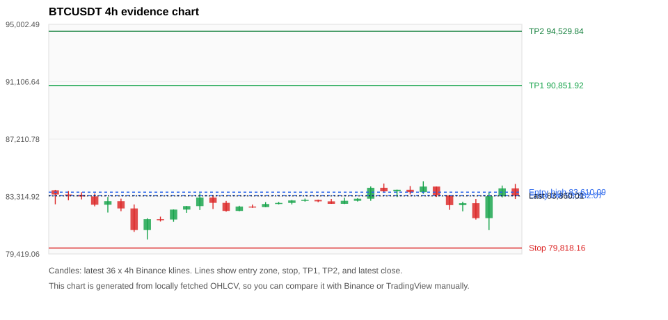
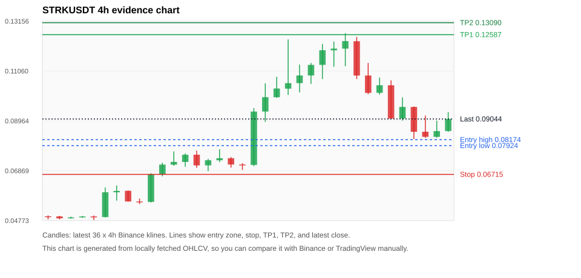
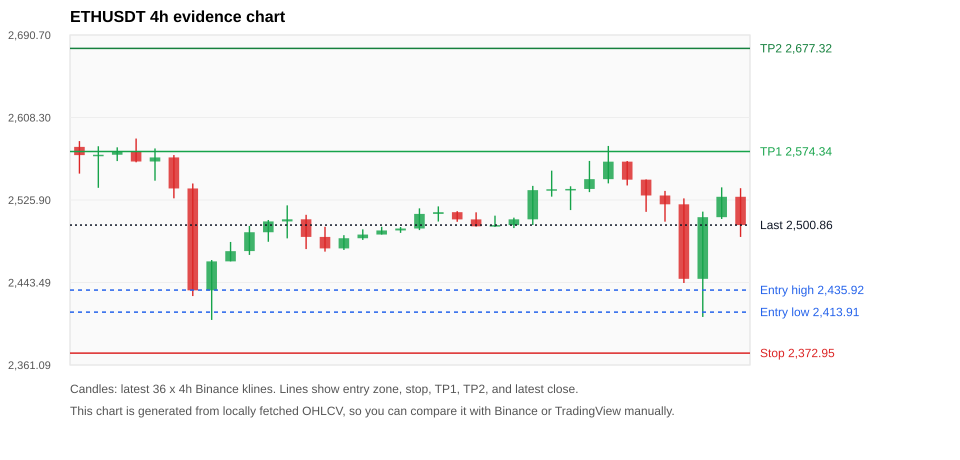
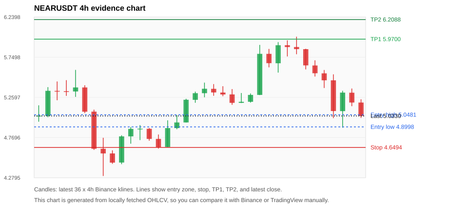
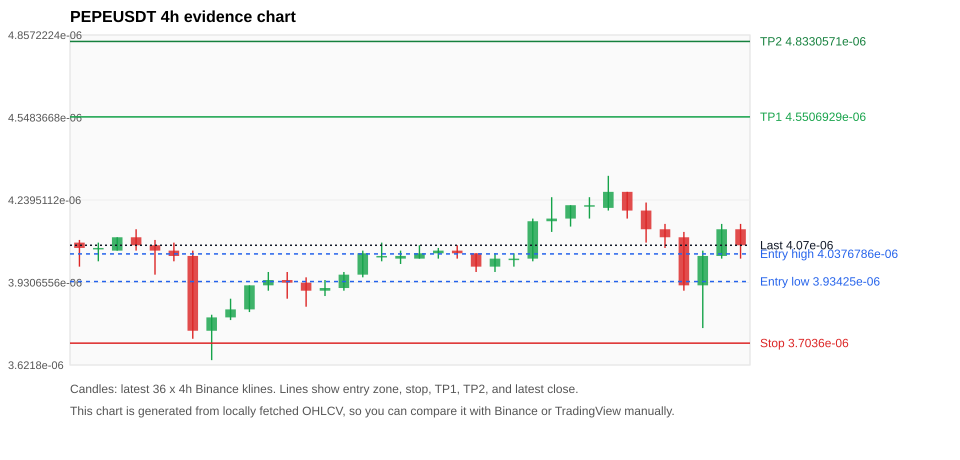

# Crypto 市场扫描报告 v1

- 报告时间：2026-10-13 20:06:33 CST
- Run ID：`20261013_120503_b1346ab8`
- Run type：`daily_full`
- Data validation mode：`paper`
- 数据来源：SQLite
- 报告版本：v1
- 扫描 ID：c73a4055faf2
- 数据源：Binance public spot API + CoinGecko/CoinMarketCap cross-check
- 过滤条件：USDT spot; 24h quote volume >= 30,000,000; trades >= 30,000; exclude stables/leveraged tokens; analyze 1h/4h/1d klines
- 默认单笔风险：账户权益的 1.00%

## 限制说明

- 交易信号仍以 Binance 现货公开 K 线为主源；外部数据源用于一致性复核。
- 结果是研究和模拟盘计划，不是确定收益或实盘下单指令。
- 历史长度过滤：候选币至少需要 180 根 1d K 线。
- 数据质量验证池：先验证 score 排名前 min(top_n * 2, 10) 的候选，再按 action + score 补足最终名单。
- 指标截止：2026-10-13T12:05:08.788000+00:00；仅使用此前至少60秒已闭合K线，ticker为扫描时点观测。
- 大盘环境过滤：RISK_OFF; BTC/ETH 大盘偏弱，山寨币买入候选降级为观察。 BTC 7d=-4.566879961924686; ETH 7d=-9.6978575487642.
- Data cross-validation enabled: Binance primary source plus CoinGecko; CoinMarketCap is checked when an API key is configured.
- BTCUSDT validation state DEGRADED: DEGRADED: [EXTERNAL_IDENTITY_AMBIGUOUS] CoinMarketCap symbol mapping has 13 matches; selected lowest cmc_rank
- STRKUSDT validation state BLOCKED: BLOCKED: [BINANCE_KLINE_EXTREME_RANGE] Binance candle range exceeds 40%.; [BINANCE_KLINE_EXTREME_RANGE] Binance candle range exceeds 40%.; [BINANCE_KLINE_EXTREME_RANGE] Binance candle range exceeds 40%.; [EXTERNAL_IDENTITY_AMBIGUOUS] CoinGecko symbol mapping has 2 exact matches; selected highest market-cap rank; [EXTERNAL_IDENTITY_AMBIGUOUS] CoinMarketCap symbol mapping has 2 matches; selected lowest cmc_rank
- ETHUSDT validation state DEGRADED: DEGRADED: [EXTERNAL_IDENTITY_AMBIGUOUS] CoinMarketCap symbol mapping has 6 matches; selected lowest cmc_rank
- PEPEUSDT validation state DEGRADED: DEGRADED: [EXTERNAL_IDENTITY_AMBIGUOUS] CoinGecko symbol mapping has 4 exact matches; selected highest market-cap rank; [EXTERNAL_IDENTITY_AMBIGUOUS] CoinMarketCap symbol mapping has 33 matches; selected lowest cmc_rank
- BNBUSDT validation state DEGRADED: DEGRADED: [EXTERNAL_IDENTITY_AMBIGUOUS] CoinMarketCap symbol mapping has 4 matches; selected lowest cmc_rank
- LINKUSDT validation state DEGRADED: DEGRADED: [EXTERNAL_PROVIDER_RATE_LIMITED] Provider rate limited request for https://api.coingecko.com/api/v3/coins/markets?vs_currency=usd&ids=chainlink&price_change_percentage=24h&per_page=1&page=1: HTTP 429
- XRPUSDT validation state DEGRADED: DEGRADED: [EXTERNAL_PROVIDER_RATE_LIMITED] Provider rate limited request for https://api.coingecko.com/api/v3/coins/markets?vs_currency=usd&ids=ripple&price_change_percentage=24h&per_page=1&page=1: HTTP 429; [EXTERNAL_IDENTITY_AMBIGUOUS] CoinMarketCap symbol mapping has 3 matches; selected lowest cmc_rank
- AVAXUSDT validation state DEGRADED: DEGRADED: [EXTERNAL_PROVIDER_RATE_LIMITED] Provider rate limited request for https://api.coingecko.com/api/v3/coins/markets?vs_currency=usd&ids=avalanche-2&price_change_percentage=24h&per_page=1&page=1: HTTP 429
- ONDOUSDT validation state DEGRADED: DEGRADED: [EXTERNAL_PROVIDER_RATE_LIMITED] Provider rate limited request for https://api.coingecko.com/api/v3/coins/markets?vs_currency=usd&ids=ondo-finance&price_change_percentage=24h&per_page=1&page=1: HTTP 429

## 5 个候选交易计划

| Rank | Coin | Action | Setup | Entry Zone | Stop Loss | TP1 | TP2 / Exit Rule | R/R | Verdict |
|---:|---|---|---|---:|---:|---:|---|---:|---|
| 1 | `BTC` | `WATCH_ONLY` | 回踩支撑/4h EMA 附近 | 83,382.07 - 83,610.09 | 79,818.16 | 90,851.92 | 94,529.84 或跌破 4h 关键支撑 | 2.00-3.00 | 只观察 |
| 2 | `STRK` | `WATCH_ONLY` | 涨幅较远，只等深回调 | 0.07924 - 0.08174 | 0.06715 | 0.12587 | 0.13090 或跌破 4h 关键支撑 | 3.40-3.78 | 只观察 |
| 3 | `ETH` | `REJECT` | 回踩支撑/4h EMA 附近 | 2,413.91 - 2,435.92 | 2,372.95 | 2,574.34 | 2,677.32 或跌破 4h 关键支撑 | 2.88-4.86 | 只观察 |
| 4 | `NEAR` | `REJECT` | 回踩支撑/4h EMA 附近 | 4.8998 - 5.0481 | 4.6494 | 5.9700 | 6.2088 或跌破 4h 关键支撑 | 3.07-3.80 | 只观察 |
| 5 | `PEPE` | `REJECT` | 趋势中，等回调入场 | 3.93425e-06 - 4.0376786e-06 | 3.7036e-06 | 4.5506929e-06 | 4.8330571e-06 或跌破 4h 关键支撑 | 2.00-3.00 | 只观察 |

## 数据交叉验证摘要

价格差异以 Binance 当前价为基准；成交量口径不同，Binance 是 USDT 现货成交额，CoinGecko/CoinMarketCap 通常是全市场成交量。

| Rank | Coin | State | Identity | Max Price Diff | Max 24h Diff | Issue Codes | Message |
|---:|---|---|---|---:|---:|---|---|
| 1 | `BTC` | DEGRADED (DATA_WARNING) | UNCONFIRMED | 0.21% | 0.07 pts | EXTERNAL_IDENTITY_AMBIGUOUS | DEGRADED: [EXTERNAL_IDENTITY_AMBIGUOUS] CoinMarketCap symbol mapping has 13 matches; selected lowest cmc_rank |
| 2 | `STRK` | BLOCKED (DATA_ERROR) | UNCONFIRMED | 0.61% | 0.38 pts | BINANCE_KLINE_EXTREME_RANGE, EXTERNAL_IDENTITY_AMBIGUOUS | BLOCKED: [BINANCE_KLINE_EXTREME_RANGE] Binance candle range exceeds 40%.; [BINANCE_KLINE_EXTREME_RANGE] Binance candle range exceeds 40%.; [BINANCE_KLINE_EXTREME_RANGE] Binance candle range exceeds 40%.; [EXTERNAL_IDENTITY_AMBIGUOUS] CoinGecko symbol mapping has 2 exact matches; selected highest market-cap rank; [EXTERNAL_IDENTITY_AMBIGUOUS] CoinMarketCap symbol mapping has 2 matches; selected lowest cmc_rank |
| 3 | `ETH` | DEGRADED (DATA_WARNING) | UNCONFIRMED | 0.18% | 0.09 pts | EXTERNAL_IDENTITY_AMBIGUOUS | DEGRADED: [EXTERNAL_IDENTITY_AMBIGUOUS] CoinMarketCap symbol mapping has 6 matches; selected lowest cmc_rank |
| 4 | `NEAR` | CLEAN (DATA_OK) | CONFIRMED | 0.46% | 0.19 pts | none | CLEAN: External provider checks agree with Binance within configured thresholds. |
| 5 | `PEPE` | DEGRADED (DATA_WARNING) | UNCONFIRMED | 0.28% | 0.14 pts | EXTERNAL_IDENTITY_AMBIGUOUS | DEGRADED: [EXTERNAL_IDENTITY_AMBIGUOUS] CoinGecko symbol mapping has 4 exact matches; selected highest market-cap rank; [EXTERNAL_IDENTITY_AMBIGUOUS] CoinMarketCap symbol mapping has 33 matches; selected lowest cmc_rank |

## 候选币说明

### 1. BTC `BTCUSDT`



- 入选原因：回踩支撑/4h EMA 附近；24h -0.01%，7d -3.31%，4h RSI 53.91，24h 成交额 $1.32B。
- 交易失效条件：跌破 79818.155 或 4h 收盘重新失守关键支撑。
- 主要风险：BTC/ETH 大盘环境未确认强势，山寨币买入信号降级；24h 动量未确认；7d 趋势未确认；External validation is degraded; this candidate is not a clean data sample.；Paper mode allows degraded validation; candidate is excluded from clean-data samples.。
- 数据交叉验证：DEGRADED / DATA_WARNING；身份=UNCONFIRMED；DEGRADED: [EXTERNAL_IDENTITY_AMBIGUOUS] CoinMarketCap symbol mapping has 13 matches; selected lowest cmc_rank

#### 可点击人工验证

- [Binance 交易页](https://www.binance.com/en/trade/BTC_USDT)
- [TradingView 图表](https://www.tradingview.com/chart/?symbol=BINANCE%3ABTCUSDT)
- [CoinGecko 搜索](https://www.coingecko.com/en/search?query=BTC)
- [CoinMarketCap 搜索](https://coinmarketcap.com/search/?q=BTC)

#### 多数据源对照

| Source | Status | Identity | Blocking | Asset ID | Price | 24h Change | 24h Volume | Price Diff | 24h Diff | Updated | Issue Codes | Message |
|---|---|---|---:|---|---:|---:|---:|---:|---:|---|---|---|
| Binance | DATA_OK | CONFIRMED | no | BTCUSDT | 83,360.01 | -0.01% | $1.32B | 0.00% | 0.00 pts | 2026-10-13T12:05:57+00:00 | none | Primary market data source passed health checks. |
| CoinGecko | DATA_OK | CONFIRMED | no | bitcoin | 83,215.00 | -0.08% | $32.68B | 0.17% | 0.07 pts | 2026-10-13T12:04:52.000Z | none | External source agrees with Binance within thresholds. |
| CoinMarketCap | DATA_WARNING | UNCONFIRMED | no | 1 | 83,182.92 | -0.09% | $31.88B | 0.21% | 0.07 pts | 2026-10-13T12:05:05.000Z | EXTERNAL_IDENTITY_AMBIGUOUS | [EXTERNAL_IDENTITY_AMBIGUOUS] CoinMarketCap symbol mapping has 13 matches; selected lowest cmc_rank |

#### 指标证据

| 指标 | 数值 | 人工核对用途 |
|---|---:|---|
| 当前价 | 83,360.01 | 与 Binance/TradingView 当前价格对照 |
| 24h 涨跌 | -0.01% | 与交易所 24h 涨跌对照 |
| 7d 涨跌 | -3.31% | 判断短线趋势是否延续 |
| 4h EMA20 | 83,215.63 | 判断短期趋势支撑 |
| 4h EMA50 | 83,494.62 | 判断中期趋势支撑 |
| 1d EMA20 | 83,159.02 | 判断日线趋势 |
| 1d EMA50 | 80,133.84 | 判断日线趋势 |
| 4h RSI14 | 53.91 | 判断是否过热/过弱 |
| 4h ATR14 | 879.31 | 推导止损和入场缓冲 |
| 最近 18 根 4h 最低点 | 81,033.66 | 支撑/止损参考 |
| 最近 36 根 4h 最高点 | 84,352.00 | TP/压力参考 |
| 支撑位 | 83,215.63 | 入场区间推导基础 |

#### 交易计划推导

- 支撑位 = 最近低点、4h EMA20、4h EMA50、1d EMA20 中不高于当前价的最高有效支撑 = `83,215.63`。
- 入场区间 = 支撑位附近 + ATR 缓冲 = `83,382.07 - 83,610.09`。
- 止损 = min(最近 18 根 4h 最低点 * 0.985, 入场中位价 - 1.15 * ATR14) = `79,818.16`。
- TP1 = max(最近 36 根 4h 最高点 * 0.995, 入场中位价 + 2R) = `90,851.92`。
- TP2 = max(入场中位价 + 3R, TP1 * 1.04) = `94,529.84`。

#### 最近 10 根 4h K线

| UTC 开盘时间 | Open | High | Low | Close | Quote Volume | Trades |
|---|---:|---:|---:|---:|---:|---:|
| 2026-10-11T20:00+00:00 | 83,669.24 | 83,780.50 | 83,276.75 | 83,773.12 | $72.9M | 209623 |
| 2026-10-12T00:00+00:00 | 83,773.12 | 84,026.66 | 83,462.00 | 83,613.06 | $147.3M | 324273 |
| 2026-10-12T04:00+00:00 | 83,613.06 | 84,352.00 | 83,500.00 | 83,991.51 | $186.9M | 390679 |
| 2026-10-12T08:00+00:00 | 83,991.52 | 83,991.52 | 83,285.10 | 83,396.60 | $229.2M | 344912 |
| 2026-10-12T12:00+00:00 | 83,396.60 | 83,396.61 | 82,410.86 | 82,730.50 | $260.9M | 668756 |
| 2026-10-12T16:00+00:00 | 82,730.50 | 82,962.40 | 82,311.50 | 82,861.80 | $104.2M | 272270 |
| 2026-10-12T20:00+00:00 | 82,861.81 | 83,147.95 | 81,750.09 | 81,850.00 | $197.2M | 483347 |
| 2026-10-13T00:00+00:00 | 81,850.01 | 83,600.00 | 81,033.66 | 83,331.17 | $266.7M | 791485 |
| 2026-10-13T04:00+00:00 | 83,331.16 | 84,059.69 | 83,255.17 | 83,870.89 | $218.5M | 424730 |
| 2026-10-13T08:00+00:00 | 83,870.89 | 84,168.00 | 83,146.53 | 83,360.01 | $266.9M | 571471 |

### 2. STRK `STRKUSDT`



- 入选原因：涨幅较远，只等深回调；24h -13.69%，7d +73.46%，4h RSI 40.76，24h 成交额 $53.7M。
- 交易失效条件：跌破 0.06715023 或 4h 收盘重新失守关键支撑。
- 主要风险：距离支撑偏远，不能追市价；24h 振幅较大，回撤风险高；BTC/ETH 大盘环境未确认强势，山寨币买入信号降级；24h 动量未确认；Blocking data-quality issue detected; paper plan creation is not allowed.。
- 数据交叉验证：BLOCKED / DATA_ERROR；身份=UNCONFIRMED；BLOCKED: [BINANCE_KLINE_EXTREME_RANGE] Binance candle range exceeds 40%.; [BINANCE_KLINE_EXTREME_RANGE] Binance candle range exceeds 40%.; [BINANCE_KLINE_EXTREME_RANGE] Binance candle range exceeds 40%.; [EXTERNAL_IDENTITY_AMBIGUOUS] CoinGecko symbol mapping has 2 exact matches; selected highest market-cap rank; [EXTERNAL_IDENTITY_AMBIGUOUS] CoinMarketCap symbol mapping has 2 matches; selected lowest cmc_rank

#### 可点击人工验证

- [Binance 交易页](https://www.binance.com/en/trade/STRK_USDT)
- [TradingView 图表](https://www.tradingview.com/chart/?symbol=BINANCE%3ASTRKUSDT)
- [CoinGecko 搜索](https://www.coingecko.com/en/search?query=STRK)
- [CoinMarketCap 搜索](https://coinmarketcap.com/search/?q=STRK)

#### 多数据源对照

| Source | Status | Identity | Blocking | Asset ID | Price | 24h Change | 24h Volume | Price Diff | 24h Diff | Updated | Issue Codes | Message |
|---|---|---|---:|---|---:|---:|---:|---:|---:|---|---|---|
| Binance | DATA_ERROR | CONFIRMED | yes | STRKUSDT | 0.09044 | -13.69% | $53.7M | 0.00% | 0.00 pts | 2026-10-13T12:05:57+00:00 | BINANCE_KLINE_EXTREME_RANGE | [BINANCE_KLINE_EXTREME_RANGE] Binance candle range exceeds 40%.; [BINANCE_KLINE_EXTREME_RANGE] Binance candle range exceeds 40%.; [BINANCE_KLINE_EXTREME_RANGE] Binance candle range exceeds 40%. |
| CoinGecko | DATA_WARNING | UNCONFIRMED | no | starknet | 0.08989 | -13.89% | $379.5M | 0.61% | 0.20 pts | 2026-10-13T12:04:52.000Z | EXTERNAL_IDENTITY_AMBIGUOUS | [EXTERNAL_IDENTITY_AMBIGUOUS] CoinGecko symbol mapping has 2 exact matches; selected highest market-cap rank |
| CoinMarketCap | DATA_WARNING | UNCONFIRMED | no | 22691 | 0.08990 | -14.07% | $375.9M | 0.60% | 0.38 pts | 2026-10-13T12:05:05.000Z | EXTERNAL_IDENTITY_AMBIGUOUS | [EXTERNAL_IDENTITY_AMBIGUOUS] CoinMarketCap symbol mapping has 2 matches; selected lowest cmc_rank |

#### 指标证据

| 指标 | 数值 | 人工核对用途 |
|---|---:|---|
| 当前价 | 0.09044 | 与 Binance/TradingView 当前价格对照 |
| 24h 涨跌 | -13.69% | 与交易所 24h 涨跌对照 |
| 7d 涨跌 | +73.46% | 判断短线趋势是否延续 |
| 4h EMA20 | 0.09229 | 判断短期趋势支撑 |
| 4h EMA50 | 0.07908 | 判断中期趋势支撑 |
| 1d EMA20 | 0.06246 | 判断日线趋势 |
| 1d EMA50 | 0.04701 | 判断日线趋势 |
| 4h RSI14 | 40.76 | 判断是否过热/过弱 |
| 4h ATR14 | 0.01160 | 推导止损和入场缓冲 |
| 最近 18 根 4h 最低点 | 0.07063 | 支撑/止损参考 |
| 最近 36 根 4h 最高点 | 0.12650 | TP/压力参考 |
| 支撑位 | 0.07908 | 入场区间推导基础 |

#### 交易计划推导

- 支撑位 = 最近低点、4h EMA20、4h EMA50、1d EMA20 中不高于当前价的最高有效支撑 = `0.07908`。
- 入场区间 = 支撑位附近 + ATR 缓冲 = `0.07924 - 0.08174`。
- 止损 = min(最近 18 根 4h 最低点 * 0.985, 入场中位价 - 1.15 * ATR14) = `0.06715`。
- TP1 = max(最近 36 根 4h 最高点 * 0.995, 入场中位价 + 2R) = `0.12587`。
- TP2 = max(入场中位价 + 3R, TP1 * 1.04) = `0.13090`。

#### 最近 10 根 4h K线

| UTC 开盘时间 | Open | High | Low | Close | Quote Volume | Trades |
|---|---:|---:|---:|---:|---:|---:|
| 2026-10-11T20:00+00:00 | 0.12001 | 0.12650 | 0.11265 | 0.12316 | $10.0M | 131134 |
| 2026-10-12T00:00+00:00 | 0.12311 | 0.12494 | 0.10724 | 0.10870 | $16.4M | 233563 |
| 2026-10-12T04:00+00:00 | 0.10870 | 0.11398 | 0.10085 | 0.10141 | $10.1M | 141062 |
| 2026-10-12T08:00+00:00 | 0.10143 | 0.10787 | 0.10069 | 0.10461 | $7.5M | 115703 |
| 2026-10-12T12:00+00:00 | 0.10460 | 0.10666 | 0.09036 | 0.09064 | $14.5M | 183030 |
| 2026-10-12T16:00+00:00 | 0.09063 | 0.09950 | 0.08973 | 0.09551 | $9.6M | 150865 |
| 2026-10-12T20:00+00:00 | 0.09549 | 0.09570 | 0.08200 | 0.08505 | $7.5M | 100669 |
| 2026-10-13T00:00+00:00 | 0.08508 | 0.09188 | 0.08251 | 0.08294 | $9.3M | 125163 |
| 2026-10-13T04:00+00:00 | 0.08293 | 0.08975 | 0.08258 | 0.08536 | $5.9M | 96288 |
| 2026-10-13T08:00+00:00 | 0.08538 | 0.09337 | 0.08503 | 0.09044 | $6.7M | 100606 |

### 3. ETH `ETHUSDT`



- 入选原因：回踩支撑/4h EMA 附近；24h -1.67%，7d -7.91%，4h RSI 50.21，24h 成交额 $785.9M。
- 交易失效条件：跌破 2372.9536 或 4h 收盘重新失守关键支撑。
- 主要风险：日线趋势未完全确认；BTC/ETH 大盘环境未确认强势，山寨币买入信号降级；24h 动量未确认；7d 趋势未确认；External validation is degraded; this candidate is not a clean data sample.；Paper mode allows degraded validation; candidate is excluded from clean-data samples.。
- 数据交叉验证：DEGRADED / DATA_WARNING；身份=UNCONFIRMED；DEGRADED: [EXTERNAL_IDENTITY_AMBIGUOUS] CoinMarketCap symbol mapping has 6 matches; selected lowest cmc_rank

#### 可点击人工验证

- [Binance 交易页](https://www.binance.com/en/trade/ETH_USDT)
- [TradingView 图表](https://www.tradingview.com/chart/?symbol=BINANCE%3AETHUSDT)
- [CoinGecko 搜索](https://www.coingecko.com/en/search?query=ETH)
- [CoinMarketCap 搜索](https://coinmarketcap.com/search/?q=ETH)

#### 多数据源对照

| Source | Status | Identity | Blocking | Asset ID | Price | 24h Change | 24h Volume | Price Diff | 24h Diff | Updated | Issue Codes | Message |
|---|---|---|---:|---|---:|---:|---:|---:|---:|---|---|---|
| Binance | DATA_OK | CONFIRMED | no | ETHUSDT | 2,500.86 | -1.67% | $785.9M | 0.00% | 0.00 pts | 2026-10-13T12:05:57+00:00 | none | Primary market data source passed health checks. |
| CoinGecko | DATA_OK | CONFIRMED | no | ethereum | 2,497.32 | -1.75% | $15.49B | 0.14% | 0.08 pts | 2026-10-13T12:05:46.000Z | none | External source agrees with Binance within thresholds. |
| CoinMarketCap | DATA_WARNING | UNCONFIRMED | no | 1027 | 2,496.24 | -1.76% | $14.82B | 0.18% | 0.09 pts | 2026-10-13T12:05:05.000Z | EXTERNAL_IDENTITY_AMBIGUOUS | [EXTERNAL_IDENTITY_AMBIGUOUS] CoinMarketCap symbol mapping has 6 matches; selected lowest cmc_rank |

#### 指标证据

| 指标 | 数值 | 人工核对用途 |
|---|---:|---|
| 当前价 | 2,500.86 | 与 Binance/TradingView 当前价格对照 |
| 24h 涨跌 | -1.67% | 与交易所 24h 涨跌对照 |
| 7d 涨跌 | -7.91% | 判断短线趋势是否延续 |
| 4h EMA20 | 2,519.64 | 判断短期趋势支撑 |
| 4h EMA50 | 2,555.52 | 判断中期趋势支撑 |
| 1d EMA20 | 2,586.05 | 判断日线趋势 |
| 1d EMA50 | 2,501.78 | 判断日线趋势 |
| 4h RSI14 | 50.21 | 判断是否过热/过弱 |
| 4h ATR14 | 38.3279 | 推导止损和入场缓冲 |
| 最近 18 根 4h 最低点 | 2,409.09 | 支撑/止损参考 |
| 最近 36 根 4h 最高点 | 2,587.28 | TP/压力参考 |
| 支撑位 | 2,409.09 | 入场区间推导基础 |

#### 交易计划推导

- 支撑位 = 最近低点、4h EMA20、4h EMA50、1d EMA20 中不高于当前价的最高有效支撑 = `2,409.09`。
- 入场区间 = 支撑位附近 + ATR 缓冲 = `2,413.91 - 2,435.92`。
- 止损 = min(最近 18 根 4h 最低点 * 0.985, 入场中位价 - 1.15 * ATR14) = `2,372.95`。
- TP1 = max(最近 36 根 4h 最高点 * 0.995, 入场中位价 + 2R) = `2,574.34`。
- TP2 = max(入场中位价 + 3R, TP1 * 1.04) = `2,677.32`。

#### 最近 10 根 4h K线

| UTC 开盘时间 | Open | High | Low | Close | Quote Volume | Trades |
|---|---:|---:|---:|---:|---:|---:|
| 2026-10-11T20:00+00:00 | 2,536.63 | 2,539.60 | 2,515.84 | 2,536.94 | $75.9M | 300519 |
| 2026-10-12T00:00+00:00 | 2,536.94 | 2,564.92 | 2,533.77 | 2,546.72 | $60.0M | 355368 |
| 2026-10-12T04:00+00:00 | 2,546.72 | 2,579.88 | 2,542.50 | 2,564.19 | $154.2M | 484666 |
| 2026-10-12T08:00+00:00 | 2,564.20 | 2,564.84 | 2,540.42 | 2,546.21 | $180.1M | 358746 |
| 2026-10-12T12:00+00:00 | 2,546.21 | 2,546.43 | 2,514.06 | 2,530.40 | $112.8M | 700379 |
| 2026-10-12T16:00+00:00 | 2,530.39 | 2,535.00 | 2,504.26 | 2,521.59 | $59.3M | 337414 |
| 2026-10-12T20:00+00:00 | 2,521.58 | 2,527.50 | 2,443.00 | 2,447.17 | $140.5M | 642199 |
| 2026-10-13T00:00+00:00 | 2,447.16 | 2,514.28 | 2,409.09 | 2,508.74 | $228.3M | 1139132 |
| 2026-10-13T04:00+00:00 | 2,508.74 | 2,538.52 | 2,506.93 | 2,529.10 | $103.0M | 390714 |
| 2026-10-13T08:00+00:00 | 2,529.11 | 2,537.69 | 2,489.00 | 2,500.86 | $141.0M | 669228 |

### 4. NEAR `NEARUSDT`



- 入选原因：回踩支撑/4h EMA 附近；24h -10.94%，7d -2.61%，4h RSI 46.43，24h 成交额 $265.2M。
- 交易失效条件：跌破 4.6493931 或 4h 收盘重新失守关键支撑。
- 主要风险：BTC/ETH 大盘环境未确认强势，山寨币买入信号降级；24h 动量未确认；7d 趋势未确认。
- 数据交叉验证：CLEAN / DATA_OK；身份=CONFIRMED；CLEAN: External provider checks agree with Binance within configured thresholds.

#### 可点击人工验证

- [Binance 交易页](https://www.binance.com/en/trade/NEAR_USDT)
- [TradingView 图表](https://www.tradingview.com/chart/?symbol=BINANCE%3ANEARUSDT)
- [CoinGecko 搜索](https://www.coingecko.com/en/search?query=NEAR)
- [CoinMarketCap 搜索](https://coinmarketcap.com/search/?q=NEAR)

#### 多数据源对照

| Source | Status | Identity | Blocking | Asset ID | Price | 24h Change | 24h Volume | Price Diff | 24h Diff | Updated | Issue Codes | Message |
|---|---|---|---:|---|---:|---:|---:|---:|---:|---|---|---|
| Binance | DATA_OK | CONFIRMED | no | NEARUSDT | 5.0330 | -10.94% | $265.2M | 0.00% | 0.00 pts | 2026-10-13T12:05:57+00:00 | none | Primary market data source passed health checks. |
| CoinGecko | DATA_OK | CONFIRMED | no | near | 5.0100 | -11.14% | $1.24B | 0.46% | 0.19 pts | 2026-10-13T12:05:46.000Z | none | External source agrees with Binance within thresholds. |
| CoinMarketCap | DATA_OK | CONFIRMED | no | 6535 | 5.0227 | -11.02% | $1.58B | 0.20% | 0.07 pts | 2026-10-13T12:05:05.000Z | none | External source agrees with Binance within thresholds. |

#### 指标证据

| 指标 | 数值 | 人工核对用途 |
|---|---:|---|
| 当前价 | 5.0330 | 与 Binance/TradingView 当前价格对照 |
| 24h 涨跌 | -10.94% | 与交易所 24h 涨跌对照 |
| 7d 涨跌 | -2.61% | 判断短线趋势是否延续 |
| 4h EMA20 | 5.3413 | 判断短期趋势支撑 |
| 4h EMA50 | 5.2099 | 判断中期趋势支撑 |
| 1d EMA20 | 4.8041 | 判断日线趋势 |
| 1d EMA50 | 3.8701 | 判断日线趋势 |
| 4h RSI14 | 46.43 | 判断是否过热/过弱 |
| 4h ATR14 | 0.28221 | 推导止损和入场缓冲 |
| 最近 18 根 4h 最低点 | 4.8900 | 支撑/止损参考 |
| 最近 36 根 4h 最高点 | 6.0000 | TP/压力参考 |
| 支撑位 | 4.8900 | 入场区间推导基础 |

#### 交易计划推导

- 支撑位 = 最近低点、4h EMA20、4h EMA50、1d EMA20 中不高于当前价的最高有效支撑 = `4.8900`。
- 入场区间 = 支撑位附近 + ATR 缓冲 = `4.8998 - 5.0481`。
- 止损 = min(最近 18 根 4h 最低点 * 0.985, 入场中位价 - 1.15 * ATR14) = `4.6494`。
- TP1 = max(最近 36 根 4h 最高点 * 0.995, 入场中位价 + 2R) = `5.9700`。
- TP2 = max(入场中位价 + 3R, TP1 * 1.04) = `6.2088`。

#### 最近 10 根 4h K线

| UTC 开盘时间 | Open | High | Low | Close | Quote Volume | Trades |
|---|---:|---:|---:|---:|---:|---:|
| 2026-10-11T20:00+00:00 | 5.6760 | 5.9340 | 5.5620 | 5.8960 | $27.8M | 101739 |
| 2026-10-12T00:00+00:00 | 5.8960 | 5.9560 | 5.7590 | 5.8740 | $36.4M | 141218 |
| 2026-10-12T04:00+00:00 | 5.8740 | 6.0000 | 5.7860 | 5.8490 | $34.9M | 148564 |
| 2026-10-12T08:00+00:00 | 5.8480 | 5.8530 | 5.6010 | 5.6500 | $36.2M | 118745 |
| 2026-10-12T12:00+00:00 | 5.6490 | 5.7120 | 5.5140 | 5.5540 | $43.6M | 152203 |
| 2026-10-12T16:00+00:00 | 5.5530 | 5.5940 | 5.3740 | 5.4680 | $32.7M | 116278 |
| 2026-10-12T20:00+00:00 | 5.4680 | 5.5410 | 5.0070 | 5.0930 | $57.6M | 224877 |
| 2026-10-13T00:00+00:00 | 5.0920 | 5.3400 | 4.8900 | 5.3180 | $63.8M | 259211 |
| 2026-10-13T04:00+00:00 | 5.3170 | 5.3680 | 5.1520 | 5.1970 | $31.7M | 104076 |
| 2026-10-13T08:00+00:00 | 5.1970 | 5.2370 | 5.0090 | 5.0330 | $35.2M | 136723 |

### 5. PEPE `PEPEUSDT`



- 入选原因：趋势中，等回调入场；24h -3.10%，7d -6.65%，4h RSI 54.44，24h 成交额 $36.4M。
- 交易失效条件：跌破 3.7036e-06 或 4h 收盘重新失守关键支撑。
- 主要风险：距离支撑偏远，不能追市价；日线趋势未完全确认；BTC/ETH 大盘环境未确认强势，山寨币买入信号降级；24h 动量未确认；7d 趋势未确认；External validation is degraded; this candidate is not a clean data sample.；Paper mode allows degraded validation; candidate is excluded from clean-data samples.。
- 数据交叉验证：DEGRADED / DATA_WARNING；身份=UNCONFIRMED；DEGRADED: [EXTERNAL_IDENTITY_AMBIGUOUS] CoinGecko symbol mapping has 4 exact matches; selected highest market-cap rank; [EXTERNAL_IDENTITY_AMBIGUOUS] CoinMarketCap symbol mapping has 33 matches; selected lowest cmc_rank

#### 可点击人工验证

- [Binance 交易页](https://www.binance.com/en/trade/PEPE_USDT)
- [TradingView 图表](https://www.tradingview.com/chart/?symbol=BINANCE%3APEPEUSDT)
- [CoinGecko 搜索](https://www.coingecko.com/en/search?query=PEPE)
- [CoinMarketCap 搜索](https://coinmarketcap.com/search/?q=PEPE)

#### 多数据源对照

| Source | Status | Identity | Blocking | Asset ID | Price | 24h Change | 24h Volume | Price Diff | 24h Diff | Updated | Issue Codes | Message |
|---|---|---|---:|---|---:|---:|---:|---:|---:|---|---|---|
| Binance | DATA_OK | CONFIRMED | no | PEPEUSDT | 4.07e-06 | -3.10% | $36.4M | 0.00% | 0.00 pts | 2026-10-13T12:05:57+00:00 | none | Primary market data source passed health checks. |
| CoinGecko | DATA_WARNING | UNCONFIRMED | no | pepe | 4.06e-06 | -3.23% | $285.9M | 0.25% | 0.14 pts | 2026-10-13T12:05:46.000Z | EXTERNAL_IDENTITY_AMBIGUOUS | [EXTERNAL_IDENTITY_AMBIGUOUS] CoinGecko symbol mapping has 4 exact matches; selected highest market-cap rank |
| CoinMarketCap | DATA_WARNING | UNCONFIRMED | no | 24478 | 4.0586235e-06 | -3.18% | $270.2M | 0.28% | 0.08 pts | 2026-10-13T12:05:05.000Z | EXTERNAL_IDENTITY_AMBIGUOUS | [EXTERNAL_IDENTITY_AMBIGUOUS] CoinMarketCap symbol mapping has 33 matches; selected lowest cmc_rank |

#### 指标证据

| 指标 | 数值 | 人工核对用途 |
|---|---:|---|
| 当前价 | 4.07e-06 | 与 Binance/TradingView 当前价格对照 |
| 24h 涨跌 | -3.10% | 与交易所 24h 涨跌对照 |
| 7d 涨跌 | -6.65% | 判断短线趋势是否延续 |
| 4h EMA20 | 4.0868228e-06 | 判断短期趋势支撑 |
| 4h EMA50 | 4.1185543e-06 | 判断中期趋势支撑 |
| 1d EMA20 | 4.1235274e-06 | 判断日线趋势 |
| 1d EMA50 | 3.8985162e-06 | 判断日线趋势 |
| 4h RSI14 | 54.44 | 判断是否过热/过弱 |
| 4h ATR14 | 1.2928571e-07 | 推导止损和入场缓冲 |
| 最近 18 根 4h 最低点 | 3.76e-06 | 支撑/止损参考 |
| 最近 36 根 4h 最高点 | 4.33e-06 | TP/压力参考 |
| 支撑位 | 3.76e-06 | 入场区间推导基础 |

#### 交易计划推导

- 支撑位 = 最近低点、4h EMA20、4h EMA50、1d EMA20 中不高于当前价的最高有效支撑 = `3.76e-06`。
- 入场区间 = 支撑位附近 + ATR 缓冲 = `3.93425e-06 - 4.0376786e-06`。
- 止损 = min(最近 18 根 4h 最低点 * 0.985, 入场中位价 - 1.15 * ATR14) = `3.7036e-06`。
- TP1 = max(最近 36 根 4h 最高点 * 0.995, 入场中位价 + 2R) = `4.5506929e-06`。
- TP2 = max(入场中位价 + 3R, TP1 * 1.04) = `4.8330571e-06`。

#### 最近 10 根 4h K线

| UTC 开盘时间 | Open | High | Low | Close | Quote Volume | Trades |
|---|---:|---:|---:|---:|---:|---:|
| 2026-10-11T20:00+00:00 | 4.17e-06 | 4.22e-06 | 4.14e-06 | 4.22e-06 | $2.5M | 9747 |
| 2026-10-12T00:00+00:00 | 4.22e-06 | 4.25e-06 | 4.17e-06 | 4.22e-06 | $3.7M | 9526 |
| 2026-10-12T04:00+00:00 | 4.21e-06 | 4.33e-06 | 4.2e-06 | 4.27e-06 | $4.9M | 17563 |
| 2026-10-12T08:00+00:00 | 4.27e-06 | 4.27e-06 | 4.17e-06 | 4.2e-06 | $4.7M | 13536 |
| 2026-10-12T12:00+00:00 | 4.2e-06 | 4.23e-06 | 4.08e-06 | 4.13e-06 | $7.2M | 21557 |
| 2026-10-12T16:00+00:00 | 4.13e-06 | 4.15e-06 | 4.06e-06 | 4.1e-06 | $2.9M | 10951 |
| 2026-10-12T20:00+00:00 | 4.1e-06 | 4.12e-06 | 3.9e-06 | 3.92e-06 | $6.0M | 20298 |
| 2026-10-13T00:00+00:00 | 3.92e-06 | 4.05e-06 | 3.76e-06 | 4.03e-06 | $9.8M | 39250 |
| 2026-10-13T04:00+00:00 | 4.03e-06 | 4.15e-06 | 4.02e-06 | 4.13e-06 | $4.9M | 13640 |
| 2026-10-13T08:00+00:00 | 4.13e-06 | 4.15e-06 | 4.02e-06 | 4.07e-06 | $5.5M | 17867 |

## 组合风控

- 不要 5 个候选全部满仓买入。
- 同时持仓总风险建议控制在账户权益的 3% - 5% 以内。
- 如果 BTC/ETH 同时破位，暂停山寨币多头计划或降低仓位。
- 第一版报告用于模拟盘和人工复核，不自动下单。

## 原始数据

```json
[
  {
    "rank": 1,
    "symbol": "BTCUSDT",
    "base_asset": "BTC",
    "price": 83360.01,
    "score": 29.462858730584685,
    "setup": "回踩支撑/4h EMA 附近",
    "verdict": "只观察",
    "entry_low": 83382.06500419216,
    "entry_high": 83610.09002999999,
    "stop_loss": 79818.1551,
    "take_profit_1": 90851.9223512882,
    "take_profit_2": 94529.84476838427,
    "risk_reward_1": 2.0,
    "risk_reward_2": 3.0,
    "pct_24h": -0.013,
    "pct_3d": 0.6666143367790589,
    "pct_7d": -3.310366841769685,
    "quote_volume_24h": 1316982105.1444674,
    "trades_24h": 3223272,
    "high_low_range_24h": 3.8679482081890315,
    "rsi_1h": 59.39594667304364,
    "rsi_4h": 53.90917962246012,
    "ema20_4h": 83215.63373671872,
    "ema50_4h": 83494.61966281338,
    "ema20_1d": 83159.02296486519,
    "ema50_1d": 80133.83683799338,
    "atr_4h": 879.307142857143,
    "macd_hist_4h": 45.23852494835842,
    "volume_ratio_24h": 1.146538253879025,
    "support_level": 83215.63373671872,
    "recent_low_4h_18": 81033.66,
    "recent_high_4h_36": 84352.0,
    "distance_to_support_pct": 0.17349656164136196,
    "binance_trade_url": "https://www.binance.com/en/trade/BTC_USDT",
    "tradingview_url": "https://www.tradingview.com/chart/?symbol=BINANCE%3ABTCUSDT",
    "coingecko_search_url": "https://www.coingecko.com/en/search?query=BTC",
    "coinmarketcap_search_url": "https://coinmarketcap.com/search/?q=BTC",
    "invalidation": "跌破 79818.155 或 4h 收盘重新失守关键支撑",
    "recent_4h_klines": [
      {
        "open_time_utc": "2026-10-07T12:00+00:00",
        "open": 83740.15,
        "high": 83766.55,
        "low": 82787.25,
        "close": 83454.24,
        "quote_volume": 396579765.0285013,
        "trades": 926157
      },
      {
        "open_time_utc": "2026-10-07T16:00+00:00",
        "open": 83454.25,
        "high": 83681.91,
        "low": 83062.0,
        "close": 83434.68,
        "quote_volume": 168198601.146888,
        "trades": 430086
      },
      {
        "open_time_utc": "2026-10-07T20:00+00:00",
        "open": 83434.67,
        "high": 83606.01,
        "low": 83119.99,
        "close": 83321.81,
        "quote_volume": 124714667.1088399,
        "trades": 246948
      },
      {
        "open_time_utc": "2026-10-08T00:00+00:00",
        "open": 83321.81,
        "high": 83521.15,
        "low": 82650.0,
        "close": 82757.0,
        "quote_volume": 209197936.7505436,
        "trades": 436209
      },
      {
        "open_time_utc": "2026-10-08T04:00+00:00",
        "open": 82757.0,
        "high": 83283.28,
        "low": 82227.56,
        "close": 82998.75,
        "quote_volume": 279816545.0006753,
        "trades": 575844
      },
      {
        "open_time_utc": "2026-10-08T08:00+00:00",
        "open": 82998.75,
        "high": 83170.0,
        "low": 82318.0,
        "close": 82506.01,
        "quote_volume": 206734475.6869481,
        "trades": 489570
      },
      {
        "open_time_utc": "2026-10-08T12:00+00:00",
        "open": 82506.0,
        "high": 82776.01,
        "low": 80914.23,
        "close": 81037.99,
        "quote_volume": 528201208.4419955,
        "trades": 1241966
      },
      {
        "open_time_utc": "2026-10-08T16:00+00:00",
        "open": 81037.99,
        "high": 81839.73,
        "low": 80393.56,
        "close": 81775.52,
        "quote_volume": 422245821.1538942,
        "trades": 932465
      },
      {
        "open_time_utc": "2026-10-08T20:00+00:00",
        "open": 81775.52,
        "high": 81948.03,
        "low": 81617.99,
        "close": 81754.45,
        "quote_volume": 132714847.2366144,
        "trades": 234769
      },
      {
        "open_time_utc": "2026-10-09T00:00+00:00",
        "open": 81754.46,
        "high": 82438.28,
        "low": 81603.52,
        "close": 82427.72,
        "quote_volume": 171118980.4850972,
        "trades": 363581
      },
      {
        "open_time_utc": "2026-10-09T04:00+00:00",
        "open": 82427.73,
        "high": 82666.0,
        "low": 82209.2,
        "close": 82664.01,
        "quote_volume": 141667193.1935252,
        "trades": 277242
      },
      {
        "open_time_utc": "2026-10-09T08:00+00:00",
        "open": 82664.01,
        "high": 83528.98,
        "low": 82400.0,
        "close": 83246.82,
        "quote_volume": 191208424.1623192,
        "trades": 411985
      },
      {
        "open_time_utc": "2026-10-09T12:00+00:00",
        "open": 83246.82,
        "high": 83418.0,
        "low": 82468.99,
        "close": 82884.0,
        "quote_volume": 227742999.169354,
        "trades": 676388
      },
      {
        "open_time_utc": "2026-10-09T16:00+00:00",
        "open": 82884.0,
        "high": 83016.0,
        "low": 82285.71,
        "close": 82337.03,
        "quote_volume": 126280481.0864286,
        "trades": 289977
      },
      {
        "open_time_utc": "2026-10-09T20:00+00:00",
        "open": 82337.03,
        "high": 82686.0,
        "low": 82317.6,
        "close": 82635.55,
        "quote_volume": 158076011.5545336,
        "trades": 122907
      },
      {
        "open_time_utc": "2026-10-10T00:00+00:00",
        "open": 82635.56,
        "high": 82767.71,
        "low": 82545.82,
        "close": 82596.83,
        "quote_volume": 98840537.6494098,
        "trades": 88679
      },
      {
        "open_time_utc": "2026-10-10T04:00+00:00",
        "open": 82596.84,
        "high": 82937.49,
        "low": 82596.83,
        "close": 82807.47,
        "quote_volume": 127588233.4971652,
        "trades": 98817
      },
      {
        "open_time_utc": "2026-10-10T08:00+00:00",
        "open": 82807.47,
        "high": 82951.88,
        "low": 82781.23,
        "close": 82879.71,
        "quote_volume": 128308698.5549746,
        "trades": 122458
      },
      {
        "open_time_utc": "2026-10-10T12:00+00:00",
        "open": 82879.71,
        "high": 83080.98,
        "low": 82778.0,
        "close": 83048.75,
        "quote_volume": 102241250.4432091,
        "trades": 125753
      },
      {
        "open_time_utc": "2026-10-10T16:00+00:00",
        "open": 83048.75,
        "high": 83173.29,
        "low": 82968.0,
        "close": 83085.43,
        "quote_volume": 63020778.9622091,
        "trades": 86730
      },
      {
        "open_time_utc": "2026-10-10T20:00+00:00",
        "open": 83085.44,
        "high": 83106.59,
        "low": 82932.01,
        "close": 82988.36,
        "quote_volume": 96247232.9514053,
        "trades": 85443
      },
      {
        "open_time_utc": "2026-10-11T00:00+00:00",
        "open": 82988.35,
        "high": 83150.61,
        "low": 82818.8,
        "close": 82820.01,
        "quote_volume": 60912798.9715078,
        "trades": 82891
      },
      {
        "open_time_utc": "2026-10-11T04:00+00:00",
        "open": 82820.0,
        "high": 83234.0,
        "low": 82804.65,
        "close": 83025.02,
        "quote_volume": 91405855.7309103,
        "trades": 98656
      },
      {
        "open_time_utc": "2026-10-11T08:00+00:00",
        "open": 83025.03,
        "high": 83202.66,
        "low": 82975.37,
        "close": 83164.0,
        "quote_volume": 67169603.9589633,
        "trades": 103777
      },
      {
        "open_time_utc": "2026-10-11T12:00+00:00",
        "open": 83164.01,
        "high": 84000.0,
        "low": 83026.05,
        "close": 83908.89,
        "quote_volume": 144333132.5478198,
        "trades": 186909
      },
      {
        "open_time_utc": "2026-10-11T16:00+00:00",
        "open": 83908.89,
        "high": 84199.0,
        "low": 83572.96,
        "close": 83669.23,
        "quote_volume": 143871191.4402753,
        "trades": 314399
      },
      {
        "open_time_utc": "2026-10-11T20:00+00:00",
        "open": 83669.24,
        "high": 83780.5,
        "low": 83276.75,
        "close": 83773.12,
        "quote_volume": 72947575.9321088,
        "trades": 209623
      },
      {
        "open_time_utc": "2026-10-12T00:00+00:00",
        "open": 83773.12,
        "high": 84026.66,
        "low": 83462.0,
        "close": 83613.06,
        "quote_volume": 147348830.7948371,
        "trades": 324273
      },
      {
        "open_time_utc": "2026-10-12T04:00+00:00",
        "open": 83613.06,
        "high": 84352.0,
        "low": 83500.0,
        "close": 83991.51,
        "quote_volume": 186885954.3043929,
        "trades": 390679
      },
      {
        "open_time_utc": "2026-10-12T08:00+00:00",
        "open": 83991.52,
        "high": 83991.52,
        "low": 83285.1,
        "close": 83396.6,
        "quote_volume": 229205805.9524827,
        "trades": 344912
      },
      {
        "open_time_utc": "2026-10-12T12:00+00:00",
        "open": 83396.6,
        "high": 83396.61,
        "low": 82410.86,
        "close": 82730.5,
        "quote_volume": 260927728.3364531,
        "trades": 668756
      },
      {
        "open_time_utc": "2026-10-12T16:00+00:00",
        "open": 82730.5,
        "high": 82962.4,
        "low": 82311.5,
        "close": 82861.8,
        "quote_volume": 104197267.571907,
        "trades": 272270
      },
      {
        "open_time_utc": "2026-10-12T20:00+00:00",
        "open": 82861.81,
        "high": 83147.95,
        "low": 81750.09,
        "close": 81850.0,
        "quote_volume": 197229396.9545104,
        "trades": 483347
      },
      {
        "open_time_utc": "2026-10-13T00:00+00:00",
        "open": 81850.01,
        "high": 83600.0,
        "low": 81033.66,
        "close": 83331.17,
        "quote_volume": 266739529.1288486,
        "trades": 791485
      },
      {
        "open_time_utc": "2026-10-13T04:00+00:00",
        "open": 83331.16,
        "high": 84059.69,
        "low": 83255.17,
        "close": 83870.89,
        "quote_volume": 218547373.0588139,
        "trades": 424730
      },
      {
        "open_time_utc": "2026-10-13T08:00+00:00",
        "open": 83870.89,
        "high": 84168.0,
        "low": 83146.53,
        "close": 83360.01,
        "quote_volume": 266888900.8564477,
        "trades": 571471
      }
    ],
    "risks": [
      "BTC/ETH 大盘环境未确认强势，山寨币买入信号降级",
      "24h 动量未确认",
      "7d 趋势未确认",
      "External validation is degraded; this candidate is not a clean data sample.",
      "Paper mode allows degraded validation; candidate is excluded from clean-data samples."
    ],
    "data_quality_status": "DATA_WARNING",
    "data_quality_message": "DEGRADED: [EXTERNAL_IDENTITY_AMBIGUOUS] CoinMarketCap symbol mapping has 13 matches; selected lowest cmc_rank",
    "data_checks": [
      {
        "provider": "Binance",
        "status": "DATA_OK",
        "provider_asset_id": "BTCUSDT",
        "provider_symbol": "BTCUSDT",
        "price_usd": 83360.01,
        "pct_24h": -0.013,
        "volume_24h": 1316982105.1444674,
        "last_updated": null,
        "fetched_at_utc": "2026-10-13T12:05:57+00:00",
        "price_diff_pct": 0.0,
        "pct_24h_diff": 0.0,
        "volume_note": "Binance USDT spot 24h quoteVolume.",
        "message": "Primary market data source passed health checks.",
        "blocking": false,
        "identity_status": "CONFIRMED",
        "issues": []
      },
      {
        "provider": "CoinGecko",
        "status": "DATA_OK",
        "provider_asset_id": "bitcoin",
        "provider_symbol": "BTC",
        "price_usd": 83215.0,
        "pct_24h": -0.07941,
        "volume_24h": 32679741545.0,
        "last_updated": "2026-10-13T12:04:52.000Z",
        "fetched_at_utc": "2026-10-13T12:05:57+00:00",
        "price_diff_pct": 0.17395631310504256,
        "pct_24h_diff": 0.06641,
        "volume_note": "CoinGecko total market volume; not the same venue scope as Binance quoteVolume.",
        "message": "External source agrees with Binance within thresholds.",
        "blocking": false,
        "identity_status": "CONFIRMED",
        "issues": []
      },
      {
        "provider": "CoinMarketCap",
        "status": "DATA_WARNING",
        "provider_asset_id": "1",
        "provider_symbol": "BTC",
        "price_usd": 83182.91645560692,
        "pct_24h": -0.08509991,
        "volume_24h": 31883232732.51627,
        "last_updated": "2026-10-13T12:05:05.000Z",
        "fetched_at_utc": "2026-10-13T12:05:57+00:00",
        "price_diff_pct": 0.21244424561978745,
        "pct_24h_diff": 0.07209991,
        "volume_note": "CoinMarketCap total market volume; not the same venue scope as Binance quoteVolume.",
        "message": "[EXTERNAL_IDENTITY_AMBIGUOUS] CoinMarketCap symbol mapping has 13 matches; selected lowest cmc_rank",
        "blocking": false,
        "identity_status": "UNCONFIRMED",
        "issues": [
          {
            "provider": "CoinMarketCap",
            "code": "EXTERNAL_IDENTITY_AMBIGUOUS",
            "severity": "WARNING",
            "blocking": false,
            "message": "CoinMarketCap symbol mapping has 13 matches; selected lowest cmc_rank",
            "context": {}
          }
        ]
      }
    ],
    "action": "WATCH_ONLY",
    "data_quality_state": "DEGRADED",
    "data_quality_issues": [
      {
        "provider": "CoinMarketCap",
        "code": "EXTERNAL_IDENTITY_AMBIGUOUS",
        "severity": "WARNING",
        "blocking": false,
        "message": "CoinMarketCap symbol mapping has 13 matches; selected lowest cmc_rank",
        "context": {}
      }
    ],
    "external_identity_status": "UNCONFIRMED"
  },
  {
    "rank": 2,
    "symbol": "STRKUSDT",
    "base_asset": "STRK",
    "price": 0.09044,
    "score": 25.59547665733504,
    "setup": "涨幅较远，只等深回调",
    "verdict": "只观察",
    "entry_low": 0.079240459760503,
    "entry_high": 0.08174000000000001,
    "stop_loss": 0.06715022988025152,
    "take_profit_1": 0.1258675,
    "take_profit_2": 0.1309022,
    "risk_reward_1": 3.4015944617502636,
    "risk_reward_2": 3.7790082548537125,
    "pct_24h": -13.691,
    "pct_3d": 24.986180210060827,
    "pct_7d": 73.45607978519372,
    "quote_volume_24h": 53661123.4052979,
    "trades_24h": 756850,
    "high_low_range_24h": 30.07317073170732,
    "rsi_1h": 49.88140417457307,
    "rsi_4h": 40.76300294406281,
    "ema20_4h": 0.09228663816905174,
    "ema50_4h": 0.07908229517016267,
    "ema20_1d": 0.06246308615820083,
    "ema50_1d": 0.047012442766632634,
    "atr_4h": 0.0116,
    "macd_hist_4h": -0.004164391147903901,
    "volume_ratio_24h": 1.0127365965778854,
    "support_level": 0.07908229517016267,
    "recent_low_4h_18": 0.07063,
    "recent_high_4h_36": 0.1265,
    "distance_to_support_pct": 14.361880627514378,
    "binance_trade_url": "https://www.binance.com/en/trade/STRK_USDT",
    "tradingview_url": "https://www.tradingview.com/chart/?symbol=BINANCE%3ASTRKUSDT",
    "coingecko_search_url": "https://www.coingecko.com/en/search?query=STRK",
    "coinmarketcap_search_url": "https://coinmarketcap.com/search/?q=STRK",
    "invalidation": "跌破 0.06715023 或 4h 收盘重新失守关键支撑",
    "recent_4h_klines": [
      {
        "open_time_utc": "2026-10-07T12:00+00:00",
        "open": 0.04954,
        "high": 0.04992,
        "low": 0.04825,
        "close": 0.04949,
        "quote_volume": 2723651.6409006,
        "trades": 26281
      },
      {
        "open_time_utc": "2026-10-07T16:00+00:00",
        "open": 0.04949,
        "high": 0.04971,
        "low": 0.04825,
        "close": 0.04867,
        "quote_volume": 1844219.9916125,
        "trades": 19994
      },
      {
        "open_time_utc": "2026-10-07T20:00+00:00",
        "open": 0.04868,
        "high": 0.04938,
        "low": 0.04862,
        "close": 0.04907,
        "quote_volume": 519472.955234,
        "trades": 6833
      },
      {
        "open_time_utc": "2026-10-08T00:00+00:00",
        "open": 0.04907,
        "high": 0.04969,
        "low": 0.04896,
        "close": 0.04946,
        "quote_volume": 1219536.9562049,
        "trades": 10216
      },
      {
        "open_time_utc": "2026-10-08T04:00+00:00",
        "open": 0.04946,
        "high": 0.04986,
        "low": 0.04797,
        "close": 0.04919,
        "quote_volume": 1526491.2798314,
        "trades": 16433
      },
      {
        "open_time_utc": "2026-10-08T08:00+00:00",
        "open": 0.0492,
        "high": 0.06166,
        "low": 0.04908,
        "close": 0.05963,
        "quote_volume": 10321898.9532289,
        "trades": 128796
      },
      {
        "open_time_utc": "2026-10-08T12:00+00:00",
        "open": 0.05963,
        "high": 0.0625,
        "low": 0.05611,
        "close": 0.0602,
        "quote_volume": 11305731.3637372,
        "trades": 128592
      },
      {
        "open_time_utc": "2026-10-08T16:00+00:00",
        "open": 0.06025,
        "high": 0.06036,
        "low": 0.05572,
        "close": 0.05576,
        "quote_volume": 5413026.9676572,
        "trades": 67300
      },
      {
        "open_time_utc": "2026-10-08T20:00+00:00",
        "open": 0.05575,
        "high": 0.05698,
        "low": 0.05466,
        "close": 0.05557,
        "quote_volume": 2290174.4826434,
        "trades": 29685
      },
      {
        "open_time_utc": "2026-10-09T00:00+00:00",
        "open": 0.05558,
        "high": 0.06766,
        "low": 0.05534,
        "close": 0.0671,
        "quote_volume": 8843390.6861364,
        "trades": 100061
      },
      {
        "open_time_utc": "2026-10-09T04:00+00:00",
        "open": 0.06711,
        "high": 0.07206,
        "low": 0.06633,
        "close": 0.07127,
        "quote_volume": 16155353.9626258,
        "trades": 153033
      },
      {
        "open_time_utc": "2026-10-09T08:00+00:00",
        "open": 0.07123,
        "high": 0.07682,
        "low": 0.07075,
        "close": 0.07238,
        "quote_volume": 15132960.9276761,
        "trades": 150901
      },
      {
        "open_time_utc": "2026-10-09T12:00+00:00",
        "open": 0.07238,
        "high": 0.07594,
        "low": 0.07041,
        "close": 0.07541,
        "quote_volume": 8765043.2567525,
        "trades": 109812
      },
      {
        "open_time_utc": "2026-10-09T16:00+00:00",
        "open": 0.07542,
        "high": 0.07716,
        "low": 0.06993,
        "close": 0.07092,
        "quote_volume": 6526026.2327104,
        "trades": 82249
      },
      {
        "open_time_utc": "2026-10-09T20:00+00:00",
        "open": 0.07095,
        "high": 0.0737,
        "low": 0.06852,
        "close": 0.0731,
        "quote_volume": 3131095.3484122,
        "trades": 47825
      },
      {
        "open_time_utc": "2026-10-10T00:00+00:00",
        "open": 0.07308,
        "high": 0.07769,
        "low": 0.07231,
        "close": 0.07394,
        "quote_volume": 5564411.5993182,
        "trades": 89202
      },
      {
        "open_time_utc": "2026-10-10T04:00+00:00",
        "open": 0.07395,
        "high": 0.07443,
        "low": 0.06998,
        "close": 0.0713,
        "quote_volume": 2156650.4240658,
        "trades": 42223
      },
      {
        "open_time_utc": "2026-10-10T08:00+00:00",
        "open": 0.0713,
        "high": 0.07185,
        "low": 0.06901,
        "close": 0.07112,
        "quote_volume": 2059099.1689913,
        "trades": 39684
      },
      {
        "open_time_utc": "2026-10-10T12:00+00:00",
        "open": 0.07113,
        "high": 0.095,
        "low": 0.07063,
        "close": 0.09355,
        "quote_volume": 22367308.7237055,
        "trades": 242885
      },
      {
        "open_time_utc": "2026-10-10T16:00+00:00",
        "open": 0.09357,
        "high": 0.10541,
        "low": 0.08924,
        "close": 0.0996,
        "quote_volume": 28994762.0051785,
        "trades": 265107
      },
      {
        "open_time_utc": "2026-10-10T20:00+00:00",
        "open": 0.09958,
        "high": 0.10818,
        "low": 0.09932,
        "close": 0.10324,
        "quote_volume": 16606146.5156912,
        "trades": 161076
      },
      {
        "open_time_utc": "2026-10-11T00:00+00:00",
        "open": 0.10317,
        "high": 0.12389,
        "low": 0.10052,
        "close": 0.1055,
        "quote_volume": 27130100.6774195,
        "trades": 291521
      },
      {
        "open_time_utc": "2026-10-11T04:00+00:00",
        "open": 0.1055,
        "high": 0.11331,
        "low": 0.10161,
        "close": 0.10873,
        "quote_volume": 19116963.7873864,
        "trades": 215207
      },
      {
        "open_time_utc": "2026-10-11T08:00+00:00",
        "open": 0.10873,
        "high": 0.114,
        "low": 0.10518,
        "close": 0.11317,
        "quote_volume": 12143077.7144611,
        "trades": 143779
      },
      {
        "open_time_utc": "2026-10-11T12:00+00:00",
        "open": 0.11318,
        "high": 0.12199,
        "low": 0.10722,
        "close": 0.11933,
        "quote_volume": 20536572.4472753,
        "trades": 215420
      },
      {
        "open_time_utc": "2026-10-11T16:00+00:00",
        "open": 0.1193,
        "high": 0.12299,
        "low": 0.11239,
        "close": 0.12002,
        "quote_volume": 14937015.3767274,
        "trades": 174482
      },
      {
        "open_time_utc": "2026-10-11T20:00+00:00",
        "open": 0.12001,
        "high": 0.1265,
        "low": 0.11265,
        "close": 0.12316,
        "quote_volume": 9976106.1128808,
        "trades": 131134
      },
      {
        "open_time_utc": "2026-10-12T00:00+00:00",
        "open": 0.12311,
        "high": 0.12494,
        "low": 0.10724,
        "close": 0.1087,
        "quote_volume": 16358928.4763105,
        "trades": 233563
      },
      {
        "open_time_utc": "2026-10-12T04:00+00:00",
        "open": 0.1087,
        "high": 0.11398,
        "low": 0.10085,
        "close": 0.10141,
        "quote_volume": 10127273.141931,
        "trades": 141062
      },
      {
        "open_time_utc": "2026-10-12T08:00+00:00",
        "open": 0.10143,
        "high": 0.10787,
        "low": 0.10069,
        "close": 0.10461,
        "quote_volume": 7460502.9273292,
        "trades": 115703
      },
      {
        "open_time_utc": "2026-10-12T12:00+00:00",
        "open": 0.1046,
        "high": 0.10666,
        "low": 0.09036,
        "close": 0.09064,
        "quote_volume": 14501515.7683017,
        "trades": 183030
      },
      {
        "open_time_utc": "2026-10-12T16:00+00:00",
        "open": 0.09063,
        "high": 0.0995,
        "low": 0.08973,
        "close": 0.09551,
        "quote_volume": 9570914.5177553,
        "trades": 150865
      },
      {
        "open_time_utc": "2026-10-12T20:00+00:00",
        "open": 0.09549,
        "high": 0.0957,
        "low": 0.082,
        "close": 0.08505,
        "quote_volume": 7491405.8870708,
        "trades": 100669
      },
      {
        "open_time_utc": "2026-10-13T00:00+00:00",
        "open": 0.08508,
        "high": 0.09188,
        "low": 0.08251,
        "close": 0.08294,
        "quote_volume": 9344238.8937224,
        "trades": 125163
      },
      {
        "open_time_utc": "2026-10-13T04:00+00:00",
        "open": 0.08293,
        "high": 0.08975,
        "low": 0.08258,
        "close": 0.08536,
        "quote_volume": 5879279.6369905,
        "trades": 96288
      },
      {
        "open_time_utc": "2026-10-13T08:00+00:00",
        "open": 0.08538,
        "high": 0.09337,
        "low": 0.08503,
        "close": 0.09044,
        "quote_volume": 6740171.8597915,
        "trades": 100606
      }
    ],
    "risks": [
      "距离支撑偏远，不能追市价",
      "24h 振幅较大，回撤风险高",
      "BTC/ETH 大盘环境未确认强势，山寨币买入信号降级",
      "24h 动量未确认",
      "Blocking data-quality issue detected; paper plan creation is not allowed."
    ],
    "data_quality_status": "DATA_ERROR",
    "data_quality_message": "BLOCKED: [BINANCE_KLINE_EXTREME_RANGE] Binance candle range exceeds 40%.; [BINANCE_KLINE_EXTREME_RANGE] Binance candle range exceeds 40%.; [BINANCE_KLINE_EXTREME_RANGE] Binance candle range exceeds 40%.; [EXTERNAL_IDENTITY_AMBIGUOUS] CoinGecko symbol mapping has 2 exact matches; selected highest market-cap rank; [EXTERNAL_IDENTITY_AMBIGUOUS] CoinMarketCap symbol mapping has 2 matches; selected lowest cmc_rank",
    "data_checks": [
      {
        "provider": "Binance",
        "status": "DATA_ERROR",
        "provider_asset_id": "STRKUSDT",
        "provider_symbol": "STRKUSDT",
        "price_usd": 0.09044,
        "pct_24h": -13.691,
        "volume_24h": 53661123.4052979,
        "last_updated": null,
        "fetched_at_utc": "2026-10-13T12:05:57+00:00",
        "price_diff_pct": 0.0,
        "pct_24h_diff": 0.0,
        "volume_note": "Binance USDT spot 24h quoteVolume.",
        "message": "[BINANCE_KLINE_EXTREME_RANGE] Binance candle range exceeds 40%.; [BINANCE_KLINE_EXTREME_RANGE] Binance candle range exceeds 40%.; [BINANCE_KLINE_EXTREME_RANGE] Binance candle range exceeds 40%.",
        "blocking": true,
        "identity_status": "CONFIRMED",
        "issues": [
          {
            "provider": "Binance",
            "code": "BINANCE_KLINE_EXTREME_RANGE",
            "severity": "ERROR",
            "blocking": true,
            "message": "Binance candle range exceeds 40%.",
            "context": {
              "symbol": "STRKUSDT",
              "interval": "1d",
              "row_index": 155,
              "open_time": 1789689600000,
              "range_pct": 57.40611961057023
            }
          },
          {
            "provider": "Binance",
            "code": "BINANCE_KLINE_EXTREME_RANGE",
            "severity": "ERROR",
            "blocking": true,
            "message": "Binance candle range exceeds 40%.",
            "context": {
              "symbol": "STRKUSDT",
              "interval": "1d",
              "row_index": 177,
              "open_time": 1791590400000,
              "range_pct": 56.759889871033174
            }
          },
          {
            "provider": "Binance",
            "code": "BINANCE_KLINE_EXTREME_RANGE",
            "severity": "ERROR",
            "blocking": true,
            "message": "Binance candle range exceeds 40%.",
            "context": {
              "symbol": "STRKUSDT",
              "interval": "1d",
              "row_index": 179,
              "open_time": 1791763200000,
              "range_pct": 52.365853658536565
            }
          }
        ]
      },
      {
        "provider": "CoinGecko",
        "status": "DATA_WARNING",
        "provider_asset_id": "starknet",
        "provider_symbol": "STRK",
        "price_usd": 0.089889,
        "pct_24h": -13.88909,
        "volume_24h": 379481686.0,
        "last_updated": "2026-10-13T12:04:52.000Z",
        "fetched_at_utc": "2026-10-13T12:05:57+00:00",
        "price_diff_pct": 0.6092436974790024,
        "pct_24h_diff": 0.19808999999999877,
        "volume_note": "CoinGecko total market volume; not the same venue scope as Binance quoteVolume.",
        "message": "[EXTERNAL_IDENTITY_AMBIGUOUS] CoinGecko symbol mapping has 2 exact matches; selected highest market-cap rank",
        "blocking": false,
        "identity_status": "UNCONFIRMED",
        "issues": [
          {
            "provider": "CoinGecko",
            "code": "EXTERNAL_IDENTITY_AMBIGUOUS",
            "severity": "WARNING",
            "blocking": false,
            "message": "CoinGecko symbol mapping has 2 exact matches; selected highest market-cap rank",
            "context": {}
          }
        ]
      },
      {
        "provider": "CoinMarketCap",
        "status": "DATA_WARNING",
        "provider_asset_id": "22691",
        "provider_symbol": "STRK",
        "price_usd": 0.08990106554230262,
        "pct_24h": -14.06699692,
        "volume_24h": 375901887.1701369,
        "last_updated": "2026-10-13T12:05:05.000Z",
        "fetched_at_utc": "2026-10-13T12:05:57+00:00",
        "price_diff_pct": 0.5959027617175859,
        "pct_24h_diff": 0.3759969199999986,
        "volume_note": "CoinMarketCap total market volume; not the same venue scope as Binance quoteVolume.",
        "message": "[EXTERNAL_IDENTITY_AMBIGUOUS] CoinMarketCap symbol mapping has 2 matches; selected lowest cmc_rank",
        "blocking": false,
        "identity_status": "UNCONFIRMED",
        "issues": [
          {
            "provider": "CoinMarketCap",
            "code": "EXTERNAL_IDENTITY_AMBIGUOUS",
            "severity": "WARNING",
            "blocking": false,
            "message": "CoinMarketCap symbol mapping has 2 matches; selected lowest cmc_rank",
            "context": {}
          }
        ]
      }
    ],
    "action": "WATCH_ONLY",
    "data_quality_state": "BLOCKED",
    "data_quality_issues": [
      {
        "provider": "Binance",
        "code": "BINANCE_KLINE_EXTREME_RANGE",
        "severity": "ERROR",
        "blocking": true,
        "message": "Binance candle range exceeds 40%.",
        "context": {
          "symbol": "STRKUSDT",
          "interval": "1d",
          "row_index": 155,
          "open_time": 1789689600000,
          "range_pct": 57.40611961057023
        }
      },
      {
        "provider": "Binance",
        "code": "BINANCE_KLINE_EXTREME_RANGE",
        "severity": "ERROR",
        "blocking": true,
        "message": "Binance candle range exceeds 40%.",
        "context": {
          "symbol": "STRKUSDT",
          "interval": "1d",
          "row_index": 177,
          "open_time": 1791590400000,
          "range_pct": 56.759889871033174
        }
      },
      {
        "provider": "Binance",
        "code": "BINANCE_KLINE_EXTREME_RANGE",
        "severity": "ERROR",
        "blocking": true,
        "message": "Binance candle range exceeds 40%.",
        "context": {
          "symbol": "STRKUSDT",
          "interval": "1d",
          "row_index": 179,
          "open_time": 1791763200000,
          "range_pct": 52.365853658536565
        }
      },
      {
        "provider": "CoinGecko",
        "code": "EXTERNAL_IDENTITY_AMBIGUOUS",
        "severity": "WARNING",
        "blocking": false,
        "message": "CoinGecko symbol mapping has 2 exact matches; selected highest market-cap rank",
        "context": {}
      },
      {
        "provider": "CoinMarketCap",
        "code": "EXTERNAL_IDENTITY_AMBIGUOUS",
        "severity": "WARNING",
        "blocking": false,
        "message": "CoinMarketCap symbol mapping has 2 matches; selected lowest cmc_rank",
        "context": {}
      }
    ],
    "external_identity_status": "UNCONFIRMED"
  },
  {
    "rank": 3,
    "symbol": "ETHUSDT",
    "base_asset": "ETH",
    "price": 2500.86,
    "score": 17.078809603212513,
    "setup": "回踩支撑/4h EMA 附近",
    "verdict": "只观察",
    "entry_low": 2413.9081800000004,
    "entry_high": 2435.9195,
    "stop_loss": 2372.95365,
    "take_profit_1": 2574.3436,
    "take_profit_2": 2677.317344,
    "risk_reward_1": 2.875850915864613,
    "risk_reward_2": 4.857632429750521,
    "pct_24h": -1.671,
    "pct_3d": 0.16581755262905506,
    "pct_7d": -7.912053112791028,
    "quote_volume_24h": 785919938.997023,
    "trades_24h": 3893834,
    "high_low_range_24h": 5.700907811663303,
    "rsi_1h": 52.32563457580609,
    "rsi_4h": 50.21420982280564,
    "ema20_4h": 2519.6358264983446,
    "ema50_4h": 2555.5249503338337,
    "ema20_1d": 2586.0539583496356,
    "ema50_1d": 2501.778609545454,
    "atr_4h": 38.327857142857155,
    "macd_hist_4h": 1.4153070660197589,
    "volume_ratio_24h": 1.1141988908804692,
    "support_level": 2409.09,
    "recent_low_4h_18": 2409.09,
    "recent_high_4h_36": 2587.28,
    "distance_to_support_pct": 3.809322192197051,
    "binance_trade_url": "https://www.binance.com/en/trade/ETH_USDT",
    "tradingview_url": "https://www.tradingview.com/chart/?symbol=BINANCE%3AETHUSDT",
    "coingecko_search_url": "https://www.coingecko.com/en/search?query=ETH",
    "coinmarketcap_search_url": "https://coinmarketcap.com/search/?q=ETH",
    "invalidation": "跌破 2372.9536 或 4h 收盘重新失守关键支撑",
    "recent_4h_klines": [
      {
        "open_time_utc": "2026-10-07T12:00+00:00",
        "open": 2578.94,
        "high": 2584.74,
        "low": 2552.26,
        "close": 2570.73,
        "quote_volume": 202735706.884156,
        "trades": 834588
      },
      {
        "open_time_utc": "2026-10-07T16:00+00:00",
        "open": 2570.74,
        "high": 2579.59,
        "low": 2538.06,
        "close": 2571.09,
        "quote_volume": 146670121.52141,
        "trades": 510374
      },
      {
        "open_time_utc": "2026-10-07T20:00+00:00",
        "open": 2571.1,
        "high": 2578.51,
        "low": 2564.77,
        "close": 2574.14,
        "quote_volume": 77137007.639322,
        "trades": 214840
      },
      {
        "open_time_utc": "2026-10-08T00:00+00:00",
        "open": 2574.15,
        "high": 2587.28,
        "low": 2563.55,
        "close": 2564.34,
        "quote_volume": 95681251.728751,
        "trades": 377548
      },
      {
        "open_time_utc": "2026-10-08T04:00+00:00",
        "open": 2564.35,
        "high": 2577.39,
        "low": 2545.19,
        "close": 2568.41,
        "quote_volume": 118181979.34608,
        "trades": 515594
      },
      {
        "open_time_utc": "2026-10-08T08:00+00:00",
        "open": 2568.42,
        "high": 2570.79,
        "low": 2527.57,
        "close": 2537.43,
        "quote_volume": 135628391.789052,
        "trades": 488814
      },
      {
        "open_time_utc": "2026-10-08T12:00+00:00",
        "open": 2537.42,
        "high": 2542.39,
        "low": 2429.95,
        "close": 2435.66,
        "quote_volume": 357779169.09135,
        "trades": 1444299
      },
      {
        "open_time_utc": "2026-10-08T16:00+00:00",
        "open": 2435.67,
        "high": 2465.96,
        "low": 2406.11,
        "close": 2464.59,
        "quote_volume": 245069092.779998,
        "trades": 1201087
      },
      {
        "open_time_utc": "2026-10-08T20:00+00:00",
        "open": 2464.6,
        "high": 2484.0,
        "low": 2464.6,
        "close": 2474.8,
        "quote_volume": 101341664.57148,
        "trades": 347689
      },
      {
        "open_time_utc": "2026-10-09T00:00+00:00",
        "open": 2474.88,
        "high": 2500.0,
        "low": 2471.05,
        "close": 2493.69,
        "quote_volume": 71176834.836052,
        "trades": 388599
      },
      {
        "open_time_utc": "2026-10-09T04:00+00:00",
        "open": 2493.68,
        "high": 2505.93,
        "low": 2484.18,
        "close": 2504.5,
        "quote_volume": 70640783.378442,
        "trades": 260666
      },
      {
        "open_time_utc": "2026-10-09T08:00+00:00",
        "open": 2504.49,
        "high": 2520.54,
        "low": 2487.57,
        "close": 2506.61,
        "quote_volume": 95262133.998051,
        "trades": 413227
      },
      {
        "open_time_utc": "2026-10-09T12:00+00:00",
        "open": 2506.61,
        "high": 2511.11,
        "low": 2476.87,
        "close": 2489.03,
        "quote_volume": 100807788.704962,
        "trades": 672885
      },
      {
        "open_time_utc": "2026-10-09T16:00+00:00",
        "open": 2489.02,
        "high": 2499.14,
        "low": 2474.34,
        "close": 2477.54,
        "quote_volume": 54967039.426111,
        "trades": 329825
      },
      {
        "open_time_utc": "2026-10-09T20:00+00:00",
        "open": 2477.54,
        "high": 2490.77,
        "low": 2476.0,
        "close": 2487.7,
        "quote_volume": 35378844.277866,
        "trades": 150199
      },
      {
        "open_time_utc": "2026-10-10T00:00+00:00",
        "open": 2487.69,
        "high": 2496.6,
        "low": 2486.03,
        "close": 2491.38,
        "quote_volume": 27061392.987516,
        "trades": 122192
      },
      {
        "open_time_utc": "2026-10-10T04:00+00:00",
        "open": 2491.39,
        "high": 2499.14,
        "low": 2491.38,
        "close": 2495.48,
        "quote_volume": 27583297.676585,
        "trades": 101537
      },
      {
        "open_time_utc": "2026-10-10T08:00+00:00",
        "open": 2495.48,
        "high": 2498.92,
        "low": 2493.06,
        "close": 2497.42,
        "quote_volume": 26069458.103955,
        "trades": 77052
      },
      {
        "open_time_utc": "2026-10-10T12:00+00:00",
        "open": 2497.43,
        "high": 2517.55,
        "low": 2495.84,
        "close": 2512.0,
        "quote_volume": 72266310.093861,
        "trades": 170386
      },
      {
        "open_time_utc": "2026-10-10T16:00+00:00",
        "open": 2511.99,
        "high": 2519.51,
        "low": 2504.38,
        "close": 2513.72,
        "quote_volume": 68604453.508632,
        "trades": 164064
      },
      {
        "open_time_utc": "2026-10-10T20:00+00:00",
        "open": 2513.73,
        "high": 2514.76,
        "low": 2504.13,
        "close": 2506.52,
        "quote_volume": 88081257.277475,
        "trades": 194933
      },
      {
        "open_time_utc": "2026-10-11T00:00+00:00",
        "open": 2506.52,
        "high": 2513.59,
        "low": 2499.24,
        "close": 2499.61,
        "quote_volume": 77115711.139957,
        "trades": 119532
      },
      {
        "open_time_utc": "2026-10-11T04:00+00:00",
        "open": 2499.61,
        "high": 2510.26,
        "low": 2498.96,
        "close": 2500.8,
        "quote_volume": 70923174.133447,
        "trades": 96394
      },
      {
        "open_time_utc": "2026-10-11T08:00+00:00",
        "open": 2500.8,
        "high": 2508.27,
        "low": 2497.85,
        "close": 2506.58,
        "quote_volume": 69277200.016101,
        "trades": 155536
      },
      {
        "open_time_utc": "2026-10-11T12:00+00:00",
        "open": 2506.58,
        "high": 2540.0,
        "low": 2500.89,
        "close": 2535.73,
        "quote_volume": 89392010.457589,
        "trades": 271497
      },
      {
        "open_time_utc": "2026-10-11T16:00+00:00",
        "open": 2535.74,
        "high": 2555.22,
        "low": 2529.25,
        "close": 2536.64,
        "quote_volume": 121385435.43496,
        "trades": 531376
      },
      {
        "open_time_utc": "2026-10-11T20:00+00:00",
        "open": 2536.63,
        "high": 2539.6,
        "low": 2515.84,
        "close": 2536.94,
        "quote_volume": 75919683.419969,
        "trades": 300519
      },
      {
        "open_time_utc": "2026-10-12T00:00+00:00",
        "open": 2536.94,
        "high": 2564.92,
        "low": 2533.77,
        "close": 2546.72,
        "quote_volume": 60018347.830329,
        "trades": 355368
      },
      {
        "open_time_utc": "2026-10-12T04:00+00:00",
        "open": 2546.72,
        "high": 2579.88,
        "low": 2542.5,
        "close": 2564.19,
        "quote_volume": 154229234.103945,
        "trades": 484666
      },
      {
        "open_time_utc": "2026-10-12T08:00+00:00",
        "open": 2564.2,
        "high": 2564.84,
        "low": 2540.42,
        "close": 2546.21,
        "quote_volume": 180105974.889974,
        "trades": 358746
      },
      {
        "open_time_utc": "2026-10-12T12:00+00:00",
        "open": 2546.21,
        "high": 2546.43,
        "low": 2514.06,
        "close": 2530.4,
        "quote_volume": 112821369.893318,
        "trades": 700379
      },
      {
        "open_time_utc": "2026-10-12T16:00+00:00",
        "open": 2530.39,
        "high": 2535.0,
        "low": 2504.26,
        "close": 2521.59,
        "quote_volume": 59344738.507813,
        "trades": 337414
      },
      {
        "open_time_utc": "2026-10-12T20:00+00:00",
        "open": 2521.58,
        "high": 2527.5,
        "low": 2443.0,
        "close": 2447.17,
        "quote_volume": 140530640.438928,
        "trades": 642199
      },
      {
        "open_time_utc": "2026-10-13T00:00+00:00",
        "open": 2447.16,
        "high": 2514.28,
        "low": 2409.09,
        "close": 2508.74,
        "quote_volume": 228294776.726056,
        "trades": 1139132
      },
      {
        "open_time_utc": "2026-10-13T04:00+00:00",
        "open": 2508.74,
        "high": 2538.52,
        "low": 2506.93,
        "close": 2529.1,
        "quote_volume": 102994838.089489,
        "trades": 390714
      },
      {
        "open_time_utc": "2026-10-13T08:00+00:00",
        "open": 2529.11,
        "high": 2537.69,
        "low": 2489.0,
        "close": 2500.86,
        "quote_volume": 140990398.356328,
        "trades": 669228
      }
    ],
    "risks": [
      "日线趋势未完全确认",
      "BTC/ETH 大盘环境未确认强势，山寨币买入信号降级",
      "24h 动量未确认",
      "7d 趋势未确认",
      "External validation is degraded; this candidate is not a clean data sample.",
      "Paper mode allows degraded validation; candidate is excluded from clean-data samples."
    ],
    "data_quality_status": "DATA_WARNING",
    "data_quality_message": "DEGRADED: [EXTERNAL_IDENTITY_AMBIGUOUS] CoinMarketCap symbol mapping has 6 matches; selected lowest cmc_rank",
    "data_checks": [
      {
        "provider": "Binance",
        "status": "DATA_OK",
        "provider_asset_id": "ETHUSDT",
        "provider_symbol": "ETHUSDT",
        "price_usd": 2500.86,
        "pct_24h": -1.671,
        "volume_24h": 785919938.997023,
        "last_updated": null,
        "fetched_at_utc": "2026-10-13T12:05:57+00:00",
        "price_diff_pct": 0.0,
        "pct_24h_diff": 0.0,
        "volume_note": "Binance USDT spot 24h quoteVolume.",
        "message": "Primary market data source passed health checks.",
        "blocking": false,
        "identity_status": "CONFIRMED",
        "issues": []
      },
      {
        "provider": "CoinGecko",
        "status": "DATA_OK",
        "provider_asset_id": "ethereum",
        "provider_symbol": "ETH",
        "price_usd": 2497.32,
        "pct_24h": -1.75458,
        "volume_24h": 15488503908.0,
        "last_updated": "2026-10-13T12:05:46.000Z",
        "fetched_at_utc": "2026-10-13T12:05:57+00:00",
        "price_diff_pct": 0.14155130635061394,
        "pct_24h_diff": 0.08357999999999999,
        "volume_note": "CoinGecko total market volume; not the same venue scope as Binance quoteVolume.",
        "message": "External source agrees with Binance within thresholds.",
        "blocking": false,
        "identity_status": "CONFIRMED",
        "issues": []
      },
      {
        "provider": "CoinMarketCap",
        "status": "DATA_WARNING",
        "provider_asset_id": "1027",
        "provider_symbol": "ETH",
        "price_usd": 2496.241075080039,
        "pct_24h": -1.76298203,
        "volume_24h": 14817616912.133966,
        "last_updated": "2026-10-13T12:05:05.000Z",
        "fetched_at_utc": "2026-10-13T12:05:57+00:00",
        "price_diff_pct": 0.18469346224742872,
        "pct_24h_diff": 0.09198203000000005,
        "volume_note": "CoinMarketCap total market volume; not the same venue scope as Binance quoteVolume.",
        "message": "[EXTERNAL_IDENTITY_AMBIGUOUS] CoinMarketCap symbol mapping has 6 matches; selected lowest cmc_rank",
        "blocking": false,
        "identity_status": "UNCONFIRMED",
        "issues": [
          {
            "provider": "CoinMarketCap",
            "code": "EXTERNAL_IDENTITY_AMBIGUOUS",
            "severity": "WARNING",
            "blocking": false,
            "message": "CoinMarketCap symbol mapping has 6 matches; selected lowest cmc_rank",
            "context": {}
          }
        ]
      }
    ],
    "action": "REJECT",
    "data_quality_state": "DEGRADED",
    "data_quality_issues": [
      {
        "provider": "CoinMarketCap",
        "code": "EXTERNAL_IDENTITY_AMBIGUOUS",
        "severity": "WARNING",
        "blocking": false,
        "message": "CoinMarketCap symbol mapping has 6 matches; selected lowest cmc_rank",
        "context": {}
      }
    ],
    "external_identity_status": "UNCONFIRMED"
  },
  {
    "rank": 4,
    "symbol": "NEARUSDT",
    "base_asset": "NEAR",
    "price": 5.033,
    "score": 8.465531756721052,
    "setup": "回踩支撑/4h EMA 附近",
    "verdict": "只观察",
    "entry_low": 4.89978,
    "entry_high": 5.048099,
    "stop_loss": 4.649393071428571,
    "take_profit_1": 5.97,
    "take_profit_2": 6.2088,
    "risk_reward_1": 3.0690847666523577,
    "risk_reward_2": 3.8048808777084475,
    "pct_24h": -10.944,
    "pct_3d": -5.1808590806329935,
    "pct_7d": -2.612229102167174,
    "quote_volume_24h": 265167632.8728,
    "trades_24h": 994800,
    "high_low_range_24h": 16.80981595092024,
    "rsi_1h": 43.58974358974362,
    "rsi_4h": 46.434937611408216,
    "ema20_4h": 5.3412516741819545,
    "ema50_4h": 5.209949129374613,
    "ema20_1d": 4.804091415807989,
    "ema50_1d": 3.8700815747659387,
    "atr_4h": 0.28221428571428575,
    "macd_hist_4h": -0.07303121074076076,
    "volume_ratio_24h": 1.4488571038903106,
    "support_level": 4.89,
    "recent_low_4h_18": 4.89,
    "recent_high_4h_36": 6.0,
    "distance_to_support_pct": 2.9243353783231285,
    "binance_trade_url": "https://www.binance.com/en/trade/NEAR_USDT",
    "tradingview_url": "https://www.tradingview.com/chart/?symbol=BINANCE%3ANEARUSDT",
    "coingecko_search_url": "https://www.coingecko.com/en/search?query=NEAR",
    "coinmarketcap_search_url": "https://coinmarketcap.com/search/?q=NEAR",
    "invalidation": "跌破 4.6493931 或 4h 收盘重新失守关键支撑",
    "recent_4h_klines": [
      {
        "open_time_utc": "2026-10-07T12:00+00:00",
        "open": 5.035,
        "high": 5.163,
        "low": 4.963,
        "close": 5.036,
        "quote_volume": 30283781.2387,
        "trades": 145919
      },
      {
        "open_time_utc": "2026-10-07T16:00+00:00",
        "open": 5.035,
        "high": 5.385,
        "low": 5.018,
        "close": 5.34,
        "quote_volume": 40303775.1993,
        "trades": 168554
      },
      {
        "open_time_utc": "2026-10-07T20:00+00:00",
        "open": 5.339,
        "high": 5.454,
        "low": 5.225,
        "close": 5.335,
        "quote_volume": 33911433.9351,
        "trades": 139957
      },
      {
        "open_time_utc": "2026-10-08T00:00+00:00",
        "open": 5.335,
        "high": 5.47,
        "low": 5.278,
        "close": 5.332,
        "quote_volume": 23244871.7434,
        "trades": 116312
      },
      {
        "open_time_utc": "2026-10-08T04:00+00:00",
        "open": 5.332,
        "high": 5.595,
        "low": 5.266,
        "close": 5.381,
        "quote_volume": 58496121.7612,
        "trades": 221843
      },
      {
        "open_time_utc": "2026-10-08T08:00+00:00",
        "open": 5.381,
        "high": 5.408,
        "low": 5.068,
        "close": 5.085,
        "quote_volume": 46938078.0577,
        "trades": 158112
      },
      {
        "open_time_utc": "2026-10-08T12:00+00:00",
        "open": 5.086,
        "high": 5.11,
        "low": 4.619,
        "close": 4.633,
        "quote_volume": 76642546.7666,
        "trades": 254630
      },
      {
        "open_time_utc": "2026-10-08T16:00+00:00",
        "open": 4.633,
        "high": 4.767,
        "low": 4.301,
        "close": 4.576,
        "quote_volume": 76633839.4387,
        "trades": 309447
      },
      {
        "open_time_utc": "2026-10-08T20:00+00:00",
        "open": 4.576,
        "high": 4.614,
        "low": 4.449,
        "close": 4.464,
        "quote_volume": 21882135.7617,
        "trades": 94909
      },
      {
        "open_time_utc": "2026-10-09T00:00+00:00",
        "open": 4.465,
        "high": 4.798,
        "low": 4.445,
        "close": 4.784,
        "quote_volume": 35763386.9084,
        "trades": 144292
      },
      {
        "open_time_utc": "2026-10-09T04:00+00:00",
        "open": 4.784,
        "high": 4.899,
        "low": 4.695,
        "close": 4.876,
        "quote_volume": 27830389.7114,
        "trades": 105892
      },
      {
        "open_time_utc": "2026-10-09T08:00+00:00",
        "open": 4.875,
        "high": 4.922,
        "low": 4.739,
        "close": 4.878,
        "quote_volume": 19766528.1546,
        "trades": 84148
      },
      {
        "open_time_utc": "2026-10-09T12:00+00:00",
        "open": 4.877,
        "high": 4.886,
        "low": 4.731,
        "close": 4.753,
        "quote_volume": 16201243.4816,
        "trades": 82251
      },
      {
        "open_time_utc": "2026-10-09T16:00+00:00",
        "open": 4.753,
        "high": 4.807,
        "low": 4.635,
        "close": 4.654,
        "quote_volume": 17288935.126,
        "trades": 68771
      },
      {
        "open_time_utc": "2026-10-09T20:00+00:00",
        "open": 4.655,
        "high": 4.98,
        "low": 4.654,
        "close": 4.885,
        "quote_volume": 23758258.7552,
        "trades": 91923
      },
      {
        "open_time_utc": "2026-10-10T00:00+00:00",
        "open": 4.885,
        "high": 5.043,
        "low": 4.871,
        "close": 4.954,
        "quote_volume": 17369888.0452,
        "trades": 84641
      },
      {
        "open_time_utc": "2026-10-10T04:00+00:00",
        "open": 4.954,
        "high": 5.243,
        "low": 4.954,
        "close": 5.231,
        "quote_volume": 30968996.1186,
        "trades": 122665
      },
      {
        "open_time_utc": "2026-10-10T08:00+00:00",
        "open": 5.23,
        "high": 5.33,
        "low": 5.194,
        "close": 5.311,
        "quote_volume": 24496974.3681,
        "trades": 90681
      },
      {
        "open_time_utc": "2026-10-10T12:00+00:00",
        "open": 5.311,
        "high": 5.44,
        "low": 5.261,
        "close": 5.365,
        "quote_volume": 35154537.4862,
        "trades": 121139
      },
      {
        "open_time_utc": "2026-10-10T16:00+00:00",
        "open": 5.364,
        "high": 5.422,
        "low": 5.279,
        "close": 5.32,
        "quote_volume": 17154486.3437,
        "trades": 67920
      },
      {
        "open_time_utc": "2026-10-10T20:00+00:00",
        "open": 5.319,
        "high": 5.396,
        "low": 5.274,
        "close": 5.295,
        "quote_volume": 10780099.0527,
        "trades": 48350
      },
      {
        "open_time_utc": "2026-10-11T00:00+00:00",
        "open": 5.296,
        "high": 5.361,
        "low": 5.169,
        "close": 5.193,
        "quote_volume": 14849267.2924,
        "trades": 59871
      },
      {
        "open_time_utc": "2026-10-11T04:00+00:00",
        "open": 5.193,
        "high": 5.313,
        "low": 5.192,
        "close": 5.206,
        "quote_volume": 10436211.284,
        "trades": 48799
      },
      {
        "open_time_utc": "2026-10-11T08:00+00:00",
        "open": 5.206,
        "high": 5.308,
        "low": 5.196,
        "close": 5.29,
        "quote_volume": 9712496.5988,
        "trades": 48006
      },
      {
        "open_time_utc": "2026-10-11T12:00+00:00",
        "open": 5.29,
        "high": 5.9,
        "low": 5.288,
        "close": 5.791,
        "quote_volume": 62487007.7149,
        "trades": 198847
      },
      {
        "open_time_utc": "2026-10-11T16:00+00:00",
        "open": 5.791,
        "high": 5.851,
        "low": 5.626,
        "close": 5.677,
        "quote_volume": 50835901.8629,
        "trades": 180476
      },
      {
        "open_time_utc": "2026-10-11T20:00+00:00",
        "open": 5.676,
        "high": 5.934,
        "low": 5.562,
        "close": 5.896,
        "quote_volume": 27799966.102,
        "trades": 101739
      },
      {
        "open_time_utc": "2026-10-12T00:00+00:00",
        "open": 5.896,
        "high": 5.956,
        "low": 5.759,
        "close": 5.874,
        "quote_volume": 36359736.3453,
        "trades": 141218
      },
      {
        "open_time_utc": "2026-10-12T04:00+00:00",
        "open": 5.874,
        "high": 6.0,
        "low": 5.786,
        "close": 5.849,
        "quote_volume": 34934650.8875,
        "trades": 148564
      },
      {
        "open_time_utc": "2026-10-12T08:00+00:00",
        "open": 5.848,
        "high": 5.853,
        "low": 5.601,
        "close": 5.65,
        "quote_volume": 36213015.1504,
        "trades": 118745
      },
      {
        "open_time_utc": "2026-10-12T12:00+00:00",
        "open": 5.649,
        "high": 5.712,
        "low": 5.514,
        "close": 5.554,
        "quote_volume": 43647873.1829,
        "trades": 152203
      },
      {
        "open_time_utc": "2026-10-12T16:00+00:00",
        "open": 5.553,
        "high": 5.594,
        "low": 5.374,
        "close": 5.468,
        "quote_volume": 32737798.1105,
        "trades": 116278
      },
      {
        "open_time_utc": "2026-10-12T20:00+00:00",
        "open": 5.468,
        "high": 5.541,
        "low": 5.007,
        "close": 5.093,
        "quote_volume": 57617895.6358,
        "trades": 224877
      },
      {
        "open_time_utc": "2026-10-13T00:00+00:00",
        "open": 5.092,
        "high": 5.34,
        "low": 4.89,
        "close": 5.318,
        "quote_volume": 63836743.4048,
        "trades": 259211
      },
      {
        "open_time_utc": "2026-10-13T04:00+00:00",
        "open": 5.317,
        "high": 5.368,
        "low": 5.152,
        "close": 5.197,
        "quote_volume": 31687934.4309,
        "trades": 104076
      },
      {
        "open_time_utc": "2026-10-13T08:00+00:00",
        "open": 5.197,
        "high": 5.237,
        "low": 5.009,
        "close": 5.033,
        "quote_volume": 35224514.7197,
        "trades": 136723
      }
    ],
    "risks": [
      "BTC/ETH 大盘环境未确认强势，山寨币买入信号降级",
      "24h 动量未确认",
      "7d 趋势未确认"
    ],
    "data_quality_status": "DATA_OK",
    "data_quality_message": "CLEAN: External provider checks agree with Binance within configured thresholds.",
    "data_checks": [
      {
        "provider": "Binance",
        "status": "DATA_OK",
        "provider_asset_id": "NEARUSDT",
        "provider_symbol": "NEARUSDT",
        "price_usd": 5.033,
        "pct_24h": -10.944,
        "volume_24h": 265167632.8728,
        "last_updated": null,
        "fetched_at_utc": "2026-10-13T12:05:57+00:00",
        "price_diff_pct": 0.0,
        "pct_24h_diff": 0.0,
        "volume_note": "Binance USDT spot 24h quoteVolume.",
        "message": "Primary market data source passed health checks.",
        "blocking": false,
        "identity_status": "CONFIRMED",
        "issues": []
      },
      {
        "provider": "CoinGecko",
        "status": "DATA_OK",
        "provider_asset_id": "near",
        "provider_symbol": "NEAR",
        "price_usd": 5.01,
        "pct_24h": -11.13701,
        "volume_24h": 1243857229.0,
        "last_updated": "2026-10-13T12:05:46.000Z",
        "fetched_at_utc": "2026-10-13T12:05:57+00:00",
        "price_diff_pct": 0.45698390621896634,
        "pct_24h_diff": 0.19300999999999924,
        "volume_note": "CoinGecko total market volume; not the same venue scope as Binance quoteVolume.",
        "message": "External source agrees with Binance within thresholds.",
        "blocking": false,
        "identity_status": "CONFIRMED",
        "issues": []
      },
      {
        "provider": "CoinMarketCap",
        "status": "DATA_OK",
        "provider_asset_id": "6535",
        "provider_symbol": "NEAR",
        "price_usd": 5.0226941775848655,
        "pct_24h": -11.01686132,
        "volume_24h": 1581494060.5658815,
        "last_updated": "2026-10-13T12:05:05.000Z",
        "fetched_at_utc": "2026-10-13T12:05:57+00:00",
        "price_diff_pct": 0.20476499930726982,
        "pct_24h_diff": 0.07286131999999945,
        "volume_note": "CoinMarketCap total market volume; not the same venue scope as Binance quoteVolume.",
        "message": "External source agrees with Binance within thresholds.",
        "blocking": false,
        "identity_status": "CONFIRMED",
        "issues": []
      }
    ],
    "action": "REJECT",
    "data_quality_state": "CLEAN",
    "data_quality_issues": [],
    "external_identity_status": "CONFIRMED"
  },
  {
    "rank": 5,
    "symbol": "PEPEUSDT",
    "base_asset": "PEPE",
    "price": 4.07e-06,
    "score": 4.713256310196996,
    "setup": "趋势中，等回调入场",
    "verdict": "只观察",
    "entry_low": 3.93425e-06,
    "entry_high": 4.037678571428571e-06,
    "stop_loss": 3.7036e-06,
    "take_profit_1": 4.5506928571428565e-06,
    "take_profit_2": 4.8330571428571416e-06,
    "risk_reward_1": 2.0,
    "risk_reward_2": 2.9999999999999987,
    "pct_24h": -3.095,
    "pct_3d": 0.9925558312654958,
    "pct_7d": -6.65137614678899,
    "quote_volume_24h": 36433720.35869375,
    "trades_24h": 123874,
    "high_low_range_24h": 12.5,
    "rsi_1h": 55.73770491803281,
    "rsi_4h": 54.44444444444445,
    "ema20_4h": 4.086822794830271e-06,
    "ema50_4h": 4.1185542536061e-06,
    "ema20_1d": 4.123527409389459e-06,
    "ema50_1d": 3.898516231262408e-06,
    "atr_4h": 1.2928571428571446e-07,
    "macd_hist_4h": -4.411005238749465e-09,
    "volume_ratio_24h": 1.5908688199693726,
    "support_level": 3.76e-06,
    "recent_low_4h_18": 3.76e-06,
    "recent_high_4h_36": 4.33e-06,
    "distance_to_support_pct": 8.244680851063823,
    "binance_trade_url": "https://www.binance.com/en/trade/PEPE_USDT",
    "tradingview_url": "https://www.tradingview.com/chart/?symbol=BINANCE%3APEPEUSDT",
    "coingecko_search_url": "https://www.coingecko.com/en/search?query=PEPE",
    "coinmarketcap_search_url": "https://coinmarketcap.com/search/?q=PEPE",
    "invalidation": "跌破 3.7036e-06 或 4h 收盘重新失守关键支撑",
    "recent_4h_klines": [
      {
        "open_time_utc": "2026-10-07T12:00+00:00",
        "open": 4.08e-06,
        "high": 4.09e-06,
        "low": 3.99e-06,
        "close": 4.06e-06,
        "quote_volume": 7203524.86344238,
        "trades": 21238
      },
      {
        "open_time_utc": "2026-10-07T16:00+00:00",
        "open": 4.06e-06,
        "high": 4.08e-06,
        "low": 4.01e-06,
        "close": 4.06e-06,
        "quote_volume": 3311460.13498449,
        "trades": 8284
      },
      {
        "open_time_utc": "2026-10-07T20:00+00:00",
        "open": 4.05e-06,
        "high": 4.1e-06,
        "low": 4.05e-06,
        "close": 4.1e-06,
        "quote_volume": 1358637.18263325,
        "trades": 5282
      },
      {
        "open_time_utc": "2026-10-08T00:00+00:00",
        "open": 4.1e-06,
        "high": 4.13e-06,
        "low": 4.05e-06,
        "close": 4.07e-06,
        "quote_volume": 2209570.67040847,
        "trades": 7979
      },
      {
        "open_time_utc": "2026-10-08T04:00+00:00",
        "open": 4.07e-06,
        "high": 4.09e-06,
        "low": 3.96e-06,
        "close": 4.05e-06,
        "quote_volume": 5724268.64997631,
        "trades": 15083
      },
      {
        "open_time_utc": "2026-10-08T08:00+00:00",
        "open": 4.05e-06,
        "high": 4.08e-06,
        "low": 4.01e-06,
        "close": 4.03e-06,
        "quote_volume": 2166220.46623435,
        "trades": 7908
      },
      {
        "open_time_utc": "2026-10-08T12:00+00:00",
        "open": 4.03e-06,
        "high": 4.05e-06,
        "low": 3.72e-06,
        "close": 3.75e-06,
        "quote_volume": 15882049.83803455,
        "trades": 40766
      },
      {
        "open_time_utc": "2026-10-08T16:00+00:00",
        "open": 3.75e-06,
        "high": 3.81e-06,
        "low": 3.64e-06,
        "close": 3.8e-06,
        "quote_volume": 11227386.62642035,
        "trades": 40943
      },
      {
        "open_time_utc": "2026-10-08T20:00+00:00",
        "open": 3.8e-06,
        "high": 3.87e-06,
        "low": 3.79e-06,
        "close": 3.83e-06,
        "quote_volume": 3127698.85056619,
        "trades": 13556
      },
      {
        "open_time_utc": "2026-10-09T00:00+00:00",
        "open": 3.83e-06,
        "high": 3.92e-06,
        "low": 3.82e-06,
        "close": 3.92e-06,
        "quote_volume": 3411009.45105477,
        "trades": 9860
      },
      {
        "open_time_utc": "2026-10-09T04:00+00:00",
        "open": 3.92e-06,
        "high": 3.97e-06,
        "low": 3.9e-06,
        "close": 3.94e-06,
        "quote_volume": 2238283.96370248,
        "trades": 7908
      },
      {
        "open_time_utc": "2026-10-09T08:00+00:00",
        "open": 3.94e-06,
        "high": 3.97e-06,
        "low": 3.87e-06,
        "close": 3.93e-06,
        "quote_volume": 4146793.43268898,
        "trades": 11369
      },
      {
        "open_time_utc": "2026-10-09T12:00+00:00",
        "open": 3.93e-06,
        "high": 3.95e-06,
        "low": 3.84e-06,
        "close": 3.9e-06,
        "quote_volume": 5465041.13868475,
        "trades": 15716
      },
      {
        "open_time_utc": "2026-10-09T16:00+00:00",
        "open": 3.9e-06,
        "high": 3.94e-06,
        "low": 3.88e-06,
        "close": 3.91e-06,
        "quote_volume": 1918753.26365278,
        "trades": 7761
      },
      {
        "open_time_utc": "2026-10-09T20:00+00:00",
        "open": 3.91e-06,
        "high": 3.97e-06,
        "low": 3.9e-06,
        "close": 3.96e-06,
        "quote_volume": 1296814.93183921,
        "trades": 5841
      },
      {
        "open_time_utc": "2026-10-10T00:00+00:00",
        "open": 3.96e-06,
        "high": 4.05e-06,
        "low": 3.95e-06,
        "close": 4.04e-06,
        "quote_volume": 2768091.63524896,
        "trades": 9284
      },
      {
        "open_time_utc": "2026-10-10T04:00+00:00",
        "open": 4.03e-06,
        "high": 4.08e-06,
        "low": 4.01e-06,
        "close": 4.03e-06,
        "quote_volume": 2336502.77154045,
        "trades": 8093
      },
      {
        "open_time_utc": "2026-10-10T08:00+00:00",
        "open": 4.02e-06,
        "high": 4.05e-06,
        "low": 4e-06,
        "close": 4.03e-06,
        "quote_volume": 930912.7124818,
        "trades": 5338
      },
      {
        "open_time_utc": "2026-10-10T12:00+00:00",
        "open": 4.02e-06,
        "high": 4.07e-06,
        "low": 4.02e-06,
        "close": 4.04e-06,
        "quote_volume": 969597.79442622,
        "trades": 5446
      },
      {
        "open_time_utc": "2026-10-10T16:00+00:00",
        "open": 4.04e-06,
        "high": 4.06e-06,
        "low": 4.02e-06,
        "close": 4.05e-06,
        "quote_volume": 831294.52214537,
        "trades": 4555
      },
      {
        "open_time_utc": "2026-10-10T20:00+00:00",
        "open": 4.05e-06,
        "high": 4.07e-06,
        "low": 4.02e-06,
        "close": 4.04e-06,
        "quote_volume": 705454.57780935,
        "trades": 4332
      },
      {
        "open_time_utc": "2026-10-11T00:00+00:00",
        "open": 4.04e-06,
        "high": 4.04e-06,
        "low": 3.97e-06,
        "close": 3.99e-06,
        "quote_volume": 2096061.58076948,
        "trades": 7195
      },
      {
        "open_time_utc": "2026-10-11T04:00+00:00",
        "open": 3.99e-06,
        "high": 4.04e-06,
        "low": 3.97e-06,
        "close": 4.02e-06,
        "quote_volume": 1313575.55450469,
        "trades": 5827
      },
      {
        "open_time_utc": "2026-10-11T08:00+00:00",
        "open": 4.02e-06,
        "high": 4.04e-06,
        "low": 3.99e-06,
        "close": 4.02e-06,
        "quote_volume": 911994.06715852,
        "trades": 4847
      },
      {
        "open_time_utc": "2026-10-11T12:00+00:00",
        "open": 4.02e-06,
        "high": 4.17e-06,
        "low": 4.01e-06,
        "close": 4.16e-06,
        "quote_volume": 3371993.06940546,
        "trades": 10494
      },
      {
        "open_time_utc": "2026-10-11T16:00+00:00",
        "open": 4.16e-06,
        "high": 4.25e-06,
        "low": 4.12e-06,
        "close": 4.17e-06,
        "quote_volume": 6994190.43789531,
        "trades": 18169
      },
      {
        "open_time_utc": "2026-10-11T20:00+00:00",
        "open": 4.17e-06,
        "high": 4.22e-06,
        "low": 4.14e-06,
        "close": 4.22e-06,
        "quote_volume": 2515677.98955948,
        "trades": 9747
      },
      {
        "open_time_utc": "2026-10-12T00:00+00:00",
        "open": 4.22e-06,
        "high": 4.25e-06,
        "low": 4.17e-06,
        "close": 4.22e-06,
        "quote_volume": 3660943.15205083,
        "trades": 9526
      },
      {
        "open_time_utc": "2026-10-12T04:00+00:00",
        "open": 4.21e-06,
        "high": 4.33e-06,
        "low": 4.2e-06,
        "close": 4.27e-06,
        "quote_volume": 4930841.34864095,
        "trades": 17563
      },
      {
        "open_time_utc": "2026-10-12T08:00+00:00",
        "open": 4.27e-06,
        "high": 4.27e-06,
        "low": 4.17e-06,
        "close": 4.2e-06,
        "quote_volume": 4663135.83552194,
        "trades": 13536
      },
      {
        "open_time_utc": "2026-10-12T12:00+00:00",
        "open": 4.2e-06,
        "high": 4.23e-06,
        "low": 4.08e-06,
        "close": 4.13e-06,
        "quote_volume": 7222871.60454851,
        "trades": 21557
      },
      {
        "open_time_utc": "2026-10-12T16:00+00:00",
        "open": 4.13e-06,
        "high": 4.15e-06,
        "low": 4.06e-06,
        "close": 4.1e-06,
        "quote_volume": 2932298.77539013,
        "trades": 10951
      },
      {
        "open_time_utc": "2026-10-12T20:00+00:00",
        "open": 4.1e-06,
        "high": 4.12e-06,
        "low": 3.9e-06,
        "close": 3.92e-06,
        "quote_volume": 6001424.5232985,
        "trades": 20298
      },
      {
        "open_time_utc": "2026-10-13T00:00+00:00",
        "open": 3.92e-06,
        "high": 4.05e-06,
        "low": 3.76e-06,
        "close": 4.03e-06,
        "quote_volume": 9794219.75723223,
        "trades": 39250
      },
      {
        "open_time_utc": "2026-10-13T04:00+00:00",
        "open": 4.03e-06,
        "high": 4.15e-06,
        "low": 4.02e-06,
        "close": 4.13e-06,
        "quote_volume": 4907824.68823679,
        "trades": 13640
      },
      {
        "open_time_utc": "2026-10-13T08:00+00:00",
        "open": 4.13e-06,
        "high": 4.15e-06,
        "low": 4.02e-06,
        "close": 4.07e-06,
        "quote_volume": 5476340.1754946,
        "trades": 17867
      }
    ],
    "risks": [
      "距离支撑偏远，不能追市价",
      "日线趋势未完全确认",
      "BTC/ETH 大盘环境未确认强势，山寨币买入信号降级",
      "24h 动量未确认",
      "7d 趋势未确认",
      "External validation is degraded; this candidate is not a clean data sample.",
      "Paper mode allows degraded validation; candidate is excluded from clean-data samples."
    ],
    "data_quality_status": "DATA_WARNING",
    "data_quality_message": "DEGRADED: [EXTERNAL_IDENTITY_AMBIGUOUS] CoinGecko symbol mapping has 4 exact matches; selected highest market-cap rank; [EXTERNAL_IDENTITY_AMBIGUOUS] CoinMarketCap symbol mapping has 33 matches; selected lowest cmc_rank",
    "data_checks": [
      {
        "provider": "Binance",
        "status": "DATA_OK",
        "provider_asset_id": "PEPEUSDT",
        "provider_symbol": "PEPEUSDT",
        "price_usd": 4.07e-06,
        "pct_24h": -3.095,
        "volume_24h": 36433720.35869375,
        "last_updated": null,
        "fetched_at_utc": "2026-10-13T12:05:57+00:00",
        "price_diff_pct": 0.0,
        "pct_24h_diff": 0.0,
        "volume_note": "Binance USDT spot 24h quoteVolume.",
        "message": "Primary market data source passed health checks.",
        "blocking": false,
        "identity_status": "CONFIRMED",
        "issues": []
      },
      {
        "provider": "CoinGecko",
        "status": "DATA_WARNING",
        "provider_asset_id": "pepe",
        "provider_symbol": "PEPE",
        "price_usd": 4.06e-06,
        "pct_24h": -3.23313,
        "volume_24h": 285929303.0,
        "last_updated": "2026-10-13T12:05:46.000Z",
        "fetched_at_utc": "2026-10-13T12:05:57+00:00",
        "price_diff_pct": 0.24570024570024335,
        "pct_24h_diff": 0.13812999999999986,
        "volume_note": "CoinGecko total market volume; not the same venue scope as Binance quoteVolume.",
        "message": "[EXTERNAL_IDENTITY_AMBIGUOUS] CoinGecko symbol mapping has 4 exact matches; selected highest market-cap rank",
        "blocking": false,
        "identity_status": "UNCONFIRMED",
        "issues": [
          {
            "provider": "CoinGecko",
            "code": "EXTERNAL_IDENTITY_AMBIGUOUS",
            "severity": "WARNING",
            "blocking": false,
            "message": "CoinGecko symbol mapping has 4 exact matches; selected highest market-cap rank",
            "context": {}
          }
        ]
      },
      {
        "provider": "CoinMarketCap",
        "status": "DATA_WARNING",
        "provider_asset_id": "24478",
        "provider_symbol": "PEPE",
        "price_usd": 4.058623476727e-06,
        "pct_24h": -3.17795704,
        "volume_24h": 270186715.9960445,
        "last_updated": "2026-10-13T12:05:05.000Z",
        "fetched_at_utc": "2026-10-13T12:05:57+00:00",
        "price_diff_pct": 0.2795214563390576,
        "pct_24h_diff": 0.0829570399999997,
        "volume_note": "CoinMarketCap total market volume; not the same venue scope as Binance quoteVolume.",
        "message": "[EXTERNAL_IDENTITY_AMBIGUOUS] CoinMarketCap symbol mapping has 33 matches; selected lowest cmc_rank",
        "blocking": false,
        "identity_status": "UNCONFIRMED",
        "issues": [
          {
            "provider": "CoinMarketCap",
            "code": "EXTERNAL_IDENTITY_AMBIGUOUS",
            "severity": "WARNING",
            "blocking": false,
            "message": "CoinMarketCap symbol mapping has 33 matches; selected lowest cmc_rank",
            "context": {}
          }
        ]
      }
    ],
    "action": "REJECT",
    "data_quality_state": "DEGRADED",
    "data_quality_issues": [
      {
        "provider": "CoinGecko",
        "code": "EXTERNAL_IDENTITY_AMBIGUOUS",
        "severity": "WARNING",
        "blocking": false,
        "message": "CoinGecko symbol mapping has 4 exact matches; selected highest market-cap rank",
        "context": {}
      },
      {
        "provider": "CoinMarketCap",
        "code": "EXTERNAL_IDENTITY_AMBIGUOUS",
        "severity": "WARNING",
        "blocking": false,
        "message": "CoinMarketCap symbol mapping has 33 matches; selected lowest cmc_rank",
        "context": {}
      }
    ],
    "external_identity_status": "UNCONFIRMED"
  }
]
```
