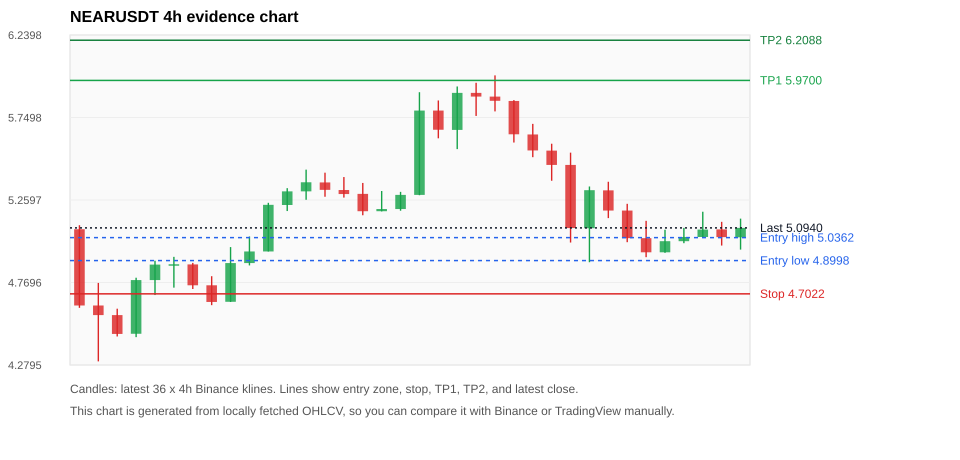
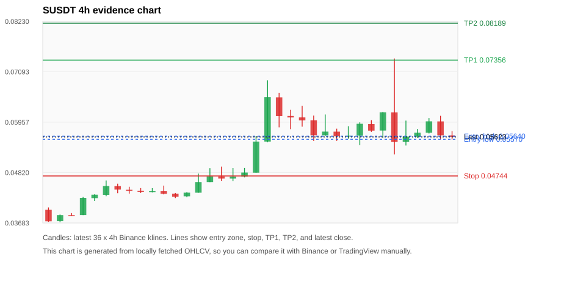
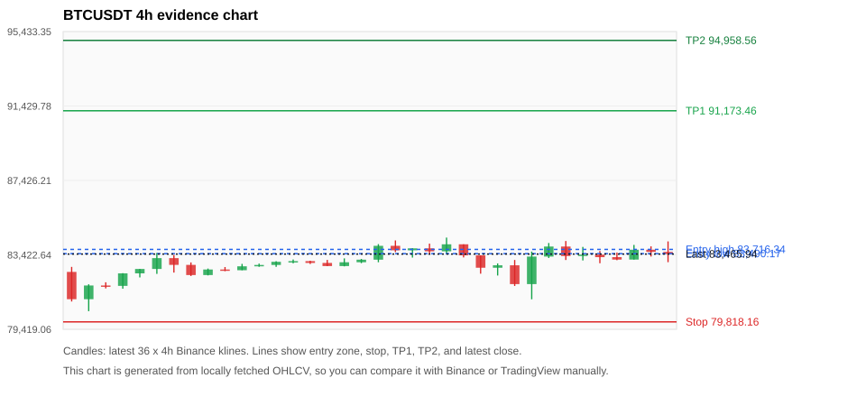
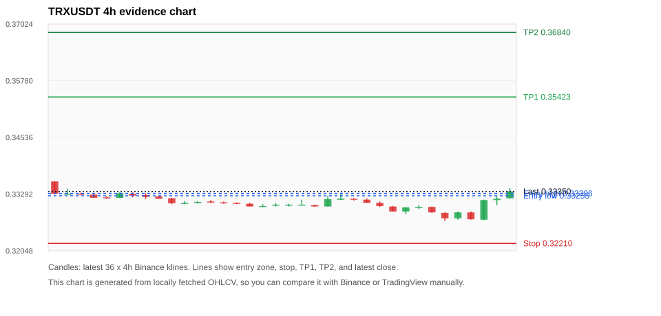
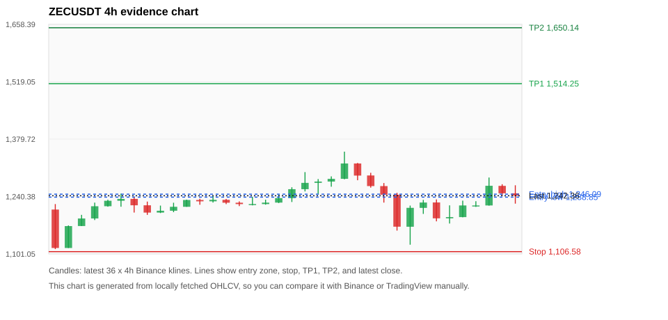

# Crypto 市场扫描报告 v1

- 报告时间：2026-10-14 20:06:38 CST
- Run ID：`20261014_120503_fe80c154`
- Run type：`daily_full`
- Data validation mode：`paper`
- 数据来源：SQLite
- 报告版本：v1
- 扫描 ID：c14fe672d2ee
- 数据源：Binance public spot API + CoinGecko/CoinMarketCap cross-check
- 过滤条件：USDT spot; 24h quote volume >= 30,000,000; trades >= 30,000; exclude stables/leveraged tokens; analyze 1h/4h/1d klines
- 默认单笔风险：账户权益的 1.00%

## 限制说明

- 交易信号仍以 Binance 现货公开 K 线为主源；外部数据源用于一致性复核。
- 结果是研究和模拟盘计划，不是确定收益或实盘下单指令。
- 历史长度过滤：候选币至少需要 180 根 1d K 线。
- 数据质量验证池：先验证 score 排名前 min(top_n * 2, 10) 的候选，再按 action + score 补足最终名单。
- 指标截止：2026-10-14T12:05:09.218000+00:00；仅使用此前至少60秒已闭合K线，ticker为扫描时点观测。
- 大盘环境过滤：RISK_OFF; BTC/ETH 大盘偏弱，山寨币买入候选降级为观察。 BTC 7d=-2.7830881918898043; ETH 7d=-7.397247070424728.
- Data cross-validation enabled: Binance primary source plus CoinGecko; CoinMarketCap is checked when an API key is configured.
- SUSDT validation state BLOCKED: BLOCKED: [BINANCE_KLINE_EXTREME_RANGE] Binance candle range exceeds 40%.; [BINANCE_KLINE_EXTREME_RANGE] Binance candle range exceeds 40%.; [BINANCE_KLINE_EXTREME_RANGE] Binance candle range exceeds 40%.; [EXTERNAL_IDENTITY_NOT_FOUND] CoinGecko could not map symbol S to a unique coin id; [EXTERNAL_IDENTITY_AMBIGUOUS] CoinMarketCap symbol mapping has 5 matches; selected lowest cmc_rank
- BTCUSDT validation state DEGRADED: DEGRADED: [EXTERNAL_IDENTITY_AMBIGUOUS] CoinMarketCap symbol mapping has 13 matches; selected lowest cmc_rank
- TRXUSDT validation state DEGRADED: DEGRADED: [EXTERNAL_PROVIDER_RATE_LIMITED] Provider rate limited request for https://api.coingecko.com/api/v3/coins/markets?vs_currency=usd&ids=tron&price_change_percentage=24h&per_page=1&page=1: HTTP 429
- ZECUSDT validation state BLOCKED: BLOCKED: [BINANCE_KLINE_EXTREME_RANGE] Binance candle range exceeds 40%.; [BINANCE_KLINE_EXTREME_RANGE] Binance candle range exceeds 40%.; [EXTERNAL_PROVIDER_RATE_LIMITED] Provider rate limited request for https://api.coingecko.com/api/v3/coins/markets?vs_currency=usd&ids=zcash&price_change_percentage=24h&per_page=1&page=1: HTTP 429; [EXTERNAL_IDENTITY_AMBIGUOUS] CoinMarketCap symbol mapping has 2 matches; selected lowest cmc_rank
- NEARUSDT validation state DEGRADED: DEGRADED: [EXTERNAL_PROVIDER_RATE_LIMITED] Provider rate limited request for https://api.coingecko.com/api/v3/coins/markets?vs_currency=usd&ids=near&price_change_percentage=24h&per_page=1&page=1: HTTP 429
- ETHUSDT validation state DEGRADED: DEGRADED: [EXTERNAL_PROVIDER_RATE_LIMITED] Provider rate limited request for https://api.coingecko.com/api/v3/coins/markets?vs_currency=usd&ids=ethereum&price_change_percentage=24h&per_page=1&page=1: HTTP 429; [EXTERNAL_IDENTITY_AMBIGUOUS] CoinMarketCap symbol mapping has 6 matches; selected lowest cmc_rank
- BNBUSDT validation state DEGRADED: DEGRADED: [EXTERNAL_PROVIDER_RATE_LIMITED] Provider rate limited request for https://api.coingecko.com/api/v3/coins/markets?vs_currency=usd&ids=binancecoin&price_change_percentage=24h&per_page=1&page=1: HTTP 429; [EXTERNAL_IDENTITY_AMBIGUOUS] CoinMarketCap symbol mapping has 4 matches; selected lowest cmc_rank
- XRPUSDT validation state DEGRADED: DEGRADED: [EXTERNAL_PROVIDER_RATE_LIMITED] Provider rate limited request for https://api.coingecko.com/api/v3/coins/markets?vs_currency=usd&ids=ripple&price_change_percentage=24h&per_page=1&page=1: HTTP 429; [EXTERNAL_IDENTITY_AMBIGUOUS] CoinMarketCap symbol mapping has 3 matches; selected lowest cmc_rank
- SOLUSDT validation state DEGRADED: DEGRADED: [EXTERNAL_PROVIDER_RATE_LIMITED] Provider rate limited request for https://api.coingecko.com/api/v3/coins/markets?vs_currency=usd&ids=solana&price_change_percentage=24h&per_page=1&page=1: HTTP 429; [EXTERNAL_IDENTITY_AMBIGUOUS] CoinMarketCap symbol mapping has 8 matches; selected lowest cmc_rank
- DOGEUSDT validation state DEGRADED: DEGRADED: [EXTERNAL_PROVIDER_RATE_LIMITED] Provider rate limited request for https://api.coingecko.com/api/v3/coins/markets?vs_currency=usd&ids=dogecoin&price_change_percentage=24h&per_page=1&page=1: HTTP 429; [EXTERNAL_IDENTITY_AMBIGUOUS] CoinMarketCap symbol mapping has 23 matches; selected lowest cmc_rank

## 5 个候选交易计划

| Rank | Coin | Action | Setup | Entry Zone | Stop Loss | TP1 | TP2 / Exit Rule | R/R | Verdict |
|---:|---|---|---|---:|---:|---:|---|---:|---|
| 1 | `NEAR` | `WAIT_PULLBACK` | 趋势中，等回调入场 | 4.8998 - 5.0362 | 4.7022 | 5.9700 | 6.2088 或跌破 4h 关键支撑 | 3.77-4.67 | 只观察 |
| 2 | `S` | `WATCH_ONLY` | 回踩支撑/4h EMA 附近 | 0.05570 - 0.05640 | 0.04744 | 0.07356 | 0.08189 或跌破 4h 关键支撑 | 2.03-3.00 | 只观察 |
| 3 | `BTC` | `WATCH_ONLY` | 回踩支撑/4h EMA 附近 | 83,490.17 - 83,716.34 | 79,818.16 | 91,173.46 | 94,958.56 或跌破 4h 关键支撑 | 2.00-3.00 | 只观察 |
| 4 | `TRX` | `WATCH_ONLY` | 回踩支撑/4h EMA 附近 | 0.33255 - 0.33306 | 0.32210 | 0.35423 | 0.36840 或跌破 4h 关键支撑 | 2.00-3.32 | 只观察 |
| 5 | `ZEC` | `REJECT` | 回踩支撑/4h EMA 附近 | 1,238.85 - 1,246.09 | 1,106.58 | 1,514.25 | 1,650.14 或跌破 4h 关键支撑 | 2.00-3.00 | 只观察 |

## 数据交叉验证摘要

价格差异以 Binance 当前价为基准；成交量口径不同，Binance 是 USDT 现货成交额，CoinGecko/CoinMarketCap 通常是全市场成交量。

| Rank | Coin | State | Identity | Max Price Diff | Max 24h Diff | Issue Codes | Message |
|---:|---|---|---|---:|---:|---|---|
| 1 | `NEAR` | DEGRADED (DATA_WARNING) | UNCONFIRMED | 0.14% | 0.23 pts | EXTERNAL_PROVIDER_RATE_LIMITED | DEGRADED: [EXTERNAL_PROVIDER_RATE_LIMITED] Provider rate limited request for https://api.coingecko.com/api/v3/coins/markets?vs_currency=usd&ids=near&price_change_percentage=24h&per_page=1&page=1: HTTP 429 |
| 2 | `S` | BLOCKED (DATA_ERROR) | UNCONFIRMED | 0.12% | 0.04 pts | BINANCE_KLINE_EXTREME_RANGE, EXTERNAL_IDENTITY_AMBIGUOUS, EXTERNAL_IDENTITY_NOT_FOUND | BLOCKED: [BINANCE_KLINE_EXTREME_RANGE] Binance candle range exceeds 40%.; [BINANCE_KLINE_EXTREME_RANGE] Binance candle range exceeds 40%.; [BINANCE_KLINE_EXTREME_RANGE] Binance candle range exceeds 40%.; [EXTERNAL_IDENTITY_NOT_FOUND] CoinGecko could not map symbol S to a unique coin id; [EXTERNAL_IDENTITY_AMBIGUOUS] CoinMarketCap symbol mapping has 5 matches; selected lowest cmc_rank |
| 3 | `BTC` | DEGRADED (DATA_WARNING) | UNCONFIRMED | 0.02% | 0.08 pts | EXTERNAL_IDENTITY_AMBIGUOUS | DEGRADED: [EXTERNAL_IDENTITY_AMBIGUOUS] CoinMarketCap symbol mapping has 13 matches; selected lowest cmc_rank |
| 4 | `TRX` | DEGRADED (DATA_WARNING) | UNCONFIRMED | 0.01% | 0.03 pts | EXTERNAL_PROVIDER_RATE_LIMITED | DEGRADED: [EXTERNAL_PROVIDER_RATE_LIMITED] Provider rate limited request for https://api.coingecko.com/api/v3/coins/markets?vs_currency=usd&ids=tron&price_change_percentage=24h&per_page=1&page=1: HTTP 429 |
| 5 | `ZEC` | BLOCKED (DATA_ERROR) | UNCONFIRMED | 0.13% | 0.44 pts | BINANCE_KLINE_EXTREME_RANGE, EXTERNAL_IDENTITY_AMBIGUOUS, EXTERNAL_PROVIDER_RATE_LIMITED | BLOCKED: [BINANCE_KLINE_EXTREME_RANGE] Binance candle range exceeds 40%.; [BINANCE_KLINE_EXTREME_RANGE] Binance candle range exceeds 40%.; [EXTERNAL_PROVIDER_RATE_LIMITED] Provider rate limited request for https://api.coingecko.com/api/v3/coins/markets?vs_currency=usd&ids=zcash&price_change_percentage=24h&per_page=1&page=1: HTTP 429; [EXTERNAL_IDENTITY_AMBIGUOUS] CoinMarketCap symbol mapping has 2 matches; selected lowest cmc_rank |

## 候选币说明

### 1. NEAR `NEARUSDT`



- 入选原因：趋势中，等回调入场；24h +1.79%，7d +0.45%，4h RSI 25.78，24h 成交额 $159.6M。
- 交易失效条件：跌破 4.7021829 或 4h 收盘重新失守关键支撑。
- 主要风险：BTC/ETH 大盘环境未确认强势，山寨币买入信号降级；External validation is degraded; this candidate is not a clean data sample.；Paper mode allows degraded validation; candidate is excluded from clean-data samples.。
- 数据交叉验证：DEGRADED / DATA_WARNING；身份=UNCONFIRMED；DEGRADED: [EXTERNAL_PROVIDER_RATE_LIMITED] Provider rate limited request for https://api.coingecko.com/api/v3/coins/markets?vs_currency=usd&ids=near&price_change_percentage=24h&per_page=1&page=1: HTTP 429

#### 可点击人工验证

- [Binance 交易页](https://www.binance.com/en/trade/NEAR_USDT)
- [TradingView 图表](https://www.tradingview.com/chart/?symbol=BINANCE%3ANEARUSDT)
- [CoinGecko 搜索](https://www.coingecko.com/en/search?query=NEAR)
- [CoinMarketCap 搜索](https://coinmarketcap.com/search/?q=NEAR)

#### 多数据源对照

| Source | Status | Identity | Blocking | Asset ID | Price | 24h Change | 24h Volume | Price Diff | 24h Diff | Updated | Issue Codes | Message |
|---|---|---|---:|---|---:|---:|---:|---:|---:|---|---|---|
| Binance | DATA_OK | CONFIRMED | no | NEARUSDT | 5.0940 | +1.79% | $159.6M | 0.00% | 0.00 pts | 2026-10-14T12:05:37+00:00 | none | Primary market data source passed health checks. |
| CoinGecko | DATA_WARNING | UNCONFIRMED | no | n/a | n/a | n/a | n/a | n/a | n/a | 2026-10-14T12:05:37+00:00 | EXTERNAL_PROVIDER_RATE_LIMITED | Provider rate limited request for https://api.coingecko.com/api/v3/coins/markets?vs_currency=usd&ids=near&price_change_percentage=24h&per_page=1&page=1: HTTP 429 |
| CoinMarketCap | DATA_OK | CONFIRMED | no | 6535 | 5.1012 | +1.56% | $1.09B | 0.14% | 0.23 pts | 2026-10-14T12:04:04.000Z | none | External source agrees with Binance within thresholds. |

#### 指标证据

| 指标 | 数值 | 人工核对用途 |
|---|---:|---|
| 当前价 | 5.0940 | 与 Binance/TradingView 当前价格对照 |
| 24h 涨跌 | +1.79% | 与交易所 24h 涨跌对照 |
| 7d 涨跌 | +0.45% | 判断短线趋势是否延续 |
| 4h EMA20 | 5.2069 | 判断短期趋势支撑 |
| 4h EMA50 | 5.1784 | 判断中期趋势支撑 |
| 1d EMA20 | 4.8266 | 判断日线趋势 |
| 1d EMA50 | 3.9160 | 判断日线趋势 |
| 4h RSI14 | 25.78 | 判断是否过热/过弱 |
| 4h ATR14 | 0.23114 | 推导止损和入场缓冲 |
| 最近 18 根 4h 最低点 | 4.8900 | 支撑/止损参考 |
| 最近 36 根 4h 最高点 | 6.0000 | TP/压力参考 |
| 支撑位 | 4.8900 | 入场区间推导基础 |

#### 交易计划推导

- 支撑位 = 最近低点、4h EMA20、4h EMA50、1d EMA20 中不高于当前价的最高有效支撑 = `4.8900`。
- 入场区间 = 支撑位附近 + ATR 缓冲 = `4.8998 - 5.0362`。
- 止损 = min(最近 18 根 4h 最低点 * 0.985, 入场中位价 - 1.15 * ATR14) = `4.7022`。
- TP1 = max(最近 36 根 4h 最高点 * 0.995, 入场中位价 + 2R) = `5.9700`。
- TP2 = max(入场中位价 + 3R, TP1 * 1.04) = `6.2088`。

#### 最近 10 根 4h K线

| UTC 开盘时间 | Open | High | Low | Close | Quote Volume | Trades |
|---|---:|---:|---:|---:|---:|---:|
| 2026-10-12T20:00+00:00 | 5.4680 | 5.5410 | 5.0070 | 5.0930 | $57.6M | 224877 |
| 2026-10-13T00:00+00:00 | 5.0920 | 5.3400 | 4.8900 | 5.3180 | $63.8M | 259211 |
| 2026-10-13T04:00+00:00 | 5.3170 | 5.3680 | 5.1520 | 5.1970 | $31.7M | 104076 |
| 2026-10-13T08:00+00:00 | 5.1970 | 5.2370 | 5.0090 | 5.0330 | $35.2M | 136723 |
| 2026-10-13T12:00+00:00 | 5.0330 | 5.1360 | 4.9200 | 4.9490 | $57.3M | 243905 |
| 2026-10-13T16:00+00:00 | 4.9490 | 5.0830 | 4.9460 | 5.0150 | $33.3M | 103594 |
| 2026-10-13T20:00+00:00 | 5.0150 | 5.0940 | 5.0030 | 5.0400 | $13.3M | 56367 |
| 2026-10-14T00:00+00:00 | 5.0400 | 5.1900 | 5.0350 | 5.0840 | $21.9M | 102330 |
| 2026-10-14T04:00+00:00 | 5.0850 | 5.1300 | 4.9890 | 5.0390 | $17.6M | 75276 |
| 2026-10-14T08:00+00:00 | 5.0380 | 5.1490 | 4.9650 | 5.0940 | $16.3M | 75399 |

### 2. S `SUSDT`



- 入选原因：回踩支撑/4h EMA 附近；24h -7.46%，7d +41.96%，4h RSI 42.47，24h 成交额 $33.2M。
- 交易失效条件：跌破 0.0474376 或 4h 收盘重新失守关键支撑。
- 主要风险：24h 振幅较大，回撤风险高；BTC/ETH 大盘环境未确认强势，山寨币买入信号降级；24h 动量未确认；Blocking data-quality issue detected; paper plan creation is not allowed.。
- 数据交叉验证：BLOCKED / DATA_ERROR；身份=UNCONFIRMED；BLOCKED: [BINANCE_KLINE_EXTREME_RANGE] Binance candle range exceeds 40%.; [BINANCE_KLINE_EXTREME_RANGE] Binance candle range exceeds 40%.; [BINANCE_KLINE_EXTREME_RANGE] Binance candle range exceeds 40%.; [EXTERNAL_IDENTITY_NOT_FOUND] CoinGecko could not map symbol S to a unique coin id; [EXTERNAL_IDENTITY_AMBIGUOUS] CoinMarketCap symbol mapping has 5 matches; selected lowest cmc_rank

#### 可点击人工验证

- [Binance 交易页](https://www.binance.com/en/trade/S_USDT)
- [TradingView 图表](https://www.tradingview.com/chart/?symbol=BINANCE%3ASUSDT)
- [CoinGecko 搜索](https://www.coingecko.com/en/search?query=S)
- [CoinMarketCap 搜索](https://coinmarketcap.com/search/?q=S)

#### 多数据源对照

| Source | Status | Identity | Blocking | Asset ID | Price | 24h Change | 24h Volume | Price Diff | 24h Diff | Updated | Issue Codes | Message |
|---|---|---|---:|---|---:|---:|---:|---:|---:|---|---|---|
| Binance | DATA_ERROR | CONFIRMED | yes | SUSDT | 0.05623 | -7.46% | $33.2M | 0.00% | 0.00 pts | 2026-10-14T12:05:37+00:00 | BINANCE_KLINE_EXTREME_RANGE | [BINANCE_KLINE_EXTREME_RANGE] Binance candle range exceeds 40%.; [BINANCE_KLINE_EXTREME_RANGE] Binance candle range exceeds 40%.; [BINANCE_KLINE_EXTREME_RANGE] Binance candle range exceeds 40%. |
| CoinGecko | DATA_ERROR | UNCONFIRMED | yes | n/a | n/a | n/a | n/a | n/a | n/a | 2026-10-14T12:05:37+00:00 | EXTERNAL_IDENTITY_NOT_FOUND | CoinGecko could not map symbol S to a unique coin id |
| CoinMarketCap | DATA_WARNING | UNCONFIRMED | no | 32684 | 0.05630 | -7.50% | $180.4M | 0.12% | 0.04 pts | 2026-10-14T12:04:04.000Z | EXTERNAL_IDENTITY_AMBIGUOUS | [EXTERNAL_IDENTITY_AMBIGUOUS] CoinMarketCap symbol mapping has 5 matches; selected lowest cmc_rank |

#### 指标证据

| 指标 | 数值 | 人工核对用途 |
|---|---:|---|
| 当前价 | 0.05623 | 与 Binance/TradingView 当前价格对照 |
| 24h 涨跌 | -7.46% | 与交易所 24h 涨跌对照 |
| 7d 涨跌 | +41.96% | 判断短线趋势是否延续 |
| 4h EMA20 | 0.05559 | 判断短期趋势支撑 |
| 4h EMA50 | 0.05054 | 判断中期趋势支撑 |
| 1d EMA20 | 0.04476 | 判断日线趋势 |
| 1d EMA50 | 0.03785 | 判断日线趋势 |
| 4h RSI14 | 42.47 | 判断是否过热/过弱 |
| 4h ATR14 | 0.0053128571 | 推导止损和入场缓冲 |
| 最近 18 根 4h 最低点 | 0.04816 | 支撑/止损参考 |
| 最近 36 根 4h 最高点 | 0.07393 | TP/压力参考 |
| 支撑位 | 0.05559 | 入场区间推导基础 |

#### 交易计划推导

- 支撑位 = 最近低点、4h EMA20、4h EMA50、1d EMA20 中不高于当前价的最高有效支撑 = `0.05559`。
- 入场区间 = 支撑位附近 + ATR 缓冲 = `0.05570 - 0.05640`。
- 止损 = min(最近 18 根 4h 最低点 * 0.985, 入场中位价 - 1.15 * ATR14) = `0.04744`。
- TP1 = max(最近 36 根 4h 最高点 * 0.995, 入场中位价 + 2R) = `0.07356`。
- TP2 = max(入场中位价 + 3R, TP1 * 1.04) = `0.08189`。

#### 最近 10 根 4h K线

| UTC 开盘时间 | Open | High | Low | Close | Quote Volume | Trades |
|---|---:|---:|---:|---:|---:|---:|
| 2026-10-12T20:00+00:00 | 0.05640 | 0.05866 | 0.05585 | 0.05654 | $1.4M | 19684 |
| 2026-10-13T00:00+00:00 | 0.05656 | 0.05954 | 0.05442 | 0.05921 | $1.8M | 25830 |
| 2026-10-13T04:00+00:00 | 0.05916 | 0.06000 | 0.05738 | 0.05766 | $969,009 | 16330 |
| 2026-10-13T08:00+00:00 | 0.05768 | 0.06189 | 0.05604 | 0.06178 | $2.8M | 36810 |
| 2026-10-13T12:00+00:00 | 0.06176 | 0.07393 | 0.05231 | 0.05514 | $23.2M | 289101 |
| 2026-10-13T16:00+00:00 | 0.05516 | 0.05992 | 0.05430 | 0.05633 | $4.7M | 68550 |
| 2026-10-13T20:00+00:00 | 0.05630 | 0.05803 | 0.05599 | 0.05719 | $1.2M | 21149 |
| 2026-10-14T00:00+00:00 | 0.05718 | 0.06050 | 0.05702 | 0.05976 | $1.5M | 24439 |
| 2026-10-14T04:00+00:00 | 0.05974 | 0.06100 | 0.05575 | 0.05660 | $2.0M | 34487 |
| 2026-10-14T08:00+00:00 | 0.05659 | 0.05754 | 0.05565 | 0.05623 | $1.0M | 16733 |

### 3. BTC `BTCUSDT`



- 入选原因：回踩支撑/4h EMA 附近；24h +0.40%，7d -0.03%，4h RSI 48.85，24h 成交额 $1.01B。
- 交易失效条件：跌破 79818.155 或 4h 收盘重新失守关键支撑。
- 主要风险：BTC/ETH 大盘环境未确认强势，山寨币买入信号降级；7d 趋势未确认；External validation is degraded; this candidate is not a clean data sample.；Paper mode allows degraded validation; candidate is excluded from clean-data samples.。
- 数据交叉验证：DEGRADED / DATA_WARNING；身份=UNCONFIRMED；DEGRADED: [EXTERNAL_IDENTITY_AMBIGUOUS] CoinMarketCap symbol mapping has 13 matches; selected lowest cmc_rank

#### 可点击人工验证

- [Binance 交易页](https://www.binance.com/en/trade/BTC_USDT)
- [TradingView 图表](https://www.tradingview.com/chart/?symbol=BINANCE%3ABTCUSDT)
- [CoinGecko 搜索](https://www.coingecko.com/en/search?query=BTC)
- [CoinMarketCap 搜索](https://coinmarketcap.com/search/?q=BTC)

#### 多数据源对照

| Source | Status | Identity | Blocking | Asset ID | Price | 24h Change | 24h Volume | Price Diff | 24h Diff | Updated | Issue Codes | Message |
|---|---|---|---:|---|---:|---:|---:|---:|---:|---|---|---|
| Binance | DATA_OK | CONFIRMED | no | BTCUSDT | 83,465.94 | +0.40% | $1.01B | 0.00% | 0.00 pts | 2026-10-14T12:05:37+00:00 | none | Primary market data source passed health checks. |
| CoinGecko | DATA_OK | CONFIRMED | no | bitcoin | 83,482.00 | +0.32% | $26.22B | 0.02% | 0.08 pts | 2026-10-14T12:04:49.000Z | none | External source agrees with Binance within thresholds. |
| CoinMarketCap | DATA_WARNING | UNCONFIRMED | no | 1 | 83,480.38 | +0.37% | $24.85B | 0.02% | 0.02 pts | 2026-10-14T12:04:04.000Z | EXTERNAL_IDENTITY_AMBIGUOUS | [EXTERNAL_IDENTITY_AMBIGUOUS] CoinMarketCap symbol mapping has 13 matches; selected lowest cmc_rank |

#### 指标证据

| 指标 | 数值 | 人工核对用途 |
|---|---:|---|
| 当前价 | 83,465.94 | 与 Binance/TradingView 当前价格对照 |
| 24h 涨跌 | +0.40% | 与交易所 24h 涨跌对照 |
| 7d 涨跌 | -0.03% | 判断短线趋势是否延续 |
| 4h EMA20 | 83,323.53 | 判断短期趋势支撑 |
| 4h EMA50 | 83,475.12 | 判断中期趋势支撑 |
| 1d EMA20 | 83,159.97 | 判断日线趋势 |
| 1d EMA50 | 80,254.69 | 判断日线趋势 |
| 4h RSI14 | 48.85 | 判断是否过热/过弱 |
| 4h ATR14 | 945.26 | 推导止损和入场缓冲 |
| 最近 18 根 4h 最低点 | 81,033.66 | 支撑/止损参考 |
| 最近 36 根 4h 最高点 | 84,352.00 | TP/压力参考 |
| 支撑位 | 83,323.53 | 入场区间推导基础 |

#### 交易计划推导

- 支撑位 = 最近低点、4h EMA20、4h EMA50、1d EMA20 中不高于当前价的最高有效支撑 = `83,323.53`。
- 入场区间 = 支撑位附近 + ATR 缓冲 = `83,490.17 - 83,716.34`。
- 止损 = min(最近 18 根 4h 最低点 * 0.985, 入场中位价 - 1.15 * ATR14) = `79,818.16`。
- TP1 = max(最近 36 根 4h 最高点 * 0.995, 入场中位价 + 2R) = `91,173.46`。
- TP2 = max(入场中位价 + 3R, TP1 * 1.04) = `94,958.56`。

#### 最近 10 根 4h K线

| UTC 开盘时间 | Open | High | Low | Close | Quote Volume | Trades |
|---|---:|---:|---:|---:|---:|---:|
| 2026-10-12T20:00+00:00 | 82,861.81 | 83,147.95 | 81,750.09 | 81,850.00 | $197.2M | 483347 |
| 2026-10-13T00:00+00:00 | 81,850.01 | 83,600.00 | 81,033.66 | 83,331.17 | $266.7M | 791485 |
| 2026-10-13T04:00+00:00 | 83,331.16 | 84,059.69 | 83,255.17 | 83,870.89 | $218.5M | 424730 |
| 2026-10-13T08:00+00:00 | 83,870.89 | 84,168.00 | 83,146.53 | 83,360.01 | $266.9M | 571471 |
| 2026-10-13T12:00+00:00 | 83,360.01 | 83,850.00 | 83,122.95 | 83,434.57 | $214.9M | 715495 |
| 2026-10-13T16:00+00:00 | 83,434.58 | 83,627.50 | 82,972.74 | 83,299.45 | $149.4M | 354480 |
| 2026-10-13T20:00+00:00 | 83,299.45 | 83,548.91 | 83,136.80 | 83,169.00 | $114.1M | 236670 |
| 2026-10-14T00:00+00:00 | 83,169.01 | 83,958.00 | 83,169.00 | 83,700.01 | $169.7M | 413318 |
| 2026-10-14T04:00+00:00 | 83,700.01 | 83,880.39 | 83,333.00 | 83,582.28 | $153.0M | 364534 |
| 2026-10-14T08:00+00:00 | 83,582.28 | 84,146.72 | 83,028.70 | 83,465.94 | $214.4M | 479608 |

### 4. TRX `TRXUSDT`



- 入选原因：回踩支撑/4h EMA 附近；24h +1.58%，7d -0.18%，4h RSI 55.56，24h 成交额 $52.5M。
- 交易失效条件：跌破 0.322095 或 4h 收盘重新失守关键支撑。
- 主要风险：日线趋势未完全确认；BTC/ETH 大盘环境未确认强势，山寨币买入信号降级；7d 趋势未确认；External validation is degraded; this candidate is not a clean data sample.；Paper mode allows degraded validation; candidate is excluded from clean-data samples.。
- 数据交叉验证：DEGRADED / DATA_WARNING；身份=UNCONFIRMED；DEGRADED: [EXTERNAL_PROVIDER_RATE_LIMITED] Provider rate limited request for https://api.coingecko.com/api/v3/coins/markets?vs_currency=usd&ids=tron&price_change_percentage=24h&per_page=1&page=1: HTTP 429

#### 可点击人工验证

- [Binance 交易页](https://www.binance.com/en/trade/TRX_USDT)
- [TradingView 图表](https://www.tradingview.com/chart/?symbol=BINANCE%3ATRXUSDT)
- [CoinGecko 搜索](https://www.coingecko.com/en/search?query=TRX)
- [CoinMarketCap 搜索](https://coinmarketcap.com/search/?q=TRX)

#### 多数据源对照

| Source | Status | Identity | Blocking | Asset ID | Price | 24h Change | 24h Volume | Price Diff | 24h Diff | Updated | Issue Codes | Message |
|---|---|---|---:|---|---:|---:|---:|---:|---:|---|---|---|
| Binance | DATA_OK | CONFIRMED | no | TRXUSDT | 0.33350 | +1.58% | $52.5M | 0.00% | 0.00 pts | 2026-10-14T12:05:37+00:00 | none | Primary market data source passed health checks. |
| CoinGecko | DATA_WARNING | UNCONFIRMED | no | n/a | n/a | n/a | n/a | n/a | n/a | 2026-10-14T12:05:37+00:00 | EXTERNAL_PROVIDER_RATE_LIMITED | Provider rate limited request for https://api.coingecko.com/api/v3/coins/markets?vs_currency=usd&ids=tron&price_change_percentage=24h&per_page=1&page=1: HTTP 429 |
| CoinMarketCap | DATA_OK | CONFIRMED | no | 1958 | 0.33348 | +1.55% | $631.0M | 0.01% | 0.03 pts | 2026-10-14T12:04:04.000Z | none | External source agrees with Binance within thresholds. |

#### 指标证据

| 指标 | 数值 | 人工核对用途 |
|---|---:|---|
| 当前价 | 0.33350 | 与 Binance/TradingView 当前价格对照 |
| 24h 涨跌 | +1.58% | 与交易所 24h 涨跌对照 |
| 7d 涨跌 | -0.18% | 判断短线趋势是否延续 |
| 4h EMA20 | 0.33067 | 判断短期趋势支撑 |
| 4h EMA50 | 0.33189 | 判断中期趋势支撑 |
| 1d EMA20 | 0.33352 | 判断日线趋势 |
| 1d EMA50 | 0.33463 | 判断日线趋势 |
| 4h RSI14 | 55.56 | 判断是否过热/过弱 |
| 4h ATR14 | 0.0016785714 | 推导止损和入场缓冲 |
| 最近 18 根 4h 最低点 | 0.32700 | 支撑/止损参考 |
| 最近 36 根 4h 最高点 | 0.33570 | TP/压力参考 |
| 支撑位 | 0.33189 | 入场区间推导基础 |

#### 交易计划推导

- 支撑位 = 最近低点、4h EMA20、4h EMA50、1d EMA20 中不高于当前价的最高有效支撑 = `0.33189`。
- 入场区间 = 支撑位附近 + ATR 缓冲 = `0.33255 - 0.33306`。
- 止损 = min(最近 18 根 4h 最低点 * 0.985, 入场中位价 - 1.15 * ATR14) = `0.32210`。
- TP1 = max(最近 36 根 4h 最高点 * 0.995, 入场中位价 + 2R) = `0.35423`。
- TP2 = max(入场中位价 + 3R, TP1 * 1.04) = `0.36840`。

#### 最近 10 根 4h K线

| UTC 开盘时间 | Open | High | Low | Close | Quote Volume | Trades |
|---|---:|---:|---:|---:|---:|---:|
| 2026-10-12T20:00+00:00 | 0.33020 | 0.33030 | 0.32910 | 0.32910 | $3.9M | 9662 |
| 2026-10-13T00:00+00:00 | 0.32910 | 0.33010 | 0.32850 | 0.33000 | $5.1M | 9597 |
| 2026-10-13T04:00+00:00 | 0.33000 | 0.33050 | 0.32960 | 0.33010 | $3.1M | 7532 |
| 2026-10-13T08:00+00:00 | 0.33010 | 0.33020 | 0.32880 | 0.32890 | $5.2M | 9726 |
| 2026-10-13T12:00+00:00 | 0.32880 | 0.32890 | 0.32700 | 0.32760 | $9.1M | 14048 |
| 2026-10-13T16:00+00:00 | 0.32760 | 0.32910 | 0.32730 | 0.32890 | $3.8M | 8508 |
| 2026-10-13T20:00+00:00 | 0.32890 | 0.32910 | 0.32730 | 0.32740 | $4.0M | 8323 |
| 2026-10-14T00:00+00:00 | 0.32730 | 0.33170 | 0.32720 | 0.33160 | $11.3M | 9637 |
| 2026-10-14T04:00+00:00 | 0.33160 | 0.33240 | 0.33050 | 0.33190 | $10.0M | 13352 |
| 2026-10-14T08:00+00:00 | 0.33200 | 0.33420 | 0.33190 | 0.33350 | $14.2M | 21769 |

### 5. ZEC `ZECUSDT`



- 入选原因：回踩支撑/4h EMA 附近；24h +5.38%，7d -5.76%，4h RSI 44.77，24h 成交额 $190.8M。
- 交易失效条件：跌破 1106.5785 或 4h 收盘重新失守关键支撑。
- 主要风险：日线趋势未完全确认；BTC/ETH 大盘环境未确认强势，山寨币买入信号降级；7d 趋势未确认；Blocking data-quality issue detected; paper plan creation is not allowed.。
- 数据交叉验证：BLOCKED / DATA_ERROR；身份=UNCONFIRMED；BLOCKED: [BINANCE_KLINE_EXTREME_RANGE] Binance candle range exceeds 40%.; [BINANCE_KLINE_EXTREME_RANGE] Binance candle range exceeds 40%.; [EXTERNAL_PROVIDER_RATE_LIMITED] Provider rate limited request for https://api.coingecko.com/api/v3/coins/markets?vs_currency=usd&ids=zcash&price_change_percentage=24h&per_page=1&page=1: HTTP 429; [EXTERNAL_IDENTITY_AMBIGUOUS] CoinMarketCap symbol mapping has 2 matches; selected lowest cmc_rank

#### 可点击人工验证

- [Binance 交易页](https://www.binance.com/en/trade/ZEC_USDT)
- [TradingView 图表](https://www.tradingview.com/chart/?symbol=BINANCE%3AZECUSDT)
- [CoinGecko 搜索](https://www.coingecko.com/en/search?query=ZEC)
- [CoinMarketCap 搜索](https://coinmarketcap.com/search/?q=ZEC)

#### 多数据源对照

| Source | Status | Identity | Blocking | Asset ID | Price | 24h Change | 24h Volume | Price Diff | 24h Diff | Updated | Issue Codes | Message |
|---|---|---|---:|---|---:|---:|---:|---:|---:|---|---|---|
| Binance | DATA_ERROR | CONFIRMED | yes | ZECUSDT | 1,242.36 | +5.38% | $190.8M | 0.00% | 0.00 pts | 2026-10-14T12:05:37+00:00 | BINANCE_KLINE_EXTREME_RANGE | [BINANCE_KLINE_EXTREME_RANGE] Binance candle range exceeds 40%.; [BINANCE_KLINE_EXTREME_RANGE] Binance candle range exceeds 40%. |
| CoinGecko | DATA_WARNING | UNCONFIRMED | no | n/a | n/a | n/a | n/a | n/a | n/a | 2026-10-14T12:05:37+00:00 | EXTERNAL_PROVIDER_RATE_LIMITED | Provider rate limited request for https://api.coingecko.com/api/v3/coins/markets?vs_currency=usd&ids=zcash&price_change_percentage=24h&per_page=1&page=1: HTTP 429 |
| CoinMarketCap | DATA_WARNING | UNCONFIRMED | no | 1437 | 1,243.98 | +4.94% | $966.9M | 0.13% | 0.44 pts | 2026-10-14T12:04:04.000Z | EXTERNAL_IDENTITY_AMBIGUOUS | [EXTERNAL_IDENTITY_AMBIGUOUS] CoinMarketCap symbol mapping has 2 matches; selected lowest cmc_rank |

#### 指标证据

| 指标 | 数值 | 人工核对用途 |
|---|---:|---|
| 当前价 | 1,242.36 | 与 Binance/TradingView 当前价格对照 |
| 24h 涨跌 | +5.38% | 与交易所 24h 涨跌对照 |
| 7d 涨跌 | -5.76% | 判断短线趋势是否延续 |
| 4h EMA20 | 1,236.38 | 判断短期趋势支撑 |
| 4h EMA50 | 1,262.79 | 判断中期趋势支撑 |
| 1d EMA20 | 1,297.86 | 判断日线趋势 |
| 1d EMA50 | 1,189.75 | 判断日线趋势 |
| 4h RSI14 | 44.77 | 判断是否过热/过弱 |
| 4h ATR14 | 50.4371 | 推导止损和入场缓冲 |
| 最近 18 根 4h 最低点 | 1,123.43 | 支撑/止损参考 |
| 最近 36 根 4h 最高点 | 1,349.30 | TP/压力参考 |
| 支撑位 | 1,236.38 | 入场区间推导基础 |

#### 交易计划推导

- 支撑位 = 最近低点、4h EMA20、4h EMA50、1d EMA20 中不高于当前价的最高有效支撑 = `1,236.38`。
- 入场区间 = 支撑位附近 + ATR 缓冲 = `1,238.85 - 1,246.09`。
- 止损 = min(最近 18 根 4h 最低点 * 0.985, 入场中位价 - 1.15 * ATR14) = `1,106.58`。
- TP1 = max(最近 36 根 4h 最高点 * 0.995, 入场中位价 + 2R) = `1,514.25`。
- TP2 = max(入场中位价 + 3R, TP1 * 1.04) = `1,650.14`。

#### 最近 10 根 4h K线

| UTC 开盘时间 | Open | High | Low | Close | Quote Volume | Trades |
|---|---:|---:|---:|---:|---:|---:|
| 2026-10-12T20:00+00:00 | 1,244.69 | 1,249.37 | 1,157.65 | 1,167.15 | $32.6M | 96304 |
| 2026-10-13T00:00+00:00 | 1,167.02 | 1,218.43 | 1,123.43 | 1,212.91 | $62.8M | 198949 |
| 2026-10-13T04:00+00:00 | 1,212.80 | 1,232.18 | 1,198.20 | 1,225.80 | $25.6M | 63445 |
| 2026-10-13T08:00+00:00 | 1,226.00 | 1,233.37 | 1,180.13 | 1,187.45 | $34.3M | 84721 |
| 2026-10-13T12:00+00:00 | 1,187.45 | 1,218.94 | 1,174.80 | 1,190.39 | $33.2M | 104233 |
| 2026-10-13T16:00+00:00 | 1,190.40 | 1,230.39 | 1,189.92 | 1,218.71 | $20.8M | 63787 |
| 2026-10-13T20:00+00:00 | 1,218.71 | 1,228.99 | 1,215.21 | 1,218.71 | $7.9M | 24997 |
| 2026-10-14T00:00+00:00 | 1,218.70 | 1,286.54 | 1,218.20 | 1,266.45 | $57.1M | 151267 |
| 2026-10-14T04:00+00:00 | 1,266.23 | 1,270.21 | 1,241.82 | 1,248.20 | $27.9M | 72900 |
| 2026-10-14T08:00+00:00 | 1,248.16 | 1,267.68 | 1,223.08 | 1,242.36 | $44.6M | 105817 |

## 组合风控

- 不要 5 个候选全部满仓买入。
- 同时持仓总风险建议控制在账户权益的 3% - 5% 以内。
- 如果 BTC/ETH 同时破位，暂停山寨币多头计划或降低仓位。
- 第一版报告用于模拟盘和人工复核，不自动下单。

## 原始数据

```json
[
  {
    "rank": 1,
    "symbol": "NEARUSDT",
    "base_asset": "NEAR",
    "price": 5.094,
    "score": 14.320566096650268,
    "setup": "趋势中，等回调入场",
    "verdict": "只观察",
    "entry_low": 4.89978,
    "entry_high": 5.036214285714286,
    "stop_loss": 4.702182857142858,
    "take_profit_1": 5.97,
    "take_profit_2": 6.2088,
    "risk_reward_1": 3.7695598430698083,
    "risk_reward_2": 4.66793142365776,
    "pct_24h": 1.79,
    "pct_3d": -5.333581118751162,
    "pct_7d": 0.4535594557286693,
    "quote_volume_24h": 159614775.9566,
    "trades_24h": 656326,
    "high_low_range_24h": 5.487804878048785,
    "rsi_1h": 52.653927813163534,
    "rsi_4h": 25.77639751552796,
    "ema20_4h": 5.206885170948925,
    "ema50_4h": 5.178415653955066,
    "ema20_1d": 4.826558898885441,
    "ema50_1d": 3.9159697241912688,
    "atr_4h": 0.23114285714285732,
    "macd_hist_4h": -0.053977850472702725,
    "volume_ratio_24h": 0.7773744006378865,
    "support_level": 4.89,
    "recent_low_4h_18": 4.89,
    "recent_high_4h_36": 6.0,
    "distance_to_support_pct": 4.171779141104315,
    "binance_trade_url": "https://www.binance.com/en/trade/NEAR_USDT",
    "tradingview_url": "https://www.tradingview.com/chart/?symbol=BINANCE%3ANEARUSDT",
    "coingecko_search_url": "https://www.coingecko.com/en/search?query=NEAR",
    "coinmarketcap_search_url": "https://coinmarketcap.com/search/?q=NEAR",
    "invalidation": "跌破 4.7021829 或 4h 收盘重新失守关键支撑",
    "recent_4h_klines": [
      {
        "open_time_utc": "2026-10-08T12:00+00:00",
        "open": 5.086,
        "high": 5.11,
        "low": 4.619,
        "close": 4.633,
        "quote_volume": 76642546.7666,
        "trades": 254630
      },
      {
        "open_time_utc": "2026-10-08T16:00+00:00",
        "open": 4.633,
        "high": 4.767,
        "low": 4.301,
        "close": 4.576,
        "quote_volume": 76633839.4387,
        "trades": 309447
      },
      {
        "open_time_utc": "2026-10-08T20:00+00:00",
        "open": 4.576,
        "high": 4.614,
        "low": 4.449,
        "close": 4.464,
        "quote_volume": 21882135.7617,
        "trades": 94909
      },
      {
        "open_time_utc": "2026-10-09T00:00+00:00",
        "open": 4.465,
        "high": 4.798,
        "low": 4.445,
        "close": 4.784,
        "quote_volume": 35763386.9084,
        "trades": 144292
      },
      {
        "open_time_utc": "2026-10-09T04:00+00:00",
        "open": 4.784,
        "high": 4.899,
        "low": 4.695,
        "close": 4.876,
        "quote_volume": 27830389.7114,
        "trades": 105892
      },
      {
        "open_time_utc": "2026-10-09T08:00+00:00",
        "open": 4.875,
        "high": 4.922,
        "low": 4.739,
        "close": 4.878,
        "quote_volume": 19766528.1546,
        "trades": 84148
      },
      {
        "open_time_utc": "2026-10-09T12:00+00:00",
        "open": 4.877,
        "high": 4.886,
        "low": 4.731,
        "close": 4.753,
        "quote_volume": 16201243.4816,
        "trades": 82251
      },
      {
        "open_time_utc": "2026-10-09T16:00+00:00",
        "open": 4.753,
        "high": 4.807,
        "low": 4.635,
        "close": 4.654,
        "quote_volume": 17288935.126,
        "trades": 68771
      },
      {
        "open_time_utc": "2026-10-09T20:00+00:00",
        "open": 4.655,
        "high": 4.98,
        "low": 4.654,
        "close": 4.885,
        "quote_volume": 23758258.7552,
        "trades": 91923
      },
      {
        "open_time_utc": "2026-10-10T00:00+00:00",
        "open": 4.885,
        "high": 5.043,
        "low": 4.871,
        "close": 4.954,
        "quote_volume": 17369888.0452,
        "trades": 84641
      },
      {
        "open_time_utc": "2026-10-10T04:00+00:00",
        "open": 4.954,
        "high": 5.243,
        "low": 4.954,
        "close": 5.231,
        "quote_volume": 30968996.1186,
        "trades": 122665
      },
      {
        "open_time_utc": "2026-10-10T08:00+00:00",
        "open": 5.23,
        "high": 5.33,
        "low": 5.194,
        "close": 5.311,
        "quote_volume": 24496974.3681,
        "trades": 90681
      },
      {
        "open_time_utc": "2026-10-10T12:00+00:00",
        "open": 5.311,
        "high": 5.44,
        "low": 5.261,
        "close": 5.365,
        "quote_volume": 35154537.4862,
        "trades": 121139
      },
      {
        "open_time_utc": "2026-10-10T16:00+00:00",
        "open": 5.364,
        "high": 5.422,
        "low": 5.279,
        "close": 5.32,
        "quote_volume": 17154486.3437,
        "trades": 67920
      },
      {
        "open_time_utc": "2026-10-10T20:00+00:00",
        "open": 5.319,
        "high": 5.396,
        "low": 5.274,
        "close": 5.295,
        "quote_volume": 10780099.0527,
        "trades": 48350
      },
      {
        "open_time_utc": "2026-10-11T00:00+00:00",
        "open": 5.296,
        "high": 5.361,
        "low": 5.169,
        "close": 5.193,
        "quote_volume": 14849267.2924,
        "trades": 59871
      },
      {
        "open_time_utc": "2026-10-11T04:00+00:00",
        "open": 5.193,
        "high": 5.313,
        "low": 5.192,
        "close": 5.206,
        "quote_volume": 10436211.284,
        "trades": 48799
      },
      {
        "open_time_utc": "2026-10-11T08:00+00:00",
        "open": 5.206,
        "high": 5.308,
        "low": 5.196,
        "close": 5.29,
        "quote_volume": 9712496.5988,
        "trades": 48006
      },
      {
        "open_time_utc": "2026-10-11T12:00+00:00",
        "open": 5.29,
        "high": 5.9,
        "low": 5.288,
        "close": 5.791,
        "quote_volume": 62487007.7149,
        "trades": 198847
      },
      {
        "open_time_utc": "2026-10-11T16:00+00:00",
        "open": 5.791,
        "high": 5.851,
        "low": 5.626,
        "close": 5.677,
        "quote_volume": 50835901.8629,
        "trades": 180476
      },
      {
        "open_time_utc": "2026-10-11T20:00+00:00",
        "open": 5.676,
        "high": 5.934,
        "low": 5.562,
        "close": 5.896,
        "quote_volume": 27799966.102,
        "trades": 101739
      },
      {
        "open_time_utc": "2026-10-12T00:00+00:00",
        "open": 5.896,
        "high": 5.956,
        "low": 5.759,
        "close": 5.874,
        "quote_volume": 36359736.3453,
        "trades": 141218
      },
      {
        "open_time_utc": "2026-10-12T04:00+00:00",
        "open": 5.874,
        "high": 6.0,
        "low": 5.786,
        "close": 5.849,
        "quote_volume": 34934650.8875,
        "trades": 148564
      },
      {
        "open_time_utc": "2026-10-12T08:00+00:00",
        "open": 5.848,
        "high": 5.853,
        "low": 5.601,
        "close": 5.65,
        "quote_volume": 36213015.1504,
        "trades": 118745
      },
      {
        "open_time_utc": "2026-10-12T12:00+00:00",
        "open": 5.649,
        "high": 5.712,
        "low": 5.514,
        "close": 5.554,
        "quote_volume": 43647873.1829,
        "trades": 152203
      },
      {
        "open_time_utc": "2026-10-12T16:00+00:00",
        "open": 5.553,
        "high": 5.594,
        "low": 5.374,
        "close": 5.468,
        "quote_volume": 32737798.1105,
        "trades": 116278
      },
      {
        "open_time_utc": "2026-10-12T20:00+00:00",
        "open": 5.468,
        "high": 5.541,
        "low": 5.007,
        "close": 5.093,
        "quote_volume": 57617895.6358,
        "trades": 224877
      },
      {
        "open_time_utc": "2026-10-13T00:00+00:00",
        "open": 5.092,
        "high": 5.34,
        "low": 4.89,
        "close": 5.318,
        "quote_volume": 63836743.4048,
        "trades": 259211
      },
      {
        "open_time_utc": "2026-10-13T04:00+00:00",
        "open": 5.317,
        "high": 5.368,
        "low": 5.152,
        "close": 5.197,
        "quote_volume": 31687934.4309,
        "trades": 104076
      },
      {
        "open_time_utc": "2026-10-13T08:00+00:00",
        "open": 5.197,
        "high": 5.237,
        "low": 5.009,
        "close": 5.033,
        "quote_volume": 35224514.7197,
        "trades": 136723
      },
      {
        "open_time_utc": "2026-10-13T12:00+00:00",
        "open": 5.033,
        "high": 5.136,
        "low": 4.92,
        "close": 4.949,
        "quote_volume": 57333262.2037,
        "trades": 243905
      },
      {
        "open_time_utc": "2026-10-13T16:00+00:00",
        "open": 4.949,
        "high": 5.083,
        "low": 4.946,
        "close": 5.015,
        "quote_volume": 33324766.8506,
        "trades": 103594
      },
      {
        "open_time_utc": "2026-10-13T20:00+00:00",
        "open": 5.015,
        "high": 5.094,
        "low": 5.003,
        "close": 5.04,
        "quote_volume": 13343556.9398,
        "trades": 56367
      },
      {
        "open_time_utc": "2026-10-14T00:00+00:00",
        "open": 5.04,
        "high": 5.19,
        "low": 5.035,
        "close": 5.084,
        "quote_volume": 21853467.6333,
        "trades": 102330
      },
      {
        "open_time_utc": "2026-10-14T04:00+00:00",
        "open": 5.085,
        "high": 5.13,
        "low": 4.989,
        "close": 5.039,
        "quote_volume": 17613809.7748,
        "trades": 75276
      },
      {
        "open_time_utc": "2026-10-14T08:00+00:00",
        "open": 5.038,
        "high": 5.149,
        "low": 4.965,
        "close": 5.094,
        "quote_volume": 16314137.5742,
        "trades": 75399
      }
    ],
    "risks": [
      "BTC/ETH 大盘环境未确认强势，山寨币买入信号降级",
      "External validation is degraded; this candidate is not a clean data sample.",
      "Paper mode allows degraded validation; candidate is excluded from clean-data samples."
    ],
    "data_quality_status": "DATA_WARNING",
    "data_quality_message": "DEGRADED: [EXTERNAL_PROVIDER_RATE_LIMITED] Provider rate limited request for https://api.coingecko.com/api/v3/coins/markets?vs_currency=usd&ids=near&price_change_percentage=24h&per_page=1&page=1: HTTP 429",
    "data_checks": [
      {
        "provider": "Binance",
        "status": "DATA_OK",
        "provider_asset_id": "NEARUSDT",
        "provider_symbol": "NEARUSDT",
        "price_usd": 5.094,
        "pct_24h": 1.79,
        "volume_24h": 159614775.9566,
        "last_updated": null,
        "fetched_at_utc": "2026-10-14T12:05:37+00:00",
        "price_diff_pct": 0.0,
        "pct_24h_diff": 0.0,
        "volume_note": "Binance USDT spot 24h quoteVolume.",
        "message": "Primary market data source passed health checks.",
        "blocking": false,
        "identity_status": "CONFIRMED",
        "issues": []
      },
      {
        "provider": "CoinGecko",
        "status": "DATA_WARNING",
        "provider_asset_id": null,
        "provider_symbol": "NEAR",
        "price_usd": null,
        "pct_24h": null,
        "volume_24h": null,
        "last_updated": null,
        "fetched_at_utc": "2026-10-14T12:05:37+00:00",
        "price_diff_pct": null,
        "pct_24h_diff": null,
        "volume_note": "External provider data unavailable.",
        "message": "Provider rate limited request for https://api.coingecko.com/api/v3/coins/markets?vs_currency=usd&ids=near&price_change_percentage=24h&per_page=1&page=1: HTTP 429",
        "blocking": false,
        "identity_status": "UNCONFIRMED",
        "issues": [
          {
            "provider": "CoinGecko",
            "code": "EXTERNAL_PROVIDER_RATE_LIMITED",
            "severity": "WARNING",
            "blocking": false,
            "message": "Provider rate limited request for https://api.coingecko.com/api/v3/coins/markets?vs_currency=usd&ids=near&price_change_percentage=24h&per_page=1&page=1: HTTP 429",
            "context": {}
          }
        ]
      },
      {
        "provider": "CoinMarketCap",
        "status": "DATA_OK",
        "provider_asset_id": "6535",
        "provider_symbol": "NEAR",
        "price_usd": 5.101180560025174,
        "pct_24h": 1.56263511,
        "volume_24h": 1089378749.4464371,
        "last_updated": "2026-10-14T12:04:04.000Z",
        "fetched_at_utc": "2026-10-14T12:05:37+00:00",
        "price_diff_pct": 0.14096113123623388,
        "pct_24h_diff": 0.22736489000000004,
        "volume_note": "CoinMarketCap total market volume; not the same venue scope as Binance quoteVolume.",
        "message": "External source agrees with Binance within thresholds.",
        "blocking": false,
        "identity_status": "CONFIRMED",
        "issues": []
      }
    ],
    "action": "WAIT_PULLBACK",
    "data_quality_state": "DEGRADED",
    "data_quality_issues": [
      {
        "provider": "CoinGecko",
        "code": "EXTERNAL_PROVIDER_RATE_LIMITED",
        "severity": "WARNING",
        "blocking": false,
        "message": "Provider rate limited request for https://api.coingecko.com/api/v3/coins/markets?vs_currency=usd&ids=near&price_change_percentage=24h&per_page=1&page=1: HTTP 429",
        "context": {}
      }
    ],
    "external_identity_status": "UNCONFIRMED"
  },
  {
    "rank": 2,
    "symbol": "SUSDT",
    "base_asset": "S",
    "price": 0.05623,
    "score": 48.03858390767985,
    "setup": "回踩支撑/4h EMA 附近",
    "verdict": "只观察",
    "entry_low": 0.05570103391073792,
    "entry_high": 0.056398689999999994,
    "stop_loss": 0.0474376,
    "take_profit_1": 0.07356035,
    "take_profit_2": 0.08188664782147581,
    "risk_reward_1": 2.0332043004933054,
    "risk_reward_2": 2.999999999999999,
    "pct_24h": -7.459,
    "pct_3d": 12.775772162053745,
    "pct_7d": 41.95910123706135,
    "quote_volume_24h": 33241522.260473,
    "trades_24h": 450771,
    "high_low_range_24h": 41.33052953546166,
    "rsi_1h": 44.88636363636365,
    "rsi_4h": 42.465753424657535,
    "ema20_4h": 0.055589854202333255,
    "ema50_4h": 0.0505402640627678,
    "ema20_1d": 0.044761407883798884,
    "ema50_1d": 0.03784650152834274,
    "atr_4h": 0.005312857142857142,
    "macd_hist_4h": -0.0006730359270553021,
    "volume_ratio_24h": 2.5826583484705856,
    "support_level": 0.055589854202333255,
    "recent_low_4h_18": 0.04816,
    "recent_high_4h_36": 0.07393,
    "distance_to_support_pct": 1.151551495956027,
    "binance_trade_url": "https://www.binance.com/en/trade/S_USDT",
    "tradingview_url": "https://www.tradingview.com/chart/?symbol=BINANCE%3ASUSDT",
    "coingecko_search_url": "https://www.coingecko.com/en/search?query=S",
    "coinmarketcap_search_url": "https://coinmarketcap.com/search/?q=S",
    "invalidation": "跌破 0.0474376 或 4h 收盘重新失守关键支撑",
    "recent_4h_klines": [
      {
        "open_time_utc": "2026-10-08T12:00+00:00",
        "open": 0.0398,
        "high": 0.04034,
        "low": 0.0371,
        "close": 0.03721,
        "quote_volume": 516718.789219,
        "trades": 7066
      },
      {
        "open_time_utc": "2026-10-08T16:00+00:00",
        "open": 0.03724,
        "high": 0.03875,
        "low": 0.03702,
        "close": 0.0386,
        "quote_volume": 464485.34481,
        "trades": 6246
      },
      {
        "open_time_utc": "2026-10-08T20:00+00:00",
        "open": 0.0386,
        "high": 0.03906,
        "low": 0.03845,
        "close": 0.03853,
        "quote_volume": 112515.264152,
        "trades": 1683
      },
      {
        "open_time_utc": "2026-10-09T00:00+00:00",
        "open": 0.03861,
        "high": 0.04272,
        "low": 0.0386,
        "close": 0.04248,
        "quote_volume": 486848.736464,
        "trades": 5286
      },
      {
        "open_time_utc": "2026-10-09T04:00+00:00",
        "open": 0.04243,
        "high": 0.0433,
        "low": 0.04179,
        "close": 0.04321,
        "quote_volume": 548522.517956,
        "trades": 5995
      },
      {
        "open_time_utc": "2026-10-09T08:00+00:00",
        "open": 0.04317,
        "high": 0.04641,
        "low": 0.04286,
        "close": 0.04517,
        "quote_volume": 2570788.956979,
        "trades": 42614
      },
      {
        "open_time_utc": "2026-10-09T12:00+00:00",
        "open": 0.04515,
        "high": 0.04569,
        "low": 0.04355,
        "close": 0.04436,
        "quote_volume": 1300177.362928,
        "trades": 17855
      },
      {
        "open_time_utc": "2026-10-09T16:00+00:00",
        "open": 0.04433,
        "high": 0.045,
        "low": 0.04346,
        "close": 0.04405,
        "quote_volume": 788228.517132,
        "trades": 8924
      },
      {
        "open_time_utc": "2026-10-09T20:00+00:00",
        "open": 0.04406,
        "high": 0.04471,
        "low": 0.04359,
        "close": 0.04398,
        "quote_volume": 556401.610678,
        "trades": 6350
      },
      {
        "open_time_utc": "2026-10-10T00:00+00:00",
        "open": 0.044,
        "high": 0.0447,
        "low": 0.04371,
        "close": 0.04401,
        "quote_volume": 386834.994851,
        "trades": 4548
      },
      {
        "open_time_utc": "2026-10-10T04:00+00:00",
        "open": 0.044,
        "high": 0.04526,
        "low": 0.04328,
        "close": 0.04341,
        "quote_volume": 410656.412411,
        "trades": 4603
      },
      {
        "open_time_utc": "2026-10-10T08:00+00:00",
        "open": 0.04345,
        "high": 0.0436,
        "low": 0.04245,
        "close": 0.04277,
        "quote_volume": 457394.172353,
        "trades": 6406
      },
      {
        "open_time_utc": "2026-10-10T12:00+00:00",
        "open": 0.04284,
        "high": 0.0438,
        "low": 0.04264,
        "close": 0.04367,
        "quote_volume": 255479.386463,
        "trades": 3513
      },
      {
        "open_time_utc": "2026-10-10T16:00+00:00",
        "open": 0.04366,
        "high": 0.04798,
        "low": 0.04366,
        "close": 0.04604,
        "quote_volume": 1538163.568116,
        "trades": 18293
      },
      {
        "open_time_utc": "2026-10-10T20:00+00:00",
        "open": 0.04604,
        "high": 0.0492,
        "low": 0.04604,
        "close": 0.04732,
        "quote_volume": 1388275.75933,
        "trades": 15970
      },
      {
        "open_time_utc": "2026-10-11T00:00+00:00",
        "open": 0.0473,
        "high": 0.04955,
        "low": 0.04633,
        "close": 0.04684,
        "quote_volume": 1685225.158795,
        "trades": 22142
      },
      {
        "open_time_utc": "2026-10-11T04:00+00:00",
        "open": 0.04684,
        "high": 0.04923,
        "low": 0.0463,
        "close": 0.04727,
        "quote_volume": 1268987.315347,
        "trades": 14571
      },
      {
        "open_time_utc": "2026-10-11T08:00+00:00",
        "open": 0.04728,
        "high": 0.04925,
        "low": 0.04712,
        "close": 0.0482,
        "quote_volume": 964922.188841,
        "trades": 15489
      },
      {
        "open_time_utc": "2026-10-11T12:00+00:00",
        "open": 0.04817,
        "high": 0.0564,
        "low": 0.04816,
        "close": 0.05519,
        "quote_volume": 6009139.050276,
        "trades": 73129
      },
      {
        "open_time_utc": "2026-10-11T16:00+00:00",
        "open": 0.05519,
        "high": 0.06901,
        "low": 0.05504,
        "close": 0.0652,
        "quote_volume": 22587385.849491,
        "trades": 257783
      },
      {
        "open_time_utc": "2026-10-11T20:00+00:00",
        "open": 0.06516,
        "high": 0.06619,
        "low": 0.0584,
        "close": 0.06094,
        "quote_volume": 6683562.552095,
        "trades": 84521
      },
      {
        "open_time_utc": "2026-10-12T00:00+00:00",
        "open": 0.06097,
        "high": 0.06236,
        "low": 0.05799,
        "close": 0.06063,
        "quote_volume": 3840646.732843,
        "trades": 45334
      },
      {
        "open_time_utc": "2026-10-12T04:00+00:00",
        "open": 0.06064,
        "high": 0.06326,
        "low": 0.05855,
        "close": 0.05996,
        "quote_volume": 4513175.598434,
        "trades": 62390
      },
      {
        "open_time_utc": "2026-10-12T08:00+00:00",
        "open": 0.05997,
        "high": 0.06105,
        "low": 0.05532,
        "close": 0.05662,
        "quote_volume": 4040807.721564,
        "trades": 56413
      },
      {
        "open_time_utc": "2026-10-12T12:00+00:00",
        "open": 0.05661,
        "high": 0.0613,
        "low": 0.05642,
        "close": 0.05744,
        "quote_volume": 4204029.972806,
        "trades": 62189
      },
      {
        "open_time_utc": "2026-10-12T16:00+00:00",
        "open": 0.05743,
        "high": 0.0581,
        "low": 0.05534,
        "close": 0.05637,
        "quote_volume": 2060896.271677,
        "trades": 28096
      },
      {
        "open_time_utc": "2026-10-12T20:00+00:00",
        "open": 0.0564,
        "high": 0.05866,
        "low": 0.05585,
        "close": 0.05654,
        "quote_volume": 1410394.800257,
        "trades": 19684
      },
      {
        "open_time_utc": "2026-10-13T00:00+00:00",
        "open": 0.05656,
        "high": 0.05954,
        "low": 0.05442,
        "close": 0.05921,
        "quote_volume": 1776540.620465,
        "trades": 25830
      },
      {
        "open_time_utc": "2026-10-13T04:00+00:00",
        "open": 0.05916,
        "high": 0.06,
        "low": 0.05738,
        "close": 0.05766,
        "quote_volume": 969009.131587,
        "trades": 16330
      },
      {
        "open_time_utc": "2026-10-13T08:00+00:00",
        "open": 0.05768,
        "high": 0.06189,
        "low": 0.05604,
        "close": 0.06178,
        "quote_volume": 2778939.066317,
        "trades": 36810
      },
      {
        "open_time_utc": "2026-10-13T12:00+00:00",
        "open": 0.06176,
        "high": 0.07393,
        "low": 0.05231,
        "close": 0.05514,
        "quote_volume": 23213998.616981,
        "trades": 289101
      },
      {
        "open_time_utc": "2026-10-13T16:00+00:00",
        "open": 0.05516,
        "high": 0.05992,
        "low": 0.0543,
        "close": 0.05633,
        "quote_volume": 4702496.658975,
        "trades": 68550
      },
      {
        "open_time_utc": "2026-10-13T20:00+00:00",
        "open": 0.0563,
        "high": 0.05803,
        "low": 0.05599,
        "close": 0.05719,
        "quote_volume": 1188571.622172,
        "trades": 21149
      },
      {
        "open_time_utc": "2026-10-14T00:00+00:00",
        "open": 0.05718,
        "high": 0.0605,
        "low": 0.05702,
        "close": 0.05976,
        "quote_volume": 1456045.301842,
        "trades": 24439
      },
      {
        "open_time_utc": "2026-10-14T04:00+00:00",
        "open": 0.05974,
        "high": 0.061,
        "low": 0.05575,
        "close": 0.0566,
        "quote_volume": 2025275.888261,
        "trades": 34487
      },
      {
        "open_time_utc": "2026-10-14T08:00+00:00",
        "open": 0.05659,
        "high": 0.05754,
        "low": 0.05565,
        "close": 0.05623,
        "quote_volume": 1004875.710589,
        "trades": 16733
      }
    ],
    "risks": [
      "24h 振幅较大，回撤风险高",
      "BTC/ETH 大盘环境未确认强势，山寨币买入信号降级",
      "24h 动量未确认",
      "Blocking data-quality issue detected; paper plan creation is not allowed."
    ],
    "data_quality_status": "DATA_ERROR",
    "data_quality_message": "BLOCKED: [BINANCE_KLINE_EXTREME_RANGE] Binance candle range exceeds 40%.; [BINANCE_KLINE_EXTREME_RANGE] Binance candle range exceeds 40%.; [BINANCE_KLINE_EXTREME_RANGE] Binance candle range exceeds 40%.; [EXTERNAL_IDENTITY_NOT_FOUND] CoinGecko could not map symbol S to a unique coin id; [EXTERNAL_IDENTITY_AMBIGUOUS] CoinMarketCap symbol mapping has 5 matches; selected lowest cmc_rank",
    "data_checks": [
      {
        "provider": "Binance",
        "status": "DATA_ERROR",
        "provider_asset_id": "SUSDT",
        "provider_symbol": "SUSDT",
        "price_usd": 0.05623,
        "pct_24h": -7.459,
        "volume_24h": 33241522.260473,
        "last_updated": null,
        "fetched_at_utc": "2026-10-14T12:05:37+00:00",
        "price_diff_pct": 0.0,
        "pct_24h_diff": 0.0,
        "volume_note": "Binance USDT spot 24h quoteVolume.",
        "message": "[BINANCE_KLINE_EXTREME_RANGE] Binance candle range exceeds 40%.; [BINANCE_KLINE_EXTREME_RANGE] Binance candle range exceeds 40%.; [BINANCE_KLINE_EXTREME_RANGE] Binance candle range exceeds 40%.",
        "blocking": true,
        "identity_status": "CONFIRMED",
        "issues": [
          {
            "provider": "Binance",
            "code": "BINANCE_KLINE_EXTREME_RANGE",
            "severity": "ERROR",
            "blocking": true,
            "message": "Binance candle range exceeds 40%.",
            "context": {
              "symbol": "SUSDT",
              "interval": "4h",
              "row_index": 114,
              "open_time": 1791892800000,
              "range_pct": 41.33052953546166
            }
          },
          {
            "provider": "Binance",
            "code": "BINANCE_KLINE_EXTREME_RANGE",
            "severity": "ERROR",
            "blocking": true,
            "message": "Binance candle range exceeds 40%.",
            "context": {
              "symbol": "SUSDT",
              "interval": "1d",
              "row_index": 177,
              "open_time": 1791676800000,
              "range_pct": 49.04967602591792
            }
          },
          {
            "provider": "Binance",
            "code": "BINANCE_KLINE_EXTREME_RANGE",
            "severity": "ERROR",
            "blocking": true,
            "message": "Binance candle range exceeds 40%.",
            "context": {
              "symbol": "SUSDT",
              "interval": "1d",
              "row_index": 179,
              "open_time": 1791849600000,
              "range_pct": 41.33052953546166
            }
          }
        ]
      },
      {
        "provider": "CoinGecko",
        "status": "DATA_ERROR",
        "provider_asset_id": null,
        "provider_symbol": "S",
        "price_usd": null,
        "pct_24h": null,
        "volume_24h": null,
        "last_updated": null,
        "fetched_at_utc": "2026-10-14T12:05:37+00:00",
        "price_diff_pct": null,
        "pct_24h_diff": null,
        "volume_note": "External provider data unavailable.",
        "message": "CoinGecko could not map symbol S to a unique coin id",
        "blocking": true,
        "identity_status": "UNCONFIRMED",
        "issues": [
          {
            "provider": "CoinGecko",
            "code": "EXTERNAL_IDENTITY_NOT_FOUND",
            "severity": "ERROR",
            "blocking": true,
            "message": "CoinGecko could not map symbol S to a unique coin id",
            "context": {}
          }
        ]
      },
      {
        "provider": "CoinMarketCap",
        "status": "DATA_WARNING",
        "provider_asset_id": "32684",
        "provider_symbol": "S",
        "price_usd": 0.056299630533157285,
        "pct_24h": -7.50163417,
        "volume_24h": 180361321.7634042,
        "last_updated": "2026-10-14T12:04:04.000Z",
        "fetched_at_utc": "2026-10-14T12:05:37+00:00",
        "price_diff_pct": 0.12383164353064785,
        "pct_24h_diff": 0.04263417000000036,
        "volume_note": "CoinMarketCap total market volume; not the same venue scope as Binance quoteVolume.",
        "message": "[EXTERNAL_IDENTITY_AMBIGUOUS] CoinMarketCap symbol mapping has 5 matches; selected lowest cmc_rank",
        "blocking": false,
        "identity_status": "UNCONFIRMED",
        "issues": [
          {
            "provider": "CoinMarketCap",
            "code": "EXTERNAL_IDENTITY_AMBIGUOUS",
            "severity": "WARNING",
            "blocking": false,
            "message": "CoinMarketCap symbol mapping has 5 matches; selected lowest cmc_rank",
            "context": {}
          }
        ]
      }
    ],
    "action": "WATCH_ONLY",
    "data_quality_state": "BLOCKED",
    "data_quality_issues": [
      {
        "provider": "Binance",
        "code": "BINANCE_KLINE_EXTREME_RANGE",
        "severity": "ERROR",
        "blocking": true,
        "message": "Binance candle range exceeds 40%.",
        "context": {
          "symbol": "SUSDT",
          "interval": "4h",
          "row_index": 114,
          "open_time": 1791892800000,
          "range_pct": 41.33052953546166
        }
      },
      {
        "provider": "Binance",
        "code": "BINANCE_KLINE_EXTREME_RANGE",
        "severity": "ERROR",
        "blocking": true,
        "message": "Binance candle range exceeds 40%.",
        "context": {
          "symbol": "SUSDT",
          "interval": "1d",
          "row_index": 177,
          "open_time": 1791676800000,
          "range_pct": 49.04967602591792
        }
      },
      {
        "provider": "Binance",
        "code": "BINANCE_KLINE_EXTREME_RANGE",
        "severity": "ERROR",
        "blocking": true,
        "message": "Binance candle range exceeds 40%.",
        "context": {
          "symbol": "SUSDT",
          "interval": "1d",
          "row_index": 179,
          "open_time": 1791849600000,
          "range_pct": 41.33052953546166
        }
      },
      {
        "provider": "CoinGecko",
        "code": "EXTERNAL_IDENTITY_NOT_FOUND",
        "severity": "ERROR",
        "blocking": true,
        "message": "CoinGecko could not map symbol S to a unique coin id",
        "context": {}
      },
      {
        "provider": "CoinMarketCap",
        "code": "EXTERNAL_IDENTITY_AMBIGUOUS",
        "severity": "WARNING",
        "blocking": false,
        "message": "CoinMarketCap symbol mapping has 5 matches; selected lowest cmc_rank",
        "context": {}
      }
    ],
    "external_identity_status": "UNCONFIRMED"
  },
  {
    "rank": 3,
    "symbol": "BTCUSDT",
    "base_asset": "BTC",
    "price": 83465.94,
    "score": 34.741494764641644,
    "setup": "回踩支撑/4h EMA 附近",
    "verdict": "只观察",
    "entry_low": 83490.173286692,
    "entry_high": 83716.33781999999,
    "stop_loss": 79818.1551,
    "take_profit_1": 91173.45646003798,
    "take_profit_2": 94958.55691338397,
    "risk_reward_1": 2.0,
    "risk_reward_2": 3.0,
    "pct_24h": 0.396,
    "pct_3d": 0.4258469985264579,
    "pct_7d": -0.031176650880315737,
    "quote_volume_24h": 1014534667.7304776,
    "trades_24h": 2562097,
    "high_low_range_24h": 1.4148984353174354,
    "rsi_1h": 48.414865771495165,
    "rsi_4h": 48.85412350417635,
    "ema20_4h": 83323.52623422357,
    "ema50_4h": 83475.12201160293,
    "ema20_1d": 83159.97314984618,
    "ema50_1d": 80254.69018915929,
    "atr_4h": 945.2564285714283,
    "macd_hist_4h": 50.9587440932902,
    "volume_ratio_24h": 0.9289102966238539,
    "support_level": 83323.52623422357,
    "recent_low_4h_18": 81033.66,
    "recent_high_4h_36": 84352.0,
    "distance_to_support_pct": 0.17091663328807627,
    "binance_trade_url": "https://www.binance.com/en/trade/BTC_USDT",
    "tradingview_url": "https://www.tradingview.com/chart/?symbol=BINANCE%3ABTCUSDT",
    "coingecko_search_url": "https://www.coingecko.com/en/search?query=BTC",
    "coinmarketcap_search_url": "https://coinmarketcap.com/search/?q=BTC",
    "invalidation": "跌破 79818.155 或 4h 收盘重新失守关键支撑",
    "recent_4h_klines": [
      {
        "open_time_utc": "2026-10-08T12:00+00:00",
        "open": 82506.0,
        "high": 82776.01,
        "low": 80914.23,
        "close": 81037.99,
        "quote_volume": 528201208.4419955,
        "trades": 1241966
      },
      {
        "open_time_utc": "2026-10-08T16:00+00:00",
        "open": 81037.99,
        "high": 81839.73,
        "low": 80393.56,
        "close": 81775.52,
        "quote_volume": 422245821.1538942,
        "trades": 932465
      },
      {
        "open_time_utc": "2026-10-08T20:00+00:00",
        "open": 81775.52,
        "high": 81948.03,
        "low": 81617.99,
        "close": 81754.45,
        "quote_volume": 132714847.2366144,
        "trades": 234769
      },
      {
        "open_time_utc": "2026-10-09T00:00+00:00",
        "open": 81754.46,
        "high": 82438.28,
        "low": 81603.52,
        "close": 82427.72,
        "quote_volume": 171118980.4850972,
        "trades": 363581
      },
      {
        "open_time_utc": "2026-10-09T04:00+00:00",
        "open": 82427.73,
        "high": 82666.0,
        "low": 82209.2,
        "close": 82664.01,
        "quote_volume": 141667193.1935252,
        "trades": 277242
      },
      {
        "open_time_utc": "2026-10-09T08:00+00:00",
        "open": 82664.01,
        "high": 83528.98,
        "low": 82400.0,
        "close": 83246.82,
        "quote_volume": 191208424.1623192,
        "trades": 411985
      },
      {
        "open_time_utc": "2026-10-09T12:00+00:00",
        "open": 83246.82,
        "high": 83418.0,
        "low": 82468.99,
        "close": 82884.0,
        "quote_volume": 227742999.169354,
        "trades": 676388
      },
      {
        "open_time_utc": "2026-10-09T16:00+00:00",
        "open": 82884.0,
        "high": 83016.0,
        "low": 82285.71,
        "close": 82337.03,
        "quote_volume": 126280481.0864286,
        "trades": 289977
      },
      {
        "open_time_utc": "2026-10-09T20:00+00:00",
        "open": 82337.03,
        "high": 82686.0,
        "low": 82317.6,
        "close": 82635.55,
        "quote_volume": 158076011.5545336,
        "trades": 122907
      },
      {
        "open_time_utc": "2026-10-10T00:00+00:00",
        "open": 82635.56,
        "high": 82767.71,
        "low": 82545.82,
        "close": 82596.83,
        "quote_volume": 98840537.6494098,
        "trades": 88679
      },
      {
        "open_time_utc": "2026-10-10T04:00+00:00",
        "open": 82596.84,
        "high": 82937.49,
        "low": 82596.83,
        "close": 82807.47,
        "quote_volume": 127588233.4971652,
        "trades": 98817
      },
      {
        "open_time_utc": "2026-10-10T08:00+00:00",
        "open": 82807.47,
        "high": 82951.88,
        "low": 82781.23,
        "close": 82879.71,
        "quote_volume": 128308698.5549746,
        "trades": 122458
      },
      {
        "open_time_utc": "2026-10-10T12:00+00:00",
        "open": 82879.71,
        "high": 83080.98,
        "low": 82778.0,
        "close": 83048.75,
        "quote_volume": 102241250.4432091,
        "trades": 125753
      },
      {
        "open_time_utc": "2026-10-10T16:00+00:00",
        "open": 83048.75,
        "high": 83173.29,
        "low": 82968.0,
        "close": 83085.43,
        "quote_volume": 63020778.9622091,
        "trades": 86730
      },
      {
        "open_time_utc": "2026-10-10T20:00+00:00",
        "open": 83085.44,
        "high": 83106.59,
        "low": 82932.01,
        "close": 82988.36,
        "quote_volume": 96247232.9514053,
        "trades": 85443
      },
      {
        "open_time_utc": "2026-10-11T00:00+00:00",
        "open": 82988.35,
        "high": 83150.61,
        "low": 82818.8,
        "close": 82820.01,
        "quote_volume": 60912798.9715078,
        "trades": 82891
      },
      {
        "open_time_utc": "2026-10-11T04:00+00:00",
        "open": 82820.0,
        "high": 83234.0,
        "low": 82804.65,
        "close": 83025.02,
        "quote_volume": 91405855.7309103,
        "trades": 98656
      },
      {
        "open_time_utc": "2026-10-11T08:00+00:00",
        "open": 83025.03,
        "high": 83202.66,
        "low": 82975.37,
        "close": 83164.0,
        "quote_volume": 67169603.9589633,
        "trades": 103777
      },
      {
        "open_time_utc": "2026-10-11T12:00+00:00",
        "open": 83164.01,
        "high": 84000.0,
        "low": 83026.05,
        "close": 83908.89,
        "quote_volume": 144333132.5478198,
        "trades": 186909
      },
      {
        "open_time_utc": "2026-10-11T16:00+00:00",
        "open": 83908.89,
        "high": 84199.0,
        "low": 83572.96,
        "close": 83669.23,
        "quote_volume": 143871191.4402753,
        "trades": 314399
      },
      {
        "open_time_utc": "2026-10-11T20:00+00:00",
        "open": 83669.24,
        "high": 83780.5,
        "low": 83276.75,
        "close": 83773.12,
        "quote_volume": 72947575.9321088,
        "trades": 209623
      },
      {
        "open_time_utc": "2026-10-12T00:00+00:00",
        "open": 83773.12,
        "high": 84026.66,
        "low": 83462.0,
        "close": 83613.06,
        "quote_volume": 147348830.7948371,
        "trades": 324273
      },
      {
        "open_time_utc": "2026-10-12T04:00+00:00",
        "open": 83613.06,
        "high": 84352.0,
        "low": 83500.0,
        "close": 83991.51,
        "quote_volume": 186885954.3043929,
        "trades": 390679
      },
      {
        "open_time_utc": "2026-10-12T08:00+00:00",
        "open": 83991.52,
        "high": 83991.52,
        "low": 83285.1,
        "close": 83396.6,
        "quote_volume": 229205805.9524827,
        "trades": 344912
      },
      {
        "open_time_utc": "2026-10-12T12:00+00:00",
        "open": 83396.6,
        "high": 83396.61,
        "low": 82410.86,
        "close": 82730.5,
        "quote_volume": 260927728.3364531,
        "trades": 668756
      },
      {
        "open_time_utc": "2026-10-12T16:00+00:00",
        "open": 82730.5,
        "high": 82962.4,
        "low": 82311.5,
        "close": 82861.8,
        "quote_volume": 104197267.571907,
        "trades": 272270
      },
      {
        "open_time_utc": "2026-10-12T20:00+00:00",
        "open": 82861.81,
        "high": 83147.95,
        "low": 81750.09,
        "close": 81850.0,
        "quote_volume": 197229396.9545104,
        "trades": 483347
      },
      {
        "open_time_utc": "2026-10-13T00:00+00:00",
        "open": 81850.01,
        "high": 83600.0,
        "low": 81033.66,
        "close": 83331.17,
        "quote_volume": 266739529.1288486,
        "trades": 791485
      },
      {
        "open_time_utc": "2026-10-13T04:00+00:00",
        "open": 83331.16,
        "high": 84059.69,
        "low": 83255.17,
        "close": 83870.89,
        "quote_volume": 218547373.0588139,
        "trades": 424730
      },
      {
        "open_time_utc": "2026-10-13T08:00+00:00",
        "open": 83870.89,
        "high": 84168.0,
        "low": 83146.53,
        "close": 83360.01,
        "quote_volume": 266888900.8564477,
        "trades": 571471
      },
      {
        "open_time_utc": "2026-10-13T12:00+00:00",
        "open": 83360.01,
        "high": 83850.0,
        "low": 83122.95,
        "close": 83434.57,
        "quote_volume": 214857876.9022682,
        "trades": 715495
      },
      {
        "open_time_utc": "2026-10-13T16:00+00:00",
        "open": 83434.58,
        "high": 83627.5,
        "low": 82972.74,
        "close": 83299.45,
        "quote_volume": 149427304.4813675,
        "trades": 354480
      },
      {
        "open_time_utc": "2026-10-13T20:00+00:00",
        "open": 83299.45,
        "high": 83548.91,
        "low": 83136.8,
        "close": 83169.0,
        "quote_volume": 114134686.4136458,
        "trades": 236670
      },
      {
        "open_time_utc": "2026-10-14T00:00+00:00",
        "open": 83169.01,
        "high": 83958.0,
        "low": 83169.0,
        "close": 83700.01,
        "quote_volume": 169691991.2902362,
        "trades": 413318
      },
      {
        "open_time_utc": "2026-10-14T04:00+00:00",
        "open": 83700.01,
        "high": 83880.39,
        "low": 83333.0,
        "close": 83582.28,
        "quote_volume": 152985535.2673899,
        "trades": 364534
      },
      {
        "open_time_utc": "2026-10-14T08:00+00:00",
        "open": 83582.28,
        "high": 84146.72,
        "low": 83028.7,
        "close": 83465.94,
        "quote_volume": 214411437.0430728,
        "trades": 479608
      }
    ],
    "risks": [
      "BTC/ETH 大盘环境未确认强势，山寨币买入信号降级",
      "7d 趋势未确认",
      "External validation is degraded; this candidate is not a clean data sample.",
      "Paper mode allows degraded validation; candidate is excluded from clean-data samples."
    ],
    "data_quality_status": "DATA_WARNING",
    "data_quality_message": "DEGRADED: [EXTERNAL_IDENTITY_AMBIGUOUS] CoinMarketCap symbol mapping has 13 matches; selected lowest cmc_rank",
    "data_checks": [
      {
        "provider": "Binance",
        "status": "DATA_OK",
        "provider_asset_id": "BTCUSDT",
        "provider_symbol": "BTCUSDT",
        "price_usd": 83465.94,
        "pct_24h": 0.396,
        "volume_24h": 1014534667.7304776,
        "last_updated": null,
        "fetched_at_utc": "2026-10-14T12:05:37+00:00",
        "price_diff_pct": 0.0,
        "pct_24h_diff": 0.0,
        "volume_note": "Binance USDT spot 24h quoteVolume.",
        "message": "Primary market data source passed health checks.",
        "blocking": false,
        "identity_status": "CONFIRMED",
        "issues": []
      },
      {
        "provider": "CoinGecko",
        "status": "DATA_OK",
        "provider_asset_id": "bitcoin",
        "provider_symbol": "BTC",
        "price_usd": 83482.0,
        "pct_24h": 0.31737,
        "volume_24h": 26217184419.0,
        "last_updated": "2026-10-14T12:04:49.000Z",
        "fetched_at_utc": "2026-10-14T12:05:37+00:00",
        "price_diff_pct": 0.019241381574325613,
        "pct_24h_diff": 0.07863000000000003,
        "volume_note": "CoinGecko total market volume; not the same venue scope as Binance quoteVolume.",
        "message": "External source agrees with Binance within thresholds.",
        "blocking": false,
        "identity_status": "CONFIRMED",
        "issues": []
      },
      {
        "provider": "CoinMarketCap",
        "status": "DATA_WARNING",
        "provider_asset_id": "1",
        "provider_symbol": "BTC",
        "price_usd": 83480.38288986472,
        "pct_24h": 0.37419615,
        "volume_24h": 24846609176.080997,
        "last_updated": "2026-10-14T12:04:04.000Z",
        "fetched_at_utc": "2026-10-14T12:05:37+00:00",
        "price_diff_pct": 0.01730393243605303,
        "pct_24h_diff": 0.021803850000000013,
        "volume_note": "CoinMarketCap total market volume; not the same venue scope as Binance quoteVolume.",
        "message": "[EXTERNAL_IDENTITY_AMBIGUOUS] CoinMarketCap symbol mapping has 13 matches; selected lowest cmc_rank",
        "blocking": false,
        "identity_status": "UNCONFIRMED",
        "issues": [
          {
            "provider": "CoinMarketCap",
            "code": "EXTERNAL_IDENTITY_AMBIGUOUS",
            "severity": "WARNING",
            "blocking": false,
            "message": "CoinMarketCap symbol mapping has 13 matches; selected lowest cmc_rank",
            "context": {}
          }
        ]
      }
    ],
    "action": "WATCH_ONLY",
    "data_quality_state": "DEGRADED",
    "data_quality_issues": [
      {
        "provider": "CoinMarketCap",
        "code": "EXTERNAL_IDENTITY_AMBIGUOUS",
        "severity": "WARNING",
        "blocking": false,
        "message": "CoinMarketCap symbol mapping has 13 matches; selected lowest cmc_rank",
        "context": {}
      }
    ],
    "external_identity_status": "UNCONFIRMED"
  },
  {
    "rank": 4,
    "symbol": "TRXUSDT",
    "base_asset": "TRX",
    "price": 0.3335,
    "score": 26.817947269140532,
    "setup": "回踩支撑/4h EMA 附近",
    "verdict": "只观察",
    "entry_low": 0.33255205429115725,
    "entry_high": 0.33306327773568584,
    "stop_loss": 0.322095,
    "take_profit_1": 0.3542329980402646,
    "take_profit_2": 0.36840231796187517,
    "risk_reward_1": 2.0,
    "risk_reward_2": 3.3226698100975365,
    "pct_24h": 1.582,
    "pct_3d": 0.846688841850618,
    "pct_7d": -0.17958695001496494,
    "quote_volume_24h": 52525432.94872,
    "trades_24h": 76082,
    "high_low_range_24h": 2.2018348623853212,
    "rsi_1h": 79.34782608695683,
    "rsi_4h": 55.55555555555568,
    "ema20_4h": 0.3306671065686783,
    "ema50_4h": 0.33188827773568585,
    "ema20_1d": 0.3335212768438731,
    "ema50_1d": 0.33462568534912956,
    "atr_4h": 0.0016785714285714262,
    "macd_hist_4h": 0.00044094012779432863,
    "volume_ratio_24h": 2.166744668509507,
    "support_level": 0.33188827773568585,
    "recent_low_4h_18": 0.327,
    "recent_high_4h_36": 0.3357,
    "distance_to_support_pct": 0.4856219313650323,
    "binance_trade_url": "https://www.binance.com/en/trade/TRX_USDT",
    "tradingview_url": "https://www.tradingview.com/chart/?symbol=BINANCE%3ATRXUSDT",
    "coingecko_search_url": "https://www.coingecko.com/en/search?query=TRX",
    "coinmarketcap_search_url": "https://coinmarketcap.com/search/?q=TRX",
    "invalidation": "跌破 0.322095 或 4h 收盘重新失守关键支撑",
    "recent_4h_klines": [
      {
        "open_time_utc": "2026-10-08T12:00+00:00",
        "open": 0.3357,
        "high": 0.3357,
        "low": 0.3329,
        "close": 0.333,
        "quote_volume": 9110067.46518,
        "trades": 18008
      },
      {
        "open_time_utc": "2026-10-08T16:00+00:00",
        "open": 0.3329,
        "high": 0.3341,
        "low": 0.3328,
        "close": 0.333,
        "quote_volume": 7113557.15789,
        "trades": 18149
      },
      {
        "open_time_utc": "2026-10-08T20:00+00:00",
        "open": 0.333,
        "high": 0.3332,
        "low": 0.3328,
        "close": 0.3328,
        "quote_volume": 2228642.80045,
        "trades": 8507
      },
      {
        "open_time_utc": "2026-10-09T00:00+00:00",
        "open": 0.3328,
        "high": 0.333,
        "low": 0.3321,
        "close": 0.3321,
        "quote_volume": 2948987.03967,
        "trades": 7336
      },
      {
        "open_time_utc": "2026-10-09T04:00+00:00",
        "open": 0.3322,
        "high": 0.3325,
        "low": 0.3319,
        "close": 0.3321,
        "quote_volume": 2720398.39997,
        "trades": 7787
      },
      {
        "open_time_utc": "2026-10-09T08:00+00:00",
        "open": 0.3321,
        "high": 0.3333,
        "low": 0.3321,
        "close": 0.3331,
        "quote_volume": 4305541.93941,
        "trades": 9765
      },
      {
        "open_time_utc": "2026-10-09T12:00+00:00",
        "open": 0.333,
        "high": 0.3333,
        "low": 0.3322,
        "close": 0.3326,
        "quote_volume": 4760112.71383,
        "trades": 11201
      },
      {
        "open_time_utc": "2026-10-09T16:00+00:00",
        "open": 0.3327,
        "high": 0.3331,
        "low": 0.3319,
        "close": 0.3323,
        "quote_volume": 6511037.81142,
        "trades": 11014
      },
      {
        "open_time_utc": "2026-10-09T20:00+00:00",
        "open": 0.3324,
        "high": 0.3325,
        "low": 0.3319,
        "close": 0.3319,
        "quote_volume": 2293510.80142,
        "trades": 6056
      },
      {
        "open_time_utc": "2026-10-10T00:00+00:00",
        "open": 0.332,
        "high": 0.3321,
        "low": 0.3307,
        "close": 0.3309,
        "quote_volume": 3375582.12096,
        "trades": 7386
      },
      {
        "open_time_utc": "2026-10-10T04:00+00:00",
        "open": 0.3309,
        "high": 0.3314,
        "low": 0.3307,
        "close": 0.331,
        "quote_volume": 2684260.22706,
        "trades": 6654
      },
      {
        "open_time_utc": "2026-10-10T08:00+00:00",
        "open": 0.331,
        "high": 0.3314,
        "low": 0.3308,
        "close": 0.3312,
        "quote_volume": 2877424.18569,
        "trades": 8973
      },
      {
        "open_time_utc": "2026-10-10T12:00+00:00",
        "open": 0.3313,
        "high": 0.3316,
        "low": 0.3309,
        "close": 0.3311,
        "quote_volume": 2830974.03481,
        "trades": 9094
      },
      {
        "open_time_utc": "2026-10-10T16:00+00:00",
        "open": 0.3311,
        "high": 0.3313,
        "low": 0.3308,
        "close": 0.3309,
        "quote_volume": 2315649.97473,
        "trades": 8009
      },
      {
        "open_time_utc": "2026-10-10T20:00+00:00",
        "open": 0.331,
        "high": 0.3311,
        "low": 0.3307,
        "close": 0.3308,
        "quote_volume": 2156956.88198,
        "trades": 5491
      },
      {
        "open_time_utc": "2026-10-11T00:00+00:00",
        "open": 0.3308,
        "high": 0.331,
        "low": 0.3302,
        "close": 0.3302,
        "quote_volume": 2214111.03387,
        "trades": 6307
      },
      {
        "open_time_utc": "2026-10-11T04:00+00:00",
        "open": 0.3302,
        "high": 0.3307,
        "low": 0.3302,
        "close": 0.3303,
        "quote_volume": 1628961.04522,
        "trades": 5803
      },
      {
        "open_time_utc": "2026-10-11T08:00+00:00",
        "open": 0.3304,
        "high": 0.3309,
        "low": 0.3302,
        "close": 0.3306,
        "quote_volume": 3084449.31247,
        "trades": 8007
      },
      {
        "open_time_utc": "2026-10-11T12:00+00:00",
        "open": 0.3306,
        "high": 0.3308,
        "low": 0.3302,
        "close": 0.3306,
        "quote_volume": 3746271.69501,
        "trades": 9593
      },
      {
        "open_time_utc": "2026-10-11T16:00+00:00",
        "open": 0.3306,
        "high": 0.3317,
        "low": 0.3305,
        "close": 0.3306,
        "quote_volume": 3840781.80102,
        "trades": 10096
      },
      {
        "open_time_utc": "2026-10-11T20:00+00:00",
        "open": 0.3305,
        "high": 0.3306,
        "low": 0.3301,
        "close": 0.3302,
        "quote_volume": 2000358.93256,
        "trades": 7071
      },
      {
        "open_time_utc": "2026-10-12T00:00+00:00",
        "open": 0.3302,
        "high": 0.3325,
        "low": 0.3302,
        "close": 0.3318,
        "quote_volume": 5259368.67016,
        "trades": 5937
      },
      {
        "open_time_utc": "2026-10-12T04:00+00:00",
        "open": 0.3317,
        "high": 0.3332,
        "low": 0.3316,
        "close": 0.3319,
        "quote_volume": 6995569.17973,
        "trades": 10152
      },
      {
        "open_time_utc": "2026-10-12T08:00+00:00",
        "open": 0.3319,
        "high": 0.332,
        "low": 0.3315,
        "close": 0.3318,
        "quote_volume": 3359036.64931,
        "trades": 9409
      },
      {
        "open_time_utc": "2026-10-12T12:00+00:00",
        "open": 0.3317,
        "high": 0.3319,
        "low": 0.331,
        "close": 0.331,
        "quote_volume": 3764952.87427,
        "trades": 11402
      },
      {
        "open_time_utc": "2026-10-12T16:00+00:00",
        "open": 0.331,
        "high": 0.3313,
        "low": 0.3301,
        "close": 0.3303,
        "quote_volume": 3167176.58073,
        "trades": 11044
      },
      {
        "open_time_utc": "2026-10-12T20:00+00:00",
        "open": 0.3302,
        "high": 0.3303,
        "low": 0.3291,
        "close": 0.3291,
        "quote_volume": 3856708.57049,
        "trades": 9662
      },
      {
        "open_time_utc": "2026-10-13T00:00+00:00",
        "open": 0.3291,
        "high": 0.3301,
        "low": 0.3285,
        "close": 0.33,
        "quote_volume": 5117137.608,
        "trades": 9597
      },
      {
        "open_time_utc": "2026-10-13T04:00+00:00",
        "open": 0.33,
        "high": 0.3305,
        "low": 0.3296,
        "close": 0.3301,
        "quote_volume": 3125695.21583,
        "trades": 7532
      },
      {
        "open_time_utc": "2026-10-13T08:00+00:00",
        "open": 0.3301,
        "high": 0.3302,
        "low": 0.3288,
        "close": 0.3289,
        "quote_volume": 5193480.10585,
        "trades": 9726
      },
      {
        "open_time_utc": "2026-10-13T12:00+00:00",
        "open": 0.3288,
        "high": 0.3289,
        "low": 0.327,
        "close": 0.3276,
        "quote_volume": 9116135.09288,
        "trades": 14048
      },
      {
        "open_time_utc": "2026-10-13T16:00+00:00",
        "open": 0.3276,
        "high": 0.3291,
        "low": 0.3273,
        "close": 0.3289,
        "quote_volume": 3762161.72378,
        "trades": 8508
      },
      {
        "open_time_utc": "2026-10-13T20:00+00:00",
        "open": 0.3289,
        "high": 0.3291,
        "low": 0.3273,
        "close": 0.3274,
        "quote_volume": 4014066.11149,
        "trades": 8323
      },
      {
        "open_time_utc": "2026-10-14T00:00+00:00",
        "open": 0.3273,
        "high": 0.3317,
        "low": 0.3272,
        "close": 0.3316,
        "quote_volume": 11264017.18993,
        "trades": 9637
      },
      {
        "open_time_utc": "2026-10-14T04:00+00:00",
        "open": 0.3316,
        "high": 0.3324,
        "low": 0.3305,
        "close": 0.3319,
        "quote_volume": 9971005.2569,
        "trades": 13352
      },
      {
        "open_time_utc": "2026-10-14T08:00+00:00",
        "open": 0.332,
        "high": 0.3342,
        "low": 0.3319,
        "close": 0.3335,
        "quote_volume": 14155323.52099,
        "trades": 21769
      }
    ],
    "risks": [
      "日线趋势未完全确认",
      "BTC/ETH 大盘环境未确认强势，山寨币买入信号降级",
      "7d 趋势未确认",
      "External validation is degraded; this candidate is not a clean data sample.",
      "Paper mode allows degraded validation; candidate is excluded from clean-data samples."
    ],
    "data_quality_status": "DATA_WARNING",
    "data_quality_message": "DEGRADED: [EXTERNAL_PROVIDER_RATE_LIMITED] Provider rate limited request for https://api.coingecko.com/api/v3/coins/markets?vs_currency=usd&ids=tron&price_change_percentage=24h&per_page=1&page=1: HTTP 429",
    "data_checks": [
      {
        "provider": "Binance",
        "status": "DATA_OK",
        "provider_asset_id": "TRXUSDT",
        "provider_symbol": "TRXUSDT",
        "price_usd": 0.3335,
        "pct_24h": 1.582,
        "volume_24h": 52525432.94872,
        "last_updated": null,
        "fetched_at_utc": "2026-10-14T12:05:37+00:00",
        "price_diff_pct": 0.0,
        "pct_24h_diff": 0.0,
        "volume_note": "Binance USDT spot 24h quoteVolume.",
        "message": "Primary market data source passed health checks.",
        "blocking": false,
        "identity_status": "CONFIRMED",
        "issues": []
      },
      {
        "provider": "CoinGecko",
        "status": "DATA_WARNING",
        "provider_asset_id": null,
        "provider_symbol": "TRX",
        "price_usd": null,
        "pct_24h": null,
        "volume_24h": null,
        "last_updated": null,
        "fetched_at_utc": "2026-10-14T12:05:37+00:00",
        "price_diff_pct": null,
        "pct_24h_diff": null,
        "volume_note": "External provider data unavailable.",
        "message": "Provider rate limited request for https://api.coingecko.com/api/v3/coins/markets?vs_currency=usd&ids=tron&price_change_percentage=24h&per_page=1&page=1: HTTP 429",
        "blocking": false,
        "identity_status": "UNCONFIRMED",
        "issues": [
          {
            "provider": "CoinGecko",
            "code": "EXTERNAL_PROVIDER_RATE_LIMITED",
            "severity": "WARNING",
            "blocking": false,
            "message": "Provider rate limited request for https://api.coingecko.com/api/v3/coins/markets?vs_currency=usd&ids=tron&price_change_percentage=24h&per_page=1&page=1: HTTP 429",
            "context": {}
          }
        ]
      },
      {
        "provider": "CoinMarketCap",
        "status": "DATA_OK",
        "provider_asset_id": "1958",
        "provider_symbol": "TRX",
        "price_usd": 0.3334793095536204,
        "pct_24h": 1.54909879,
        "volume_24h": 631021474.3179668,
        "last_updated": "2026-10-14T12:04:04.000Z",
        "fetched_at_utc": "2026-10-14T12:05:37+00:00",
        "price_diff_pct": 0.00620403189794463,
        "pct_24h_diff": 0.032901210000000125,
        "volume_note": "CoinMarketCap total market volume; not the same venue scope as Binance quoteVolume.",
        "message": "External source agrees with Binance within thresholds.",
        "blocking": false,
        "identity_status": "CONFIRMED",
        "issues": []
      }
    ],
    "action": "WATCH_ONLY",
    "data_quality_state": "DEGRADED",
    "data_quality_issues": [
      {
        "provider": "CoinGecko",
        "code": "EXTERNAL_PROVIDER_RATE_LIMITED",
        "severity": "WARNING",
        "blocking": false,
        "message": "Provider rate limited request for https://api.coingecko.com/api/v3/coins/markets?vs_currency=usd&ids=tron&price_change_percentage=24h&per_page=1&page=1: HTTP 429",
        "context": {}
      }
    ],
    "external_identity_status": "UNCONFIRMED"
  },
  {
    "rank": 5,
    "symbol": "ZECUSDT",
    "base_asset": "ZEC",
    "price": 1242.36,
    "score": 17.38667711738593,
    "setup": "回踩支撑/4h EMA 附近",
    "verdict": "只观察",
    "entry_low": 1238.8491424693777,
    "entry_high": 1246.0870799999998,
    "stop_loss": 1106.57855,
    "take_profit_1": 1514.2472337040667,
    "take_profit_2": 1650.1367949387557,
    "risk_reward_1": 2.0,
    "risk_reward_2": 3.0,
    "pct_24h": 5.381,
    "pct_3d": 0.7060349369756302,
    "pct_7d": -5.756874644414955,
    "quote_volume_24h": 190799108.18615,
    "trades_24h": 520837,
    "high_low_range_24h": 9.511406196799467,
    "rsi_1h": 58.56201975850709,
    "rsi_4h": 44.76909300243059,
    "ema20_4h": 1236.3763896899977,
    "ema50_4h": 1262.7933933475017,
    "ema20_1d": 1297.8571533191177,
    "ema50_1d": 1189.75482984513,
    "atr_4h": 50.43714285714285,
    "macd_hist_4h": 2.821922759561045,
    "volume_ratio_24h": 1.0710284198137614,
    "support_level": 1236.3763896899977,
    "recent_low_4h_18": 1123.43,
    "recent_high_4h_36": 1349.3,
    "distance_to_support_pct": 0.4839634887805033,
    "binance_trade_url": "https://www.binance.com/en/trade/ZEC_USDT",
    "tradingview_url": "https://www.tradingview.com/chart/?symbol=BINANCE%3AZECUSDT",
    "coingecko_search_url": "https://www.coingecko.com/en/search?query=ZEC",
    "coinmarketcap_search_url": "https://coinmarketcap.com/search/?q=ZEC",
    "invalidation": "跌破 1106.5785 或 4h 收盘重新失守关键支撑",
    "recent_4h_klines": [
      {
        "open_time_utc": "2026-10-08T12:00+00:00",
        "open": 1208.74,
        "high": 1222.02,
        "low": 1112.77,
        "close": 1115.45,
        "quote_volume": 91898390.25098,
        "trades": 245176
      },
      {
        "open_time_utc": "2026-10-08T16:00+00:00",
        "open": 1115.46,
        "high": 1170.15,
        "low": 1115.46,
        "close": 1168.62,
        "quote_volume": 74310246.37097,
        "trades": 192656
      },
      {
        "open_time_utc": "2026-10-08T20:00+00:00",
        "open": 1168.74,
        "high": 1195.87,
        "low": 1168.73,
        "close": 1187.02,
        "quote_volume": 48670137.61086,
        "trades": 108483
      },
      {
        "open_time_utc": "2026-10-09T00:00+00:00",
        "open": 1187.12,
        "high": 1225.59,
        "low": 1183.24,
        "close": 1216.79,
        "quote_volume": 50478313.08045,
        "trades": 133835
      },
      {
        "open_time_utc": "2026-10-09T04:00+00:00",
        "open": 1216.82,
        "high": 1232.51,
        "low": 1215.67,
        "close": 1230.1,
        "quote_volume": 21315947.96029,
        "trades": 55047
      },
      {
        "open_time_utc": "2026-10-09T08:00+00:00",
        "open": 1230.1,
        "high": 1247.58,
        "low": 1215.62,
        "close": 1234.62,
        "quote_volume": 18363947.22144,
        "trades": 49397
      },
      {
        "open_time_utc": "2026-10-09T12:00+00:00",
        "open": 1234.6,
        "high": 1239.98,
        "low": 1201.45,
        "close": 1219.1,
        "quote_volume": 29643013.35305,
        "trades": 75290
      },
      {
        "open_time_utc": "2026-10-09T16:00+00:00",
        "open": 1219.09,
        "high": 1228.1,
        "low": 1195.86,
        "close": 1201.36,
        "quote_volume": 20245728.82441,
        "trades": 59270
      },
      {
        "open_time_utc": "2026-10-09T20:00+00:00",
        "open": 1201.39,
        "high": 1218.38,
        "low": 1200.2,
        "close": 1205.86,
        "quote_volume": 15094274.26268,
        "trades": 32625
      },
      {
        "open_time_utc": "2026-10-10T00:00+00:00",
        "open": 1205.94,
        "high": 1225.31,
        "low": 1202.41,
        "close": 1215.46,
        "quote_volume": 13723287.95208,
        "trades": 44847
      },
      {
        "open_time_utc": "2026-10-10T04:00+00:00",
        "open": 1215.46,
        "high": 1232.85,
        "low": 1215.46,
        "close": 1231.94,
        "quote_volume": 13522116.4162,
        "trades": 42154
      },
      {
        "open_time_utc": "2026-10-10T08:00+00:00",
        "open": 1231.99,
        "high": 1234.93,
        "low": 1220.4,
        "close": 1228.72,
        "quote_volume": 10373008.78125,
        "trades": 35289
      },
      {
        "open_time_utc": "2026-10-10T12:00+00:00",
        "open": 1228.75,
        "high": 1242.25,
        "low": 1225.77,
        "close": 1232.36,
        "quote_volume": 17853496.52932,
        "trades": 40595
      },
      {
        "open_time_utc": "2026-10-10T16:00+00:00",
        "open": 1232.4,
        "high": 1234.54,
        "low": 1221.9,
        "close": 1225.35,
        "quote_volume": 7887962.53879,
        "trades": 18048
      },
      {
        "open_time_utc": "2026-10-10T20:00+00:00",
        "open": 1225.35,
        "high": 1228.6,
        "low": 1217.12,
        "close": 1221.98,
        "quote_volume": 4569648.83916,
        "trades": 13320
      },
      {
        "open_time_utc": "2026-10-11T00:00+00:00",
        "open": 1222.01,
        "high": 1239.6,
        "low": 1218.87,
        "close": 1222.13,
        "quote_volume": 12139352.32738,
        "trades": 36129
      },
      {
        "open_time_utc": "2026-10-11T04:00+00:00",
        "open": 1222.01,
        "high": 1232.77,
        "low": 1220.61,
        "close": 1225.55,
        "quote_volume": 8792879.89401,
        "trades": 27626
      },
      {
        "open_time_utc": "2026-10-11T08:00+00:00",
        "open": 1225.62,
        "high": 1244.9,
        "low": 1224.48,
        "close": 1236.6,
        "quote_volume": 36487449.50035,
        "trades": 328776
      },
      {
        "open_time_utc": "2026-10-11T12:00+00:00",
        "open": 1236.59,
        "high": 1262.86,
        "low": 1227.07,
        "close": 1258.2,
        "quote_volume": 17610849.85504,
        "trades": 41564
      },
      {
        "open_time_utc": "2026-10-11T16:00+00:00",
        "open": 1258.2,
        "high": 1299.66,
        "low": 1252.72,
        "close": 1273.53,
        "quote_volume": 37252848.22117,
        "trades": 79200
      },
      {
        "open_time_utc": "2026-10-11T20:00+00:00",
        "open": 1273.6,
        "high": 1282.77,
        "low": 1245.01,
        "close": 1276.69,
        "quote_volume": 18859315.95364,
        "trades": 43732
      },
      {
        "open_time_utc": "2026-10-12T00:00+00:00",
        "open": 1276.69,
        "high": 1289.29,
        "low": 1264.21,
        "close": 1283.25,
        "quote_volume": 16659288.06837,
        "trades": 48484
      },
      {
        "open_time_utc": "2026-10-12T04:00+00:00",
        "open": 1283.37,
        "high": 1349.3,
        "low": 1282.27,
        "close": 1320.58,
        "quote_volume": 29949544.01902,
        "trades": 88169
      },
      {
        "open_time_utc": "2026-10-12T08:00+00:00",
        "open": 1320.58,
        "high": 1321.89,
        "low": 1279.93,
        "close": 1291.19,
        "quote_volume": 32357227.14091,
        "trades": 92336
      },
      {
        "open_time_utc": "2026-10-12T12:00+00:00",
        "open": 1291.5,
        "high": 1297.99,
        "low": 1262.0,
        "close": 1265.72,
        "quote_volume": 33167347.95772,
        "trades": 89145
      },
      {
        "open_time_utc": "2026-10-12T16:00+00:00",
        "open": 1265.71,
        "high": 1273.1,
        "low": 1225.62,
        "close": 1244.68,
        "quote_volume": 26917370.03862,
        "trades": 62529
      },
      {
        "open_time_utc": "2026-10-12T20:00+00:00",
        "open": 1244.69,
        "high": 1249.37,
        "low": 1157.65,
        "close": 1167.15,
        "quote_volume": 32602384.8573,
        "trades": 96304
      },
      {
        "open_time_utc": "2026-10-13T00:00+00:00",
        "open": 1167.02,
        "high": 1218.43,
        "low": 1123.43,
        "close": 1212.91,
        "quote_volume": 62801396.13487,
        "trades": 198949
      },
      {
        "open_time_utc": "2026-10-13T04:00+00:00",
        "open": 1212.8,
        "high": 1232.18,
        "low": 1198.2,
        "close": 1225.8,
        "quote_volume": 25647418.20253,
        "trades": 63445
      },
      {
        "open_time_utc": "2026-10-13T08:00+00:00",
        "open": 1226.0,
        "high": 1233.37,
        "low": 1180.13,
        "close": 1187.45,
        "quote_volume": 34324310.58112,
        "trades": 84721
      },
      {
        "open_time_utc": "2026-10-13T12:00+00:00",
        "open": 1187.45,
        "high": 1218.94,
        "low": 1174.8,
        "close": 1190.39,
        "quote_volume": 33175138.43378,
        "trades": 104233
      },
      {
        "open_time_utc": "2026-10-13T16:00+00:00",
        "open": 1190.4,
        "high": 1230.39,
        "low": 1189.92,
        "close": 1218.71,
        "quote_volume": 20832583.08343,
        "trades": 63787
      },
      {
        "open_time_utc": "2026-10-13T20:00+00:00",
        "open": 1218.71,
        "high": 1228.99,
        "low": 1215.21,
        "close": 1218.71,
        "quote_volume": 7866919.7119,
        "trades": 24997
      },
      {
        "open_time_utc": "2026-10-14T00:00+00:00",
        "open": 1218.7,
        "high": 1286.54,
        "low": 1218.2,
        "close": 1266.45,
        "quote_volume": 57084031.21808,
        "trades": 151267
      },
      {
        "open_time_utc": "2026-10-14T04:00+00:00",
        "open": 1266.23,
        "high": 1270.21,
        "low": 1241.82,
        "close": 1248.2,
        "quote_volume": 27901972.26603,
        "trades": 72900
      },
      {
        "open_time_utc": "2026-10-14T08:00+00:00",
        "open": 1248.16,
        "high": 1267.68,
        "low": 1223.08,
        "close": 1242.36,
        "quote_volume": 44601407.38485,
        "trades": 105817
      }
    ],
    "risks": [
      "日线趋势未完全确认",
      "BTC/ETH 大盘环境未确认强势，山寨币买入信号降级",
      "7d 趋势未确认",
      "Blocking data-quality issue detected; paper plan creation is not allowed."
    ],
    "data_quality_status": "DATA_ERROR",
    "data_quality_message": "BLOCKED: [BINANCE_KLINE_EXTREME_RANGE] Binance candle range exceeds 40%.; [BINANCE_KLINE_EXTREME_RANGE] Binance candle range exceeds 40%.; [EXTERNAL_PROVIDER_RATE_LIMITED] Provider rate limited request for https://api.coingecko.com/api/v3/coins/markets?vs_currency=usd&ids=zcash&price_change_percentage=24h&per_page=1&page=1: HTTP 429; [EXTERNAL_IDENTITY_AMBIGUOUS] CoinMarketCap symbol mapping has 2 matches; selected lowest cmc_rank",
    "data_checks": [
      {
        "provider": "Binance",
        "status": "DATA_ERROR",
        "provider_asset_id": "ZECUSDT",
        "provider_symbol": "ZECUSDT",
        "price_usd": 1242.36,
        "pct_24h": 5.381,
        "volume_24h": 190799108.18615,
        "last_updated": null,
        "fetched_at_utc": "2026-10-14T12:05:37+00:00",
        "price_diff_pct": 0.0,
        "pct_24h_diff": 0.0,
        "volume_note": "Binance USDT spot 24h quoteVolume.",
        "message": "[BINANCE_KLINE_EXTREME_RANGE] Binance candle range exceeds 40%.; [BINANCE_KLINE_EXTREME_RANGE] Binance candle range exceeds 40%.",
        "blocking": true,
        "identity_status": "CONFIRMED",
        "issues": [
          {
            "provider": "Binance",
            "code": "BINANCE_KLINE_EXTREME_RANGE",
            "severity": "ERROR",
            "blocking": true,
            "message": "Binance candle range exceeds 40%.",
            "context": {
              "symbol": "ZECUSDT",
              "interval": "1d",
              "row_index": 48,
              "open_time": 1780531200000,
              "range_pct": 42.369663962396345
            }
          },
          {
            "provider": "Binance",
            "code": "BINANCE_KLINE_EXTREME_RANGE",
            "severity": "ERROR",
            "blocking": true,
            "message": "Binance candle range exceeds 40%.",
            "context": {
              "symbol": "ZECUSDT",
              "interval": "1d",
              "row_index": 49,
              "open_time": 1780617600000,
              "range_pct": 83.68383176075484
            }
          }
        ]
      },
      {
        "provider": "CoinGecko",
        "status": "DATA_WARNING",
        "provider_asset_id": null,
        "provider_symbol": "ZEC",
        "price_usd": null,
        "pct_24h": null,
        "volume_24h": null,
        "last_updated": null,
        "fetched_at_utc": "2026-10-14T12:05:37+00:00",
        "price_diff_pct": null,
        "pct_24h_diff": null,
        "volume_note": "External provider data unavailable.",
        "message": "Provider rate limited request for https://api.coingecko.com/api/v3/coins/markets?vs_currency=usd&ids=zcash&price_change_percentage=24h&per_page=1&page=1: HTTP 429",
        "blocking": false,
        "identity_status": "UNCONFIRMED",
        "issues": [
          {
            "provider": "CoinGecko",
            "code": "EXTERNAL_PROVIDER_RATE_LIMITED",
            "severity": "WARNING",
            "blocking": false,
            "message": "Provider rate limited request for https://api.coingecko.com/api/v3/coins/markets?vs_currency=usd&ids=zcash&price_change_percentage=24h&per_page=1&page=1: HTTP 429",
            "context": {}
          }
        ]
      },
      {
        "provider": "CoinMarketCap",
        "status": "DATA_WARNING",
        "provider_asset_id": "1437",
        "provider_symbol": "ZEC",
        "price_usd": 1243.9752268343148,
        "pct_24h": 4.94425888,
        "volume_24h": 966943308.8815099,
        "last_updated": "2026-10-14T12:04:04.000Z",
        "fetched_at_utc": "2026-10-14T12:05:37+00:00",
        "price_diff_pct": 0.13001278488641405,
        "pct_24h_diff": 0.43674112000000065,
        "volume_note": "CoinMarketCap total market volume; not the same venue scope as Binance quoteVolume.",
        "message": "[EXTERNAL_IDENTITY_AMBIGUOUS] CoinMarketCap symbol mapping has 2 matches; selected lowest cmc_rank",
        "blocking": false,
        "identity_status": "UNCONFIRMED",
        "issues": [
          {
            "provider": "CoinMarketCap",
            "code": "EXTERNAL_IDENTITY_AMBIGUOUS",
            "severity": "WARNING",
            "blocking": false,
            "message": "CoinMarketCap symbol mapping has 2 matches; selected lowest cmc_rank",
            "context": {}
          }
        ]
      }
    ],
    "action": "REJECT",
    "data_quality_state": "BLOCKED",
    "data_quality_issues": [
      {
        "provider": "Binance",
        "code": "BINANCE_KLINE_EXTREME_RANGE",
        "severity": "ERROR",
        "blocking": true,
        "message": "Binance candle range exceeds 40%.",
        "context": {
          "symbol": "ZECUSDT",
          "interval": "1d",
          "row_index": 48,
          "open_time": 1780531200000,
          "range_pct": 42.369663962396345
        }
      },
      {
        "provider": "Binance",
        "code": "BINANCE_KLINE_EXTREME_RANGE",
        "severity": "ERROR",
        "blocking": true,
        "message": "Binance candle range exceeds 40%.",
        "context": {
          "symbol": "ZECUSDT",
          "interval": "1d",
          "row_index": 49,
          "open_time": 1780617600000,
          "range_pct": 83.68383176075484
        }
      },
      {
        "provider": "CoinGecko",
        "code": "EXTERNAL_PROVIDER_RATE_LIMITED",
        "severity": "WARNING",
        "blocking": false,
        "message": "Provider rate limited request for https://api.coingecko.com/api/v3/coins/markets?vs_currency=usd&ids=zcash&price_change_percentage=24h&per_page=1&page=1: HTTP 429",
        "context": {}
      },
      {
        "provider": "CoinMarketCap",
        "code": "EXTERNAL_IDENTITY_AMBIGUOUS",
        "severity": "WARNING",
        "blocking": false,
        "message": "CoinMarketCap symbol mapping has 2 matches; selected lowest cmc_rank",
        "context": {}
      }
    ],
    "external_identity_status": "UNCONFIRMED"
  }
]
```
