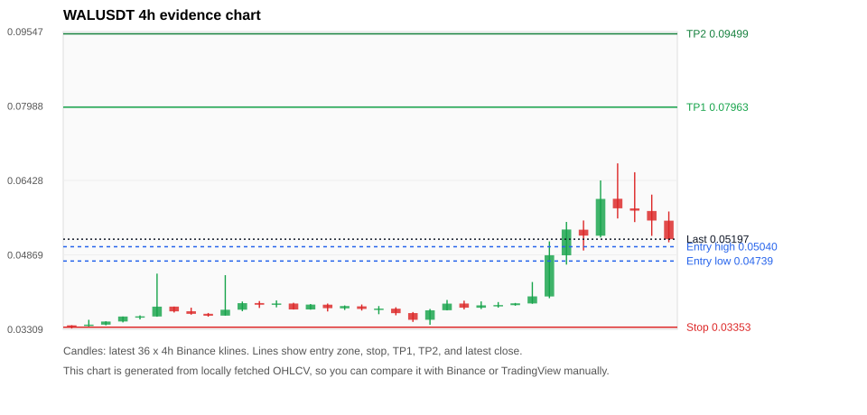
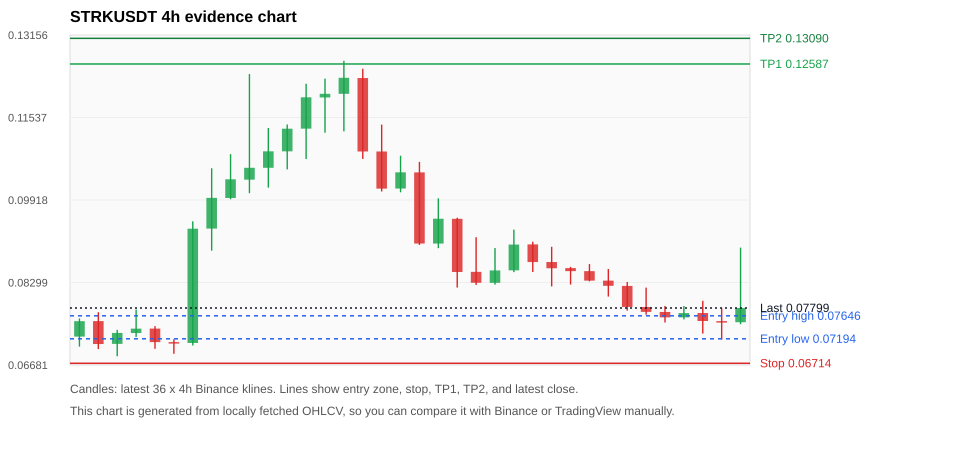
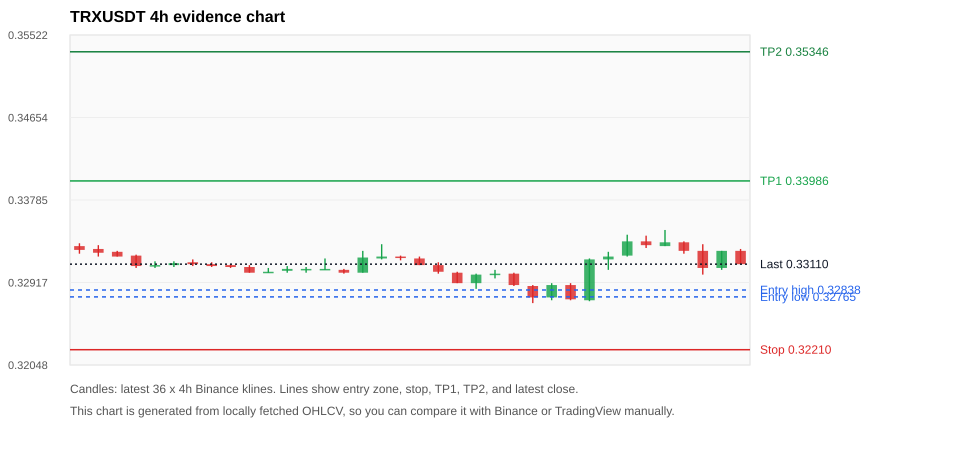
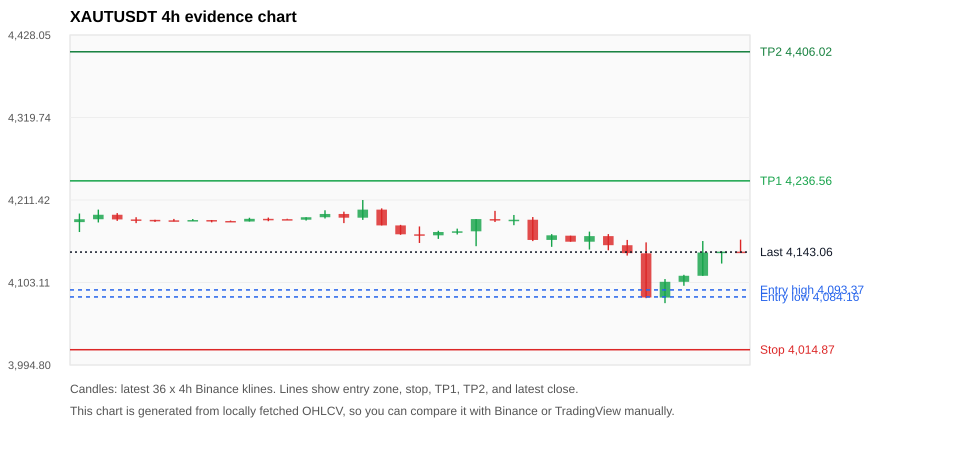
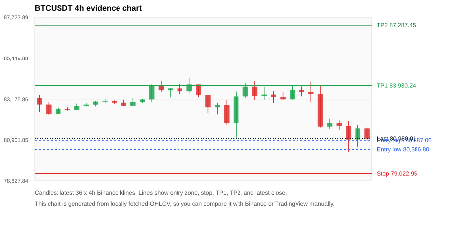

# Crypto 市场扫描报告 v1

- 报告时间：2026-10-15 20:06:51 CST
- Run ID：`20261015_120503_e3cb011c`
- Run type：`daily_full`
- Data validation mode：`paper`
- 数据来源：SQLite
- 报告版本：v1
- 扫描 ID：ae3fae59533c
- 数据源：Binance public spot API + CoinGecko/CoinMarketCap cross-check
- 过滤条件：USDT spot; 24h quote volume >= 30,000,000; trades >= 30,000; exclude stables/leveraged tokens; analyze 1h/4h/1d klines
- 默认单笔风险：账户权益的 1.00%

## 限制说明

- 交易信号仍以 Binance 现货公开 K 线为主源；外部数据源用于一致性复核。
- 结果是研究和模拟盘计划，不是确定收益或实盘下单指令。
- 历史长度过滤：候选币至少需要 180 根 1d K 线。
- 数据质量验证池：先验证 score 排名前 min(top_n * 2, 10) 的候选，再按 action + score 补足最终名单。
- 指标截止：2026-10-15T12:05:11.162000+00:00；仅使用此前至少60秒已闭合K线，ticker为扫描时点观测。
- 大盘环境过滤：RISK_OFF; BTC/ETH 大盘偏弱，山寨币买入候选降级为观察。 BTC 7d=-1.9680321394842548; ETH 7d=-5.92586261819481.
- Data cross-validation enabled: Binance primary source plus CoinGecko; CoinMarketCap is checked when an API key is configured.
- WALUSDT validation state BLOCKED: BLOCKED: [BINANCE_KLINE_EXTREME_RANGE] Binance candle range exceeds 40%.; [BINANCE_KLINE_EXTREME_RANGE] Binance candle range exceeds 40%.; [EXTERNAL_PRICE_DIFF_WARNING] price diff 1.33% exceeds warning threshold; [EXTERNAL_PRICE_DIFF_WARNING] price diff 1.00% exceeds warning threshold; [EXTERNAL_IDENTITY_AMBIGUOUS] CoinMarketCap symbol mapping has 4 matches; selected lowest cmc_rank
- STRKUSDT validation state BLOCKED: BLOCKED: [BINANCE_KLINE_EXTREME_RANGE] Binance candle range exceeds 40%.; [BINANCE_KLINE_EXTREME_RANGE] Binance candle range exceeds 40%.; [BINANCE_KLINE_EXTREME_RANGE] Binance candle range exceeds 40%.; [EXTERNAL_IDENTITY_AMBIGUOUS] CoinGecko symbol mapping has 2 exact matches; selected highest market-cap rank; [EXTERNAL_IDENTITY_AMBIGUOUS] CoinMarketCap symbol mapping has 2 matches; selected lowest cmc_rank
- TRXUSDT validation state DEGRADED: DEGRADED: [EXTERNAL_PROVIDER_RATE_LIMITED] Provider rate limited request for https://api.coingecko.com/api/v3/coins/markets?vs_currency=usd&ids=tron&price_change_percentage=24h&per_page=1&page=1: HTTP 429
- XAUTUSDT validation state DEGRADED: DEGRADED: [EXTERNAL_PROVIDER_RATE_LIMITED] Provider rate limited request for https://api.coingecko.com/api/v3/coins/markets?vs_currency=usd&ids=tether-gold&price_change_percentage=24h&per_page=1&page=1: HTTP 429
- BTCUSDT validation state DEGRADED: DEGRADED: [EXTERNAL_PROVIDER_RATE_LIMITED] Provider rate limited request for https://api.coingecko.com/api/v3/coins/markets?vs_currency=usd&ids=bitcoin&price_change_percentage=24h&per_page=1&page=1: HTTP 429; [EXTERNAL_IDENTITY_AMBIGUOUS] CoinMarketCap symbol mapping has 13 matches; selected lowest cmc_rank
- ETHUSDT validation state DEGRADED: DEGRADED: [EXTERNAL_PROVIDER_RATE_LIMITED] Provider rate limited request for https://api.coingecko.com/api/v3/coins/markets?vs_currency=usd&ids=ethereum&price_change_percentage=24h&per_page=1&page=1: HTTP 429; [EXTERNAL_IDENTITY_AMBIGUOUS] CoinMarketCap symbol mapping has 6 matches; selected lowest cmc_rank
- BNBUSDT validation state DEGRADED: DEGRADED: [EXTERNAL_PROVIDER_RATE_LIMITED] Provider rate limited request for https://api.coingecko.com/api/v3/coins/markets?vs_currency=usd&ids=binancecoin&price_change_percentage=24h&per_page=1&page=1: HTTP 429; [EXTERNAL_IDENTITY_AMBIGUOUS] CoinMarketCap symbol mapping has 4 matches; selected lowest cmc_rank
- XRPUSDT validation state DEGRADED: DEGRADED: [EXTERNAL_PROVIDER_RATE_LIMITED] Provider rate limited request for https://api.coingecko.com/api/v3/coins/markets?vs_currency=usd&ids=ripple&price_change_percentage=24h&per_page=1&page=1: HTTP 429; [EXTERNAL_IDENTITY_AMBIGUOUS] CoinMarketCap symbol mapping has 3 matches; selected lowest cmc_rank
- DOGEUSDT validation state DEGRADED: DEGRADED: [EXTERNAL_PROVIDER_RATE_LIMITED] Provider rate limited request for https://api.coingecko.com/api/v3/coins/markets?vs_currency=usd&ids=dogecoin&price_change_percentage=24h&per_page=1&page=1: HTTP 429; [EXTERNAL_IDENTITY_AMBIGUOUS] CoinMarketCap symbol mapping has 23 matches; selected lowest cmc_rank
- SOLUSDT validation state DEGRADED: DEGRADED: [EXTERNAL_PROVIDER_RATE_LIMITED] Provider rate limited request for https://api.coingecko.com/api/v3/coins/markets?vs_currency=usd&ids=solana&price_change_percentage=24h&per_page=1&page=1: HTTP 429; [EXTERNAL_IDENTITY_AMBIGUOUS] CoinMarketCap symbol mapping has 8 matches; selected lowest cmc_rank

## 5 个候选交易计划

| Rank | Coin | Action | Setup | Entry Zone | Stop Loss | TP1 | TP2 / Exit Rule | R/R | Verdict |
|---:|---|---|---|---:|---:|---:|---|---:|---|
| 1 | `WAL` | `WATCH_ONLY` | 趋势中，等回调入场 | 0.04739 - 0.05040 | 0.03353 | 0.07963 | 0.09499 或跌破 4h 关键支撑 | 2.00-3.00 | 只观察 |
| 2 | `STRK` | `WATCH_ONLY` | 趋势中，等回调入场 | 0.07194 - 0.07646 | 0.06714 | 0.12587 | 0.13090 或跌破 4h 关键支撑 | 7.32-8.03 | 只观察 |
| 3 | `TRX` | `REJECT` | 回踩支撑/4h EMA 附近 | 0.32765 - 0.32838 | 0.32210 | 0.33986 | 0.35346 或跌破 4h 关键支撑 | 2.00-4.30 | 只观察 |
| 4 | `XAUT` | `REJECT` | 回踩支撑/4h EMA 附近 | 4,084.16 - 4,093.37 | 4,014.87 | 4,236.56 | 4,406.02 或跌破 4h 关键支撑 | 2.00-4.29 | 只观察 |
| 5 | `BTC` | `REJECT` | 回踩支撑/4h EMA 附近 | 80,386.80 - 80,887.00 | 79,022.95 | 83,930.24 | 87,287.45 或跌破 4h 关键支撑 | 2.04-4.12 | 只观察 |

## 数据交叉验证摘要

价格差异以 Binance 当前价为基准；成交量口径不同，Binance 是 USDT 现货成交额，CoinGecko/CoinMarketCap 通常是全市场成交量。

| Rank | Coin | State | Identity | Max Price Diff | Max 24h Diff | Issue Codes | Message |
|---:|---|---|---|---:|---:|---|---|
| 1 | `WAL` | BLOCKED (DATA_ERROR) | UNCONFIRMED | 1.33% | 0.27 pts | BINANCE_KLINE_EXTREME_RANGE, EXTERNAL_IDENTITY_AMBIGUOUS, EXTERNAL_PRICE_DIFF_WARNING | BLOCKED: [BINANCE_KLINE_EXTREME_RANGE] Binance candle range exceeds 40%.; [BINANCE_KLINE_EXTREME_RANGE] Binance candle range exceeds 40%.; [EXTERNAL_PRICE_DIFF_WARNING] price diff 1.33% exceeds warning threshold; [EXTERNAL_PRICE_DIFF_WARNING] price diff 1.00% exceeds warning threshold; [EXTERNAL_IDENTITY_AMBIGUOUS] CoinMarketCap symbol mapping has 4 matches; selected lowest cmc_rank |
| 2 | `STRK` | BLOCKED (DATA_ERROR) | UNCONFIRMED | 0.73% | 0.41 pts | BINANCE_KLINE_EXTREME_RANGE, EXTERNAL_IDENTITY_AMBIGUOUS | BLOCKED: [BINANCE_KLINE_EXTREME_RANGE] Binance candle range exceeds 40%.; [BINANCE_KLINE_EXTREME_RANGE] Binance candle range exceeds 40%.; [BINANCE_KLINE_EXTREME_RANGE] Binance candle range exceeds 40%.; [EXTERNAL_IDENTITY_AMBIGUOUS] CoinGecko symbol mapping has 2 exact matches; selected highest market-cap rank; [EXTERNAL_IDENTITY_AMBIGUOUS] CoinMarketCap symbol mapping has 2 matches; selected lowest cmc_rank |
| 3 | `TRX` | DEGRADED (DATA_WARNING) | UNCONFIRMED | 0.14% | 0.07 pts | EXTERNAL_PROVIDER_RATE_LIMITED | DEGRADED: [EXTERNAL_PROVIDER_RATE_LIMITED] Provider rate limited request for https://api.coingecko.com/api/v3/coins/markets?vs_currency=usd&ids=tron&price_change_percentage=24h&per_page=1&page=1: HTTP 429 |
| 4 | `XAUT` | DEGRADED (DATA_WARNING) | UNCONFIRMED | 0.09% | 0.10 pts | EXTERNAL_PROVIDER_RATE_LIMITED | DEGRADED: [EXTERNAL_PROVIDER_RATE_LIMITED] Provider rate limited request for https://api.coingecko.com/api/v3/coins/markets?vs_currency=usd&ids=tether-gold&price_change_percentage=24h&per_page=1&page=1: HTTP 429 |
| 5 | `BTC` | DEGRADED (DATA_WARNING) | UNCONFIRMED | 0.23% | 0.00 pts | EXTERNAL_IDENTITY_AMBIGUOUS, EXTERNAL_PROVIDER_RATE_LIMITED | DEGRADED: [EXTERNAL_PROVIDER_RATE_LIMITED] Provider rate limited request for https://api.coingecko.com/api/v3/coins/markets?vs_currency=usd&ids=bitcoin&price_change_percentage=24h&per_page=1&page=1: HTTP 429; [EXTERNAL_IDENTITY_AMBIGUOUS] CoinMarketCap symbol mapping has 13 matches; selected lowest cmc_rank |

## 候选币说明

### 1. WAL `WALUSDT`



- 入选原因：趋势中，等回调入场；24h -2.12%，7d +47.98%，4h RSI 70.67，24h 成交额 $45.8M。
- 交易失效条件：跌破 0.0335294 或 4h 收盘重新失守关键支撑。
- 主要风险：距离支撑偏远，不能追市价；24h 振幅较大，回撤风险高；成交量突增，可能是事件驱动；BTC/ETH 大盘环境未确认强势，山寨币买入信号降级；24h 动量未确认；Blocking data-quality issue detected; paper plan creation is not allowed.。
- 数据交叉验证：BLOCKED / DATA_ERROR；身份=UNCONFIRMED；BLOCKED: [BINANCE_KLINE_EXTREME_RANGE] Binance candle range exceeds 40%.; [BINANCE_KLINE_EXTREME_RANGE] Binance candle range exceeds 40%.; [EXTERNAL_PRICE_DIFF_WARNING] price diff 1.33% exceeds warning threshold; [EXTERNAL_PRICE_DIFF_WARNING] price diff 1.00% exceeds warning threshold; [EXTERNAL_IDENTITY_AMBIGUOUS] CoinMarketCap symbol mapping has 4 matches; selected lowest cmc_rank

#### 可点击人工验证

- [Binance 交易页](https://www.binance.com/en/trade/WAL_USDT)
- [TradingView 图表](https://www.tradingview.com/chart/?symbol=BINANCE%3AWALUSDT)
- [CoinGecko 搜索](https://www.coingecko.com/en/search?query=WAL)
- [CoinMarketCap 搜索](https://coinmarketcap.com/search/?q=WAL)

#### 多数据源对照

| Source | Status | Identity | Blocking | Asset ID | Price | 24h Change | 24h Volume | Price Diff | 24h Diff | Updated | Issue Codes | Message |
|---|---|---|---:|---|---:|---:|---:|---:|---:|---|---|---|
| Binance | DATA_ERROR | CONFIRMED | yes | WALUSDT | 0.05197 | -2.12% | $45.8M | 0.00% | 0.00 pts | 2026-10-15T12:05:53+00:00 | BINANCE_KLINE_EXTREME_RANGE | [BINANCE_KLINE_EXTREME_RANGE] Binance candle range exceeds 40%.; [BINANCE_KLINE_EXTREME_RANGE] Binance candle range exceeds 40%. |
| CoinGecko | DATA_WARNING | CONFIRMED | yes | walrus-2 | 0.05266 | -2.39% | $253.5M | 1.33% | 0.27 pts | 2026-10-15T12:04:52.000Z | EXTERNAL_PRICE_DIFF_WARNING | [EXTERNAL_PRICE_DIFF_WARNING] price diff 1.33% exceeds warning threshold |
| CoinMarketCap | DATA_WARNING | UNCONFIRMED | yes | 36119 | 0.05249 | -1.99% | $289.7M | 1.00% | 0.14 pts | 2026-10-15T12:05:03.000Z | EXTERNAL_IDENTITY_AMBIGUOUS, EXTERNAL_PRICE_DIFF_WARNING | [EXTERNAL_PRICE_DIFF_WARNING] price diff 1.00% exceeds warning threshold; [EXTERNAL_IDENTITY_AMBIGUOUS] CoinMarketCap symbol mapping has 4 matches; selected lowest cmc_rank |

#### 指标证据

| 指标 | 数值 | 人工核对用途 |
|---|---:|---|
| 当前价 | 0.05197 | 与 Binance/TradingView 当前价格对照 |
| 24h 涨跌 | -2.12% | 与交易所 24h 涨跌对照 |
| 7d 涨跌 | +47.98% | 判断短线趋势是否延续 |
| 4h EMA20 | 0.04730 | 判断短期趋势支撑 |
| 4h EMA50 | 0.04178 | 判断中期趋势支撑 |
| 1d EMA20 | 0.03733 | 判断日线趋势 |
| 1d EMA50 | 0.03340 | 判断日线趋势 |
| 4h RSI14 | 70.67 | 判断是否过热/过弱 |
| 4h ATR14 | 0.0062942857 | 推导止损和入场缓冲 |
| 最近 18 根 4h 最低点 | 0.03404 | 支撑/止损参考 |
| 最近 36 根 4h 最高点 | 0.06786 | TP/压力参考 |
| 支撑位 | 0.04730 | 入场区间推导基础 |

#### 交易计划推导

- 支撑位 = 最近低点、4h EMA20、4h EMA50、1d EMA20 中不高于当前价的最高有效支撑 = `0.04730`。
- 入场区间 = 支撑位附近 + ATR 缓冲 = `0.04739 - 0.05040`。
- 止损 = min(最近 18 根 4h 最低点 * 0.985, 入场中位价 - 1.15 * ATR14) = `0.03353`。
- TP1 = max(最近 36 根 4h 最高点 * 0.995, 入场中位价 + 2R) = `0.07963`。
- TP2 = max(入场中位价 + 3R, TP1 * 1.04) = `0.09499`。

#### 最近 10 根 4h K线

| UTC 开盘时间 | Open | High | Low | Close | Quote Volume | Trades |
|---|---:|---:|---:|---:|---:|---:|
| 2026-10-13T20:00+00:00 | 0.03815 | 0.03861 | 0.03803 | 0.03853 | $150,078 | 3766 |
| 2026-10-14T00:00+00:00 | 0.03851 | 0.04300 | 0.03843 | 0.03999 | $2.8M | 47183 |
| 2026-10-14T04:00+00:00 | 0.03997 | 0.05151 | 0.03961 | 0.04861 | $7.6M | 123427 |
| 2026-10-14T08:00+00:00 | 0.04860 | 0.05559 | 0.04665 | 0.05400 | $7.6M | 97500 |
| 2026-10-14T12:00+00:00 | 0.05396 | 0.05589 | 0.04960 | 0.05272 | $7.0M | 87934 |
| 2026-10-14T16:00+00:00 | 0.05270 | 0.06428 | 0.05233 | 0.06041 | $11.1M | 151522 |
| 2026-10-14T20:00+00:00 | 0.06044 | 0.06786 | 0.05631 | 0.05844 | $6.2M | 90805 |
| 2026-10-15T00:00+00:00 | 0.05842 | 0.06600 | 0.05555 | 0.05795 | $8.0M | 102477 |
| 2026-10-15T04:00+00:00 | 0.05788 | 0.06131 | 0.05266 | 0.05588 | $8.7M | 125519 |
| 2026-10-15T08:00+00:00 | 0.05585 | 0.05777 | 0.05132 | 0.05197 | $4.7M | 77987 |

### 2. STRK `STRKUSDT`



- 入选原因：趋势中，等回调入场；24h -0.38%，7d +36.87%，4h RSI 40.89，24h 成交额 $36.9M。
- 交易失效条件：跌破 0.067141032 或 4h 收盘重新失守关键支撑。
- 主要风险：距离支撑偏远，不能追市价；24h 振幅较大，回撤风险高；BTC/ETH 大盘环境未确认强势，山寨币买入信号降级；24h 动量未确认；Blocking data-quality issue detected; paper plan creation is not allowed.。
- 数据交叉验证：BLOCKED / DATA_ERROR；身份=UNCONFIRMED；BLOCKED: [BINANCE_KLINE_EXTREME_RANGE] Binance candle range exceeds 40%.; [BINANCE_KLINE_EXTREME_RANGE] Binance candle range exceeds 40%.; [BINANCE_KLINE_EXTREME_RANGE] Binance candle range exceeds 40%.; [EXTERNAL_IDENTITY_AMBIGUOUS] CoinGecko symbol mapping has 2 exact matches; selected highest market-cap rank; [EXTERNAL_IDENTITY_AMBIGUOUS] CoinMarketCap symbol mapping has 2 matches; selected lowest cmc_rank

#### 可点击人工验证

- [Binance 交易页](https://www.binance.com/en/trade/STRK_USDT)
- [TradingView 图表](https://www.tradingview.com/chart/?symbol=BINANCE%3ASTRKUSDT)
- [CoinGecko 搜索](https://www.coingecko.com/en/search?query=STRK)
- [CoinMarketCap 搜索](https://coinmarketcap.com/search/?q=STRK)

#### 多数据源对照

| Source | Status | Identity | Blocking | Asset ID | Price | 24h Change | 24h Volume | Price Diff | 24h Diff | Updated | Issue Codes | Message |
|---|---|---|---:|---|---:|---:|---:|---:|---:|---|---|---|
| Binance | DATA_ERROR | CONFIRMED | yes | STRKUSDT | 0.07799 | -0.38% | $36.9M | 0.00% | 0.00 pts | 2026-10-15T12:05:53+00:00 | BINANCE_KLINE_EXTREME_RANGE | [BINANCE_KLINE_EXTREME_RANGE] Binance candle range exceeds 40%.; [BINANCE_KLINE_EXTREME_RANGE] Binance candle range exceeds 40%.; [BINANCE_KLINE_EXTREME_RANGE] Binance candle range exceeds 40%. |
| CoinGecko | DATA_WARNING | UNCONFIRMED | no | starknet | 0.07855 | -0.69% | $246.4M | 0.72% | 0.31 pts | 2026-10-15T12:04:52.000Z | EXTERNAL_IDENTITY_AMBIGUOUS | [EXTERNAL_IDENTITY_AMBIGUOUS] CoinGecko symbol mapping has 2 exact matches; selected highest market-cap rank |
| CoinMarketCap | DATA_WARNING | UNCONFIRMED | no | 22691 | 0.07856 | +0.03% | $253.4M | 0.73% | 0.41 pts | 2026-10-15T12:05:03.000Z | EXTERNAL_IDENTITY_AMBIGUOUS | [EXTERNAL_IDENTITY_AMBIGUOUS] CoinMarketCap symbol mapping has 2 matches; selected lowest cmc_rank |

#### 指标证据

| 指标 | 数值 | 人工核对用途 |
|---|---:|---|
| 当前价 | 0.07799 | 与 Binance/TradingView 当前价格对照 |
| 24h 涨跌 | -0.38% | 与交易所 24h 涨跌对照 |
| 7d 涨跌 | +36.87% | 判断短线趋势是否延续 |
| 4h EMA20 | 0.08291 | 判断短期趋势支撑 |
| 4h EMA50 | 0.07926 | 判断中期趋势支撑 |
| 1d EMA20 | 0.06581 | 判断日线趋势 |
| 1d EMA50 | 0.04963 | 判断日线趋势 |
| 4h RSI14 | 40.89 | 判断是否过热/过弱 |
| 4h ATR14 | 0.0061378571 | 推导止损和入场缓冲 |
| 最近 18 根 4h 最低点 | 0.07180 | 支撑/止损参考 |
| 最近 36 根 4h 最高点 | 0.12650 | TP/压力参考 |
| 支撑位 | 0.07180 | 入场区间推导基础 |

#### 交易计划推导

- 支撑位 = 最近低点、4h EMA20、4h EMA50、1d EMA20 中不高于当前价的最高有效支撑 = `0.07180`。
- 入场区间 = 支撑位附近 + ATR 缓冲 = `0.07194 - 0.07646`。
- 止损 = min(最近 18 根 4h 最低点 * 0.985, 入场中位价 - 1.15 * ATR14) = `0.06714`。
- TP1 = max(最近 36 根 4h 最高点 * 0.995, 入场中位价 + 2R) = `0.12587`。
- TP2 = max(入场中位价 + 3R, TP1 * 1.04) = `0.13090`。

#### 最近 10 根 4h K线

| UTC 开盘时间 | Open | High | Low | Close | Quote Volume | Trades |
|---|---:|---:|---:|---:|---:|---:|
| 2026-10-13T20:00+00:00 | 0.08582 | 0.08607 | 0.08259 | 0.08522 | $2.2M | 38024 |
| 2026-10-14T00:00+00:00 | 0.08522 | 0.08661 | 0.08322 | 0.08336 | $2.9M | 58458 |
| 2026-10-14T04:00+00:00 | 0.08336 | 0.08564 | 0.08023 | 0.08234 | $5.0M | 84580 |
| 2026-10-14T08:00+00:00 | 0.08232 | 0.08310 | 0.07747 | 0.07820 | $4.6M | 69011 |
| 2026-10-14T12:00+00:00 | 0.07819 | 0.08199 | 0.07668 | 0.07723 | $4.6M | 75925 |
| 2026-10-14T16:00+00:00 | 0.07721 | 0.07839 | 0.07514 | 0.07615 | $2.2M | 39761 |
| 2026-10-14T20:00+00:00 | 0.07615 | 0.07838 | 0.07576 | 0.07699 | $1.3M | 33002 |
| 2026-10-15T00:00+00:00 | 0.07700 | 0.07940 | 0.07297 | 0.07544 | $3.3M | 55853 |
| 2026-10-15T04:00+00:00 | 0.07542 | 0.07795 | 0.07180 | 0.07522 | $5.0M | 67062 |
| 2026-10-15T08:00+00:00 | 0.07520 | 0.08984 | 0.07481 | 0.07799 | $20.5M | 293632 |

### 3. TRX `TRXUSDT`



- 入选原因：回踩支撑/4h EMA 附近；24h -0.93%，7d -1.08%，4h RSI 53.04，24h 成交额 $41.6M。
- 交易失效条件：跌破 0.322095 或 4h 收盘重新失守关键支撑。
- 主要风险：日线趋势未完全确认；BTC/ETH 大盘环境未确认强势，山寨币买入信号降级；24h 动量未确认；7d 趋势未确认；External validation is degraded; this candidate is not a clean data sample.；Paper mode allows degraded validation; candidate is excluded from clean-data samples.。
- 数据交叉验证：DEGRADED / DATA_WARNING；身份=UNCONFIRMED；DEGRADED: [EXTERNAL_PROVIDER_RATE_LIMITED] Provider rate limited request for https://api.coingecko.com/api/v3/coins/markets?vs_currency=usd&ids=tron&price_change_percentage=24h&per_page=1&page=1: HTTP 429

#### 可点击人工验证

- [Binance 交易页](https://www.binance.com/en/trade/TRX_USDT)
- [TradingView 图表](https://www.tradingview.com/chart/?symbol=BINANCE%3ATRXUSDT)
- [CoinGecko 搜索](https://www.coingecko.com/en/search?query=TRX)
- [CoinMarketCap 搜索](https://coinmarketcap.com/search/?q=TRX)

#### 多数据源对照

| Source | Status | Identity | Blocking | Asset ID | Price | 24h Change | 24h Volume | Price Diff | 24h Diff | Updated | Issue Codes | Message |
|---|---|---|---:|---|---:|---:|---:|---:|---:|---|---|---|
| Binance | DATA_OK | CONFIRMED | no | TRXUSDT | 0.33110 | -0.93% | $41.6M | 0.00% | 0.00 pts | 2026-10-15T12:05:53+00:00 | none | Primary market data source passed health checks. |
| CoinGecko | DATA_WARNING | UNCONFIRMED | no | n/a | n/a | n/a | n/a | n/a | n/a | 2026-10-15T12:05:53+00:00 | EXTERNAL_PROVIDER_RATE_LIMITED | Provider rate limited request for https://api.coingecko.com/api/v3/coins/markets?vs_currency=usd&ids=tron&price_change_percentage=24h&per_page=1&page=1: HTTP 429 |
| CoinMarketCap | DATA_OK | CONFIRMED | no | 1958 | 0.33063 | -0.86% | $540.8M | 0.14% | 0.07 pts | 2026-10-15T12:05:03.000Z | none | External source agrees with Binance within thresholds. |

#### 指标证据

| 指标 | 数值 | 人工核对用途 |
|---|---:|---|
| 当前价 | 0.33110 | 与 Binance/TradingView 当前价格对照 |
| 24h 涨跌 | -0.93% | 与交易所 24h 涨跌对照 |
| 7d 涨跌 | -1.08% | 判断短线趋势是否延续 |
| 4h EMA20 | 0.33131 | 判断短期趋势支撑 |
| 4h EMA50 | 0.33193 | 判断中期趋势支撑 |
| 1d EMA20 | 0.33342 | 判断日线趋势 |
| 1d EMA50 | 0.33455 | 判断日线趋势 |
| 4h RSI14 | 53.04 | 判断是否过热/过弱 |
| 4h ATR14 | 0.0019714286 | 推导止损和入场缓冲 |
| 最近 18 根 4h 最低点 | 0.32700 | 支撑/止损参考 |
| 最近 36 根 4h 最高点 | 0.33470 | TP/压力参考 |
| 支撑位 | 0.32700 | 入场区间推导基础 |

#### 交易计划推导

- 支撑位 = 最近低点、4h EMA20、4h EMA50、1d EMA20 中不高于当前价的最高有效支撑 = `0.32700`。
- 入场区间 = 支撑位附近 + ATR 缓冲 = `0.32765 - 0.32838`。
- 止损 = min(最近 18 根 4h 最低点 * 0.985, 入场中位价 - 1.15 * ATR14) = `0.32210`。
- TP1 = max(最近 36 根 4h 最高点 * 0.995, 入场中位价 + 2R) = `0.33986`。
- TP2 = max(入场中位价 + 3R, TP1 * 1.04) = `0.35346`。

#### 最近 10 根 4h K线

| UTC 开盘时间 | Open | High | Low | Close | Quote Volume | Trades |
|---|---:|---:|---:|---:|---:|---:|
| 2026-10-13T20:00+00:00 | 0.32890 | 0.32910 | 0.32730 | 0.32740 | $4.0M | 8323 |
| 2026-10-14T00:00+00:00 | 0.32730 | 0.33170 | 0.32720 | 0.33160 | $11.3M | 9637 |
| 2026-10-14T04:00+00:00 | 0.33160 | 0.33240 | 0.33050 | 0.33190 | $10.0M | 13352 |
| 2026-10-14T08:00+00:00 | 0.33200 | 0.33420 | 0.33190 | 0.33350 | $14.2M | 21769 |
| 2026-10-14T12:00+00:00 | 0.33350 | 0.33410 | 0.33280 | 0.33310 | $9.1M | 17746 |
| 2026-10-14T16:00+00:00 | 0.33300 | 0.33470 | 0.33300 | 0.33340 | $6.6M | 14076 |
| 2026-10-14T20:00+00:00 | 0.33340 | 0.33350 | 0.33220 | 0.33250 | $3.3M | 6032 |
| 2026-10-15T00:00+00:00 | 0.33250 | 0.33320 | 0.33000 | 0.33070 | $10.5M | 13615 |
| 2026-10-15T04:00+00:00 | 0.33070 | 0.33250 | 0.33050 | 0.33250 | $6.5M | 10844 |
| 2026-10-15T08:00+00:00 | 0.33250 | 0.33270 | 0.33110 | 0.33110 | $5.5M | 11291 |

### 4. XAUT `XAUTUSDT`



- 入选原因：回踩支撑/4h EMA 附近；24h -0.10%，7d +0.56%，4h RSI 38.63，24h 成交额 $67.4M。
- 交易失效条件：跌破 4014.8699 或 4h 收盘重新失守关键支撑。
- 主要风险：成交量突增，可能是事件驱动；日线趋势未完全确认；BTC/ETH 大盘环境未确认强势，山寨币买入信号降级；24h 动量未确认；External validation is degraded; this candidate is not a clean data sample.；Paper mode allows degraded validation; candidate is excluded from clean-data samples.。
- 数据交叉验证：DEGRADED / DATA_WARNING；身份=UNCONFIRMED；DEGRADED: [EXTERNAL_PROVIDER_RATE_LIMITED] Provider rate limited request for https://api.coingecko.com/api/v3/coins/markets?vs_currency=usd&ids=tether-gold&price_change_percentage=24h&per_page=1&page=1: HTTP 429

#### 可点击人工验证

- [Binance 交易页](https://www.binance.com/en/trade/XAUT_USDT)
- [TradingView 图表](https://www.tradingview.com/chart/?symbol=BINANCE%3AXAUTUSDT)
- [CoinGecko 搜索](https://www.coingecko.com/en/search?query=XAUT)
- [CoinMarketCap 搜索](https://coinmarketcap.com/search/?q=XAUT)

#### 多数据源对照

| Source | Status | Identity | Blocking | Asset ID | Price | 24h Change | 24h Volume | Price Diff | 24h Diff | Updated | Issue Codes | Message |
|---|---|---|---:|---|---:|---:|---:|---:|---:|---|---|---|
| Binance | DATA_OK | CONFIRMED | no | XAUTUSDT | 4,143.06 | -0.10% | $67.4M | 0.00% | 0.00 pts | 2026-10-15T12:05:53+00:00 | none | Primary market data source passed health checks. |
| CoinGecko | DATA_WARNING | UNCONFIRMED | no | n/a | n/a | n/a | n/a | n/a | n/a | 2026-10-15T12:05:53+00:00 | EXTERNAL_PROVIDER_RATE_LIMITED | Provider rate limited request for https://api.coingecko.com/api/v3/coins/markets?vs_currency=usd&ids=tether-gold&price_change_percentage=24h&per_page=1&page=1: HTTP 429 |
| CoinMarketCap | DATA_OK | CONFIRMED | no | 5176 | 4,139.25 | -0.01% | $416.8M | 0.09% | 0.10 pts | 2026-10-15T12:05:03.000Z | none | External source agrees with Binance within thresholds. |

#### 指标证据

| 指标 | 数值 | 人工核对用途 |
|---|---:|---|
| 当前价 | 4,143.06 | 与 Binance/TradingView 当前价格对照 |
| 24h 涨跌 | -0.10% | 与交易所 24h 涨跌对照 |
| 7d 涨跌 | +0.56% | 判断短线趋势是否延续 |
| 4h EMA20 | 4,148.62 | 判断短期趋势支撑 |
| 4h EMA50 | 4,159.36 | 判断中期趋势支撑 |
| 1d EMA20 | 4,187.20 | 判断日线趋势 |
| 1d EMA50 | 4,249.19 | 判断日线趋势 |
| 4h RSI14 | 38.63 | 判断是否过热/过弱 |
| 4h ATR14 | 24.7986 | 推导止损和入场缓冲 |
| 最近 18 根 4h 最低点 | 4,076.01 | 支撑/止损参考 |
| 最近 36 根 4h 最高点 | 4,211.41 | TP/压力参考 |
| 支撑位 | 4,076.01 | 入场区间推导基础 |

#### 交易计划推导

- 支撑位 = 最近低点、4h EMA20、4h EMA50、1d EMA20 中不高于当前价的最高有效支撑 = `4,076.01`。
- 入场区间 = 支撑位附近 + ATR 缓冲 = `4,084.16 - 4,093.37`。
- 止损 = min(最近 18 根 4h 最低点 * 0.985, 入场中位价 - 1.15 * ATR14) = `4,014.87`。
- TP1 = max(最近 36 根 4h 最高点 * 0.995, 入场中位价 + 2R) = `4,236.56`。
- TP2 = max(入场中位价 + 3R, TP1 * 1.04) = `4,406.02`。

#### 最近 10 根 4h K线

| UTC 开盘时间 | Open | High | Low | Close | Quote Volume | Trades |
|---|---:|---:|---:|---:|---:|---:|
| 2026-10-13T20:00+00:00 | 4,164.56 | 4,164.56 | 4,156.65 | 4,156.66 | $492,708 | 1493 |
| 2026-10-14T00:00+00:00 | 4,156.66 | 4,169.92 | 4,146.40 | 4,164.01 | $2.5M | 6539 |
| 2026-10-14T04:00+00:00 | 4,164.01 | 4,166.66 | 4,145.44 | 4,152.07 | $1.7M | 4950 |
| 2026-10-14T08:00+00:00 | 4,152.06 | 4,159.00 | 4,138.45 | 4,141.65 | $3.0M | 12515 |
| 2026-10-14T12:00+00:00 | 4,141.41 | 4,155.80 | 4,082.54 | 4,083.43 | $37.0M | 80963 |
| 2026-10-14T16:00+00:00 | 4,083.30 | 4,107.64 | 4,076.01 | 4,104.01 | $11.9M | 26971 |
| 2026-10-14T20:00+00:00 | 4,104.01 | 4,113.20 | 4,098.80 | 4,111.94 | $2.9M | 8586 |
| 2026-10-15T00:00+00:00 | 4,111.94 | 4,157.58 | 4,111.77 | 4,142.46 | $5.2M | 15275 |
| 2026-10-15T04:00+00:00 | 4,142.51 | 4,143.66 | 4,127.99 | 4,143.59 | $4.9M | 9288 |
| 2026-10-15T08:00+00:00 | 4,143.60 | 4,159.36 | 4,143.06 | 4,143.06 | $5.4M | 12169 |

### 5. BTC `BTCUSDT`



- 入选原因：回踩支撑/4h EMA 附近；24h -3.29%，7d -1.62%，4h RSI 31.24，24h 成交额 $1.91B。
- 交易失效条件：跌破 79022.955 或 4h 收盘重新失守关键支撑。
- 主要风险：日线趋势未完全确认；BTC/ETH 大盘环境未确认强势，山寨币买入信号降级；24h 动量未确认；7d 趋势未确认；External validation is degraded; this candidate is not a clean data sample.；Paper mode allows degraded validation; candidate is excluded from clean-data samples.。
- 数据交叉验证：DEGRADED / DATA_WARNING；身份=UNCONFIRMED；DEGRADED: [EXTERNAL_PROVIDER_RATE_LIMITED] Provider rate limited request for https://api.coingecko.com/api/v3/coins/markets?vs_currency=usd&ids=bitcoin&price_change_percentage=24h&per_page=1&page=1: HTTP 429; [EXTERNAL_IDENTITY_AMBIGUOUS] CoinMarketCap symbol mapping has 13 matches; selected lowest cmc_rank

#### 可点击人工验证

- [Binance 交易页](https://www.binance.com/en/trade/BTC_USDT)
- [TradingView 图表](https://www.tradingview.com/chart/?symbol=BINANCE%3ABTCUSDT)
- [CoinGecko 搜索](https://www.coingecko.com/en/search?query=BTC)
- [CoinMarketCap 搜索](https://coinmarketcap.com/search/?q=BTC)

#### 多数据源对照

| Source | Status | Identity | Blocking | Asset ID | Price | 24h Change | 24h Volume | Price Diff | 24h Diff | Updated | Issue Codes | Message |
|---|---|---|---:|---|---:|---:|---:|---:|---:|---|---|---|
| Binance | DATA_OK | CONFIRMED | no | BTCUSDT | 80,980.01 | -3.29% | $1.91B | 0.00% | 0.00 pts | 2026-10-15T12:05:53+00:00 | none | Primary market data source passed health checks. |
| CoinGecko | DATA_WARNING | UNCONFIRMED | no | n/a | n/a | n/a | n/a | n/a | n/a | 2026-10-15T12:05:53+00:00 | EXTERNAL_PROVIDER_RATE_LIMITED | Provider rate limited request for https://api.coingecko.com/api/v3/coins/markets?vs_currency=usd&ids=bitcoin&price_change_percentage=24h&per_page=1&page=1: HTTP 429 |
| CoinMarketCap | DATA_WARNING | UNCONFIRMED | no | 1 | 80,795.18 | -3.29% | $42.13B | 0.23% | 0.00 pts | 2026-10-15T12:05:03.000Z | EXTERNAL_IDENTITY_AMBIGUOUS | [EXTERNAL_IDENTITY_AMBIGUOUS] CoinMarketCap symbol mapping has 13 matches; selected lowest cmc_rank |

#### 指标证据

| 指标 | 数值 | 人工核对用途 |
|---|---:|---|
| 当前价 | 80,980.01 | 与 Binance/TradingView 当前价格对照 |
| 24h 涨跌 | -3.29% | 与交易所 24h 涨跌对照 |
| 7d 涨跌 | -1.62% | 判断短线趋势是否延续 |
| 4h EMA20 | 82,452.46 | 判断短期趋势支撑 |
| 4h EMA50 | 83,031.41 | 判断中期趋势支撑 |
| 1d EMA20 | 83,019.21 | 判断日线趋势 |
| 1d EMA50 | 80,312.24 | 判断日线趋势 |
| 4h RSI14 | 31.24 | 判断是否过热/过弱 |
| 4h ATR14 | 943.78 | 推导止损和入场缓冲 |
| 最近 18 根 4h 最低点 | 80,226.35 | 支撑/止损参考 |
| 最近 36 根 4h 最高点 | 84,352.00 | TP/压力参考 |
| 支撑位 | 80,226.35 | 入场区间推导基础 |

#### 交易计划推导

- 支撑位 = 最近低点、4h EMA20、4h EMA50、1d EMA20 中不高于当前价的最高有效支撑 = `80,226.35`。
- 入场区间 = 支撑位附近 + ATR 缓冲 = `80,386.80 - 80,887.00`。
- 止损 = min(最近 18 根 4h 最低点 * 0.985, 入场中位价 - 1.15 * ATR14) = `79,022.95`。
- TP1 = max(最近 36 根 4h 最高点 * 0.995, 入场中位价 + 2R) = `83,930.24`。
- TP2 = max(入场中位价 + 3R, TP1 * 1.04) = `87,287.45`。

#### 最近 10 根 4h K线

| UTC 开盘时间 | Open | High | Low | Close | Quote Volume | Trades |
|---|---:|---:|---:|---:|---:|---:|
| 2026-10-13T20:00+00:00 | 83,299.45 | 83,548.91 | 83,136.80 | 83,169.00 | $114.1M | 236670 |
| 2026-10-14T00:00+00:00 | 83,169.01 | 83,958.00 | 83,169.00 | 83,700.01 | $169.7M | 413318 |
| 2026-10-14T04:00+00:00 | 83,700.01 | 83,880.39 | 83,333.00 | 83,582.28 | $153.0M | 364534 |
| 2026-10-14T08:00+00:00 | 83,582.28 | 84,146.72 | 83,028.70 | 83,465.94 | $214.4M | 479608 |
| 2026-10-14T12:00+00:00 | 83,465.94 | 83,933.00 | 81,588.88 | 81,641.44 | $591.6M | 1298189 |
| 2026-10-14T16:00+00:00 | 81,641.44 | 82,083.04 | 81,514.28 | 81,840.53 | $206.1M | 522768 |
| 2026-10-14T20:00+00:00 | 81,840.95 | 81,980.10 | 81,444.42 | 81,682.01 | $178.9M | 480427 |
| 2026-10-15T00:00+00:00 | 81,682.02 | 81,938.96 | 80,226.35 | 80,928.00 | $484.5M | 1141461 |
| 2026-10-15T04:00+00:00 | 80,928.00 | 81,743.61 | 80,500.01 | 81,541.34 | $282.4M | 757007 |
| 2026-10-15T08:00+00:00 | 81,541.33 | 81,585.00 | 80,851.13 | 80,980.01 | $159.8M | 464150 |

## 组合风控

- 不要 5 个候选全部满仓买入。
- 同时持仓总风险建议控制在账户权益的 3% - 5% 以内。
- 如果 BTC/ETH 同时破位，暂停山寨币多头计划或降低仓位。
- 第一版报告用于模拟盘和人工复核，不自动下单。

## 原始数据

```json
[
  {
    "rank": 1,
    "symbol": "WALUSDT",
    "base_asset": "WAL",
    "price": 0.05197,
    "score": 48.521085103760186,
    "setup": "趋势中，等回调入场",
    "verdict": "只观察",
    "entry_low": 0.04739499655220187,
    "entry_high": 0.05039642857142857,
    "stop_loss": 0.0335294,
    "take_profit_1": 0.07962833768544567,
    "take_profit_2": 0.09499465024726088,
    "risk_reward_1": 2.0000000000000004,
    "risk_reward_2": 3.0,
    "pct_24h": -2.124,
    "pct_3d": 39.62923159591616,
    "pct_7d": 47.97835990888384,
    "quote_volume_24h": 45779815.862454,
    "trades_24h": 636424,
    "high_low_range_24h": 36.814516129032256,
    "rsi_1h": 31.418822860392396,
    "rsi_4h": 70.67147613762488,
    "ema20_4h": 0.04730039576068051,
    "ema50_4h": 0.04178348714761404,
    "ema20_1d": 0.037330959385773396,
    "ema50_1d": 0.033404711281912275,
    "atr_4h": 0.006294285714285716,
    "macd_hist_4h": 0.001249019236561016,
    "volume_ratio_24h": 8.329598515442333,
    "support_level": 0.04730039576068051,
    "recent_low_4h_18": 0.03404,
    "recent_high_4h_36": 0.06786,
    "distance_to_support_pct": 9.872230801081816,
    "binance_trade_url": "https://www.binance.com/en/trade/WAL_USDT",
    "tradingview_url": "https://www.tradingview.com/chart/?symbol=BINANCE%3AWALUSDT",
    "coingecko_search_url": "https://www.coingecko.com/en/search?query=WAL",
    "coinmarketcap_search_url": "https://coinmarketcap.com/search/?q=WAL",
    "invalidation": "跌破 0.0335294 或 4h 收盘重新失守关键支撑",
    "recent_4h_klines": [
      {
        "open_time_utc": "2026-10-09T12:00+00:00",
        "open": 0.03392,
        "high": 0.03393,
        "low": 0.03326,
        "close": 0.0338,
        "quote_volume": 60135.379599,
        "trades": 1658
      },
      {
        "open_time_utc": "2026-10-09T16:00+00:00",
        "open": 0.0338,
        "high": 0.03508,
        "low": 0.03369,
        "close": 0.03407,
        "quote_volume": 51849.064909,
        "trades": 1539
      },
      {
        "open_time_utc": "2026-10-09T20:00+00:00",
        "open": 0.03407,
        "high": 0.03477,
        "low": 0.03392,
        "close": 0.03472,
        "quote_volume": 45053.50133,
        "trades": 1389
      },
      {
        "open_time_utc": "2026-10-10T00:00+00:00",
        "open": 0.03473,
        "high": 0.03577,
        "low": 0.03454,
        "close": 0.03577,
        "quote_volume": 70526.888983,
        "trades": 1981
      },
      {
        "open_time_utc": "2026-10-10T04:00+00:00",
        "open": 0.03577,
        "high": 0.03601,
        "low": 0.03516,
        "close": 0.03581,
        "quote_volume": 101202.969595,
        "trades": 2194
      },
      {
        "open_time_utc": "2026-10-10T08:00+00:00",
        "open": 0.03578,
        "high": 0.04476,
        "low": 0.03572,
        "close": 0.03784,
        "quote_volume": 4773289.727508,
        "trades": 127697
      },
      {
        "open_time_utc": "2026-10-10T12:00+00:00",
        "open": 0.03785,
        "high": 0.03785,
        "low": 0.03661,
        "close": 0.03685,
        "quote_volume": 933546.927577,
        "trades": 17978
      },
      {
        "open_time_utc": "2026-10-10T16:00+00:00",
        "open": 0.03687,
        "high": 0.03762,
        "low": 0.03615,
        "close": 0.03633,
        "quote_volume": 355432.09323,
        "trades": 6160
      },
      {
        "open_time_utc": "2026-10-10T20:00+00:00",
        "open": 0.03634,
        "high": 0.03651,
        "low": 0.03574,
        "close": 0.03594,
        "quote_volume": 208250.683816,
        "trades": 4330
      },
      {
        "open_time_utc": "2026-10-11T00:00+00:00",
        "open": 0.03596,
        "high": 0.04444,
        "low": 0.03596,
        "close": 0.03719,
        "quote_volume": 1728073.421439,
        "trades": 47627
      },
      {
        "open_time_utc": "2026-10-11T04:00+00:00",
        "open": 0.0372,
        "high": 0.03891,
        "low": 0.03688,
        "close": 0.03857,
        "quote_volume": 429665.054706,
        "trades": 14120
      },
      {
        "open_time_utc": "2026-10-11T08:00+00:00",
        "open": 0.03859,
        "high": 0.03901,
        "low": 0.03756,
        "close": 0.03824,
        "quote_volume": 455491.28904,
        "trades": 10981
      },
      {
        "open_time_utc": "2026-10-11T12:00+00:00",
        "open": 0.03822,
        "high": 0.03915,
        "low": 0.03769,
        "close": 0.0385,
        "quote_volume": 580672.945341,
        "trades": 8852
      },
      {
        "open_time_utc": "2026-10-11T16:00+00:00",
        "open": 0.03849,
        "high": 0.03865,
        "low": 0.03723,
        "close": 0.03725,
        "quote_volume": 271061.704988,
        "trades": 4980
      },
      {
        "open_time_utc": "2026-10-11T20:00+00:00",
        "open": 0.03725,
        "high": 0.03839,
        "low": 0.0372,
        "close": 0.03827,
        "quote_volume": 333984.74805,
        "trades": 6876
      },
      {
        "open_time_utc": "2026-10-12T00:00+00:00",
        "open": 0.03825,
        "high": 0.03849,
        "low": 0.03683,
        "close": 0.03752,
        "quote_volume": 442276.382058,
        "trades": 8385
      },
      {
        "open_time_utc": "2026-10-12T04:00+00:00",
        "open": 0.03749,
        "high": 0.03809,
        "low": 0.03714,
        "close": 0.03796,
        "quote_volume": 348821.091403,
        "trades": 6745
      },
      {
        "open_time_utc": "2026-10-12T08:00+00:00",
        "open": 0.0379,
        "high": 0.03829,
        "low": 0.03702,
        "close": 0.03736,
        "quote_volume": 362603.123424,
        "trades": 6377
      },
      {
        "open_time_utc": "2026-10-12T12:00+00:00",
        "open": 0.03735,
        "high": 0.03796,
        "low": 0.03625,
        "close": 0.03743,
        "quote_volume": 288462.033318,
        "trades": 5686
      },
      {
        "open_time_utc": "2026-10-12T16:00+00:00",
        "open": 0.03741,
        "high": 0.03771,
        "low": 0.03603,
        "close": 0.03647,
        "quote_volume": 158754.28902,
        "trades": 4098
      },
      {
        "open_time_utc": "2026-10-12T20:00+00:00",
        "open": 0.03649,
        "high": 0.03671,
        "low": 0.03464,
        "close": 0.03508,
        "quote_volume": 415954.825037,
        "trades": 8022
      },
      {
        "open_time_utc": "2026-10-13T00:00+00:00",
        "open": 0.03509,
        "high": 0.03735,
        "low": 0.03404,
        "close": 0.03707,
        "quote_volume": 385881.31198,
        "trades": 8627
      },
      {
        "open_time_utc": "2026-10-13T04:00+00:00",
        "open": 0.03709,
        "high": 0.03924,
        "low": 0.03706,
        "close": 0.03847,
        "quote_volume": 437978.989898,
        "trades": 9687
      },
      {
        "open_time_utc": "2026-10-13T08:00+00:00",
        "open": 0.03849,
        "high": 0.03909,
        "low": 0.03726,
        "close": 0.03762,
        "quote_volume": 416021.548114,
        "trades": 9021
      },
      {
        "open_time_utc": "2026-10-13T12:00+00:00",
        "open": 0.03761,
        "high": 0.03894,
        "low": 0.03733,
        "close": 0.03811,
        "quote_volume": 287029.798482,
        "trades": 7141
      },
      {
        "open_time_utc": "2026-10-13T16:00+00:00",
        "open": 0.03812,
        "high": 0.0388,
        "low": 0.03763,
        "close": 0.03817,
        "quote_volume": 372614.63778,
        "trades": 8879
      },
      {
        "open_time_utc": "2026-10-13T20:00+00:00",
        "open": 0.03815,
        "high": 0.03861,
        "low": 0.03803,
        "close": 0.03853,
        "quote_volume": 150077.669535,
        "trades": 3766
      },
      {
        "open_time_utc": "2026-10-14T00:00+00:00",
        "open": 0.03851,
        "high": 0.043,
        "low": 0.03843,
        "close": 0.03999,
        "quote_volume": 2780209.278317,
        "trades": 47183
      },
      {
        "open_time_utc": "2026-10-14T04:00+00:00",
        "open": 0.03997,
        "high": 0.05151,
        "low": 0.03961,
        "close": 0.04861,
        "quote_volume": 7572754.78647,
        "trades": 123427
      },
      {
        "open_time_utc": "2026-10-14T08:00+00:00",
        "open": 0.0486,
        "high": 0.05559,
        "low": 0.04665,
        "close": 0.054,
        "quote_volume": 7563294.782436,
        "trades": 97500
      },
      {
        "open_time_utc": "2026-10-14T12:00+00:00",
        "open": 0.05396,
        "high": 0.05589,
        "low": 0.0496,
        "close": 0.05272,
        "quote_volume": 7040660.119244,
        "trades": 87934
      },
      {
        "open_time_utc": "2026-10-14T16:00+00:00",
        "open": 0.0527,
        "high": 0.06428,
        "low": 0.05233,
        "close": 0.06041,
        "quote_volume": 11119098.932754,
        "trades": 151522
      },
      {
        "open_time_utc": "2026-10-14T20:00+00:00",
        "open": 0.06044,
        "high": 0.06786,
        "low": 0.05631,
        "close": 0.05844,
        "quote_volume": 6224717.000408,
        "trades": 90805
      },
      {
        "open_time_utc": "2026-10-15T00:00+00:00",
        "open": 0.05842,
        "high": 0.066,
        "low": 0.05555,
        "close": 0.05795,
        "quote_volume": 8029766.398678,
        "trades": 102477
      },
      {
        "open_time_utc": "2026-10-15T04:00+00:00",
        "open": 0.05788,
        "high": 0.06131,
        "low": 0.05266,
        "close": 0.05588,
        "quote_volume": 8692514.56571,
        "trades": 125519
      },
      {
        "open_time_utc": "2026-10-15T08:00+00:00",
        "open": 0.05585,
        "high": 0.05777,
        "low": 0.05132,
        "close": 0.05197,
        "quote_volume": 4662767.012613,
        "trades": 77987
      }
    ],
    "risks": [
      "距离支撑偏远，不能追市价",
      "24h 振幅较大，回撤风险高",
      "成交量突增，可能是事件驱动",
      "BTC/ETH 大盘环境未确认强势，山寨币买入信号降级",
      "24h 动量未确认",
      "Blocking data-quality issue detected; paper plan creation is not allowed."
    ],
    "data_quality_status": "DATA_ERROR",
    "data_quality_message": "BLOCKED: [BINANCE_KLINE_EXTREME_RANGE] Binance candle range exceeds 40%.; [BINANCE_KLINE_EXTREME_RANGE] Binance candle range exceeds 40%.; [EXTERNAL_PRICE_DIFF_WARNING] price diff 1.33% exceeds warning threshold; [EXTERNAL_PRICE_DIFF_WARNING] price diff 1.00% exceeds warning threshold; [EXTERNAL_IDENTITY_AMBIGUOUS] CoinMarketCap symbol mapping has 4 matches; selected lowest cmc_rank",
    "data_checks": [
      {
        "provider": "Binance",
        "status": "DATA_ERROR",
        "provider_asset_id": "WALUSDT",
        "provider_symbol": "WALUSDT",
        "price_usd": 0.05197,
        "pct_24h": -2.124,
        "volume_24h": 45779815.862454,
        "last_updated": null,
        "fetched_at_utc": "2026-10-15T12:05:53+00:00",
        "price_diff_pct": 0.0,
        "pct_24h_diff": 0.0,
        "volume_note": "Binance USDT spot 24h quoteVolume.",
        "message": "[BINANCE_KLINE_EXTREME_RANGE] Binance candle range exceeds 40%.; [BINANCE_KLINE_EXTREME_RANGE] Binance candle range exceeds 40%.",
        "blocking": true,
        "identity_status": "CONFIRMED",
        "issues": [
          {
            "provider": "Binance",
            "code": "BINANCE_KLINE_EXTREME_RANGE",
            "severity": "ERROR",
            "blocking": true,
            "message": "Binance candle range exceeds 40%.",
            "context": {
              "symbol": "WALUSDT",
              "interval": "1d",
              "row_index": 119,
              "open_time": 1786752000000,
              "range_pct": 49.029126213592235
            }
          },
          {
            "provider": "Binance",
            "code": "BINANCE_KLINE_EXTREME_RANGE",
            "severity": "ERROR",
            "blocking": true,
            "message": "Binance candle range exceeds 40%.",
            "context": {
              "symbol": "WALUSDT",
              "interval": "1d",
              "row_index": 179,
              "open_time": 1791936000000,
              "range_pct": 76.58079625292741
            }
          }
        ]
      },
      {
        "provider": "CoinGecko",
        "status": "DATA_WARNING",
        "provider_asset_id": "walrus-2",
        "provider_symbol": "WAL",
        "price_usd": 0.052663,
        "pct_24h": -2.39295,
        "volume_24h": 253530466.0,
        "last_updated": "2026-10-15T12:04:52.000Z",
        "fetched_at_utc": "2026-10-15T12:05:53+00:00",
        "price_diff_pct": 1.3334616124687302,
        "pct_24h_diff": 0.2689499999999998,
        "volume_note": "CoinGecko total market volume; not the same venue scope as Binance quoteVolume.",
        "message": "[EXTERNAL_PRICE_DIFF_WARNING] price diff 1.33% exceeds warning threshold",
        "blocking": true,
        "identity_status": "CONFIRMED",
        "issues": [
          {
            "provider": "CoinGecko",
            "code": "EXTERNAL_PRICE_DIFF_WARNING",
            "severity": "WARNING",
            "blocking": true,
            "message": "price diff 1.33% exceeds warning threshold",
            "context": {
              "price_diff_pct": 1.3334616124687302
            }
          }
        ]
      },
      {
        "provider": "CoinMarketCap",
        "status": "DATA_WARNING",
        "provider_asset_id": "36119",
        "provider_symbol": "WAL",
        "price_usd": 0.05249171644449782,
        "pct_24h": -1.98589706,
        "volume_24h": 289696369.2160861,
        "last_updated": "2026-10-15T12:05:03.000Z",
        "fetched_at_utc": "2026-10-15T12:05:53+00:00",
        "price_diff_pct": 1.003880016351393,
        "pct_24h_diff": 0.13810294,
        "volume_note": "CoinMarketCap total market volume; not the same venue scope as Binance quoteVolume.",
        "message": "[EXTERNAL_PRICE_DIFF_WARNING] price diff 1.00% exceeds warning threshold; [EXTERNAL_IDENTITY_AMBIGUOUS] CoinMarketCap symbol mapping has 4 matches; selected lowest cmc_rank",
        "blocking": true,
        "identity_status": "UNCONFIRMED",
        "issues": [
          {
            "provider": "CoinMarketCap",
            "code": "EXTERNAL_PRICE_DIFF_WARNING",
            "severity": "WARNING",
            "blocking": true,
            "message": "price diff 1.00% exceeds warning threshold",
            "context": {
              "price_diff_pct": 1.003880016351393
            }
          },
          {
            "provider": "CoinMarketCap",
            "code": "EXTERNAL_IDENTITY_AMBIGUOUS",
            "severity": "WARNING",
            "blocking": false,
            "message": "CoinMarketCap symbol mapping has 4 matches; selected lowest cmc_rank",
            "context": {}
          }
        ]
      }
    ],
    "action": "WATCH_ONLY",
    "data_quality_state": "BLOCKED",
    "data_quality_issues": [
      {
        "provider": "Binance",
        "code": "BINANCE_KLINE_EXTREME_RANGE",
        "severity": "ERROR",
        "blocking": true,
        "message": "Binance candle range exceeds 40%.",
        "context": {
          "symbol": "WALUSDT",
          "interval": "1d",
          "row_index": 119,
          "open_time": 1786752000000,
          "range_pct": 49.029126213592235
        }
      },
      {
        "provider": "Binance",
        "code": "BINANCE_KLINE_EXTREME_RANGE",
        "severity": "ERROR",
        "blocking": true,
        "message": "Binance candle range exceeds 40%.",
        "context": {
          "symbol": "WALUSDT",
          "interval": "1d",
          "row_index": 179,
          "open_time": 1791936000000,
          "range_pct": 76.58079625292741
        }
      },
      {
        "provider": "CoinGecko",
        "code": "EXTERNAL_PRICE_DIFF_WARNING",
        "severity": "WARNING",
        "blocking": true,
        "message": "price diff 1.33% exceeds warning threshold",
        "context": {
          "price_diff_pct": 1.3334616124687302
        }
      },
      {
        "provider": "CoinMarketCap",
        "code": "EXTERNAL_PRICE_DIFF_WARNING",
        "severity": "WARNING",
        "blocking": true,
        "message": "price diff 1.00% exceeds warning threshold",
        "context": {
          "price_diff_pct": 1.003880016351393
        }
      },
      {
        "provider": "CoinMarketCap",
        "code": "EXTERNAL_IDENTITY_AMBIGUOUS",
        "severity": "WARNING",
        "blocking": false,
        "message": "CoinMarketCap symbol mapping has 4 matches; selected lowest cmc_rank",
        "context": {}
      }
    ],
    "external_identity_status": "UNCONFIRMED"
  },
  {
    "rank": 2,
    "symbol": "STRKUSDT",
    "base_asset": "STRK",
    "price": 0.07799,
    "score": 27.421772211934062,
    "setup": "趋势中，等回调入场",
    "verdict": "只观察",
    "entry_low": 0.0719436,
    "entry_high": 0.07645553571428572,
    "stop_loss": 0.06714103214285713,
    "take_profit_1": 0.1258675,
    "take_profit_2": 0.1309022,
    "risk_reward_1": 7.319922181350842,
    "risk_reward_2": 8.033200431089002,
    "pct_24h": -0.379,
    "pct_3d": -24.872362970812055,
    "pct_7d": 36.87258687258688,
    "quote_volume_24h": 36918911.2251935,
    "trades_24h": 567169,
    "high_low_range_24h": 25.125348189415032,
    "rsi_1h": 52.38221985626831,
    "rsi_4h": 40.89068825910933,
    "ema20_4h": 0.08290683865567267,
    "ema50_4h": 0.07925870912645022,
    "ema20_1d": 0.06580751495150476,
    "ema50_1d": 0.04963035149798954,
    "atr_4h": 0.006137857142857144,
    "macd_hist_4h": -0.0018812109225424547,
    "volume_ratio_24h": 0.5963874560598178,
    "support_level": 0.0718,
    "recent_low_4h_18": 0.0718,
    "recent_high_4h_36": 0.1265,
    "distance_to_support_pct": 8.621169916434535,
    "binance_trade_url": "https://www.binance.com/en/trade/STRK_USDT",
    "tradingview_url": "https://www.tradingview.com/chart/?symbol=BINANCE%3ASTRKUSDT",
    "coingecko_search_url": "https://www.coingecko.com/en/search?query=STRK",
    "coinmarketcap_search_url": "https://coinmarketcap.com/search/?q=STRK",
    "invalidation": "跌破 0.067141032 或 4h 收盘重新失守关键支撑",
    "recent_4h_klines": [
      {
        "open_time_utc": "2026-10-09T12:00+00:00",
        "open": 0.07238,
        "high": 0.07594,
        "low": 0.07041,
        "close": 0.07541,
        "quote_volume": 8765043.2567525,
        "trades": 109812
      },
      {
        "open_time_utc": "2026-10-09T16:00+00:00",
        "open": 0.07542,
        "high": 0.07716,
        "low": 0.06993,
        "close": 0.07092,
        "quote_volume": 6526026.2327104,
        "trades": 82249
      },
      {
        "open_time_utc": "2026-10-09T20:00+00:00",
        "open": 0.07095,
        "high": 0.0737,
        "low": 0.06852,
        "close": 0.0731,
        "quote_volume": 3131095.3484122,
        "trades": 47825
      },
      {
        "open_time_utc": "2026-10-10T00:00+00:00",
        "open": 0.07308,
        "high": 0.07769,
        "low": 0.07231,
        "close": 0.07394,
        "quote_volume": 5564411.5993182,
        "trades": 89202
      },
      {
        "open_time_utc": "2026-10-10T04:00+00:00",
        "open": 0.07395,
        "high": 0.07443,
        "low": 0.06998,
        "close": 0.0713,
        "quote_volume": 2156650.4240658,
        "trades": 42223
      },
      {
        "open_time_utc": "2026-10-10T08:00+00:00",
        "open": 0.0713,
        "high": 0.07185,
        "low": 0.06901,
        "close": 0.07112,
        "quote_volume": 2059099.1689913,
        "trades": 39684
      },
      {
        "open_time_utc": "2026-10-10T12:00+00:00",
        "open": 0.07113,
        "high": 0.095,
        "low": 0.07063,
        "close": 0.09355,
        "quote_volume": 22367308.7237055,
        "trades": 242885
      },
      {
        "open_time_utc": "2026-10-10T16:00+00:00",
        "open": 0.09357,
        "high": 0.10541,
        "low": 0.08924,
        "close": 0.0996,
        "quote_volume": 28994762.0051785,
        "trades": 265107
      },
      {
        "open_time_utc": "2026-10-10T20:00+00:00",
        "open": 0.09958,
        "high": 0.10818,
        "low": 0.09932,
        "close": 0.10324,
        "quote_volume": 16606146.5156912,
        "trades": 161076
      },
      {
        "open_time_utc": "2026-10-11T00:00+00:00",
        "open": 0.10317,
        "high": 0.12389,
        "low": 0.10052,
        "close": 0.1055,
        "quote_volume": 27130100.6774195,
        "trades": 291521
      },
      {
        "open_time_utc": "2026-10-11T04:00+00:00",
        "open": 0.1055,
        "high": 0.11331,
        "low": 0.10161,
        "close": 0.10873,
        "quote_volume": 19116963.7873864,
        "trades": 215207
      },
      {
        "open_time_utc": "2026-10-11T08:00+00:00",
        "open": 0.10873,
        "high": 0.114,
        "low": 0.10518,
        "close": 0.11317,
        "quote_volume": 12143077.7144611,
        "trades": 143779
      },
      {
        "open_time_utc": "2026-10-11T12:00+00:00",
        "open": 0.11318,
        "high": 0.12199,
        "low": 0.10722,
        "close": 0.11933,
        "quote_volume": 20536572.4472753,
        "trades": 215420
      },
      {
        "open_time_utc": "2026-10-11T16:00+00:00",
        "open": 0.1193,
        "high": 0.12299,
        "low": 0.11239,
        "close": 0.12002,
        "quote_volume": 14937015.3767274,
        "trades": 174482
      },
      {
        "open_time_utc": "2026-10-11T20:00+00:00",
        "open": 0.12001,
        "high": 0.1265,
        "low": 0.11265,
        "close": 0.12316,
        "quote_volume": 9976106.1128808,
        "trades": 131134
      },
      {
        "open_time_utc": "2026-10-12T00:00+00:00",
        "open": 0.12311,
        "high": 0.12494,
        "low": 0.10724,
        "close": 0.1087,
        "quote_volume": 16358928.4763105,
        "trades": 233563
      },
      {
        "open_time_utc": "2026-10-12T04:00+00:00",
        "open": 0.1087,
        "high": 0.11398,
        "low": 0.10085,
        "close": 0.10141,
        "quote_volume": 10127273.141931,
        "trades": 141062
      },
      {
        "open_time_utc": "2026-10-12T08:00+00:00",
        "open": 0.10143,
        "high": 0.10787,
        "low": 0.10069,
        "close": 0.10461,
        "quote_volume": 7460502.9273292,
        "trades": 115703
      },
      {
        "open_time_utc": "2026-10-12T12:00+00:00",
        "open": 0.1046,
        "high": 0.10666,
        "low": 0.09036,
        "close": 0.09064,
        "quote_volume": 14501515.7683017,
        "trades": 183030
      },
      {
        "open_time_utc": "2026-10-12T16:00+00:00",
        "open": 0.09063,
        "high": 0.0995,
        "low": 0.08973,
        "close": 0.09551,
        "quote_volume": 9570914.5177553,
        "trades": 150865
      },
      {
        "open_time_utc": "2026-10-12T20:00+00:00",
        "open": 0.09549,
        "high": 0.0957,
        "low": 0.082,
        "close": 0.08505,
        "quote_volume": 7491405.8870708,
        "trades": 100669
      },
      {
        "open_time_utc": "2026-10-13T00:00+00:00",
        "open": 0.08508,
        "high": 0.09188,
        "low": 0.08251,
        "close": 0.08294,
        "quote_volume": 9344238.8937224,
        "trades": 125163
      },
      {
        "open_time_utc": "2026-10-13T04:00+00:00",
        "open": 0.08293,
        "high": 0.08975,
        "low": 0.08258,
        "close": 0.08536,
        "quote_volume": 5879279.6369905,
        "trades": 96288
      },
      {
        "open_time_utc": "2026-10-13T08:00+00:00",
        "open": 0.08538,
        "high": 0.09337,
        "low": 0.08503,
        "close": 0.09044,
        "quote_volume": 6740171.8597915,
        "trades": 100606
      },
      {
        "open_time_utc": "2026-10-13T12:00+00:00",
        "open": 0.09047,
        "high": 0.091,
        "low": 0.08506,
        "close": 0.087,
        "quote_volume": 4911907.5838958,
        "trades": 78468
      },
      {
        "open_time_utc": "2026-10-13T16:00+00:00",
        "open": 0.08701,
        "high": 0.09,
        "low": 0.08222,
        "close": 0.08579,
        "quote_volume": 4463763.9061525,
        "trades": 69920
      },
      {
        "open_time_utc": "2026-10-13T20:00+00:00",
        "open": 0.08582,
        "high": 0.08607,
        "low": 0.08259,
        "close": 0.08522,
        "quote_volume": 2210724.700563,
        "trades": 38024
      },
      {
        "open_time_utc": "2026-10-14T00:00+00:00",
        "open": 0.08522,
        "high": 0.08661,
        "low": 0.08322,
        "close": 0.08336,
        "quote_volume": 2907827.9905729,
        "trades": 58458
      },
      {
        "open_time_utc": "2026-10-14T04:00+00:00",
        "open": 0.08336,
        "high": 0.08564,
        "low": 0.08023,
        "close": 0.08234,
        "quote_volume": 5041709.9713575,
        "trades": 84580
      },
      {
        "open_time_utc": "2026-10-14T08:00+00:00",
        "open": 0.08232,
        "high": 0.0831,
        "low": 0.07747,
        "close": 0.0782,
        "quote_volume": 4612863.214772,
        "trades": 69011
      },
      {
        "open_time_utc": "2026-10-14T12:00+00:00",
        "open": 0.07819,
        "high": 0.08199,
        "low": 0.07668,
        "close": 0.07723,
        "quote_volume": 4582881.7651759,
        "trades": 75925
      },
      {
        "open_time_utc": "2026-10-14T16:00+00:00",
        "open": 0.07721,
        "high": 0.07839,
        "low": 0.07514,
        "close": 0.07615,
        "quote_volume": 2192651.2536616,
        "trades": 39761
      },
      {
        "open_time_utc": "2026-10-14T20:00+00:00",
        "open": 0.07615,
        "high": 0.07838,
        "low": 0.07576,
        "close": 0.07699,
        "quote_volume": 1267584.9160739,
        "trades": 33002
      },
      {
        "open_time_utc": "2026-10-15T00:00+00:00",
        "open": 0.077,
        "high": 0.0794,
        "low": 0.07297,
        "close": 0.07544,
        "quote_volume": 3269631.7417163,
        "trades": 55853
      },
      {
        "open_time_utc": "2026-10-15T04:00+00:00",
        "open": 0.07542,
        "high": 0.07795,
        "low": 0.0718,
        "close": 0.07522,
        "quote_volume": 5007542.0495303,
        "trades": 67062
      },
      {
        "open_time_utc": "2026-10-15T08:00+00:00",
        "open": 0.0752,
        "high": 0.08984,
        "low": 0.07481,
        "close": 0.07799,
        "quote_volume": 20533873.3106412,
        "trades": 293632
      }
    ],
    "risks": [
      "距离支撑偏远，不能追市价",
      "24h 振幅较大，回撤风险高",
      "BTC/ETH 大盘环境未确认强势，山寨币买入信号降级",
      "24h 动量未确认",
      "Blocking data-quality issue detected; paper plan creation is not allowed."
    ],
    "data_quality_status": "DATA_ERROR",
    "data_quality_message": "BLOCKED: [BINANCE_KLINE_EXTREME_RANGE] Binance candle range exceeds 40%.; [BINANCE_KLINE_EXTREME_RANGE] Binance candle range exceeds 40%.; [BINANCE_KLINE_EXTREME_RANGE] Binance candle range exceeds 40%.; [EXTERNAL_IDENTITY_AMBIGUOUS] CoinGecko symbol mapping has 2 exact matches; selected highest market-cap rank; [EXTERNAL_IDENTITY_AMBIGUOUS] CoinMarketCap symbol mapping has 2 matches; selected lowest cmc_rank",
    "data_checks": [
      {
        "provider": "Binance",
        "status": "DATA_ERROR",
        "provider_asset_id": "STRKUSDT",
        "provider_symbol": "STRKUSDT",
        "price_usd": 0.07799,
        "pct_24h": -0.379,
        "volume_24h": 36918911.2251935,
        "last_updated": null,
        "fetched_at_utc": "2026-10-15T12:05:53+00:00",
        "price_diff_pct": 0.0,
        "pct_24h_diff": 0.0,
        "volume_note": "Binance USDT spot 24h quoteVolume.",
        "message": "[BINANCE_KLINE_EXTREME_RANGE] Binance candle range exceeds 40%.; [BINANCE_KLINE_EXTREME_RANGE] Binance candle range exceeds 40%.; [BINANCE_KLINE_EXTREME_RANGE] Binance candle range exceeds 40%.",
        "blocking": true,
        "identity_status": "CONFIRMED",
        "issues": [
          {
            "provider": "Binance",
            "code": "BINANCE_KLINE_EXTREME_RANGE",
            "severity": "ERROR",
            "blocking": true,
            "message": "Binance candle range exceeds 40%.",
            "context": {
              "symbol": "STRKUSDT",
              "interval": "1d",
              "row_index": 153,
              "open_time": 1789689600000,
              "range_pct": 57.40611961057023
            }
          },
          {
            "provider": "Binance",
            "code": "BINANCE_KLINE_EXTREME_RANGE",
            "severity": "ERROR",
            "blocking": true,
            "message": "Binance candle range exceeds 40%.",
            "context": {
              "symbol": "STRKUSDT",
              "interval": "1d",
              "row_index": 175,
              "open_time": 1791590400000,
              "range_pct": 56.759889871033174
            }
          },
          {
            "provider": "Binance",
            "code": "BINANCE_KLINE_EXTREME_RANGE",
            "severity": "ERROR",
            "blocking": true,
            "message": "Binance candle range exceeds 40%.",
            "context": {
              "symbol": "STRKUSDT",
              "interval": "1d",
              "row_index": 177,
              "open_time": 1791763200000,
              "range_pct": 52.365853658536565
            }
          }
        ]
      },
      {
        "provider": "CoinGecko",
        "status": "DATA_WARNING",
        "provider_asset_id": "starknet",
        "provider_symbol": "STRK",
        "price_usd": 0.078548,
        "pct_24h": -0.68523,
        "volume_24h": 246355786.0,
        "last_updated": "2026-10-15T12:04:52.000Z",
        "fetched_at_utc": "2026-10-15T12:05:53+00:00",
        "price_diff_pct": 0.7154763431209167,
        "pct_24h_diff": 0.30623,
        "volume_note": "CoinGecko total market volume; not the same venue scope as Binance quoteVolume.",
        "message": "[EXTERNAL_IDENTITY_AMBIGUOUS] CoinGecko symbol mapping has 2 exact matches; selected highest market-cap rank",
        "blocking": false,
        "identity_status": "UNCONFIRMED",
        "issues": [
          {
            "provider": "CoinGecko",
            "code": "EXTERNAL_IDENTITY_AMBIGUOUS",
            "severity": "WARNING",
            "blocking": false,
            "message": "CoinGecko symbol mapping has 2 exact matches; selected highest market-cap rank",
            "context": {}
          }
        ]
      },
      {
        "provider": "CoinMarketCap",
        "status": "DATA_WARNING",
        "provider_asset_id": "22691",
        "provider_symbol": "STRK",
        "price_usd": 0.07856227085470585,
        "pct_24h": 0.03054062,
        "volume_24h": 253440770.83142737,
        "last_updated": "2026-10-15T12:05:03.000Z",
        "fetched_at_utc": "2026-10-15T12:05:53+00:00",
        "price_diff_pct": 0.7337746566301416,
        "pct_24h_diff": 0.40954062,
        "volume_note": "CoinMarketCap total market volume; not the same venue scope as Binance quoteVolume.",
        "message": "[EXTERNAL_IDENTITY_AMBIGUOUS] CoinMarketCap symbol mapping has 2 matches; selected lowest cmc_rank",
        "blocking": false,
        "identity_status": "UNCONFIRMED",
        "issues": [
          {
            "provider": "CoinMarketCap",
            "code": "EXTERNAL_IDENTITY_AMBIGUOUS",
            "severity": "WARNING",
            "blocking": false,
            "message": "CoinMarketCap symbol mapping has 2 matches; selected lowest cmc_rank",
            "context": {}
          }
        ]
      }
    ],
    "action": "WATCH_ONLY",
    "data_quality_state": "BLOCKED",
    "data_quality_issues": [
      {
        "provider": "Binance",
        "code": "BINANCE_KLINE_EXTREME_RANGE",
        "severity": "ERROR",
        "blocking": true,
        "message": "Binance candle range exceeds 40%.",
        "context": {
          "symbol": "STRKUSDT",
          "interval": "1d",
          "row_index": 153,
          "open_time": 1789689600000,
          "range_pct": 57.40611961057023
        }
      },
      {
        "provider": "Binance",
        "code": "BINANCE_KLINE_EXTREME_RANGE",
        "severity": "ERROR",
        "blocking": true,
        "message": "Binance candle range exceeds 40%.",
        "context": {
          "symbol": "STRKUSDT",
          "interval": "1d",
          "row_index": 175,
          "open_time": 1791590400000,
          "range_pct": 56.759889871033174
        }
      },
      {
        "provider": "Binance",
        "code": "BINANCE_KLINE_EXTREME_RANGE",
        "severity": "ERROR",
        "blocking": true,
        "message": "Binance candle range exceeds 40%.",
        "context": {
          "symbol": "STRKUSDT",
          "interval": "1d",
          "row_index": 177,
          "open_time": 1791763200000,
          "range_pct": 52.365853658536565
        }
      },
      {
        "provider": "CoinGecko",
        "code": "EXTERNAL_IDENTITY_AMBIGUOUS",
        "severity": "WARNING",
        "blocking": false,
        "message": "CoinGecko symbol mapping has 2 exact matches; selected highest market-cap rank",
        "context": {}
      },
      {
        "provider": "CoinMarketCap",
        "code": "EXTERNAL_IDENTITY_AMBIGUOUS",
        "severity": "WARNING",
        "blocking": false,
        "message": "CoinMarketCap symbol mapping has 2 matches; selected lowest cmc_rank",
        "context": {}
      }
    ],
    "external_identity_status": "UNCONFIRMED"
  },
  {
    "rank": 3,
    "symbol": "TRXUSDT",
    "base_asset": "TRX",
    "price": 0.3311,
    "score": 18.803276664667656,
    "setup": "回踩支撑/4h EMA 附近",
    "verdict": "只观察",
    "entry_low": 0.327654,
    "entry_high": 0.32838,
    "stop_loss": 0.322095,
    "take_profit_1": 0.33986099999999997,
    "take_profit_2": 0.35345543999999995,
    "risk_reward_1": 2.0,
    "risk_reward_2": 4.295582573454918,
    "pct_24h": -0.928,
    "pct_3d": -0.12066365007541435,
    "pct_7d": -1.075590080669253,
    "quote_volume_24h": 41645980.18169,
    "trades_24h": 73985,
    "high_low_range_24h": 1.4242424242424168,
    "rsi_1h": 37.142857142857686,
    "rsi_4h": 53.03867403314914,
    "ema20_4h": 0.3313129890509061,
    "ema50_4h": 0.3319282583159006,
    "ema20_1d": 0.3334240123006978,
    "ema50_1d": 0.33454608504423305,
    "atr_4h": 0.0019714285714285762,
    "macd_hist_4h": 0.00023894311027456585,
    "volume_ratio_24h": 1.4926587918843588,
    "support_level": 0.327,
    "recent_low_4h_18": 0.327,
    "recent_high_4h_36": 0.3347,
    "distance_to_support_pct": 1.2538226299694255,
    "binance_trade_url": "https://www.binance.com/en/trade/TRX_USDT",
    "tradingview_url": "https://www.tradingview.com/chart/?symbol=BINANCE%3ATRXUSDT",
    "coingecko_search_url": "https://www.coingecko.com/en/search?query=TRX",
    "coinmarketcap_search_url": "https://coinmarketcap.com/search/?q=TRX",
    "invalidation": "跌破 0.322095 或 4h 收盘重新失守关键支撑",
    "recent_4h_klines": [
      {
        "open_time_utc": "2026-10-09T12:00+00:00",
        "open": 0.333,
        "high": 0.3333,
        "low": 0.3322,
        "close": 0.3326,
        "quote_volume": 4760112.71383,
        "trades": 11201
      },
      {
        "open_time_utc": "2026-10-09T16:00+00:00",
        "open": 0.3327,
        "high": 0.3331,
        "low": 0.3319,
        "close": 0.3323,
        "quote_volume": 6511037.81142,
        "trades": 11014
      },
      {
        "open_time_utc": "2026-10-09T20:00+00:00",
        "open": 0.3324,
        "high": 0.3325,
        "low": 0.3319,
        "close": 0.3319,
        "quote_volume": 2293510.80142,
        "trades": 6056
      },
      {
        "open_time_utc": "2026-10-10T00:00+00:00",
        "open": 0.332,
        "high": 0.3321,
        "low": 0.3307,
        "close": 0.3309,
        "quote_volume": 3375582.12096,
        "trades": 7386
      },
      {
        "open_time_utc": "2026-10-10T04:00+00:00",
        "open": 0.3309,
        "high": 0.3314,
        "low": 0.3307,
        "close": 0.331,
        "quote_volume": 2684260.22706,
        "trades": 6654
      },
      {
        "open_time_utc": "2026-10-10T08:00+00:00",
        "open": 0.331,
        "high": 0.3314,
        "low": 0.3308,
        "close": 0.3312,
        "quote_volume": 2877424.18569,
        "trades": 8973
      },
      {
        "open_time_utc": "2026-10-10T12:00+00:00",
        "open": 0.3313,
        "high": 0.3316,
        "low": 0.3309,
        "close": 0.3311,
        "quote_volume": 2830974.03481,
        "trades": 9094
      },
      {
        "open_time_utc": "2026-10-10T16:00+00:00",
        "open": 0.3311,
        "high": 0.3313,
        "low": 0.3308,
        "close": 0.3309,
        "quote_volume": 2315649.97473,
        "trades": 8009
      },
      {
        "open_time_utc": "2026-10-10T20:00+00:00",
        "open": 0.331,
        "high": 0.3311,
        "low": 0.3307,
        "close": 0.3308,
        "quote_volume": 2156956.88198,
        "trades": 5491
      },
      {
        "open_time_utc": "2026-10-11T00:00+00:00",
        "open": 0.3308,
        "high": 0.331,
        "low": 0.3302,
        "close": 0.3302,
        "quote_volume": 2214111.03387,
        "trades": 6307
      },
      {
        "open_time_utc": "2026-10-11T04:00+00:00",
        "open": 0.3302,
        "high": 0.3307,
        "low": 0.3302,
        "close": 0.3303,
        "quote_volume": 1628961.04522,
        "trades": 5803
      },
      {
        "open_time_utc": "2026-10-11T08:00+00:00",
        "open": 0.3304,
        "high": 0.3309,
        "low": 0.3302,
        "close": 0.3306,
        "quote_volume": 3084449.31247,
        "trades": 8007
      },
      {
        "open_time_utc": "2026-10-11T12:00+00:00",
        "open": 0.3306,
        "high": 0.3308,
        "low": 0.3302,
        "close": 0.3306,
        "quote_volume": 3746271.69501,
        "trades": 9593
      },
      {
        "open_time_utc": "2026-10-11T16:00+00:00",
        "open": 0.3306,
        "high": 0.3317,
        "low": 0.3305,
        "close": 0.3306,
        "quote_volume": 3840781.80102,
        "trades": 10096
      },
      {
        "open_time_utc": "2026-10-11T20:00+00:00",
        "open": 0.3305,
        "high": 0.3306,
        "low": 0.3301,
        "close": 0.3302,
        "quote_volume": 2000358.93256,
        "trades": 7071
      },
      {
        "open_time_utc": "2026-10-12T00:00+00:00",
        "open": 0.3302,
        "high": 0.3325,
        "low": 0.3302,
        "close": 0.3318,
        "quote_volume": 5259368.67016,
        "trades": 5937
      },
      {
        "open_time_utc": "2026-10-12T04:00+00:00",
        "open": 0.3317,
        "high": 0.3332,
        "low": 0.3316,
        "close": 0.3319,
        "quote_volume": 6995569.17973,
        "trades": 10152
      },
      {
        "open_time_utc": "2026-10-12T08:00+00:00",
        "open": 0.3319,
        "high": 0.332,
        "low": 0.3315,
        "close": 0.3318,
        "quote_volume": 3359036.64931,
        "trades": 9409
      },
      {
        "open_time_utc": "2026-10-12T12:00+00:00",
        "open": 0.3317,
        "high": 0.3319,
        "low": 0.331,
        "close": 0.331,
        "quote_volume": 3764952.87427,
        "trades": 11402
      },
      {
        "open_time_utc": "2026-10-12T16:00+00:00",
        "open": 0.331,
        "high": 0.3313,
        "low": 0.3301,
        "close": 0.3303,
        "quote_volume": 3167176.58073,
        "trades": 11044
      },
      {
        "open_time_utc": "2026-10-12T20:00+00:00",
        "open": 0.3302,
        "high": 0.3303,
        "low": 0.3291,
        "close": 0.3291,
        "quote_volume": 3856708.57049,
        "trades": 9662
      },
      {
        "open_time_utc": "2026-10-13T00:00+00:00",
        "open": 0.3291,
        "high": 0.3301,
        "low": 0.3285,
        "close": 0.33,
        "quote_volume": 5117137.608,
        "trades": 9597
      },
      {
        "open_time_utc": "2026-10-13T04:00+00:00",
        "open": 0.33,
        "high": 0.3305,
        "low": 0.3296,
        "close": 0.3301,
        "quote_volume": 3125695.21583,
        "trades": 7532
      },
      {
        "open_time_utc": "2026-10-13T08:00+00:00",
        "open": 0.3301,
        "high": 0.3302,
        "low": 0.3288,
        "close": 0.3289,
        "quote_volume": 5193480.10585,
        "trades": 9726
      },
      {
        "open_time_utc": "2026-10-13T12:00+00:00",
        "open": 0.3288,
        "high": 0.3289,
        "low": 0.327,
        "close": 0.3276,
        "quote_volume": 9116135.09288,
        "trades": 14048
      },
      {
        "open_time_utc": "2026-10-13T16:00+00:00",
        "open": 0.3276,
        "high": 0.3291,
        "low": 0.3273,
        "close": 0.3289,
        "quote_volume": 3762161.72378,
        "trades": 8508
      },
      {
        "open_time_utc": "2026-10-13T20:00+00:00",
        "open": 0.3289,
        "high": 0.3291,
        "low": 0.3273,
        "close": 0.3274,
        "quote_volume": 4014066.11149,
        "trades": 8323
      },
      {
        "open_time_utc": "2026-10-14T00:00+00:00",
        "open": 0.3273,
        "high": 0.3317,
        "low": 0.3272,
        "close": 0.3316,
        "quote_volume": 11264017.18993,
        "trades": 9637
      },
      {
        "open_time_utc": "2026-10-14T04:00+00:00",
        "open": 0.3316,
        "high": 0.3324,
        "low": 0.3305,
        "close": 0.3319,
        "quote_volume": 9971005.2569,
        "trades": 13352
      },
      {
        "open_time_utc": "2026-10-14T08:00+00:00",
        "open": 0.332,
        "high": 0.3342,
        "low": 0.3319,
        "close": 0.3335,
        "quote_volume": 14155323.52099,
        "trades": 21769
      },
      {
        "open_time_utc": "2026-10-14T12:00+00:00",
        "open": 0.3335,
        "high": 0.3341,
        "low": 0.3328,
        "close": 0.3331,
        "quote_volume": 9080422.93121,
        "trades": 17746
      },
      {
        "open_time_utc": "2026-10-14T16:00+00:00",
        "open": 0.333,
        "high": 0.3347,
        "low": 0.333,
        "close": 0.3334,
        "quote_volume": 6620926.38107,
        "trades": 14076
      },
      {
        "open_time_utc": "2026-10-14T20:00+00:00",
        "open": 0.3334,
        "high": 0.3335,
        "low": 0.3322,
        "close": 0.3325,
        "quote_volume": 3348502.75502,
        "trades": 6032
      },
      {
        "open_time_utc": "2026-10-15T00:00+00:00",
        "open": 0.3325,
        "high": 0.3332,
        "low": 0.33,
        "close": 0.3307,
        "quote_volume": 10523047.54657,
        "trades": 13615
      },
      {
        "open_time_utc": "2026-10-15T04:00+00:00",
        "open": 0.3307,
        "high": 0.3325,
        "low": 0.3305,
        "close": 0.3325,
        "quote_volume": 6452138.20799,
        "trades": 10844
      },
      {
        "open_time_utc": "2026-10-15T08:00+00:00",
        "open": 0.3325,
        "high": 0.3327,
        "low": 0.3311,
        "close": 0.3311,
        "quote_volume": 5488159.5227,
        "trades": 11291
      }
    ],
    "risks": [
      "日线趋势未完全确认",
      "BTC/ETH 大盘环境未确认强势，山寨币买入信号降级",
      "24h 动量未确认",
      "7d 趋势未确认",
      "External validation is degraded; this candidate is not a clean data sample.",
      "Paper mode allows degraded validation; candidate is excluded from clean-data samples."
    ],
    "data_quality_status": "DATA_WARNING",
    "data_quality_message": "DEGRADED: [EXTERNAL_PROVIDER_RATE_LIMITED] Provider rate limited request for https://api.coingecko.com/api/v3/coins/markets?vs_currency=usd&ids=tron&price_change_percentage=24h&per_page=1&page=1: HTTP 429",
    "data_checks": [
      {
        "provider": "Binance",
        "status": "DATA_OK",
        "provider_asset_id": "TRXUSDT",
        "provider_symbol": "TRXUSDT",
        "price_usd": 0.3311,
        "pct_24h": -0.928,
        "volume_24h": 41645980.18169,
        "last_updated": null,
        "fetched_at_utc": "2026-10-15T12:05:53+00:00",
        "price_diff_pct": 0.0,
        "pct_24h_diff": 0.0,
        "volume_note": "Binance USDT spot 24h quoteVolume.",
        "message": "Primary market data source passed health checks.",
        "blocking": false,
        "identity_status": "CONFIRMED",
        "issues": []
      },
      {
        "provider": "CoinGecko",
        "status": "DATA_WARNING",
        "provider_asset_id": null,
        "provider_symbol": "TRX",
        "price_usd": null,
        "pct_24h": null,
        "volume_24h": null,
        "last_updated": null,
        "fetched_at_utc": "2026-10-15T12:05:53+00:00",
        "price_diff_pct": null,
        "pct_24h_diff": null,
        "volume_note": "External provider data unavailable.",
        "message": "Provider rate limited request for https://api.coingecko.com/api/v3/coins/markets?vs_currency=usd&ids=tron&price_change_percentage=24h&per_page=1&page=1: HTTP 429",
        "blocking": false,
        "identity_status": "UNCONFIRMED",
        "issues": [
          {
            "provider": "CoinGecko",
            "code": "EXTERNAL_PROVIDER_RATE_LIMITED",
            "severity": "WARNING",
            "blocking": false,
            "message": "Provider rate limited request for https://api.coingecko.com/api/v3/coins/markets?vs_currency=usd&ids=tron&price_change_percentage=24h&per_page=1&page=1: HTTP 429",
            "context": {}
          }
        ]
      },
      {
        "provider": "CoinMarketCap",
        "status": "DATA_OK",
        "provider_asset_id": "1958",
        "provider_symbol": "TRX",
        "price_usd": 0.3306270399579804,
        "pct_24h": -0.85530632,
        "volume_24h": 540753540.8694023,
        "last_updated": "2026-10-15T12:05:03.000Z",
        "fetched_at_utc": "2026-10-15T12:05:53+00:00",
        "price_diff_pct": 0.1428450746057482,
        "pct_24h_diff": 0.0726936800000001,
        "volume_note": "CoinMarketCap total market volume; not the same venue scope as Binance quoteVolume.",
        "message": "External source agrees with Binance within thresholds.",
        "blocking": false,
        "identity_status": "CONFIRMED",
        "issues": []
      }
    ],
    "action": "REJECT",
    "data_quality_state": "DEGRADED",
    "data_quality_issues": [
      {
        "provider": "CoinGecko",
        "code": "EXTERNAL_PROVIDER_RATE_LIMITED",
        "severity": "WARNING",
        "blocking": false,
        "message": "Provider rate limited request for https://api.coingecko.com/api/v3/coins/markets?vs_currency=usd&ids=tron&price_change_percentage=24h&per_page=1&page=1: HTTP 429",
        "context": {}
      }
    ],
    "external_identity_status": "UNCONFIRMED"
  },
  {
    "rank": 4,
    "symbol": "XAUTUSDT",
    "base_asset": "XAUT",
    "price": 4143.06,
    "score": 11.662553536712476,
    "setup": "回踩支撑/4h EMA 附近",
    "verdict": "只观察",
    "entry_low": 4084.16202,
    "entry_high": 4093.369,
    "stop_loss": 4014.86985,
    "take_profit_1": 4236.55683,
    "take_profit_2": 4406.0191032,
    "risk_reward_1": 2.0,
    "risk_reward_2": 4.293264221471186,
    "pct_24h": -0.104,
    "pct_3d": -0.4997754492815476,
    "pct_7d": 0.5601968941596924,
    "quote_volume_24h": 67420373.151907,
    "trades_24h": 153056,
    "high_low_range_24h": 2.0448919408931676,
    "rsi_1h": 66.51664322550411,
    "rsi_4h": 38.63433580013669,
    "ema20_4h": 4148.6218690565365,
    "ema50_4h": 4159.361498800602,
    "ema20_1d": 4187.203401121569,
    "ema50_1d": 4249.1934193188645,
    "atr_4h": 24.798571428571513,
    "macd_hist_4h": -1.9767099779790591,
    "volume_ratio_24h": 4.0976972673687335,
    "support_level": 4076.01,
    "recent_low_4h_18": 4076.01,
    "recent_high_4h_36": 4211.41,
    "distance_to_support_pct": 1.6449910574311666,
    "binance_trade_url": "https://www.binance.com/en/trade/XAUT_USDT",
    "tradingview_url": "https://www.tradingview.com/chart/?symbol=BINANCE%3AXAUTUSDT",
    "coingecko_search_url": "https://www.coingecko.com/en/search?query=XAUT",
    "coinmarketcap_search_url": "https://coinmarketcap.com/search/?q=XAUT",
    "invalidation": "跌破 4014.8699 或 4h 收盘重新失守关键支撑",
    "recent_4h_klines": [
      {
        "open_time_utc": "2026-10-09T12:00+00:00",
        "open": 4182.39,
        "high": 4193.66,
        "low": 4169.38,
        "close": 4186.17,
        "quote_volume": 4970665.065842,
        "trades": 12504
      },
      {
        "open_time_utc": "2026-10-09T16:00+00:00",
        "open": 4186.17,
        "high": 4198.8,
        "low": 4181.92,
        "close": 4192.06,
        "quote_volume": 4150349.839552,
        "trades": 8757
      },
      {
        "open_time_utc": "2026-10-09T20:00+00:00",
        "open": 4192.06,
        "high": 4194.25,
        "low": 4184.01,
        "close": 4185.91,
        "quote_volume": 927307.949789,
        "trades": 1965
      },
      {
        "open_time_utc": "2026-10-10T00:00+00:00",
        "open": 4185.92,
        "high": 4188.84,
        "low": 4181.03,
        "close": 4185.36,
        "quote_volume": 714651.037909,
        "trades": 2082
      },
      {
        "open_time_utc": "2026-10-10T04:00+00:00",
        "open": 4185.36,
        "high": 4185.5,
        "low": 4182.62,
        "close": 4184.75,
        "quote_volume": 467244.301788,
        "trades": 1709
      },
      {
        "open_time_utc": "2026-10-10T08:00+00:00",
        "open": 4184.74,
        "high": 4186.58,
        "low": 4183.4,
        "close": 4183.96,
        "quote_volume": 583004.446998,
        "trades": 2801
      },
      {
        "open_time_utc": "2026-10-10T12:00+00:00",
        "open": 4183.96,
        "high": 4186.43,
        "low": 4183.91,
        "close": 4185.1,
        "quote_volume": 363533.073808,
        "trades": 1271
      },
      {
        "open_time_utc": "2026-10-10T16:00+00:00",
        "open": 4185.1,
        "high": 4185.18,
        "low": 4182.07,
        "close": 4183.85,
        "quote_volume": 702238.778547,
        "trades": 1486
      },
      {
        "open_time_utc": "2026-10-10T20:00+00:00",
        "open": 4183.86,
        "high": 4184.48,
        "low": 4182.93,
        "close": 4183.17,
        "quote_volume": 198590.379417,
        "trades": 912
      },
      {
        "open_time_utc": "2026-10-11T00:00+00:00",
        "open": 4183.18,
        "high": 4188.12,
        "low": 4183.17,
        "close": 4186.72,
        "quote_volume": 249305.017603,
        "trades": 939
      },
      {
        "open_time_utc": "2026-10-11T04:00+00:00",
        "open": 4186.71,
        "high": 4188.34,
        "low": 4183.55,
        "close": 4186.27,
        "quote_volume": 267939.295583,
        "trades": 1028
      },
      {
        "open_time_utc": "2026-10-11T08:00+00:00",
        "open": 4186.28,
        "high": 4186.8,
        "low": 4185.5,
        "close": 4185.55,
        "quote_volume": 396729.761838,
        "trades": 973
      },
      {
        "open_time_utc": "2026-10-11T12:00+00:00",
        "open": 4185.56,
        "high": 4188.79,
        "low": 4184.41,
        "close": 4188.79,
        "quote_volume": 902583.840688,
        "trades": 2002
      },
      {
        "open_time_utc": "2026-10-11T16:00+00:00",
        "open": 4188.79,
        "high": 4197.95,
        "low": 4187.13,
        "close": 4193.09,
        "quote_volume": 528807.897558,
        "trades": 2328
      },
      {
        "open_time_utc": "2026-10-11T20:00+00:00",
        "open": 4193.09,
        "high": 4196.11,
        "low": 4181.08,
        "close": 4188.19,
        "quote_volume": 3174409.312242,
        "trades": 7499
      },
      {
        "open_time_utc": "2026-10-12T00:00+00:00",
        "open": 4188.19,
        "high": 4211.41,
        "low": 4185.3,
        "close": 4198.79,
        "quote_volume": 8335553.183017,
        "trades": 16185
      },
      {
        "open_time_utc": "2026-10-12T04:00+00:00",
        "open": 4198.79,
        "high": 4200.43,
        "low": 4178.02,
        "close": 4178.06,
        "quote_volume": 3050635.418321,
        "trades": 6921
      },
      {
        "open_time_utc": "2026-10-12T08:00+00:00",
        "open": 4178.05,
        "high": 4178.8,
        "low": 4165.69,
        "close": 4166.39,
        "quote_volume": 3031669.687945,
        "trades": 6208
      },
      {
        "open_time_utc": "2026-10-12T12:00+00:00",
        "open": 4166.39,
        "high": 4176.7,
        "low": 4155.0,
        "close": 4165.06,
        "quote_volume": 2956753.811589,
        "trades": 9507
      },
      {
        "open_time_utc": "2026-10-12T16:00+00:00",
        "open": 4165.06,
        "high": 4171.01,
        "low": 4160.36,
        "close": 4169.4,
        "quote_volume": 1223154.409645,
        "trades": 5165
      },
      {
        "open_time_utc": "2026-10-12T20:00+00:00",
        "open": 4169.4,
        "high": 4173.83,
        "low": 4166.15,
        "close": 4170.31,
        "quote_volume": 933513.180179,
        "trades": 2412
      },
      {
        "open_time_utc": "2026-10-13T00:00+00:00",
        "open": 4170.31,
        "high": 4186.38,
        "low": 4150.77,
        "close": 4186.37,
        "quote_volume": 2200499.899873,
        "trades": 8195
      },
      {
        "open_time_utc": "2026-10-13T04:00+00:00",
        "open": 4186.37,
        "high": 4197.15,
        "low": 4182.51,
        "close": 4185.73,
        "quote_volume": 1909212.321277,
        "trades": 5888
      },
      {
        "open_time_utc": "2026-10-13T08:00+00:00",
        "open": 4185.21,
        "high": 4191.77,
        "low": 4178.32,
        "close": 4185.52,
        "quote_volume": 1208937.186328,
        "trades": 4251
      },
      {
        "open_time_utc": "2026-10-13T12:00+00:00",
        "open": 4185.52,
        "high": 4189.06,
        "low": 4157.46,
        "close": 4158.96,
        "quote_volume": 2223369.501208,
        "trades": 6718
      },
      {
        "open_time_utc": "2026-10-13T16:00+00:00",
        "open": 4159.0,
        "high": 4166.64,
        "low": 4149.92,
        "close": 4165.06,
        "quote_volume": 1028739.938555,
        "trades": 3859
      },
      {
        "open_time_utc": "2026-10-13T20:00+00:00",
        "open": 4164.56,
        "high": 4164.56,
        "low": 4156.65,
        "close": 4156.66,
        "quote_volume": 492708.044393,
        "trades": 1493
      },
      {
        "open_time_utc": "2026-10-14T00:00+00:00",
        "open": 4156.66,
        "high": 4169.92,
        "low": 4146.4,
        "close": 4164.01,
        "quote_volume": 2472781.788484,
        "trades": 6539
      },
      {
        "open_time_utc": "2026-10-14T04:00+00:00",
        "open": 4164.01,
        "high": 4166.66,
        "low": 4145.44,
        "close": 4152.07,
        "quote_volume": 1656832.468369,
        "trades": 4950
      },
      {
        "open_time_utc": "2026-10-14T08:00+00:00",
        "open": 4152.06,
        "high": 4159.0,
        "low": 4138.45,
        "close": 4141.65,
        "quote_volume": 2954252.331571,
        "trades": 12515
      },
      {
        "open_time_utc": "2026-10-14T12:00+00:00",
        "open": 4141.41,
        "high": 4155.8,
        "low": 4082.54,
        "close": 4083.43,
        "quote_volume": 37029877.733815,
        "trades": 80963
      },
      {
        "open_time_utc": "2026-10-14T16:00+00:00",
        "open": 4083.3,
        "high": 4107.64,
        "low": 4076.01,
        "close": 4104.01,
        "quote_volume": 11935852.929727,
        "trades": 26971
      },
      {
        "open_time_utc": "2026-10-14T20:00+00:00",
        "open": 4104.01,
        "high": 4113.2,
        "low": 4098.8,
        "close": 4111.94,
        "quote_volume": 2941586.568293,
        "trades": 8586
      },
      {
        "open_time_utc": "2026-10-15T00:00+00:00",
        "open": 4111.94,
        "high": 4157.58,
        "low": 4111.77,
        "close": 4142.46,
        "quote_volume": 5249459.688716,
        "trades": 15275
      },
      {
        "open_time_utc": "2026-10-15T04:00+00:00",
        "open": 4142.51,
        "high": 4143.66,
        "low": 4127.99,
        "close": 4143.59,
        "quote_volume": 4895707.21861,
        "trades": 9288
      },
      {
        "open_time_utc": "2026-10-15T08:00+00:00",
        "open": 4143.6,
        "high": 4159.36,
        "low": 4143.06,
        "close": 4143.06,
        "quote_volume": 5395870.612033,
        "trades": 12169
      }
    ],
    "risks": [
      "成交量突增，可能是事件驱动",
      "日线趋势未完全确认",
      "BTC/ETH 大盘环境未确认强势，山寨币买入信号降级",
      "24h 动量未确认",
      "External validation is degraded; this candidate is not a clean data sample.",
      "Paper mode allows degraded validation; candidate is excluded from clean-data samples."
    ],
    "data_quality_status": "DATA_WARNING",
    "data_quality_message": "DEGRADED: [EXTERNAL_PROVIDER_RATE_LIMITED] Provider rate limited request for https://api.coingecko.com/api/v3/coins/markets?vs_currency=usd&ids=tether-gold&price_change_percentage=24h&per_page=1&page=1: HTTP 429",
    "data_checks": [
      {
        "provider": "Binance",
        "status": "DATA_OK",
        "provider_asset_id": "XAUTUSDT",
        "provider_symbol": "XAUTUSDT",
        "price_usd": 4143.06,
        "pct_24h": -0.104,
        "volume_24h": 67420373.151907,
        "last_updated": null,
        "fetched_at_utc": "2026-10-15T12:05:53+00:00",
        "price_diff_pct": 0.0,
        "pct_24h_diff": 0.0,
        "volume_note": "Binance USDT spot 24h quoteVolume.",
        "message": "Primary market data source passed health checks.",
        "blocking": false,
        "identity_status": "CONFIRMED",
        "issues": []
      },
      {
        "provider": "CoinGecko",
        "status": "DATA_WARNING",
        "provider_asset_id": null,
        "provider_symbol": "XAUT",
        "price_usd": null,
        "pct_24h": null,
        "volume_24h": null,
        "last_updated": null,
        "fetched_at_utc": "2026-10-15T12:05:53+00:00",
        "price_diff_pct": null,
        "pct_24h_diff": null,
        "volume_note": "External provider data unavailable.",
        "message": "Provider rate limited request for https://api.coingecko.com/api/v3/coins/markets?vs_currency=usd&ids=tether-gold&price_change_percentage=24h&per_page=1&page=1: HTTP 429",
        "blocking": false,
        "identity_status": "UNCONFIRMED",
        "issues": [
          {
            "provider": "CoinGecko",
            "code": "EXTERNAL_PROVIDER_RATE_LIMITED",
            "severity": "WARNING",
            "blocking": false,
            "message": "Provider rate limited request for https://api.coingecko.com/api/v3/coins/markets?vs_currency=usd&ids=tether-gold&price_change_percentage=24h&per_page=1&page=1: HTTP 429",
            "context": {}
          }
        ]
      },
      {
        "provider": "CoinMarketCap",
        "status": "DATA_OK",
        "provider_asset_id": "5176",
        "provider_symbol": "XAUT",
        "price_usd": 4139.252193065366,
        "pct_24h": -0.00674516,
        "volume_24h": 416811075.58302,
        "last_updated": "2026-10-15T12:05:03.000Z",
        "fetched_at_utc": "2026-10-15T12:05:53+00:00",
        "price_diff_pct": 0.09190808085412121,
        "pct_24h_diff": 0.09725484,
        "volume_note": "CoinMarketCap total market volume; not the same venue scope as Binance quoteVolume.",
        "message": "External source agrees with Binance within thresholds.",
        "blocking": false,
        "identity_status": "CONFIRMED",
        "issues": []
      }
    ],
    "action": "REJECT",
    "data_quality_state": "DEGRADED",
    "data_quality_issues": [
      {
        "provider": "CoinGecko",
        "code": "EXTERNAL_PROVIDER_RATE_LIMITED",
        "severity": "WARNING",
        "blocking": false,
        "message": "Provider rate limited request for https://api.coingecko.com/api/v3/coins/markets?vs_currency=usd&ids=tether-gold&price_change_percentage=24h&per_page=1&page=1: HTTP 429",
        "context": {}
      }
    ],
    "external_identity_status": "UNCONFIRMED"
  },
  {
    "rank": 5,
    "symbol": "BTCUSDT",
    "base_asset": "BTC",
    "price": 80980.01,
    "score": 5.2196994467606785,
    "setup": "回踩支撑/4h EMA 附近",
    "verdict": "只观察",
    "entry_low": 80386.8027,
    "entry_high": 80886.998,
    "stop_loss": 79022.95475,
    "take_profit_1": 83930.24,
    "take_profit_2": 87287.4496,
    "risk_reward_1": 2.04055183148675,
    "risk_reward_2": 4.12067745653879,
    "pct_24h": -3.288,
    "pct_3d": -2.149626711384467,
    "pct_7d": -1.6158303972785837,
    "quote_volume_24h": 1906806030.5455718,
    "trades_24h": 4660642,
    "high_low_range_24h": 4.620240108144014,
    "rsi_1h": 40.21581693547786,
    "rsi_4h": 31.240545112182033,
    "ema20_4h": 82452.46034903258,
    "ema50_4h": 83031.41085945333,
    "ema20_1d": 83019.2147457001,
    "ema50_1d": 80312.23667241771,
    "atr_4h": 943.7828571428576,
    "macd_hist_4h": -238.72390199377872,
    "volume_ratio_24h": 1.8448639433704803,
    "support_level": 80226.35,
    "recent_low_4h_18": 80226.35,
    "recent_high_4h_36": 84352.0,
    "distance_to_support_pct": 0.939417036921153,
    "binance_trade_url": "https://www.binance.com/en/trade/BTC_USDT",
    "tradingview_url": "https://www.tradingview.com/chart/?symbol=BINANCE%3ABTCUSDT",
    "coingecko_search_url": "https://www.coingecko.com/en/search?query=BTC",
    "coinmarketcap_search_url": "https://coinmarketcap.com/search/?q=BTC",
    "invalidation": "跌破 79022.955 或 4h 收盘重新失守关键支撑",
    "recent_4h_klines": [
      {
        "open_time_utc": "2026-10-09T12:00+00:00",
        "open": 83246.82,
        "high": 83418.0,
        "low": 82468.99,
        "close": 82884.0,
        "quote_volume": 227742999.169354,
        "trades": 676388
      },
      {
        "open_time_utc": "2026-10-09T16:00+00:00",
        "open": 82884.0,
        "high": 83016.0,
        "low": 82285.71,
        "close": 82337.03,
        "quote_volume": 126280481.0864286,
        "trades": 289977
      },
      {
        "open_time_utc": "2026-10-09T20:00+00:00",
        "open": 82337.03,
        "high": 82686.0,
        "low": 82317.6,
        "close": 82635.55,
        "quote_volume": 158076011.5545336,
        "trades": 122907
      },
      {
        "open_time_utc": "2026-10-10T00:00+00:00",
        "open": 82635.56,
        "high": 82767.71,
        "low": 82545.82,
        "close": 82596.83,
        "quote_volume": 98840537.6494098,
        "trades": 88679
      },
      {
        "open_time_utc": "2026-10-10T04:00+00:00",
        "open": 82596.84,
        "high": 82937.49,
        "low": 82596.83,
        "close": 82807.47,
        "quote_volume": 127588233.4971652,
        "trades": 98817
      },
      {
        "open_time_utc": "2026-10-10T08:00+00:00",
        "open": 82807.47,
        "high": 82951.88,
        "low": 82781.23,
        "close": 82879.71,
        "quote_volume": 128308698.5549746,
        "trades": 122458
      },
      {
        "open_time_utc": "2026-10-10T12:00+00:00",
        "open": 82879.71,
        "high": 83080.98,
        "low": 82778.0,
        "close": 83048.75,
        "quote_volume": 102241250.4432091,
        "trades": 125753
      },
      {
        "open_time_utc": "2026-10-10T16:00+00:00",
        "open": 83048.75,
        "high": 83173.29,
        "low": 82968.0,
        "close": 83085.43,
        "quote_volume": 63020778.9622091,
        "trades": 86730
      },
      {
        "open_time_utc": "2026-10-10T20:00+00:00",
        "open": 83085.44,
        "high": 83106.59,
        "low": 82932.01,
        "close": 82988.36,
        "quote_volume": 96247232.9514053,
        "trades": 85443
      },
      {
        "open_time_utc": "2026-10-11T00:00+00:00",
        "open": 82988.35,
        "high": 83150.61,
        "low": 82818.8,
        "close": 82820.01,
        "quote_volume": 60912798.9715078,
        "trades": 82891
      },
      {
        "open_time_utc": "2026-10-11T04:00+00:00",
        "open": 82820.0,
        "high": 83234.0,
        "low": 82804.65,
        "close": 83025.02,
        "quote_volume": 91405855.7309103,
        "trades": 98656
      },
      {
        "open_time_utc": "2026-10-11T08:00+00:00",
        "open": 83025.03,
        "high": 83202.66,
        "low": 82975.37,
        "close": 83164.0,
        "quote_volume": 67169603.9589633,
        "trades": 103777
      },
      {
        "open_time_utc": "2026-10-11T12:00+00:00",
        "open": 83164.01,
        "high": 84000.0,
        "low": 83026.05,
        "close": 83908.89,
        "quote_volume": 144333132.5478198,
        "trades": 186909
      },
      {
        "open_time_utc": "2026-10-11T16:00+00:00",
        "open": 83908.89,
        "high": 84199.0,
        "low": 83572.96,
        "close": 83669.23,
        "quote_volume": 143871191.4402753,
        "trades": 314399
      },
      {
        "open_time_utc": "2026-10-11T20:00+00:00",
        "open": 83669.24,
        "high": 83780.5,
        "low": 83276.75,
        "close": 83773.12,
        "quote_volume": 72947575.9321088,
        "trades": 209623
      },
      {
        "open_time_utc": "2026-10-12T00:00+00:00",
        "open": 83773.12,
        "high": 84026.66,
        "low": 83462.0,
        "close": 83613.06,
        "quote_volume": 147348830.7948371,
        "trades": 324273
      },
      {
        "open_time_utc": "2026-10-12T04:00+00:00",
        "open": 83613.06,
        "high": 84352.0,
        "low": 83500.0,
        "close": 83991.51,
        "quote_volume": 186885954.3043929,
        "trades": 390679
      },
      {
        "open_time_utc": "2026-10-12T08:00+00:00",
        "open": 83991.52,
        "high": 83991.52,
        "low": 83285.1,
        "close": 83396.6,
        "quote_volume": 229205805.9524827,
        "trades": 344912
      },
      {
        "open_time_utc": "2026-10-12T12:00+00:00",
        "open": 83396.6,
        "high": 83396.61,
        "low": 82410.86,
        "close": 82730.5,
        "quote_volume": 260927728.3364531,
        "trades": 668756
      },
      {
        "open_time_utc": "2026-10-12T16:00+00:00",
        "open": 82730.5,
        "high": 82962.4,
        "low": 82311.5,
        "close": 82861.8,
        "quote_volume": 104197267.571907,
        "trades": 272270
      },
      {
        "open_time_utc": "2026-10-12T20:00+00:00",
        "open": 82861.81,
        "high": 83147.95,
        "low": 81750.09,
        "close": 81850.0,
        "quote_volume": 197229396.9545104,
        "trades": 483347
      },
      {
        "open_time_utc": "2026-10-13T00:00+00:00",
        "open": 81850.01,
        "high": 83600.0,
        "low": 81033.66,
        "close": 83331.17,
        "quote_volume": 266739529.1288486,
        "trades": 791485
      },
      {
        "open_time_utc": "2026-10-13T04:00+00:00",
        "open": 83331.16,
        "high": 84059.69,
        "low": 83255.17,
        "close": 83870.89,
        "quote_volume": 218547373.0588139,
        "trades": 424730
      },
      {
        "open_time_utc": "2026-10-13T08:00+00:00",
        "open": 83870.89,
        "high": 84168.0,
        "low": 83146.53,
        "close": 83360.01,
        "quote_volume": 266888900.8564477,
        "trades": 571471
      },
      {
        "open_time_utc": "2026-10-13T12:00+00:00",
        "open": 83360.01,
        "high": 83850.0,
        "low": 83122.95,
        "close": 83434.57,
        "quote_volume": 214857876.9022682,
        "trades": 715495
      },
      {
        "open_time_utc": "2026-10-13T16:00+00:00",
        "open": 83434.58,
        "high": 83627.5,
        "low": 82972.74,
        "close": 83299.45,
        "quote_volume": 149427304.4813675,
        "trades": 354480
      },
      {
        "open_time_utc": "2026-10-13T20:00+00:00",
        "open": 83299.45,
        "high": 83548.91,
        "low": 83136.8,
        "close": 83169.0,
        "quote_volume": 114134686.4136458,
        "trades": 236670
      },
      {
        "open_time_utc": "2026-10-14T00:00+00:00",
        "open": 83169.01,
        "high": 83958.0,
        "low": 83169.0,
        "close": 83700.01,
        "quote_volume": 169691991.2902362,
        "trades": 413318
      },
      {
        "open_time_utc": "2026-10-14T04:00+00:00",
        "open": 83700.01,
        "high": 83880.39,
        "low": 83333.0,
        "close": 83582.28,
        "quote_volume": 152985535.2673899,
        "trades": 364534
      },
      {
        "open_time_utc": "2026-10-14T08:00+00:00",
        "open": 83582.28,
        "high": 84146.72,
        "low": 83028.7,
        "close": 83465.94,
        "quote_volume": 214411437.0430728,
        "trades": 479608
      },
      {
        "open_time_utc": "2026-10-14T12:00+00:00",
        "open": 83465.94,
        "high": 83933.0,
        "low": 81588.88,
        "close": 81641.44,
        "quote_volume": 591563579.3587394,
        "trades": 1298189
      },
      {
        "open_time_utc": "2026-10-14T16:00+00:00",
        "open": 81641.44,
        "high": 82083.04,
        "low": 81514.28,
        "close": 81840.53,
        "quote_volume": 206056625.1771225,
        "trades": 522768
      },
      {
        "open_time_utc": "2026-10-14T20:00+00:00",
        "open": 81840.95,
        "high": 81980.1,
        "low": 81444.42,
        "close": 81682.01,
        "quote_volume": 178876599.9743045,
        "trades": 480427
      },
      {
        "open_time_utc": "2026-10-15T00:00+00:00",
        "open": 81682.02,
        "high": 81938.96,
        "low": 80226.35,
        "close": 80928.0,
        "quote_volume": 484512861.9078364,
        "trades": 1141461
      },
      {
        "open_time_utc": "2026-10-15T04:00+00:00",
        "open": 80928.0,
        "high": 81743.61,
        "low": 80500.01,
        "close": 81541.34,
        "quote_volume": 282407349.4050152,
        "trades": 757007
      },
      {
        "open_time_utc": "2026-10-15T08:00+00:00",
        "open": 81541.33,
        "high": 81585.0,
        "low": 80851.13,
        "close": 80980.01,
        "quote_volume": 159751538.8585345,
        "trades": 464150
      }
    ],
    "risks": [
      "日线趋势未完全确认",
      "BTC/ETH 大盘环境未确认强势，山寨币买入信号降级",
      "24h 动量未确认",
      "7d 趋势未确认",
      "External validation is degraded; this candidate is not a clean data sample.",
      "Paper mode allows degraded validation; candidate is excluded from clean-data samples."
    ],
    "data_quality_status": "DATA_WARNING",
    "data_quality_message": "DEGRADED: [EXTERNAL_PROVIDER_RATE_LIMITED] Provider rate limited request for https://api.coingecko.com/api/v3/coins/markets?vs_currency=usd&ids=bitcoin&price_change_percentage=24h&per_page=1&page=1: HTTP 429; [EXTERNAL_IDENTITY_AMBIGUOUS] CoinMarketCap symbol mapping has 13 matches; selected lowest cmc_rank",
    "data_checks": [
      {
        "provider": "Binance",
        "status": "DATA_OK",
        "provider_asset_id": "BTCUSDT",
        "provider_symbol": "BTCUSDT",
        "price_usd": 80980.01,
        "pct_24h": -3.288,
        "volume_24h": 1906806030.5455718,
        "last_updated": null,
        "fetched_at_utc": "2026-10-15T12:05:53+00:00",
        "price_diff_pct": 0.0,
        "pct_24h_diff": 0.0,
        "volume_note": "Binance USDT spot 24h quoteVolume.",
        "message": "Primary market data source passed health checks.",
        "blocking": false,
        "identity_status": "CONFIRMED",
        "issues": []
      },
      {
        "provider": "CoinGecko",
        "status": "DATA_WARNING",
        "provider_asset_id": null,
        "provider_symbol": "BTC",
        "price_usd": null,
        "pct_24h": null,
        "volume_24h": null,
        "last_updated": null,
        "fetched_at_utc": "2026-10-15T12:05:53+00:00",
        "price_diff_pct": null,
        "pct_24h_diff": null,
        "volume_note": "External provider data unavailable.",
        "message": "Provider rate limited request for https://api.coingecko.com/api/v3/coins/markets?vs_currency=usd&ids=bitcoin&price_change_percentage=24h&per_page=1&page=1: HTTP 429",
        "blocking": false,
        "identity_status": "UNCONFIRMED",
        "issues": [
          {
            "provider": "CoinGecko",
            "code": "EXTERNAL_PROVIDER_RATE_LIMITED",
            "severity": "WARNING",
            "blocking": false,
            "message": "Provider rate limited request for https://api.coingecko.com/api/v3/coins/markets?vs_currency=usd&ids=bitcoin&price_change_percentage=24h&per_page=1&page=1: HTTP 429",
            "context": {}
          }
        ]
      },
      {
        "provider": "CoinMarketCap",
        "status": "DATA_WARNING",
        "provider_asset_id": "1",
        "provider_symbol": "BTC",
        "price_usd": 80795.17790579169,
        "pct_24h": -3.28583763,
        "volume_24h": 42132145246.18055,
        "last_updated": "2026-10-15T12:05:03.000Z",
        "fetched_at_utc": "2026-10-15T12:05:53+00:00",
        "price_diff_pct": 0.22824409901691572,
        "pct_24h_diff": 0.002162369999999747,
        "volume_note": "CoinMarketCap total market volume; not the same venue scope as Binance quoteVolume.",
        "message": "[EXTERNAL_IDENTITY_AMBIGUOUS] CoinMarketCap symbol mapping has 13 matches; selected lowest cmc_rank",
        "blocking": false,
        "identity_status": "UNCONFIRMED",
        "issues": [
          {
            "provider": "CoinMarketCap",
            "code": "EXTERNAL_IDENTITY_AMBIGUOUS",
            "severity": "WARNING",
            "blocking": false,
            "message": "CoinMarketCap symbol mapping has 13 matches; selected lowest cmc_rank",
            "context": {}
          }
        ]
      }
    ],
    "action": "REJECT",
    "data_quality_state": "DEGRADED",
    "data_quality_issues": [
      {
        "provider": "CoinGecko",
        "code": "EXTERNAL_PROVIDER_RATE_LIMITED",
        "severity": "WARNING",
        "blocking": false,
        "message": "Provider rate limited request for https://api.coingecko.com/api/v3/coins/markets?vs_currency=usd&ids=bitcoin&price_change_percentage=24h&per_page=1&page=1: HTTP 429",
        "context": {}
      },
      {
        "provider": "CoinMarketCap",
        "code": "EXTERNAL_IDENTITY_AMBIGUOUS",
        "severity": "WARNING",
        "blocking": false,
        "message": "CoinMarketCap symbol mapping has 13 matches; selected lowest cmc_rank",
        "context": {}
      }
    ],
    "external_identity_status": "UNCONFIRMED"
  }
]
```
