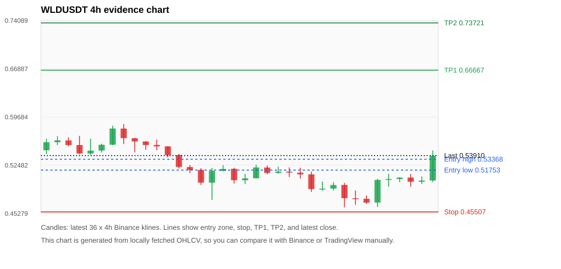
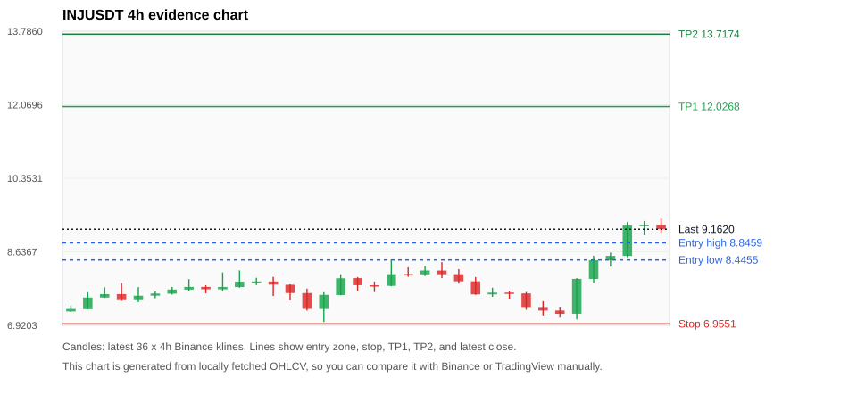
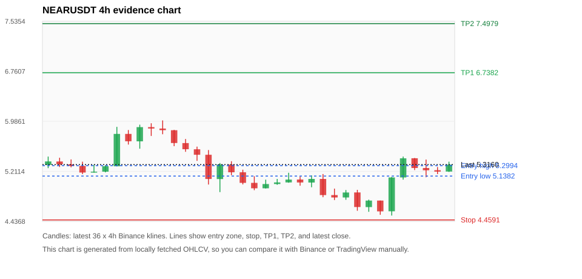
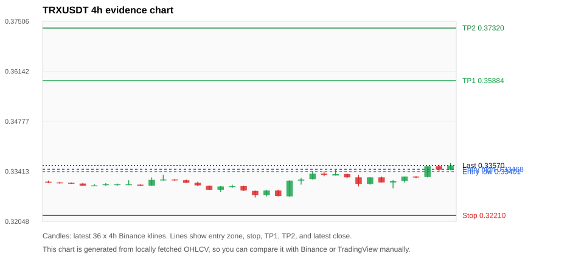
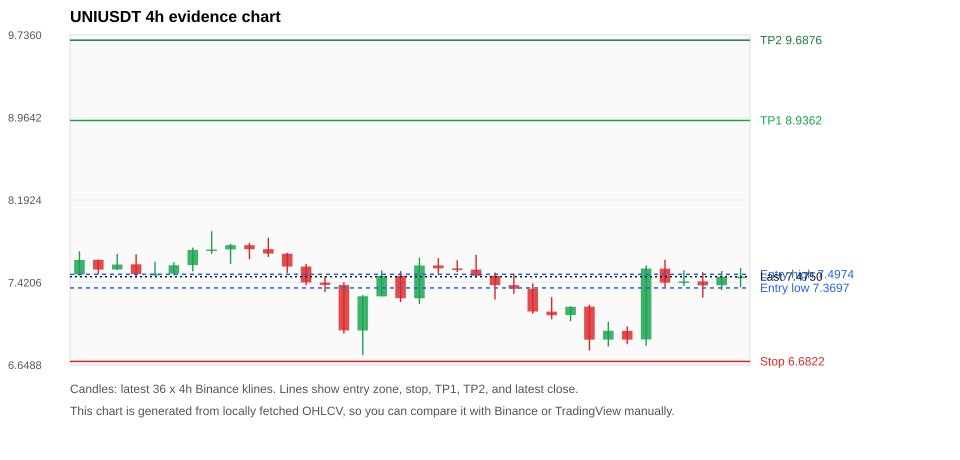

# Crypto 市场扫描报告 v1

- 报告时间：2026-10-16 20:06:21 CST
- Run ID：`20261016_120503_6504f6a9`
- Run type：`daily_full`
- Data validation mode：`paper`
- 数据来源：SQLite
- 报告版本：v1
- 扫描 ID：f9f42a63c440
- 数据源：Binance public spot API + CoinGecko/CoinMarketCap cross-check
- 过滤条件：USDT spot; 24h quote volume >= 30,000,000; trades >= 30,000; exclude stables/leveraged tokens; analyze 1h/4h/1d klines
- 默认单笔风险：账户权益的 1.00%

## 限制说明

- 交易信号仍以 Binance 现货公开 K 线为主源；外部数据源用于一致性复核。
- 结果是研究和模拟盘计划，不是确定收益或实盘下单指令。
- 历史长度过滤：候选币至少需要 180 根 1d K 线。
- 数据质量验证池：先验证 score 排名前 min(top_n * 2, 10) 的候选，再按 action + score 补足最终名单。
- 指标截止：2026-10-16T12:05:09.165000+00:00；仅使用此前至少60秒已闭合K线，ticker为扫描时点观测。
- 大盘环境过滤：RISK_OFF; BTC/ETH 大盘偏弱，山寨币买入候选降级为观察。 BTC 7d=0.6011660527347473; ETH 7d=-1.3221270405689434.
- Data cross-validation enabled: Binance primary source plus CoinGecko; CoinMarketCap is checked when an API key is configured.
- WLDUSDT validation state BLOCKED: BLOCKED: [BINANCE_KLINE_EXTREME_RANGE] Binance candle range exceeds 40%.; [EXTERNAL_IDENTITY_AMBIGUOUS] CoinMarketCap symbol mapping has 2 matches; selected lowest cmc_rank
- UNIUSDT validation state DEGRADED: DEGRADED: [EXTERNAL_IDENTITY_AMBIGUOUS] CoinMarketCap symbol mapping has 7 matches; selected lowest cmc_rank
- AVAXUSDT validation state DEGRADED: DEGRADED: [EXTERNAL_PROVIDER_RATE_LIMITED] Provider rate limited request for https://api.coingecko.com/api/v3/coins/markets?vs_currency=usd&ids=avalanche-2&price_change_percentage=24h&per_page=1&page=1: HTTP 429
- ZECUSDT validation state BLOCKED: BLOCKED: [BINANCE_KLINE_EXTREME_RANGE] Binance candle range exceeds 40%.; [BINANCE_KLINE_EXTREME_RANGE] Binance candle range exceeds 40%.; [EXTERNAL_PROVIDER_RATE_LIMITED] Provider rate limited request for https://api.coingecko.com/api/v3/coins/markets?vs_currency=usd&ids=zcash&price_change_percentage=24h&per_page=1&page=1: HTTP 429; [EXTERNAL_IDENTITY_AMBIGUOUS] CoinMarketCap symbol mapping has 2 matches; selected lowest cmc_rank
- ETHUSDT validation state DEGRADED: DEGRADED: [EXTERNAL_PROVIDER_RATE_LIMITED] Provider rate limited request for https://api.coingecko.com/api/v3/coins/markets?vs_currency=usd&ids=ethereum&price_change_percentage=24h&per_page=1&page=1: HTTP 429; [EXTERNAL_IDENTITY_AMBIGUOUS] CoinMarketCap symbol mapping has 6 matches; selected lowest cmc_rank
- BTCUSDT validation state DEGRADED: DEGRADED: [EXTERNAL_PROVIDER_RATE_LIMITED] Provider rate limited request for https://api.coingecko.com/api/v3/coins/markets?vs_currency=usd&ids=bitcoin&price_change_percentage=24h&per_page=1&page=1: HTTP 429; [EXTERNAL_IDENTITY_AMBIGUOUS] CoinMarketCap symbol mapping has 13 matches; selected lowest cmc_rank
- SUIUSDT validation state DEGRADED: DEGRADED: [EXTERNAL_PROVIDER_RATE_LIMITED] Provider rate limited request for https://api.coingecko.com/api/v3/coins/markets?vs_currency=usd&ids=sui&price_change_percentage=24h&per_page=1&page=1: HTTP 429; [EXTERNAL_IDENTITY_AMBIGUOUS] CoinMarketCap symbol mapping has 5 matches; selected lowest cmc_rank

## 5 个候选交易计划

| Rank | Coin | Action | Setup | Entry Zone | Stop Loss | TP1 | TP2 / Exit Rule | R/R | Verdict |
|---:|---|---|---|---:|---:|---:|---|---:|---|
| 1 | `WLD` | `WAIT_PULLBACK` | 趋势中，等回调入场 | 0.51753 - 0.53368 | 0.45507 | 0.66667 | 0.73721 或跌破 4h 关键支撑 | 2.00-3.00 | 只观察 |
| 2 | `INJ` | `WATCH_ONLY` | 涨幅较远，只等深回调 | 8.4455 - 8.8459 | 6.9551 | 12.0268 | 13.7174 或跌破 4h 关键支撑 | 2.00-3.00 | 只等回调 |
| 3 | `NEAR` | `WATCH_ONLY` | 回踩支撑/4h EMA 附近 | 5.1382 - 5.2994 | 4.4591 | 6.7382 | 7.4979 或跌破 4h 关键支撑 | 2.00-3.00 | 只观察 |
| 4 | `TRX` | `WATCH_ONLY` | 回踩支撑/4h EMA 附近 | 0.33401 - 0.33468 | 0.32210 | 0.35884 | 0.37320 或跌破 4h 关键支撑 | 2.00-3.17 | 只观察 |
| 5 | `UNI` | `WATCH_ONLY` | 回踩支撑/4h EMA 附近 | 7.3697 - 7.4974 | 6.6822 | 8.9362 | 9.6876 或跌破 4h 关键支撑 | 2.00-3.00 | 只观察 |

## 数据交叉验证摘要

价格差异以 Binance 当前价为基准；成交量口径不同，Binance 是 USDT 现货成交额，CoinGecko/CoinMarketCap 通常是全市场成交量。

| Rank | Coin | State | Identity | Max Price Diff | Max 24h Diff | Issue Codes | Message |
|---:|---|---|---|---:|---:|---|---|
| 1 | `WLD` | BLOCKED (DATA_ERROR) | UNCONFIRMED | 0.42% | 0.34 pts | BINANCE_KLINE_EXTREME_RANGE, EXTERNAL_IDENTITY_AMBIGUOUS | BLOCKED: [BINANCE_KLINE_EXTREME_RANGE] Binance candle range exceeds 40%.; [EXTERNAL_IDENTITY_AMBIGUOUS] CoinMarketCap symbol mapping has 2 matches; selected lowest cmc_rank |
| 2 | `INJ` | CLEAN (DATA_OK) | CONFIRMED | 0.24% | 0.17 pts | none | CLEAN: External provider checks agree with Binance within configured thresholds. |
| 3 | `NEAR` | CLEAN (DATA_OK) | CONFIRMED | 0.49% | 0.01 pts | none | CLEAN: External provider checks agree with Binance within configured thresholds. |
| 4 | `TRX` | CLEAN (DATA_OK) | CONFIRMED | 0.13% | 0.11 pts | none | CLEAN: External provider checks agree with Binance within configured thresholds. |
| 5 | `UNI` | DEGRADED (DATA_WARNING) | UNCONFIRMED | 0.47% | 0.07 pts | EXTERNAL_IDENTITY_AMBIGUOUS | DEGRADED: [EXTERNAL_IDENTITY_AMBIGUOUS] CoinMarketCap symbol mapping has 7 matches; selected lowest cmc_rank |

## 候选币说明

### 1. WLD `WLDUSDT`



- 入选原因：趋势中，等回调入场；24h +14.43%，7d +9.04%，4h RSI 58.43，24h 成交额 $46.8M。
- 交易失效条件：跌破 0.45507 或 4h 收盘重新失守关键支撑。
- 主要风险：BTC/ETH 大盘环境未确认强势，山寨币买入信号降级；Blocking data-quality issue detected; paper plan creation is not allowed.。
- 数据交叉验证：BLOCKED / DATA_ERROR；身份=UNCONFIRMED；BLOCKED: [BINANCE_KLINE_EXTREME_RANGE] Binance candle range exceeds 40%.; [EXTERNAL_IDENTITY_AMBIGUOUS] CoinMarketCap symbol mapping has 2 matches; selected lowest cmc_rank

#### 可点击人工验证

- [Binance 交易页](https://www.binance.com/en/trade/WLD_USDT)
- [TradingView 图表](https://www.tradingview.com/chart/?symbol=BINANCE%3AWLDUSDT)
- [CoinGecko 搜索](https://www.coingecko.com/en/search?query=WLD)
- [CoinMarketCap 搜索](https://coinmarketcap.com/search/?q=WLD)

#### 多数据源对照

| Source | Status | Identity | Blocking | Asset ID | Price | 24h Change | 24h Volume | Price Diff | 24h Diff | Updated | Issue Codes | Message |
|---|---|---|---:|---|---:|---:|---:|---:|---:|---|---|---|
| Binance | DATA_ERROR | CONFIRMED | yes | WLDUSDT | 0.53910 | +14.43% | $46.8M | 0.00% | 0.00 pts | 2026-10-16T12:05:40+00:00 | BINANCE_KLINE_EXTREME_RANGE | [BINANCE_KLINE_EXTREME_RANGE] Binance candle range exceeds 40%. |
| CoinGecko | DATA_OK | CONFIRMED | no | worldcoin-wld | 0.53684 | +14.61% | $376.9M | 0.42% | 0.18 pts | 2026-10-16T12:04:59.000Z | none | External source agrees with Binance within thresholds. |
| CoinMarketCap | DATA_WARNING | UNCONFIRMED | no | 13502 | 0.53715 | +14.77% | $385.2M | 0.36% | 0.34 pts | 2026-10-16T12:04:02.000Z | EXTERNAL_IDENTITY_AMBIGUOUS | [EXTERNAL_IDENTITY_AMBIGUOUS] CoinMarketCap symbol mapping has 2 matches; selected lowest cmc_rank |

#### 指标证据

| 指标 | 数值 | 人工核对用途 |
|---|---:|---|
| 当前价 | 0.53910 | 与 Binance/TradingView 当前价格对照 |
| 24h 涨跌 | +14.43% | 与交易所 24h 涨跌对照 |
| 7d 涨跌 | +9.04% | 判断短线趋势是否延续 |
| 4h EMA20 | 0.50676 | 判断短期趋势支撑 |
| 4h EMA50 | 0.51650 | 判断中期趋势支撑 |
| 1d EMA20 | 0.51093 | 判断日线趋势 |
| 1d EMA50 | 0.47032 | 判断日线趋势 |
| 4h RSI14 | 58.43 | 判断是否过热/过弱 |
| 4h ATR14 | 0.02169 | 推导止损和入场缓冲 |
| 最近 18 根 4h 最低点 | 0.46200 | 支撑/止损参考 |
| 最近 36 根 4h 最高点 | 0.58620 | TP/压力参考 |
| 支撑位 | 0.51650 | 入场区间推导基础 |

#### 交易计划推导

- 支撑位 = 最近低点、4h EMA20、4h EMA50、1d EMA20 中不高于当前价的最高有效支撑 = `0.51650`。
- 入场区间 = 支撑位附近 + ATR 缓冲 = `0.51753 - 0.53368`。
- 止损 = min(最近 18 根 4h 最低点 * 0.985, 入场中位价 - 1.15 * ATR14) = `0.45507`。
- TP1 = max(最近 36 根 4h 最高点 * 0.995, 入场中位价 + 2R) = `0.66667`。
- TP2 = max(入场中位价 + 3R, TP1 * 1.04) = `0.73721`。

#### 最近 10 根 4h K线

| UTC 开盘时间 | Open | High | Low | Close | Quote Volume | Trades |
|---|---:|---:|---:|---:|---:|---:|
| 2026-10-14T20:00+00:00 | 0.48990 | 0.49950 | 0.48690 | 0.49520 | $2.5M | 15965 |
| 2026-10-15T00:00+00:00 | 0.49530 | 0.49850 | 0.46200 | 0.47560 | $9.3M | 62759 |
| 2026-10-15T04:00+00:00 | 0.47550 | 0.48710 | 0.46570 | 0.47460 | $5.3M | 39939 |
| 2026-10-15T08:00+00:00 | 0.47470 | 0.47960 | 0.46690 | 0.46890 | $3.6M | 27582 |
| 2026-10-15T12:00+00:00 | 0.46900 | 0.50460 | 0.46250 | 0.50280 | $10.2M | 72828 |
| 2026-10-15T16:00+00:00 | 0.50280 | 0.51200 | 0.49280 | 0.50410 | $7.4M | 52016 |
| 2026-10-15T20:00+00:00 | 0.50410 | 0.50710 | 0.49960 | 0.50630 | $3.3M | 25888 |
| 2026-10-16T00:00+00:00 | 0.50640 | 0.51170 | 0.49290 | 0.50010 | $4.1M | 31379 |
| 2026-10-16T04:00+00:00 | 0.50010 | 0.50790 | 0.49680 | 0.50190 | $2.8M | 26592 |
| 2026-10-16T08:00+00:00 | 0.50200 | 0.54670 | 0.49970 | 0.53910 | $18.9M | 137096 |

### 2. INJ `INJUSDT`



- 入选原因：涨幅较远，只等深回调；24h +27.47%，7d +30.68%，4h RSI 64.72，24h 成交额 $48.1M。
- 交易失效条件：跌破 6.955085 或 4h 收盘重新失守关键支撑。
- 主要风险：距离支撑偏远，不能追市价；24h 振幅较大，回撤风险高；成交量突增，可能是事件驱动；BTC/ETH 大盘环境未确认强势，山寨币买入信号降级。
- 数据交叉验证：CLEAN / DATA_OK；身份=CONFIRMED；CLEAN: External provider checks agree with Binance within configured thresholds.

#### 可点击人工验证

- [Binance 交易页](https://www.binance.com/en/trade/INJ_USDT)
- [TradingView 图表](https://www.tradingview.com/chart/?symbol=BINANCE%3AINJUSDT)
- [CoinGecko 搜索](https://www.coingecko.com/en/search?query=INJ)
- [CoinMarketCap 搜索](https://coinmarketcap.com/search/?q=INJ)

#### 多数据源对照

| Source | Status | Identity | Blocking | Asset ID | Price | 24h Change | 24h Volume | Price Diff | 24h Diff | Updated | Issue Codes | Message |
|---|---|---|---:|---|---:|---:|---:|---:|---:|---|---|---|
| Binance | DATA_OK | CONFIRMED | no | INJUSDT | 9.1620 | +27.47% | $48.1M | 0.00% | 0.00 pts | 2026-10-16T12:05:40+00:00 | none | Primary market data source passed health checks. |
| CoinGecko | DATA_OK | CONFIRMED | no | injective-protocol | 9.1400 | +27.55% | $346.0M | 0.24% | 0.09 pts | 2026-10-16T12:04:59.000Z | none | External source agrees with Binance within thresholds. |
| CoinMarketCap | DATA_OK | CONFIRMED | no | 7226 | 9.1526 | +27.30% | $317.2M | 0.10% | 0.17 pts | 2026-10-16T12:04:02.000Z | none | External source agrees with Binance within thresholds. |

#### 指标证据

| 指标 | 数值 | 人工核对用途 |
|---|---:|---|
| 当前价 | 9.1620 | 与 Binance/TradingView 当前价格对照 |
| 24h 涨跌 | +27.47% | 与交易所 24h 涨跌对照 |
| 7d 涨跌 | +30.68% | 判断短线趋势是否延续 |
| 4h EMA20 | 8.1918 | 判断短期趋势支撑 |
| 4h EMA50 | 7.8608 | 判断中期趋势支撑 |
| 1d EMA20 | 7.5573 | 判断日线趋势 |
| 1d EMA50 | 6.8747 | 判断日线趋势 |
| 4h RSI14 | 64.72 | 判断是否过热/过弱 |
| 4h ATR14 | 0.42150 | 推导止损和入场缓冲 |
| 最近 18 根 4h 最低点 | 7.0610 | 支撑/止损参考 |
| 最近 36 根 4h 最高点 | 9.4130 | TP/压力参考 |
| 支撑位 | 8.1918 | 入场区间推导基础 |

#### 交易计划推导

- 支撑位 = 最近低点、4h EMA20、4h EMA50、1d EMA20 中不高于当前价的最高有效支撑 = `8.1918`。
- 入场区间 = 支撑位附近 + ATR 缓冲 = `8.4455 - 8.8459`。
- 止损 = min(最近 18 根 4h 最低点 * 0.985, 入场中位价 - 1.15 * ATR14) = `6.9551`。
- TP1 = max(最近 36 根 4h 最高点 * 0.995, 入场中位价 + 2R) = `12.0268`。
- TP2 = max(入场中位价 + 3R, TP1 * 1.04) = `13.7174`。

#### 最近 10 根 4h K线

| UTC 开盘时间 | Open | High | Low | Close | Quote Volume | Trades |
|---|---:|---:|---:|---:|---:|---:|
| 2026-10-14T20:00+00:00 | 7.6850 | 7.7170 | 7.5340 | 7.6650 | $1.0M | 19058 |
| 2026-10-15T00:00+00:00 | 7.6660 | 7.6990 | 7.2850 | 7.3280 | $2.6M | 40430 |
| 2026-10-15T04:00+00:00 | 7.3280 | 7.4840 | 7.1520 | 7.2660 | $2.8M | 37458 |
| 2026-10-15T08:00+00:00 | 7.2670 | 7.3380 | 7.1020 | 7.1900 | $2.0M | 23574 |
| 2026-10-15T12:00+00:00 | 7.1920 | 8.0210 | 7.0610 | 8.0040 | $5.9M | 64791 |
| 2026-10-15T16:00+00:00 | 8.0030 | 8.5450 | 7.9140 | 8.4400 | $8.6M | 107459 |
| 2026-10-15T20:00+00:00 | 8.4380 | 8.6180 | 8.2920 | 8.5410 | $4.2M | 46224 |
| 2026-10-16T00:00+00:00 | 8.5410 | 9.3340 | 8.5070 | 9.2490 | $14.0M | 147986 |
| 2026-10-16T04:00+00:00 | 9.2480 | 9.3570 | 9.0240 | 9.2640 | $7.6M | 94383 |
| 2026-10-16T08:00+00:00 | 9.2640 | 9.4130 | 9.0870 | 9.1620 | $7.7M | 105705 |

### 3. NEAR `NEARUSDT`



- 入选原因：回踩支撑/4h EMA 附近；24h +15.51%，7d +10.75%，4h RSI 55.54，24h 成交额 $217.8M。
- 交易失效条件：跌破 4.459095 或 4h 收盘重新失守关键支撑。
- 主要风险：BTC/ETH 大盘环境未确认强势，山寨币买入信号降级。
- 数据交叉验证：CLEAN / DATA_OK；身份=CONFIRMED；CLEAN: External provider checks agree with Binance within configured thresholds.

#### 可点击人工验证

- [Binance 交易页](https://www.binance.com/en/trade/NEAR_USDT)
- [TradingView 图表](https://www.tradingview.com/chart/?symbol=BINANCE%3ANEARUSDT)
- [CoinGecko 搜索](https://www.coingecko.com/en/search?query=NEAR)
- [CoinMarketCap 搜索](https://coinmarketcap.com/search/?q=NEAR)

#### 多数据源对照

| Source | Status | Identity | Blocking | Asset ID | Price | 24h Change | 24h Volume | Price Diff | 24h Diff | Updated | Issue Codes | Message |
|---|---|---|---:|---|---:|---:|---:|---:|---:|---|---|---|
| Binance | DATA_OK | CONFIRMED | no | NEARUSDT | 5.3160 | +15.51% | $217.8M | 0.00% | 0.00 pts | 2026-10-16T12:05:40+00:00 | none | Primary market data source passed health checks. |
| CoinGecko | DATA_OK | CONFIRMED | no | near | 5.2900 | +15.52% | $1.37B | 0.49% | 0.01 pts | 2026-10-16T12:04:59.000Z | none | External source agrees with Binance within thresholds. |
| CoinMarketCap | DATA_OK | CONFIRMED | no | 6535 | 5.3034 | +15.51% | $1.55B | 0.24% | 0.00 pts | 2026-10-16T12:04:02.000Z | none | External source agrees with Binance within thresholds. |

#### 指标证据

| 指标 | 数值 | 人工核对用途 |
|---|---:|---|
| 当前价 | 5.3160 | 与 Binance/TradingView 当前价格对照 |
| 24h 涨跌 | +15.51% | 与交易所 24h 涨跌对照 |
| 7d 涨跌 | +10.75% | 判断短线趋势是否延续 |
| 4h EMA20 | 5.1162 | 判断短期趋势支撑 |
| 4h EMA50 | 5.1280 | 判断中期趋势支撑 |
| 1d EMA20 | 4.8731 | 判断日线趋势 |
| 1d EMA50 | 4.0053 | 判断日线趋势 |
| 4h RSI14 | 55.54 | 判断是否过热/过弱 |
| 4h ATR14 | 0.24486 | 推导止损和入场缓冲 |
| 最近 18 根 4h 最低点 | 4.5270 | 支撑/止损参考 |
| 最近 36 根 4h 最高点 | 6.0000 | TP/压力参考 |
| 支撑位 | 5.1280 | 入场区间推导基础 |

#### 交易计划推导

- 支撑位 = 最近低点、4h EMA20、4h EMA50、1d EMA20 中不高于当前价的最高有效支撑 = `5.1280`。
- 入场区间 = 支撑位附近 + ATR 缓冲 = `5.1382 - 5.2994`。
- 止损 = min(最近 18 根 4h 最低点 * 0.985, 入场中位价 - 1.15 * ATR14) = `4.4591`。
- TP1 = max(最近 36 根 4h 最高点 * 0.995, 入场中位价 + 2R) = `6.7382`。
- TP2 = max(入场中位价 + 3R, TP1 * 1.04) = `7.4979`。

#### 最近 10 根 4h K线

| UTC 开盘时间 | Open | High | Low | Close | Quote Volume | Trades |
|---|---:|---:|---:|---:|---:|---:|
| 2026-10-14T20:00+00:00 | 4.8070 | 4.9220 | 4.7710 | 4.8840 | $16.6M | 83221 |
| 2026-10-15T00:00+00:00 | 4.8850 | 4.9250 | 4.6010 | 4.6590 | $42.3M | 174537 |
| 2026-10-15T04:00+00:00 | 4.6580 | 4.7730 | 4.5850 | 4.7590 | $27.8M | 113253 |
| 2026-10-15T08:00+00:00 | 4.7590 | 4.7590 | 4.5390 | 4.5920 | $16.9M | 79270 |
| 2026-10-15T12:00+00:00 | 4.5930 | 5.1250 | 4.5270 | 5.1170 | $61.7M | 242425 |
| 2026-10-15T16:00+00:00 | 5.1170 | 5.4400 | 5.0830 | 5.4130 | $48.8M | 182184 |
| 2026-10-15T20:00+00:00 | 5.4140 | 5.4180 | 5.2310 | 5.2630 | $30.4M | 109284 |
| 2026-10-16T00:00+00:00 | 5.2630 | 5.3940 | 5.1200 | 5.2280 | $29.0M | 101136 |
| 2026-10-16T04:00+00:00 | 5.2290 | 5.2780 | 5.1690 | 5.2070 | $19.0M | 77186 |
| 2026-10-16T08:00+00:00 | 5.2080 | 5.3610 | 5.2020 | 5.3160 | $28.6M | 85338 |

### 4. TRX `TRXUSDT`



- 入选原因：回踩支撑/4h EMA 附近；24h +1.51%，7d +0.87%，4h RSI 63.58，24h 成交额 $33.7M。
- 交易失效条件：跌破 0.322095 或 4h 收盘重新失守关键支撑。
- 主要风险：BTC/ETH 大盘环境未确认强势，山寨币买入信号降级。
- 数据交叉验证：CLEAN / DATA_OK；身份=CONFIRMED；CLEAN: External provider checks agree with Binance within configured thresholds.

#### 可点击人工验证

- [Binance 交易页](https://www.binance.com/en/trade/TRX_USDT)
- [TradingView 图表](https://www.tradingview.com/chart/?symbol=BINANCE%3ATRXUSDT)
- [CoinGecko 搜索](https://www.coingecko.com/en/search?query=TRX)
- [CoinMarketCap 搜索](https://coinmarketcap.com/search/?q=TRX)

#### 多数据源对照

| Source | Status | Identity | Blocking | Asset ID | Price | 24h Change | 24h Volume | Price Diff | 24h Diff | Updated | Issue Codes | Message |
|---|---|---|---:|---|---:|---:|---:|---:|---:|---|---|---|
| Binance | DATA_OK | CONFIRMED | no | TRXUSDT | 0.33570 | +1.51% | $33.7M | 0.00% | 0.00 pts | 2026-10-16T12:05:40+00:00 | none | Primary market data source passed health checks. |
| CoinGecko | DATA_OK | CONFIRMED | no | tron | 0.33543 | +1.48% | $399.5M | 0.08% | 0.03 pts | 2026-10-16T12:04:59.000Z | none | External source agrees with Binance within thresholds. |
| CoinMarketCap | DATA_OK | CONFIRMED | no | 1958 | 0.33527 | +1.40% | $497.6M | 0.13% | 0.11 pts | 2026-10-16T12:04:02.000Z | none | External source agrees with Binance within thresholds. |

#### 指标证据

| 指标 | 数值 | 人工核对用途 |
|---|---:|---|
| 当前价 | 0.33570 | 与 Binance/TradingView 当前价格对照 |
| 24h 涨跌 | +1.51% | 与交易所 24h 涨跌对照 |
| 7d 涨跌 | +0.87% | 判断短线趋势是否延续 |
| 4h EMA20 | 0.33253 | 判断短期趋势支撑 |
| 4h EMA50 | 0.33233 | 判断中期趋势支撑 |
| 1d EMA20 | 0.33335 | 判断日线趋势 |
| 1d EMA50 | 0.33447 | 判断日线趋势 |
| 4h RSI14 | 63.58 | 判断是否过热/过弱 |
| 4h ATR14 | 0.0019 | 推导止损和入场缓冲 |
| 最近 18 根 4h 最低点 | 0.32700 | 支撑/止损参考 |
| 最近 36 根 4h 最高点 | 0.33640 | TP/压力参考 |
| 支撑位 | 0.33335 | 入场区间推导基础 |

#### 交易计划推导

- 支撑位 = 最近低点、4h EMA20、4h EMA50、1d EMA20 中不高于当前价的最高有效支撑 = `0.33335`。
- 入场区间 = 支撑位附近 + ATR 缓冲 = `0.33401 - 0.33468`。
- 止损 = min(最近 18 根 4h 最低点 * 0.985, 入场中位价 - 1.15 * ATR14) = `0.32210`。
- TP1 = max(最近 36 根 4h 最高点 * 0.995, 入场中位价 + 2R) = `0.35884`。
- TP2 = max(入场中位价 + 3R, TP1 * 1.04) = `0.37320`。

#### 最近 10 根 4h K线

| UTC 开盘时间 | Open | High | Low | Close | Quote Volume | Trades |
|---|---:|---:|---:|---:|---:|---:|
| 2026-10-14T20:00+00:00 | 0.33340 | 0.33350 | 0.33220 | 0.33250 | $3.3M | 6032 |
| 2026-10-15T00:00+00:00 | 0.33250 | 0.33320 | 0.33000 | 0.33070 | $10.5M | 13615 |
| 2026-10-15T04:00+00:00 | 0.33070 | 0.33250 | 0.33050 | 0.33250 | $6.5M | 10844 |
| 2026-10-15T08:00+00:00 | 0.33250 | 0.33270 | 0.33110 | 0.33110 | $5.5M | 11291 |
| 2026-10-15T12:00+00:00 | 0.33110 | 0.33170 | 0.32950 | 0.33150 | $9.7M | 17547 |
| 2026-10-15T16:00+00:00 | 0.33150 | 0.33270 | 0.33110 | 0.33270 | $4.6M | 9888 |
| 2026-10-15T20:00+00:00 | 0.33270 | 0.33280 | 0.33220 | 0.33260 | $2.2M | 6551 |
| 2026-10-16T00:00+00:00 | 0.33260 | 0.33550 | 0.33250 | 0.33550 | $7.1M | 13026 |
| 2026-10-16T04:00+00:00 | 0.33550 | 0.33590 | 0.33400 | 0.33460 | $4.5M | 10803 |
| 2026-10-16T08:00+00:00 | 0.33460 | 0.33640 | 0.33440 | 0.33570 | $6.0M | 12304 |

### 5. UNI `UNIUSDT`



- 入选原因：回踩支撑/4h EMA 附近；24h +8.36%，7d +1.65%，4h RSI 49.76，24h 成交额 $56.7M。
- 交易失效条件：跌破 6.68224 或 4h 收盘重新失守关键支撑。
- 主要风险：日线趋势未完全确认；BTC/ETH 大盘环境未确认强势，山寨币买入信号降级；External validation is degraded; this candidate is not a clean data sample.；Paper mode allows degraded validation; candidate is excluded from clean-data samples.。
- 数据交叉验证：DEGRADED / DATA_WARNING；身份=UNCONFIRMED；DEGRADED: [EXTERNAL_IDENTITY_AMBIGUOUS] CoinMarketCap symbol mapping has 7 matches; selected lowest cmc_rank

#### 可点击人工验证

- [Binance 交易页](https://www.binance.com/en/trade/UNI_USDT)
- [TradingView 图表](https://www.tradingview.com/chart/?symbol=BINANCE%3AUNIUSDT)
- [CoinGecko 搜索](https://www.coingecko.com/en/search?query=UNI)
- [CoinMarketCap 搜索](https://coinmarketcap.com/search/?q=UNI)

#### 多数据源对照

| Source | Status | Identity | Blocking | Asset ID | Price | 24h Change | 24h Volume | Price Diff | 24h Diff | Updated | Issue Codes | Message |
|---|---|---|---:|---|---:|---:|---:|---:|---:|---|---|---|
| Binance | DATA_OK | CONFIRMED | no | UNIUSDT | 7.4750 | +8.36% | $56.7M | 0.00% | 0.00 pts | 2026-10-16T12:05:40+00:00 | none | Primary market data source passed health checks. |
| CoinGecko | DATA_OK | CONFIRMED | no | uniswap | 7.4400 | +8.34% | $596.8M | 0.47% | 0.02 pts | 2026-10-16T12:04:59.000Z | none | External source agrees with Binance within thresholds. |
| CoinMarketCap | DATA_WARNING | UNCONFIRMED | no | 7083 | 7.4500 | +8.43% | $621.4M | 0.33% | 0.07 pts | 2026-10-16T12:04:02.000Z | EXTERNAL_IDENTITY_AMBIGUOUS | [EXTERNAL_IDENTITY_AMBIGUOUS] CoinMarketCap symbol mapping has 7 matches; selected lowest cmc_rank |

#### 指标证据

| 指标 | 数值 | 人工核对用途 |
|---|---:|---|
| 当前价 | 7.4750 | 与 Binance/TradingView 当前价格对照 |
| 24h 涨跌 | +8.36% | 与交易所 24h 涨跌对照 |
| 7d 涨跌 | +1.65% | 判断短线趋势是否延续 |
| 4h EMA20 | 7.3550 | 判断短期趋势支撑 |
| 4h EMA50 | 7.5685 | 判断中期趋势支撑 |
| 1d EMA20 | 7.9028 | 判断日线趋势 |
| 1d EMA50 | 7.3237 | 判断日线趋势 |
| 4h RSI14 | 49.76 | 判断是否过热/过弱 |
| 4h ATR14 | 0.26057 | 推导止损和入场缓冲 |
| 最近 18 根 4h 最低点 | 6.7840 | 支撑/止损参考 |
| 最近 36 根 4h 最高点 | 7.9010 | TP/压力参考 |
| 支撑位 | 7.3550 | 入场区间推导基础 |

#### 交易计划推导

- 支撑位 = 最近低点、4h EMA20、4h EMA50、1d EMA20 中不高于当前价的最高有效支撑 = `7.3550`。
- 入场区间 = 支撑位附近 + ATR 缓冲 = `7.3697 - 7.4974`。
- 止损 = min(最近 18 根 4h 最低点 * 0.985, 入场中位价 - 1.15 * ATR14) = `6.6822`。
- TP1 = max(最近 36 根 4h 最高点 * 0.995, 入场中位价 + 2R) = `8.9362`。
- TP2 = max(入场中位价 + 3R, TP1 * 1.04) = `9.6876`。

#### 最近 10 根 4h K线

| UTC 开盘时间 | Open | High | Low | Close | Quote Volume | Trades |
|---|---:|---:|---:|---:|---:|---:|
| 2026-10-14T20:00+00:00 | 7.1160 | 7.1980 | 7.0590 | 7.1930 | $2.8M | 19557 |
| 2026-10-15T00:00+00:00 | 7.1950 | 7.2130 | 6.7840 | 6.8860 | $12.2M | 65951 |
| 2026-10-15T04:00+00:00 | 6.8870 | 7.0530 | 6.8220 | 6.9690 | $6.2M | 38425 |
| 2026-10-15T08:00+00:00 | 6.9680 | 7.0110 | 6.8430 | 6.8860 | $6.9M | 36560 |
| 2026-10-15T12:00+00:00 | 6.8880 | 7.5810 | 6.8300 | 7.5510 | $26.1M | 104847 |
| 2026-10-15T16:00+00:00 | 7.5500 | 7.6340 | 7.3790 | 7.4190 | $9.2M | 44495 |
| 2026-10-15T20:00+00:00 | 7.4190 | 7.5350 | 7.3900 | 7.4310 | $4.3M | 23107 |
| 2026-10-16T00:00+00:00 | 7.4310 | 7.5170 | 7.2790 | 7.3940 | $5.5M | 28980 |
| 2026-10-16T04:00+00:00 | 7.3950 | 7.5280 | 7.3500 | 7.4740 | $4.7M | 27920 |
| 2026-10-16T08:00+00:00 | 7.4730 | 7.5560 | 7.3760 | 7.4750 | $6.9M | 44471 |

## 组合风控

- 不要 5 个候选全部满仓买入。
- 同时持仓总风险建议控制在账户权益的 3% - 5% 以内。
- 如果 BTC/ETH 同时破位，暂停山寨币多头计划或降低仓位。
- 第一版报告用于模拟盘和人工复核，不自动下单。

## 原始数据

```json
[
  {
    "rank": 1,
    "symbol": "WLDUSDT",
    "base_asset": "WLD",
    "price": 0.5391,
    "score": 47.95019908494952,
    "setup": "趋势中，等回调入场",
    "verdict": "只观察",
    "entry_low": 0.5175293695918213,
    "entry_high": 0.5336785714285714,
    "stop_loss": 0.45507000000000003,
    "take_profit_1": 0.666671911530589,
    "take_profit_2": 0.7372058820407854,
    "risk_reward_1": 2.0,
    "risk_reward_2": 3.000000000000001,
    "pct_24h": 14.426,
    "pct_3d": 6.604706347636946,
    "pct_7d": 9.041262135922334,
    "quote_volume_24h": 46813886.03722,
    "trades_24h": 346719,
    "high_low_range_24h": 18.205405405405383,
    "rsi_1h": 70.5156950672646,
    "rsi_4h": 58.42776203966007,
    "ema20_4h": 0.506758042418733,
    "ema50_4h": 0.516496376838145,
    "ema20_1d": 0.5109311910684562,
    "ema50_1d": 0.4703162071481525,
    "atr_4h": 0.021685714285714284,
    "macd_hist_4h": 0.004586804682239307,
    "volume_ratio_24h": 1.2216281359978072,
    "support_level": 0.516496376838145,
    "recent_low_4h_18": 0.462,
    "recent_high_4h_36": 0.5862,
    "distance_to_support_pct": 4.376337216579995,
    "binance_trade_url": "https://www.binance.com/en/trade/WLD_USDT",
    "tradingview_url": "https://www.tradingview.com/chart/?symbol=BINANCE%3AWLDUSDT",
    "coingecko_search_url": "https://www.coingecko.com/en/search?query=WLD",
    "coinmarketcap_search_url": "https://coinmarketcap.com/search/?q=WLD",
    "invalidation": "跌破 0.45507 或 4h 收盘重新失守关键支撑",
    "recent_4h_klines": [
      {
        "open_time_utc": "2026-10-10T12:00+00:00",
        "open": 0.5471,
        "high": 0.5642,
        "low": 0.5415,
        "close": 0.5592,
        "quote_volume": 7721187.71353,
        "trades": 61597
      },
      {
        "open_time_utc": "2026-10-10T16:00+00:00",
        "open": 0.5592,
        "high": 0.568,
        "low": 0.555,
        "close": 0.5619,
        "quote_volume": 6105535.63505,
        "trades": 48421
      },
      {
        "open_time_utc": "2026-10-10T20:00+00:00",
        "open": 0.5618,
        "high": 0.5661,
        "low": 0.5529,
        "close": 0.5549,
        "quote_volume": 2896233.74362,
        "trades": 26045
      },
      {
        "open_time_utc": "2026-10-11T00:00+00:00",
        "open": 0.5549,
        "high": 0.5686,
        "low": 0.5411,
        "close": 0.5423,
        "quote_volume": 7255793.50533,
        "trades": 44962
      },
      {
        "open_time_utc": "2026-10-11T04:00+00:00",
        "open": 0.5422,
        "high": 0.5645,
        "low": 0.5404,
        "close": 0.5466,
        "quote_volume": 6386283.32492,
        "trades": 39136
      },
      {
        "open_time_utc": "2026-10-11T08:00+00:00",
        "open": 0.5467,
        "high": 0.5569,
        "low": 0.5437,
        "close": 0.5553,
        "quote_volume": 2793309.21884,
        "trades": 21163
      },
      {
        "open_time_utc": "2026-10-11T12:00+00:00",
        "open": 0.5554,
        "high": 0.5838,
        "low": 0.5546,
        "close": 0.5796,
        "quote_volume": 10826861.51327,
        "trades": 60139
      },
      {
        "open_time_utc": "2026-10-11T16:00+00:00",
        "open": 0.5795,
        "high": 0.5862,
        "low": 0.5564,
        "close": 0.5652,
        "quote_volume": 8591450.35113,
        "trades": 46805
      },
      {
        "open_time_utc": "2026-10-11T20:00+00:00",
        "open": 0.5651,
        "high": 0.5655,
        "low": 0.544,
        "close": 0.5603,
        "quote_volume": 4952654.01358,
        "trades": 42723
      },
      {
        "open_time_utc": "2026-10-12T00:00+00:00",
        "open": 0.5602,
        "high": 0.5608,
        "low": 0.5478,
        "close": 0.555,
        "quote_volume": 4970914.88578,
        "trades": 40166
      },
      {
        "open_time_utc": "2026-10-12T04:00+00:00",
        "open": 0.5551,
        "high": 0.563,
        "low": 0.5471,
        "close": 0.5529,
        "quote_volume": 6754605.23294,
        "trades": 41871
      },
      {
        "open_time_utc": "2026-10-12T08:00+00:00",
        "open": 0.5529,
        "high": 0.5532,
        "low": 0.5366,
        "close": 0.5399,
        "quote_volume": 4955211.13137,
        "trades": 28114
      },
      {
        "open_time_utc": "2026-10-12T12:00+00:00",
        "open": 0.5398,
        "high": 0.5417,
        "low": 0.5198,
        "close": 0.5222,
        "quote_volume": 9679494.8874,
        "trades": 57031
      },
      {
        "open_time_utc": "2026-10-12T16:00+00:00",
        "open": 0.5221,
        "high": 0.5251,
        "low": 0.5129,
        "close": 0.5179,
        "quote_volume": 5290680.26564,
        "trades": 29839
      },
      {
        "open_time_utc": "2026-10-12T20:00+00:00",
        "open": 0.5178,
        "high": 0.5203,
        "low": 0.4953,
        "close": 0.4988,
        "quote_volume": 4608445.89983,
        "trades": 40643
      },
      {
        "open_time_utc": "2026-10-13T00:00+00:00",
        "open": 0.4987,
        "high": 0.5207,
        "low": 0.473,
        "close": 0.5164,
        "quote_volume": 17349729.71871,
        "trades": 124282
      },
      {
        "open_time_utc": "2026-10-13T04:00+00:00",
        "open": 0.5163,
        "high": 0.5249,
        "low": 0.5159,
        "close": 0.5192,
        "quote_volume": 6541994.39484,
        "trades": 37772
      },
      {
        "open_time_utc": "2026-10-13T08:00+00:00",
        "open": 0.5194,
        "high": 0.521,
        "low": 0.4974,
        "close": 0.5025,
        "quote_volume": 8183598.08784,
        "trades": 49640
      },
      {
        "open_time_utc": "2026-10-13T12:00+00:00",
        "open": 0.5024,
        "high": 0.5119,
        "low": 0.4966,
        "close": 0.5052,
        "quote_volume": 5966967.98793,
        "trades": 65255
      },
      {
        "open_time_utc": "2026-10-13T16:00+00:00",
        "open": 0.5053,
        "high": 0.5254,
        "low": 0.5051,
        "close": 0.5214,
        "quote_volume": 6224967.27157,
        "trades": 44926
      },
      {
        "open_time_utc": "2026-10-13T20:00+00:00",
        "open": 0.5213,
        "high": 0.5243,
        "low": 0.5113,
        "close": 0.5133,
        "quote_volume": 4316072.11497,
        "trades": 26150
      },
      {
        "open_time_utc": "2026-10-14T00:00+00:00",
        "open": 0.5133,
        "high": 0.5226,
        "low": 0.5122,
        "close": 0.5153,
        "quote_volume": 3430866.66558,
        "trades": 23975
      },
      {
        "open_time_utc": "2026-10-14T04:00+00:00",
        "open": 0.5152,
        "high": 0.5215,
        "low": 0.5071,
        "close": 0.5137,
        "quote_volume": 3037154.62929,
        "trades": 25468
      },
      {
        "open_time_utc": "2026-10-14T08:00+00:00",
        "open": 0.5137,
        "high": 0.5211,
        "low": 0.5048,
        "close": 0.5111,
        "quote_volume": 2970658.20863,
        "trades": 23450
      },
      {
        "open_time_utc": "2026-10-14T12:00+00:00",
        "open": 0.5111,
        "high": 0.5152,
        "low": 0.485,
        "close": 0.4891,
        "quote_volume": 12299974.23306,
        "trades": 71963
      },
      {
        "open_time_utc": "2026-10-14T16:00+00:00",
        "open": 0.4892,
        "high": 0.5004,
        "low": 0.4866,
        "close": 0.4898,
        "quote_volume": 3488329.12245,
        "trades": 23463
      },
      {
        "open_time_utc": "2026-10-14T20:00+00:00",
        "open": 0.4899,
        "high": 0.4995,
        "low": 0.4869,
        "close": 0.4952,
        "quote_volume": 2522629.1968,
        "trades": 15965
      },
      {
        "open_time_utc": "2026-10-15T00:00+00:00",
        "open": 0.4953,
        "high": 0.4985,
        "low": 0.462,
        "close": 0.4756,
        "quote_volume": 9290850.46369,
        "trades": 62759
      },
      {
        "open_time_utc": "2026-10-15T04:00+00:00",
        "open": 0.4755,
        "high": 0.4871,
        "low": 0.4657,
        "close": 0.4746,
        "quote_volume": 5346075.90086,
        "trades": 39939
      },
      {
        "open_time_utc": "2026-10-15T08:00+00:00",
        "open": 0.4747,
        "high": 0.4796,
        "low": 0.4669,
        "close": 0.4689,
        "quote_volume": 3640523.43047,
        "trades": 27582
      },
      {
        "open_time_utc": "2026-10-15T12:00+00:00",
        "open": 0.469,
        "high": 0.5046,
        "low": 0.4625,
        "close": 0.5028,
        "quote_volume": 10163903.74956,
        "trades": 72828
      },
      {
        "open_time_utc": "2026-10-15T16:00+00:00",
        "open": 0.5028,
        "high": 0.512,
        "low": 0.4928,
        "close": 0.5041,
        "quote_volume": 7381281.43965,
        "trades": 52016
      },
      {
        "open_time_utc": "2026-10-15T20:00+00:00",
        "open": 0.5041,
        "high": 0.5071,
        "low": 0.4996,
        "close": 0.5063,
        "quote_volume": 3314000.6511,
        "trades": 25888
      },
      {
        "open_time_utc": "2026-10-16T00:00+00:00",
        "open": 0.5064,
        "high": 0.5117,
        "low": 0.4929,
        "close": 0.5001,
        "quote_volume": 4084827.40029,
        "trades": 31379
      },
      {
        "open_time_utc": "2026-10-16T04:00+00:00",
        "open": 0.5001,
        "high": 0.5079,
        "low": 0.4968,
        "close": 0.5019,
        "quote_volume": 2817248.81023,
        "trades": 26592
      },
      {
        "open_time_utc": "2026-10-16T08:00+00:00",
        "open": 0.502,
        "high": 0.5467,
        "low": 0.4997,
        "close": 0.5391,
        "quote_volume": 18920858.06054,
        "trades": 137096
      }
    ],
    "risks": [
      "BTC/ETH 大盘环境未确认强势，山寨币买入信号降级",
      "Blocking data-quality issue detected; paper plan creation is not allowed."
    ],
    "data_quality_status": "DATA_ERROR",
    "data_quality_message": "BLOCKED: [BINANCE_KLINE_EXTREME_RANGE] Binance candle range exceeds 40%.; [EXTERNAL_IDENTITY_AMBIGUOUS] CoinMarketCap symbol mapping has 2 matches; selected lowest cmc_rank",
    "data_checks": [
      {
        "provider": "Binance",
        "status": "DATA_ERROR",
        "provider_asset_id": "WLDUSDT",
        "provider_symbol": "WLDUSDT",
        "price_usd": 0.5391,
        "pct_24h": 14.426,
        "volume_24h": 46813886.03722,
        "last_updated": null,
        "fetched_at_utc": "2026-10-16T12:05:40+00:00",
        "price_diff_pct": 0.0,
        "pct_24h_diff": 0.0,
        "volume_note": "Binance USDT spot 24h quoteVolume.",
        "message": "[BINANCE_KLINE_EXTREME_RANGE] Binance candle range exceeds 40%.",
        "blocking": true,
        "identity_status": "CONFIRMED",
        "issues": [
          {
            "provider": "Binance",
            "code": "BINANCE_KLINE_EXTREME_RANGE",
            "severity": "ERROR",
            "blocking": true,
            "message": "Binance candle range exceeds 40%.",
            "context": {
              "symbol": "WLDUSDT",
              "interval": "1d",
              "row_index": 45,
              "open_time": 1780444800000,
              "range_pct": 48.543689320388374
            }
          }
        ]
      },
      {
        "provider": "CoinGecko",
        "status": "DATA_OK",
        "provider_asset_id": "worldcoin-wld",
        "provider_symbol": "WLD",
        "price_usd": 0.536838,
        "pct_24h": 14.60895,
        "volume_24h": 376933604.0,
        "last_updated": "2026-10-16T12:04:59.000Z",
        "fetched_at_utc": "2026-10-16T12:05:40+00:00",
        "price_diff_pct": 0.4195882025598193,
        "pct_24h_diff": 0.18294999999999995,
        "volume_note": "CoinGecko total market volume; not the same venue scope as Binance quoteVolume.",
        "message": "External source agrees with Binance within thresholds.",
        "blocking": false,
        "identity_status": "CONFIRMED",
        "issues": []
      },
      {
        "provider": "CoinMarketCap",
        "status": "DATA_WARNING",
        "provider_asset_id": "13502",
        "provider_symbol": "WLD",
        "price_usd": 0.5371454246093872,
        "pct_24h": 14.7705469,
        "volume_24h": 385162781.389298,
        "last_updated": "2026-10-16T12:04:02.000Z",
        "fetched_at_utc": "2026-10-16T12:05:40+00:00",
        "price_diff_pct": 0.36256267679703835,
        "pct_24h_diff": 0.3445468999999992,
        "volume_note": "CoinMarketCap total market volume; not the same venue scope as Binance quoteVolume.",
        "message": "[EXTERNAL_IDENTITY_AMBIGUOUS] CoinMarketCap symbol mapping has 2 matches; selected lowest cmc_rank",
        "blocking": false,
        "identity_status": "UNCONFIRMED",
        "issues": [
          {
            "provider": "CoinMarketCap",
            "code": "EXTERNAL_IDENTITY_AMBIGUOUS",
            "severity": "WARNING",
            "blocking": false,
            "message": "CoinMarketCap symbol mapping has 2 matches; selected lowest cmc_rank",
            "context": {}
          }
        ]
      }
    ],
    "action": "WAIT_PULLBACK",
    "data_quality_state": "BLOCKED",
    "data_quality_issues": [
      {
        "provider": "Binance",
        "code": "BINANCE_KLINE_EXTREME_RANGE",
        "severity": "ERROR",
        "blocking": true,
        "message": "Binance candle range exceeds 40%.",
        "context": {
          "symbol": "WLDUSDT",
          "interval": "1d",
          "row_index": 45,
          "open_time": 1780444800000,
          "range_pct": 48.543689320388374
        }
      },
      {
        "provider": "CoinMarketCap",
        "code": "EXTERNAL_IDENTITY_AMBIGUOUS",
        "severity": "WARNING",
        "blocking": false,
        "message": "CoinMarketCap symbol mapping has 2 matches; selected lowest cmc_rank",
        "context": {}
      }
    ],
    "external_identity_status": "UNCONFIRMED"
  },
  {
    "rank": 2,
    "symbol": "INJUSDT",
    "base_asset": "INJ",
    "price": 9.162,
    "score": 67.16359353193982,
    "setup": "涨幅较远，只等深回调",
    "verdict": "只等回调",
    "entry_low": 8.445450000000001,
    "entry_high": 8.845875000000001,
    "stop_loss": 6.9550849999999995,
    "take_profit_1": 12.026817500000002,
    "take_profit_2": 13.717395000000003,
    "risk_reward_1": 2.0,
    "risk_reward_2": 3.0000000000000004,
    "pct_24h": 27.467,
    "pct_3d": 17.94541709577757,
    "pct_7d": 30.680359435173308,
    "quote_volume_24h": 48118079.52142,
    "trades_24h": 568369,
    "high_low_range_24h": 33.30972950007081,
    "rsi_1h": 80.99250936329594,
    "rsi_4h": 64.71848225214202,
    "ema20_4h": 8.191848908301813,
    "ema50_4h": 7.860826226582447,
    "ema20_1d": 7.557269889221106,
    "ema50_1d": 6.874743736138913,
    "atr_4h": 0.4215000000000001,
    "macd_hist_4h": 0.1647710494003306,
    "volume_ratio_24h": 3.356731717439093,
    "support_level": 8.191848908301813,
    "recent_low_4h_18": 7.061,
    "recent_high_4h_36": 9.413,
    "distance_to_support_pct": 11.842883121477188,
    "binance_trade_url": "https://www.binance.com/en/trade/INJ_USDT",
    "tradingview_url": "https://www.tradingview.com/chart/?symbol=BINANCE%3AINJUSDT",
    "coingecko_search_url": "https://www.coingecko.com/en/search?query=INJ",
    "coinmarketcap_search_url": "https://coinmarketcap.com/search/?q=INJ",
    "invalidation": "跌破 6.955085 或 4h 收盘重新失守关键支撑",
    "recent_4h_klines": [
      {
        "open_time_utc": "2026-10-10T12:00+00:00",
        "open": 7.245,
        "high": 7.387,
        "low": 7.233,
        "close": 7.303,
        "quote_volume": 1332926.46587,
        "trades": 14550
      },
      {
        "open_time_utc": "2026-10-10T16:00+00:00",
        "open": 7.299,
        "high": 7.695,
        "low": 7.299,
        "close": 7.57,
        "quote_volume": 3876311.41484,
        "trades": 37807
      },
      {
        "open_time_utc": "2026-10-10T20:00+00:00",
        "open": 7.57,
        "high": 7.81,
        "low": 7.561,
        "close": 7.649,
        "quote_volume": 1736969.29735,
        "trades": 21336
      },
      {
        "open_time_utc": "2026-10-11T00:00+00:00",
        "open": 7.65,
        "high": 7.907,
        "low": 7.49,
        "close": 7.509,
        "quote_volume": 3563172.93565,
        "trades": 41282
      },
      {
        "open_time_utc": "2026-10-11T04:00+00:00",
        "open": 7.509,
        "high": 7.813,
        "low": 7.463,
        "close": 7.612,
        "quote_volume": 1613766.14392,
        "trades": 21801
      },
      {
        "open_time_utc": "2026-10-11T08:00+00:00",
        "open": 7.614,
        "high": 7.713,
        "low": 7.555,
        "close": 7.663,
        "quote_volume": 969924.77079,
        "trades": 11445
      },
      {
        "open_time_utc": "2026-10-11T12:00+00:00",
        "open": 7.66,
        "high": 7.816,
        "low": 7.641,
        "close": 7.756,
        "quote_volume": 1587113.19148,
        "trades": 19329
      },
      {
        "open_time_utc": "2026-10-11T16:00+00:00",
        "open": 7.755,
        "high": 7.998,
        "low": 7.718,
        "close": 7.817,
        "quote_volume": 2345766.58007,
        "trades": 24234
      },
      {
        "open_time_utc": "2026-10-11T20:00+00:00",
        "open": 7.817,
        "high": 7.854,
        "low": 7.671,
        "close": 7.762,
        "quote_volume": 1115876.05702,
        "trades": 13038
      },
      {
        "open_time_utc": "2026-10-12T00:00+00:00",
        "open": 7.761,
        "high": 8.154,
        "low": 7.718,
        "close": 7.816,
        "quote_volume": 2591378.16114,
        "trades": 35003
      },
      {
        "open_time_utc": "2026-10-12T04:00+00:00",
        "open": 7.815,
        "high": 8.202,
        "low": 7.798,
        "close": 7.939,
        "quote_volume": 3569740.90339,
        "trades": 34522
      },
      {
        "open_time_utc": "2026-10-12T08:00+00:00",
        "open": 7.938,
        "high": 8.029,
        "low": 7.86,
        "close": 7.943,
        "quote_volume": 1840724.51308,
        "trades": 19877
      },
      {
        "open_time_utc": "2026-10-12T12:00+00:00",
        "open": 7.943,
        "high": 8.051,
        "low": 7.605,
        "close": 7.872,
        "quote_volume": 3560240.72484,
        "trades": 45521
      },
      {
        "open_time_utc": "2026-10-12T16:00+00:00",
        "open": 7.868,
        "high": 7.878,
        "low": 7.502,
        "close": 7.675,
        "quote_volume": 3064652.55381,
        "trades": 35246
      },
      {
        "open_time_utc": "2026-10-12T20:00+00:00",
        "open": 7.674,
        "high": 7.778,
        "low": 7.265,
        "close": 7.305,
        "quote_volume": 3001039.59571,
        "trades": 37449
      },
      {
        "open_time_utc": "2026-10-13T00:00+00:00",
        "open": 7.303,
        "high": 7.694,
        "low": 6.999,
        "close": 7.633,
        "quote_volume": 3511826.7529,
        "trades": 39870
      },
      {
        "open_time_utc": "2026-10-13T04:00+00:00",
        "open": 7.629,
        "high": 8.113,
        "low": 7.622,
        "close": 8.018,
        "quote_volume": 5339434.54268,
        "trades": 60752
      },
      {
        "open_time_utc": "2026-10-13T08:00+00:00",
        "open": 8.022,
        "high": 8.045,
        "low": 7.727,
        "close": 7.858,
        "quote_volume": 3277891.98998,
        "trades": 49694
      },
      {
        "open_time_utc": "2026-10-13T12:00+00:00",
        "open": 7.856,
        "high": 7.943,
        "low": 7.698,
        "close": 7.842,
        "quote_volume": 2315069.96852,
        "trades": 36279
      },
      {
        "open_time_utc": "2026-10-13T16:00+00:00",
        "open": 7.843,
        "high": 8.456,
        "low": 7.833,
        "close": 8.114,
        "quote_volume": 6626647.88966,
        "trades": 76502
      },
      {
        "open_time_utc": "2026-10-13T20:00+00:00",
        "open": 8.117,
        "high": 8.275,
        "low": 8.052,
        "close": 8.112,
        "quote_volume": 1731811.88714,
        "trades": 23675
      },
      {
        "open_time_utc": "2026-10-14T00:00+00:00",
        "open": 8.11,
        "high": 8.303,
        "low": 8.07,
        "close": 8.2,
        "quote_volume": 2015622.4989,
        "trades": 29953
      },
      {
        "open_time_utc": "2026-10-14T04:00+00:00",
        "open": 8.199,
        "high": 8.394,
        "low": 8.022,
        "close": 8.113,
        "quote_volume": 2974634.68727,
        "trades": 33699
      },
      {
        "open_time_utc": "2026-10-14T08:00+00:00",
        "open": 8.114,
        "high": 8.232,
        "low": 7.895,
        "close": 7.947,
        "quote_volume": 2101300.79506,
        "trades": 23931
      },
      {
        "open_time_utc": "2026-10-14T12:00+00:00",
        "open": 7.947,
        "high": 8.047,
        "low": 7.634,
        "close": 7.643,
        "quote_volume": 4062382.33076,
        "trades": 51069
      },
      {
        "open_time_utc": "2026-10-14T16:00+00:00",
        "open": 7.643,
        "high": 7.798,
        "low": 7.587,
        "close": 7.684,
        "quote_volume": 2084087.1719,
        "trades": 28030
      },
      {
        "open_time_utc": "2026-10-14T20:00+00:00",
        "open": 7.685,
        "high": 7.717,
        "low": 7.534,
        "close": 7.665,
        "quote_volume": 1008438.51889,
        "trades": 19058
      },
      {
        "open_time_utc": "2026-10-15T00:00+00:00",
        "open": 7.666,
        "high": 7.699,
        "low": 7.285,
        "close": 7.328,
        "quote_volume": 2614037.64632,
        "trades": 40430
      },
      {
        "open_time_utc": "2026-10-15T04:00+00:00",
        "open": 7.328,
        "high": 7.484,
        "low": 7.152,
        "close": 7.266,
        "quote_volume": 2822962.17328,
        "trades": 37458
      },
      {
        "open_time_utc": "2026-10-15T08:00+00:00",
        "open": 7.267,
        "high": 7.338,
        "low": 7.102,
        "close": 7.19,
        "quote_volume": 1963866.68059,
        "trades": 23574
      },
      {
        "open_time_utc": "2026-10-15T12:00+00:00",
        "open": 7.192,
        "high": 8.021,
        "low": 7.061,
        "close": 8.004,
        "quote_volume": 5884503.2541,
        "trades": 64791
      },
      {
        "open_time_utc": "2026-10-15T16:00+00:00",
        "open": 8.003,
        "high": 8.545,
        "low": 7.914,
        "close": 8.44,
        "quote_volume": 8555665.30071,
        "trades": 107459
      },
      {
        "open_time_utc": "2026-10-15T20:00+00:00",
        "open": 8.438,
        "high": 8.618,
        "low": 8.292,
        "close": 8.541,
        "quote_volume": 4227602.03483,
        "trades": 46224
      },
      {
        "open_time_utc": "2026-10-16T00:00+00:00",
        "open": 8.541,
        "high": 9.334,
        "low": 8.507,
        "close": 9.249,
        "quote_volume": 14018326.74214,
        "trades": 147986
      },
      {
        "open_time_utc": "2026-10-16T04:00+00:00",
        "open": 9.248,
        "high": 9.357,
        "low": 9.024,
        "close": 9.264,
        "quote_volume": 7630745.6507,
        "trades": 94383
      },
      {
        "open_time_utc": "2026-10-16T08:00+00:00",
        "open": 9.264,
        "high": 9.413,
        "low": 9.087,
        "close": 9.162,
        "quote_volume": 7730115.09379,
        "trades": 105705
      }
    ],
    "risks": [
      "距离支撑偏远，不能追市价",
      "24h 振幅较大，回撤风险高",
      "成交量突增，可能是事件驱动",
      "BTC/ETH 大盘环境未确认强势，山寨币买入信号降级"
    ],
    "data_quality_status": "DATA_OK",
    "data_quality_message": "CLEAN: External provider checks agree with Binance within configured thresholds.",
    "data_checks": [
      {
        "provider": "Binance",
        "status": "DATA_OK",
        "provider_asset_id": "INJUSDT",
        "provider_symbol": "INJUSDT",
        "price_usd": 9.162,
        "pct_24h": 27.467,
        "volume_24h": 48118079.52142,
        "last_updated": null,
        "fetched_at_utc": "2026-10-16T12:05:40+00:00",
        "price_diff_pct": 0.0,
        "pct_24h_diff": 0.0,
        "volume_note": "Binance USDT spot 24h quoteVolume.",
        "message": "Primary market data source passed health checks.",
        "blocking": false,
        "identity_status": "CONFIRMED",
        "issues": []
      },
      {
        "provider": "CoinGecko",
        "status": "DATA_OK",
        "provider_asset_id": "injective-protocol",
        "provider_symbol": "INJ",
        "price_usd": 9.14,
        "pct_24h": 27.554,
        "volume_24h": 346027877.0,
        "last_updated": "2026-10-16T12:04:59.000Z",
        "fetched_at_utc": "2026-10-16T12:05:40+00:00",
        "price_diff_pct": 0.24012224405151975,
        "pct_24h_diff": 0.08699999999999974,
        "volume_note": "CoinGecko total market volume; not the same venue scope as Binance quoteVolume.",
        "message": "External source agrees with Binance within thresholds.",
        "blocking": false,
        "identity_status": "CONFIRMED",
        "issues": []
      },
      {
        "provider": "CoinMarketCap",
        "status": "DATA_OK",
        "provider_asset_id": "7226",
        "provider_symbol": "INJ",
        "price_usd": 9.152551131910068,
        "pct_24h": 27.29571292,
        "volume_24h": 317228547.7793928,
        "last_updated": "2026-10-16T12:04:02.000Z",
        "fetched_at_utc": "2026-10-16T12:05:40+00:00",
        "price_diff_pct": 0.10313106406825115,
        "pct_24h_diff": 0.17128707999999904,
        "volume_note": "CoinMarketCap total market volume; not the same venue scope as Binance quoteVolume.",
        "message": "External source agrees with Binance within thresholds.",
        "blocking": false,
        "identity_status": "CONFIRMED",
        "issues": []
      }
    ],
    "action": "WATCH_ONLY",
    "data_quality_state": "CLEAN",
    "data_quality_issues": [],
    "external_identity_status": "CONFIRMED"
  },
  {
    "rank": 3,
    "symbol": "NEARUSDT",
    "base_asset": "NEAR",
    "price": 5.316,
    "score": 56.45240295138953,
    "setup": "回踩支撑/4h EMA 附近",
    "verdict": "只观察",
    "entry_low": 5.138214837962996,
    "entry_high": 5.299358920122751,
    "stop_loss": 4.4590950000000005,
    "take_profit_1": 6.73817063712862,
    "take_profit_2": 7.497862516171494,
    "risk_reward_1": 2.0,
    "risk_reward_2": 3.0,
    "pct_24h": 15.509,
    "pct_3d": 4.07204385277995,
    "pct_7d": 10.749999999999993,
    "quote_volume_24h": 217763625.5155,
    "trades_24h": 797692,
    "high_low_range_24h": 20.167881599293125,
    "rsi_1h": 47.904191616766475,
    "rsi_4h": 55.544933078393875,
    "ema20_4h": 5.116151663572547,
    "ema50_4h": 5.127958920122751,
    "ema20_1d": 4.873074289451103,
    "ema50_1d": 4.005305975505083,
    "atr_4h": 0.24485714285714286,
    "macd_hist_4h": 0.05134179498917081,
    "volume_ratio_24h": 1.1962382247449561,
    "support_level": 5.127958920122751,
    "recent_low_4h_18": 4.527,
    "recent_high_4h_36": 6.0,
    "distance_to_support_pct": 3.666977111289871,
    "binance_trade_url": "https://www.binance.com/en/trade/NEAR_USDT",
    "tradingview_url": "https://www.tradingview.com/chart/?symbol=BINANCE%3ANEARUSDT",
    "coingecko_search_url": "https://www.coingecko.com/en/search?query=NEAR",
    "coinmarketcap_search_url": "https://coinmarketcap.com/search/?q=NEAR",
    "invalidation": "跌破 4.459095 或 4h 收盘重新失守关键支撑",
    "recent_4h_klines": [
      {
        "open_time_utc": "2026-10-10T12:00+00:00",
        "open": 5.311,
        "high": 5.44,
        "low": 5.261,
        "close": 5.365,
        "quote_volume": 35154537.4862,
        "trades": 121139
      },
      {
        "open_time_utc": "2026-10-10T16:00+00:00",
        "open": 5.364,
        "high": 5.422,
        "low": 5.279,
        "close": 5.32,
        "quote_volume": 17154486.3437,
        "trades": 67920
      },
      {
        "open_time_utc": "2026-10-10T20:00+00:00",
        "open": 5.319,
        "high": 5.396,
        "low": 5.274,
        "close": 5.295,
        "quote_volume": 10780099.0527,
        "trades": 48350
      },
      {
        "open_time_utc": "2026-10-11T00:00+00:00",
        "open": 5.296,
        "high": 5.361,
        "low": 5.169,
        "close": 5.193,
        "quote_volume": 14849267.2924,
        "trades": 59871
      },
      {
        "open_time_utc": "2026-10-11T04:00+00:00",
        "open": 5.193,
        "high": 5.313,
        "low": 5.192,
        "close": 5.206,
        "quote_volume": 10436211.284,
        "trades": 48799
      },
      {
        "open_time_utc": "2026-10-11T08:00+00:00",
        "open": 5.206,
        "high": 5.308,
        "low": 5.196,
        "close": 5.29,
        "quote_volume": 9712496.5988,
        "trades": 48006
      },
      {
        "open_time_utc": "2026-10-11T12:00+00:00",
        "open": 5.29,
        "high": 5.9,
        "low": 5.288,
        "close": 5.791,
        "quote_volume": 62487007.7149,
        "trades": 198847
      },
      {
        "open_time_utc": "2026-10-11T16:00+00:00",
        "open": 5.791,
        "high": 5.851,
        "low": 5.626,
        "close": 5.677,
        "quote_volume": 50835901.8629,
        "trades": 180476
      },
      {
        "open_time_utc": "2026-10-11T20:00+00:00",
        "open": 5.676,
        "high": 5.934,
        "low": 5.562,
        "close": 5.896,
        "quote_volume": 27799966.102,
        "trades": 101739
      },
      {
        "open_time_utc": "2026-10-12T00:00+00:00",
        "open": 5.896,
        "high": 5.956,
        "low": 5.759,
        "close": 5.874,
        "quote_volume": 36359736.3453,
        "trades": 141218
      },
      {
        "open_time_utc": "2026-10-12T04:00+00:00",
        "open": 5.874,
        "high": 6.0,
        "low": 5.786,
        "close": 5.849,
        "quote_volume": 34934650.8875,
        "trades": 148564
      },
      {
        "open_time_utc": "2026-10-12T08:00+00:00",
        "open": 5.848,
        "high": 5.853,
        "low": 5.601,
        "close": 5.65,
        "quote_volume": 36213015.1504,
        "trades": 118745
      },
      {
        "open_time_utc": "2026-10-12T12:00+00:00",
        "open": 5.649,
        "high": 5.712,
        "low": 5.514,
        "close": 5.554,
        "quote_volume": 43647873.1829,
        "trades": 152203
      },
      {
        "open_time_utc": "2026-10-12T16:00+00:00",
        "open": 5.553,
        "high": 5.594,
        "low": 5.374,
        "close": 5.468,
        "quote_volume": 32737798.1105,
        "trades": 116278
      },
      {
        "open_time_utc": "2026-10-12T20:00+00:00",
        "open": 5.468,
        "high": 5.541,
        "low": 5.007,
        "close": 5.093,
        "quote_volume": 57617895.6358,
        "trades": 224877
      },
      {
        "open_time_utc": "2026-10-13T00:00+00:00",
        "open": 5.092,
        "high": 5.34,
        "low": 4.89,
        "close": 5.318,
        "quote_volume": 63836743.4048,
        "trades": 259211
      },
      {
        "open_time_utc": "2026-10-13T04:00+00:00",
        "open": 5.317,
        "high": 5.368,
        "low": 5.152,
        "close": 5.197,
        "quote_volume": 31687934.4309,
        "trades": 104076
      },
      {
        "open_time_utc": "2026-10-13T08:00+00:00",
        "open": 5.197,
        "high": 5.237,
        "low": 5.009,
        "close": 5.033,
        "quote_volume": 35224514.7197,
        "trades": 136723
      },
      {
        "open_time_utc": "2026-10-13T12:00+00:00",
        "open": 5.033,
        "high": 5.136,
        "low": 4.92,
        "close": 4.949,
        "quote_volume": 57333262.2037,
        "trades": 243905
      },
      {
        "open_time_utc": "2026-10-13T16:00+00:00",
        "open": 4.949,
        "high": 5.083,
        "low": 4.946,
        "close": 5.015,
        "quote_volume": 33324766.8506,
        "trades": 103594
      },
      {
        "open_time_utc": "2026-10-13T20:00+00:00",
        "open": 5.015,
        "high": 5.094,
        "low": 5.003,
        "close": 5.04,
        "quote_volume": 13343556.9398,
        "trades": 56367
      },
      {
        "open_time_utc": "2026-10-14T00:00+00:00",
        "open": 5.04,
        "high": 5.19,
        "low": 5.035,
        "close": 5.084,
        "quote_volume": 21853467.6333,
        "trades": 102330
      },
      {
        "open_time_utc": "2026-10-14T04:00+00:00",
        "open": 5.085,
        "high": 5.13,
        "low": 4.989,
        "close": 5.039,
        "quote_volume": 17613809.7748,
        "trades": 75276
      },
      {
        "open_time_utc": "2026-10-14T08:00+00:00",
        "open": 5.038,
        "high": 5.149,
        "low": 4.965,
        "close": 5.094,
        "quote_volume": 16314137.5742,
        "trades": 75399
      },
      {
        "open_time_utc": "2026-10-14T12:00+00:00",
        "open": 5.094,
        "high": 5.17,
        "low": 4.811,
        "close": 4.844,
        "quote_volume": 61591788.1059,
        "trades": 261027
      },
      {
        "open_time_utc": "2026-10-14T16:00+00:00",
        "open": 4.844,
        "high": 4.944,
        "low": 4.767,
        "close": 4.807,
        "quote_volume": 24508672.7722,
        "trades": 106871
      },
      {
        "open_time_utc": "2026-10-14T20:00+00:00",
        "open": 4.807,
        "high": 4.922,
        "low": 4.771,
        "close": 4.884,
        "quote_volume": 16554732.6521,
        "trades": 83221
      },
      {
        "open_time_utc": "2026-10-15T00:00+00:00",
        "open": 4.885,
        "high": 4.925,
        "low": 4.601,
        "close": 4.659,
        "quote_volume": 42253151.9416,
        "trades": 174537
      },
      {
        "open_time_utc": "2026-10-15T04:00+00:00",
        "open": 4.658,
        "high": 4.773,
        "low": 4.585,
        "close": 4.759,
        "quote_volume": 27783095.7737,
        "trades": 113253
      },
      {
        "open_time_utc": "2026-10-15T08:00+00:00",
        "open": 4.759,
        "high": 4.759,
        "low": 4.539,
        "close": 4.592,
        "quote_volume": 16872752.4338,
        "trades": 79270
      },
      {
        "open_time_utc": "2026-10-15T12:00+00:00",
        "open": 4.593,
        "high": 5.125,
        "low": 4.527,
        "close": 5.117,
        "quote_volume": 61749088.5091,
        "trades": 242425
      },
      {
        "open_time_utc": "2026-10-15T16:00+00:00",
        "open": 5.117,
        "high": 5.44,
        "low": 5.083,
        "close": 5.413,
        "quote_volume": 48779321.5228,
        "trades": 182184
      },
      {
        "open_time_utc": "2026-10-15T20:00+00:00",
        "open": 5.414,
        "high": 5.418,
        "low": 5.231,
        "close": 5.263,
        "quote_volume": 30403134.1207,
        "trades": 109284
      },
      {
        "open_time_utc": "2026-10-16T00:00+00:00",
        "open": 5.263,
        "high": 5.394,
        "low": 5.12,
        "close": 5.228,
        "quote_volume": 28971981.9528,
        "trades": 101136
      },
      {
        "open_time_utc": "2026-10-16T04:00+00:00",
        "open": 5.229,
        "high": 5.278,
        "low": 5.169,
        "close": 5.207,
        "quote_volume": 19038991.8156,
        "trades": 77186
      },
      {
        "open_time_utc": "2026-10-16T08:00+00:00",
        "open": 5.208,
        "high": 5.361,
        "low": 5.202,
        "close": 5.316,
        "quote_volume": 28553852.853,
        "trades": 85338
      }
    ],
    "risks": [
      "BTC/ETH 大盘环境未确认强势，山寨币买入信号降级"
    ],
    "data_quality_status": "DATA_OK",
    "data_quality_message": "CLEAN: External provider checks agree with Binance within configured thresholds.",
    "data_checks": [
      {
        "provider": "Binance",
        "status": "DATA_OK",
        "provider_asset_id": "NEARUSDT",
        "provider_symbol": "NEARUSDT",
        "price_usd": 5.316,
        "pct_24h": 15.509,
        "volume_24h": 217763625.5155,
        "last_updated": null,
        "fetched_at_utc": "2026-10-16T12:05:40+00:00",
        "price_diff_pct": 0.0,
        "pct_24h_diff": 0.0,
        "volume_note": "Binance USDT spot 24h quoteVolume.",
        "message": "Primary market data source passed health checks.",
        "blocking": false,
        "identity_status": "CONFIRMED",
        "issues": []
      },
      {
        "provider": "CoinGecko",
        "status": "DATA_OK",
        "provider_asset_id": "near",
        "provider_symbol": "NEAR",
        "price_usd": 5.29,
        "pct_24h": 15.52142,
        "volume_24h": 1369192437.0,
        "last_updated": "2026-10-16T12:04:59.000Z",
        "fetched_at_utc": "2026-10-16T12:05:40+00:00",
        "price_diff_pct": 0.4890895410082732,
        "pct_24h_diff": 0.012420000000000542,
        "volume_note": "CoinGecko total market volume; not the same venue scope as Binance quoteVolume.",
        "message": "External source agrees with Binance within thresholds.",
        "blocking": false,
        "identity_status": "CONFIRMED",
        "issues": []
      },
      {
        "provider": "CoinMarketCap",
        "status": "DATA_OK",
        "provider_asset_id": "6535",
        "provider_symbol": "NEAR",
        "price_usd": 5.303374278290552,
        "pct_24h": 15.51111461,
        "volume_24h": 1552517784.4753356,
        "last_updated": "2026-10-16T12:04:02.000Z",
        "fetched_at_utc": "2026-10-16T12:05:40+00:00",
        "price_diff_pct": 0.23750417060661488,
        "pct_24h_diff": 0.0021146099999995727,
        "volume_note": "CoinMarketCap total market volume; not the same venue scope as Binance quoteVolume.",
        "message": "External source agrees with Binance within thresholds.",
        "blocking": false,
        "identity_status": "CONFIRMED",
        "issues": []
      }
    ],
    "action": "WATCH_ONLY",
    "data_quality_state": "CLEAN",
    "data_quality_issues": [],
    "external_identity_status": "CONFIRMED"
  },
  {
    "rank": 4,
    "symbol": "TRXUSDT",
    "base_asset": "TRX",
    "price": 0.3357,
    "score": 51.25091746540052,
    "setup": "回踩支撑/4h EMA 附近",
    "verdict": "只观察",
    "entry_low": 0.334012225922321,
    "entry_high": 0.33467553485261575,
    "stop_loss": 0.322095,
    "take_profit_1": 0.3588416411624051,
    "take_profit_2": 0.3731953068089013,
    "risk_reward_1": 2.0,
    "risk_reward_2": 3.1718349100037933,
    "pct_24h": 1.511,
    "pct_3d": 2.3163669612922932,
    "pct_7d": 0.8713942307692291,
    "quote_volume_24h": 33693055.07185,
    "trades_24h": 69323,
    "high_low_range_24h": 2.0940819423368673,
    "rsi_1h": 73.52941176470526,
    "rsi_4h": 63.57615894039732,
    "ema20_4h": 0.3325305305583065,
    "ema50_4h": 0.33232970866261374,
    "ema20_1d": 0.33334553485261575,
    "ema50_1d": 0.3344730494691896,
    "atr_4h": 0.001899999999999993,
    "macd_hist_4h": 0.0004849510102165472,
    "volume_ratio_24h": 1.1378697852613568,
    "support_level": 0.33334553485261575,
    "recent_low_4h_18": 0.327,
    "recent_high_4h_36": 0.3364,
    "distance_to_support_pct": 0.7063136899149614,
    "binance_trade_url": "https://www.binance.com/en/trade/TRX_USDT",
    "tradingview_url": "https://www.tradingview.com/chart/?symbol=BINANCE%3ATRXUSDT",
    "coingecko_search_url": "https://www.coingecko.com/en/search?query=TRX",
    "coinmarketcap_search_url": "https://coinmarketcap.com/search/?q=TRX",
    "invalidation": "跌破 0.322095 或 4h 收盘重新失守关键支撑",
    "recent_4h_klines": [
      {
        "open_time_utc": "2026-10-10T12:00+00:00",
        "open": 0.3313,
        "high": 0.3316,
        "low": 0.3309,
        "close": 0.3311,
        "quote_volume": 2830974.03481,
        "trades": 9094
      },
      {
        "open_time_utc": "2026-10-10T16:00+00:00",
        "open": 0.3311,
        "high": 0.3313,
        "low": 0.3308,
        "close": 0.3309,
        "quote_volume": 2315649.97473,
        "trades": 8009
      },
      {
        "open_time_utc": "2026-10-10T20:00+00:00",
        "open": 0.331,
        "high": 0.3311,
        "low": 0.3307,
        "close": 0.3308,
        "quote_volume": 2156956.88198,
        "trades": 5491
      },
      {
        "open_time_utc": "2026-10-11T00:00+00:00",
        "open": 0.3308,
        "high": 0.331,
        "low": 0.3302,
        "close": 0.3302,
        "quote_volume": 2214111.03387,
        "trades": 6307
      },
      {
        "open_time_utc": "2026-10-11T04:00+00:00",
        "open": 0.3302,
        "high": 0.3307,
        "low": 0.3302,
        "close": 0.3303,
        "quote_volume": 1628961.04522,
        "trades": 5803
      },
      {
        "open_time_utc": "2026-10-11T08:00+00:00",
        "open": 0.3304,
        "high": 0.3309,
        "low": 0.3302,
        "close": 0.3306,
        "quote_volume": 3084449.31247,
        "trades": 8007
      },
      {
        "open_time_utc": "2026-10-11T12:00+00:00",
        "open": 0.3306,
        "high": 0.3308,
        "low": 0.3302,
        "close": 0.3306,
        "quote_volume": 3746271.69501,
        "trades": 9593
      },
      {
        "open_time_utc": "2026-10-11T16:00+00:00",
        "open": 0.3306,
        "high": 0.3317,
        "low": 0.3305,
        "close": 0.3306,
        "quote_volume": 3840781.80102,
        "trades": 10096
      },
      {
        "open_time_utc": "2026-10-11T20:00+00:00",
        "open": 0.3305,
        "high": 0.3306,
        "low": 0.3301,
        "close": 0.3302,
        "quote_volume": 2000358.93256,
        "trades": 7071
      },
      {
        "open_time_utc": "2026-10-12T00:00+00:00",
        "open": 0.3302,
        "high": 0.3325,
        "low": 0.3302,
        "close": 0.3318,
        "quote_volume": 5259368.67016,
        "trades": 5937
      },
      {
        "open_time_utc": "2026-10-12T04:00+00:00",
        "open": 0.3317,
        "high": 0.3332,
        "low": 0.3316,
        "close": 0.3319,
        "quote_volume": 6995569.17973,
        "trades": 10152
      },
      {
        "open_time_utc": "2026-10-12T08:00+00:00",
        "open": 0.3319,
        "high": 0.332,
        "low": 0.3315,
        "close": 0.3318,
        "quote_volume": 3359036.64931,
        "trades": 9409
      },
      {
        "open_time_utc": "2026-10-12T12:00+00:00",
        "open": 0.3317,
        "high": 0.3319,
        "low": 0.331,
        "close": 0.331,
        "quote_volume": 3764952.87427,
        "trades": 11402
      },
      {
        "open_time_utc": "2026-10-12T16:00+00:00",
        "open": 0.331,
        "high": 0.3313,
        "low": 0.3301,
        "close": 0.3303,
        "quote_volume": 3167176.58073,
        "trades": 11044
      },
      {
        "open_time_utc": "2026-10-12T20:00+00:00",
        "open": 0.3302,
        "high": 0.3303,
        "low": 0.3291,
        "close": 0.3291,
        "quote_volume": 3856708.57049,
        "trades": 9662
      },
      {
        "open_time_utc": "2026-10-13T00:00+00:00",
        "open": 0.3291,
        "high": 0.3301,
        "low": 0.3285,
        "close": 0.33,
        "quote_volume": 5117137.608,
        "trades": 9597
      },
      {
        "open_time_utc": "2026-10-13T04:00+00:00",
        "open": 0.33,
        "high": 0.3305,
        "low": 0.3296,
        "close": 0.3301,
        "quote_volume": 3125695.21583,
        "trades": 7532
      },
      {
        "open_time_utc": "2026-10-13T08:00+00:00",
        "open": 0.3301,
        "high": 0.3302,
        "low": 0.3288,
        "close": 0.3289,
        "quote_volume": 5193480.10585,
        "trades": 9726
      },
      {
        "open_time_utc": "2026-10-13T12:00+00:00",
        "open": 0.3288,
        "high": 0.3289,
        "low": 0.327,
        "close": 0.3276,
        "quote_volume": 9116135.09288,
        "trades": 14048
      },
      {
        "open_time_utc": "2026-10-13T16:00+00:00",
        "open": 0.3276,
        "high": 0.3291,
        "low": 0.3273,
        "close": 0.3289,
        "quote_volume": 3762161.72378,
        "trades": 8508
      },
      {
        "open_time_utc": "2026-10-13T20:00+00:00",
        "open": 0.3289,
        "high": 0.3291,
        "low": 0.3273,
        "close": 0.3274,
        "quote_volume": 4014066.11149,
        "trades": 8323
      },
      {
        "open_time_utc": "2026-10-14T00:00+00:00",
        "open": 0.3273,
        "high": 0.3317,
        "low": 0.3272,
        "close": 0.3316,
        "quote_volume": 11264017.18993,
        "trades": 9637
      },
      {
        "open_time_utc": "2026-10-14T04:00+00:00",
        "open": 0.3316,
        "high": 0.3324,
        "low": 0.3305,
        "close": 0.3319,
        "quote_volume": 9971005.2569,
        "trades": 13352
      },
      {
        "open_time_utc": "2026-10-14T08:00+00:00",
        "open": 0.332,
        "high": 0.3342,
        "low": 0.3319,
        "close": 0.3335,
        "quote_volume": 14155323.52099,
        "trades": 21769
      },
      {
        "open_time_utc": "2026-10-14T12:00+00:00",
        "open": 0.3335,
        "high": 0.3341,
        "low": 0.3328,
        "close": 0.3331,
        "quote_volume": 9080422.93121,
        "trades": 17746
      },
      {
        "open_time_utc": "2026-10-14T16:00+00:00",
        "open": 0.333,
        "high": 0.3347,
        "low": 0.333,
        "close": 0.3334,
        "quote_volume": 6620926.38107,
        "trades": 14076
      },
      {
        "open_time_utc": "2026-10-14T20:00+00:00",
        "open": 0.3334,
        "high": 0.3335,
        "low": 0.3322,
        "close": 0.3325,
        "quote_volume": 3348502.75502,
        "trades": 6032
      },
      {
        "open_time_utc": "2026-10-15T00:00+00:00",
        "open": 0.3325,
        "high": 0.3332,
        "low": 0.33,
        "close": 0.3307,
        "quote_volume": 10523047.54657,
        "trades": 13615
      },
      {
        "open_time_utc": "2026-10-15T04:00+00:00",
        "open": 0.3307,
        "high": 0.3325,
        "low": 0.3305,
        "close": 0.3325,
        "quote_volume": 6452138.20799,
        "trades": 10844
      },
      {
        "open_time_utc": "2026-10-15T08:00+00:00",
        "open": 0.3325,
        "high": 0.3327,
        "low": 0.3311,
        "close": 0.3311,
        "quote_volume": 5488159.5227,
        "trades": 11291
      },
      {
        "open_time_utc": "2026-10-15T12:00+00:00",
        "open": 0.3311,
        "high": 0.3317,
        "low": 0.3295,
        "close": 0.3315,
        "quote_volume": 9701983.5057,
        "trades": 17547
      },
      {
        "open_time_utc": "2026-10-15T16:00+00:00",
        "open": 0.3315,
        "high": 0.3327,
        "low": 0.3311,
        "close": 0.3327,
        "quote_volume": 4625820.71413,
        "trades": 9888
      },
      {
        "open_time_utc": "2026-10-15T20:00+00:00",
        "open": 0.3327,
        "high": 0.3328,
        "low": 0.3322,
        "close": 0.3326,
        "quote_volume": 2239500.54865,
        "trades": 6551
      },
      {
        "open_time_utc": "2026-10-16T00:00+00:00",
        "open": 0.3326,
        "high": 0.3355,
        "low": 0.3325,
        "close": 0.3355,
        "quote_volume": 7101349.51857,
        "trades": 13026
      },
      {
        "open_time_utc": "2026-10-16T04:00+00:00",
        "open": 0.3355,
        "high": 0.3359,
        "low": 0.334,
        "close": 0.3346,
        "quote_volume": 4494308.90356,
        "trades": 10803
      },
      {
        "open_time_utc": "2026-10-16T08:00+00:00",
        "open": 0.3346,
        "high": 0.3364,
        "low": 0.3344,
        "close": 0.3357,
        "quote_volume": 5964686.28618,
        "trades": 12304
      }
    ],
    "risks": [
      "BTC/ETH 大盘环境未确认强势，山寨币买入信号降级"
    ],
    "data_quality_status": "DATA_OK",
    "data_quality_message": "CLEAN: External provider checks agree with Binance within configured thresholds.",
    "data_checks": [
      {
        "provider": "Binance",
        "status": "DATA_OK",
        "provider_asset_id": "TRXUSDT",
        "provider_symbol": "TRXUSDT",
        "price_usd": 0.3357,
        "pct_24h": 1.511,
        "volume_24h": 33693055.07185,
        "last_updated": null,
        "fetched_at_utc": "2026-10-16T12:05:40+00:00",
        "price_diff_pct": 0.0,
        "pct_24h_diff": 0.0,
        "volume_note": "Binance USDT spot 24h quoteVolume.",
        "message": "Primary market data source passed health checks.",
        "blocking": false,
        "identity_status": "CONFIRMED",
        "issues": []
      },
      {
        "provider": "CoinGecko",
        "status": "DATA_OK",
        "provider_asset_id": "tron",
        "provider_symbol": "TRX",
        "price_usd": 0.335426,
        "pct_24h": 1.47647,
        "volume_24h": 399537007.0,
        "last_updated": "2026-10-16T12:04:59.000Z",
        "fetched_at_utc": "2026-10-16T12:05:40+00:00",
        "price_diff_pct": 0.08162049448912614,
        "pct_24h_diff": 0.03452999999999995,
        "volume_note": "CoinGecko total market volume; not the same venue scope as Binance quoteVolume.",
        "message": "External source agrees with Binance within thresholds.",
        "blocking": false,
        "identity_status": "CONFIRMED",
        "issues": []
      },
      {
        "provider": "CoinMarketCap",
        "status": "DATA_OK",
        "provider_asset_id": "1958",
        "provider_symbol": "TRX",
        "price_usd": 0.3352736095308241,
        "pct_24h": 1.39923304,
        "volume_24h": 497615715.2897886,
        "last_updated": "2026-10-16T12:04:02.000Z",
        "fetched_at_utc": "2026-10-16T12:05:40+00:00",
        "price_diff_pct": 0.1270153318963119,
        "pct_24h_diff": 0.11176695999999997,
        "volume_note": "CoinMarketCap total market volume; not the same venue scope as Binance quoteVolume.",
        "message": "External source agrees with Binance within thresholds.",
        "blocking": false,
        "identity_status": "CONFIRMED",
        "issues": []
      }
    ],
    "action": "WATCH_ONLY",
    "data_quality_state": "CLEAN",
    "data_quality_issues": [],
    "external_identity_status": "CONFIRMED"
  },
  {
    "rank": 5,
    "symbol": "UNIUSDT",
    "base_asset": "UNI",
    "price": 7.475,
    "score": 36.80938161238329,
    "setup": "回踩支撑/4h EMA 附近",
    "verdict": "只观察",
    "entry_low": 7.369727176971444,
    "entry_high": 7.497424999999999,
    "stop_loss": 6.682239999999999,
    "take_profit_1": 8.936248265457166,
    "take_profit_2": 9.687584353942889,
    "risk_reward_1": 2.0000000000000013,
    "risk_reward_2": 3.0000000000000013,
    "pct_24h": 8.355,
    "pct_3d": 1.8669937312619123,
    "pct_7d": 1.645363067718253,
    "quote_volume_24h": 56709769.10848,
    "trades_24h": 274202,
    "high_low_range_24h": 11.771595900439236,
    "rsi_1h": 47.3484848484848,
    "rsi_4h": 49.75636166756902,
    "ema20_4h": 7.355017142686072,
    "ema50_4h": 7.568479743754021,
    "ema20_1d": 7.902775308680661,
    "ema50_1d": 7.323679611868468,
    "atr_4h": 0.26057142857142873,
    "macd_hist_4h": 0.04873064124647171,
    "volume_ratio_24h": 1.264719554033255,
    "support_level": 7.355017142686072,
    "recent_low_4h_18": 6.784,
    "recent_high_4h_36": 7.901,
    "distance_to_support_pct": 1.6313062904719455,
    "binance_trade_url": "https://www.binance.com/en/trade/UNI_USDT",
    "tradingview_url": "https://www.tradingview.com/chart/?symbol=BINANCE%3AUNIUSDT",
    "coingecko_search_url": "https://www.coingecko.com/en/search?query=UNI",
    "coinmarketcap_search_url": "https://coinmarketcap.com/search/?q=UNI",
    "invalidation": "跌破 6.68224 或 4h 收盘重新失守关键支撑",
    "recent_4h_klines": [
      {
        "open_time_utc": "2026-10-10T12:00+00:00",
        "open": 7.496,
        "high": 7.713,
        "low": 7.484,
        "close": 7.632,
        "quote_volume": 12837413.34818,
        "trades": 57256
      },
      {
        "open_time_utc": "2026-10-10T16:00+00:00",
        "open": 7.633,
        "high": 7.635,
        "low": 7.497,
        "close": 7.542,
        "quote_volume": 4728822.32938,
        "trades": 22189
      },
      {
        "open_time_utc": "2026-10-10T20:00+00:00",
        "open": 7.542,
        "high": 7.689,
        "low": 7.539,
        "close": 7.589,
        "quote_volume": 5325857.4564,
        "trades": 29584
      },
      {
        "open_time_utc": "2026-10-11T00:00+00:00",
        "open": 7.591,
        "high": 7.685,
        "low": 7.468,
        "close": 7.5,
        "quote_volume": 5528833.8374,
        "trades": 24882
      },
      {
        "open_time_utc": "2026-10-11T04:00+00:00",
        "open": 7.498,
        "high": 7.615,
        "low": 7.48,
        "close": 7.502,
        "quote_volume": 3501856.88643,
        "trades": 15878
      },
      {
        "open_time_utc": "2026-10-11T08:00+00:00",
        "open": 7.503,
        "high": 7.61,
        "low": 7.489,
        "close": 7.582,
        "quote_volume": 3703981.00981,
        "trades": 22482
      },
      {
        "open_time_utc": "2026-10-11T12:00+00:00",
        "open": 7.583,
        "high": 7.747,
        "low": 7.525,
        "close": 7.725,
        "quote_volume": 4793263.12284,
        "trades": 27873
      },
      {
        "open_time_utc": "2026-10-11T16:00+00:00",
        "open": 7.725,
        "high": 7.901,
        "low": 7.688,
        "close": 7.729,
        "quote_volume": 12163585.62693,
        "trades": 57736
      },
      {
        "open_time_utc": "2026-10-11T20:00+00:00",
        "open": 7.73,
        "high": 7.781,
        "low": 7.595,
        "close": 7.77,
        "quote_volume": 5301457.88886,
        "trades": 26271
      },
      {
        "open_time_utc": "2026-10-12T00:00+00:00",
        "open": 7.77,
        "high": 7.792,
        "low": 7.639,
        "close": 7.732,
        "quote_volume": 6683269.56847,
        "trades": 31759
      },
      {
        "open_time_utc": "2026-10-12T04:00+00:00",
        "open": 7.733,
        "high": 7.839,
        "low": 7.659,
        "close": 7.691,
        "quote_volume": 8432745.59218,
        "trades": 33547
      },
      {
        "open_time_utc": "2026-10-12T08:00+00:00",
        "open": 7.69,
        "high": 7.698,
        "low": 7.51,
        "close": 7.57,
        "quote_volume": 5452125.96589,
        "trades": 23906
      },
      {
        "open_time_utc": "2026-10-12T12:00+00:00",
        "open": 7.57,
        "high": 7.595,
        "low": 7.396,
        "close": 7.421,
        "quote_volume": 9040005.71534,
        "trades": 43086
      },
      {
        "open_time_utc": "2026-10-12T16:00+00:00",
        "open": 7.42,
        "high": 7.476,
        "low": 7.332,
        "close": 7.398,
        "quote_volume": 4381199.21405,
        "trades": 22297
      },
      {
        "open_time_utc": "2026-10-12T20:00+00:00",
        "open": 7.397,
        "high": 7.424,
        "low": 6.943,
        "close": 6.973,
        "quote_volume": 9133438.46914,
        "trades": 45823
      },
      {
        "open_time_utc": "2026-10-13T00:00+00:00",
        "open": 6.972,
        "high": 7.304,
        "low": 6.742,
        "close": 7.292,
        "quote_volume": 19890838.78514,
        "trades": 78381
      },
      {
        "open_time_utc": "2026-10-13T04:00+00:00",
        "open": 7.291,
        "high": 7.534,
        "low": 7.291,
        "close": 7.482,
        "quote_volume": 6981872.91727,
        "trades": 30469
      },
      {
        "open_time_utc": "2026-10-13T08:00+00:00",
        "open": 7.483,
        "high": 7.528,
        "low": 7.237,
        "close": 7.274,
        "quote_volume": 9947904.62909,
        "trades": 40877
      },
      {
        "open_time_utc": "2026-10-13T12:00+00:00",
        "open": 7.273,
        "high": 7.654,
        "low": 7.219,
        "close": 7.58,
        "quote_volume": 11748065.52347,
        "trades": 59261
      },
      {
        "open_time_utc": "2026-10-13T16:00+00:00",
        "open": 7.58,
        "high": 7.649,
        "low": 7.499,
        "close": 7.553,
        "quote_volume": 4070412.61006,
        "trades": 31507
      },
      {
        "open_time_utc": "2026-10-13T20:00+00:00",
        "open": 7.552,
        "high": 7.629,
        "low": 7.519,
        "close": 7.541,
        "quote_volume": 3034097.57205,
        "trades": 17405
      },
      {
        "open_time_utc": "2026-10-14T00:00+00:00",
        "open": 7.541,
        "high": 7.68,
        "low": 7.468,
        "close": 7.484,
        "quote_volume": 5410542.40781,
        "trades": 24938
      },
      {
        "open_time_utc": "2026-10-14T04:00+00:00",
        "open": 7.483,
        "high": 7.514,
        "low": 7.261,
        "close": 7.396,
        "quote_volume": 7711800.71995,
        "trades": 35695
      },
      {
        "open_time_utc": "2026-10-14T08:00+00:00",
        "open": 7.396,
        "high": 7.505,
        "low": 7.315,
        "close": 7.363,
        "quote_volume": 6504657.48026,
        "trades": 29350
      },
      {
        "open_time_utc": "2026-10-14T12:00+00:00",
        "open": 7.362,
        "high": 7.413,
        "low": 7.129,
        "close": 7.149,
        "quote_volume": 14727033.69923,
        "trades": 63847
      },
      {
        "open_time_utc": "2026-10-14T16:00+00:00",
        "open": 7.148,
        "high": 7.284,
        "low": 7.077,
        "close": 7.115,
        "quote_volume": 10354183.50994,
        "trades": 40281
      },
      {
        "open_time_utc": "2026-10-14T20:00+00:00",
        "open": 7.116,
        "high": 7.198,
        "low": 7.059,
        "close": 7.193,
        "quote_volume": 2781115.8781,
        "trades": 19557
      },
      {
        "open_time_utc": "2026-10-15T00:00+00:00",
        "open": 7.195,
        "high": 7.213,
        "low": 6.784,
        "close": 6.886,
        "quote_volume": 12224314.38619,
        "trades": 65951
      },
      {
        "open_time_utc": "2026-10-15T04:00+00:00",
        "open": 6.887,
        "high": 7.053,
        "low": 6.822,
        "close": 6.969,
        "quote_volume": 6169341.78255,
        "trades": 38425
      },
      {
        "open_time_utc": "2026-10-15T08:00+00:00",
        "open": 6.968,
        "high": 7.011,
        "low": 6.843,
        "close": 6.886,
        "quote_volume": 6899587.33809,
        "trades": 36560
      },
      {
        "open_time_utc": "2026-10-15T12:00+00:00",
        "open": 6.888,
        "high": 7.581,
        "low": 6.83,
        "close": 7.551,
        "quote_volume": 26065117.98449,
        "trades": 104847
      },
      {
        "open_time_utc": "2026-10-15T16:00+00:00",
        "open": 7.55,
        "high": 7.634,
        "low": 7.379,
        "close": 7.419,
        "quote_volume": 9248044.17227,
        "trades": 44495
      },
      {
        "open_time_utc": "2026-10-15T20:00+00:00",
        "open": 7.419,
        "high": 7.535,
        "low": 7.39,
        "close": 7.431,
        "quote_volume": 4307114.70617,
        "trades": 23107
      },
      {
        "open_time_utc": "2026-10-16T00:00+00:00",
        "open": 7.431,
        "high": 7.517,
        "low": 7.279,
        "close": 7.394,
        "quote_volume": 5549834.23309,
        "trades": 28980
      },
      {
        "open_time_utc": "2026-10-16T04:00+00:00",
        "open": 7.395,
        "high": 7.528,
        "low": 7.35,
        "close": 7.474,
        "quote_volume": 4654676.24019,
        "trades": 27920
      },
      {
        "open_time_utc": "2026-10-16T08:00+00:00",
        "open": 7.473,
        "high": 7.556,
        "low": 7.376,
        "close": 7.475,
        "quote_volume": 6899520.54291,
        "trades": 44471
      }
    ],
    "risks": [
      "日线趋势未完全确认",
      "BTC/ETH 大盘环境未确认强势，山寨币买入信号降级",
      "External validation is degraded; this candidate is not a clean data sample.",
      "Paper mode allows degraded validation; candidate is excluded from clean-data samples."
    ],
    "data_quality_status": "DATA_WARNING",
    "data_quality_message": "DEGRADED: [EXTERNAL_IDENTITY_AMBIGUOUS] CoinMarketCap symbol mapping has 7 matches; selected lowest cmc_rank",
    "data_checks": [
      {
        "provider": "Binance",
        "status": "DATA_OK",
        "provider_asset_id": "UNIUSDT",
        "provider_symbol": "UNIUSDT",
        "price_usd": 7.475,
        "pct_24h": 8.355,
        "volume_24h": 56709769.10848,
        "last_updated": null,
        "fetched_at_utc": "2026-10-16T12:05:40+00:00",
        "price_diff_pct": 0.0,
        "pct_24h_diff": 0.0,
        "volume_note": "Binance USDT spot 24h quoteVolume.",
        "message": "Primary market data source passed health checks.",
        "blocking": false,
        "identity_status": "CONFIRMED",
        "issues": []
      },
      {
        "provider": "CoinGecko",
        "status": "DATA_OK",
        "provider_asset_id": "uniswap",
        "provider_symbol": "UNI",
        "price_usd": 7.44,
        "pct_24h": 8.33675,
        "volume_24h": 596821304.0,
        "last_updated": "2026-10-16T12:04:59.000Z",
        "fetched_at_utc": "2026-10-16T12:05:40+00:00",
        "price_diff_pct": 0.46822742474915396,
        "pct_24h_diff": 0.0182500000000001,
        "volume_note": "CoinGecko total market volume; not the same venue scope as Binance quoteVolume.",
        "message": "External source agrees with Binance within thresholds.",
        "blocking": false,
        "identity_status": "CONFIRMED",
        "issues": []
      },
      {
        "provider": "CoinMarketCap",
        "status": "DATA_WARNING",
        "provider_asset_id": "7083",
        "provider_symbol": "UNI",
        "price_usd": 7.449980570073283,
        "pct_24h": 8.42737711,
        "volume_24h": 621425037.9913919,
        "last_updated": "2026-10-16T12:04:02.000Z",
        "fetched_at_utc": "2026-10-16T12:05:40+00:00",
        "price_diff_pct": 0.33470809266510765,
        "pct_24h_diff": 0.07237710999999969,
        "volume_note": "CoinMarketCap total market volume; not the same venue scope as Binance quoteVolume.",
        "message": "[EXTERNAL_IDENTITY_AMBIGUOUS] CoinMarketCap symbol mapping has 7 matches; selected lowest cmc_rank",
        "blocking": false,
        "identity_status": "UNCONFIRMED",
        "issues": [
          {
            "provider": "CoinMarketCap",
            "code": "EXTERNAL_IDENTITY_AMBIGUOUS",
            "severity": "WARNING",
            "blocking": false,
            "message": "CoinMarketCap symbol mapping has 7 matches; selected lowest cmc_rank",
            "context": {}
          }
        ]
      }
    ],
    "action": "WATCH_ONLY",
    "data_quality_state": "DEGRADED",
    "data_quality_issues": [
      {
        "provider": "CoinMarketCap",
        "code": "EXTERNAL_IDENTITY_AMBIGUOUS",
        "severity": "WARNING",
        "blocking": false,
        "message": "CoinMarketCap symbol mapping has 7 matches; selected lowest cmc_rank",
        "context": {}
      }
    ],
    "external_identity_status": "UNCONFIRMED"
  }
]
```
