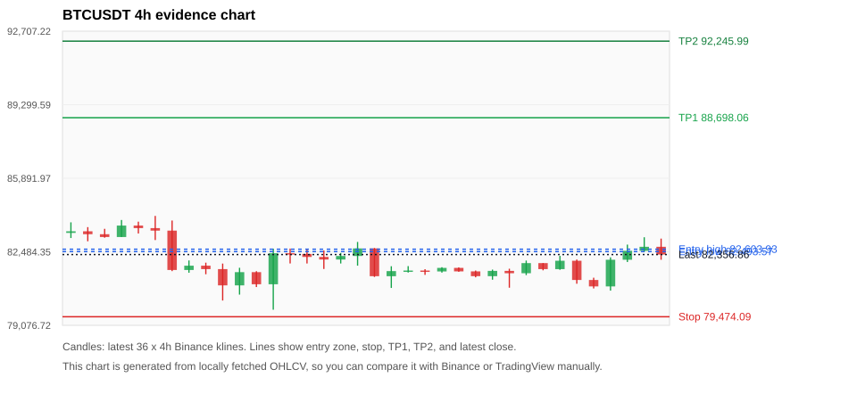
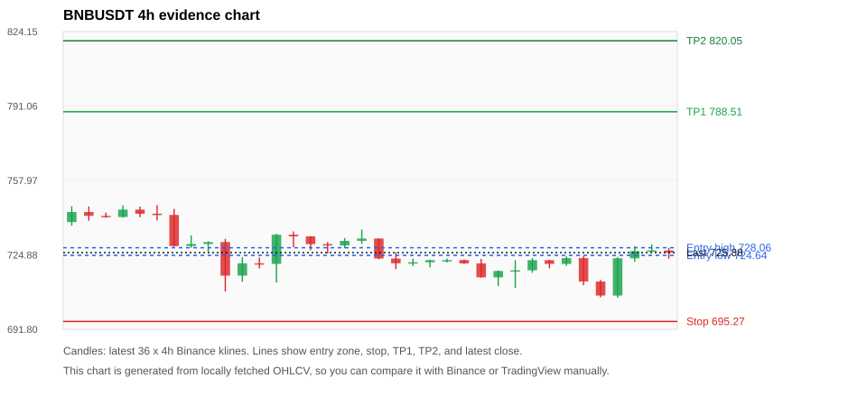
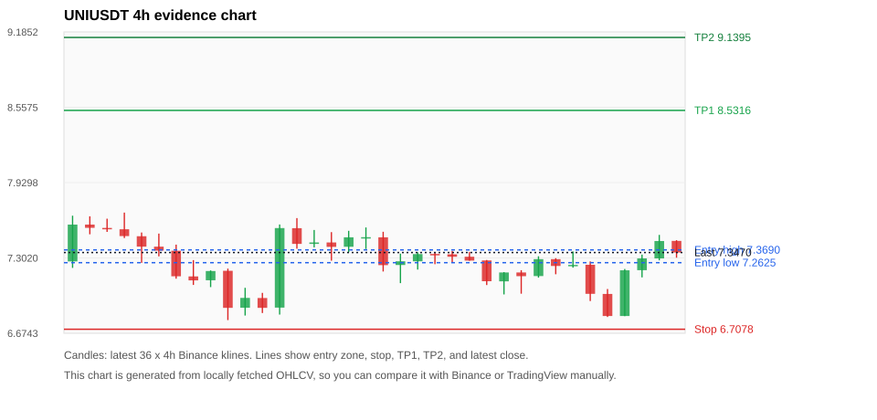
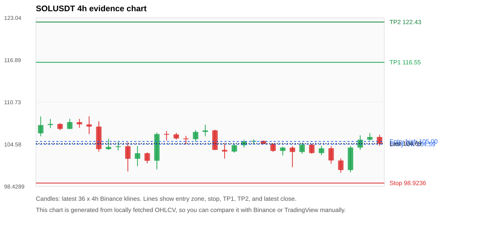
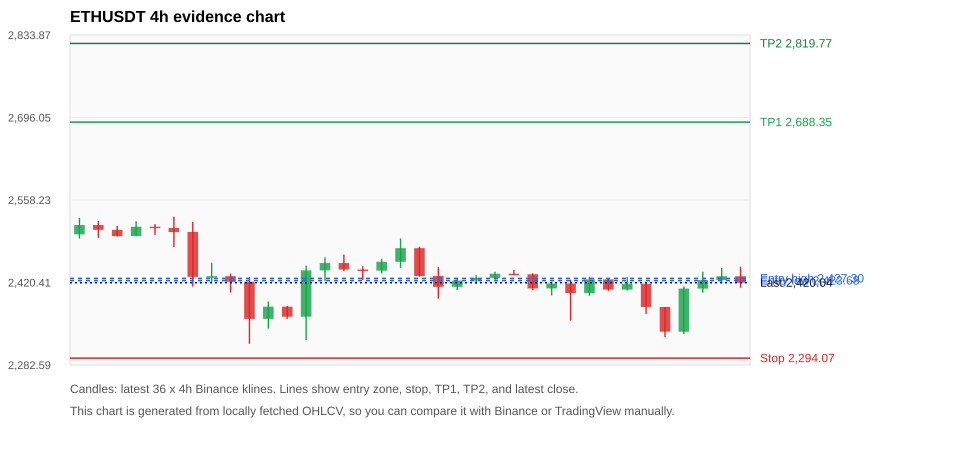

# Crypto 市场扫描报告 v1

- 报告时间：2026-10-19 20:06:01 CST
- Run ID：`20261019_120502_29de6a60`
- Run type：`daily_full`
- Data validation mode：`paper`
- 数据来源：SQLite
- 报告版本：v1
- 扫描 ID：5b74c4c9f02a
- 数据源：Binance public spot API + CoinGecko/CoinMarketCap cross-check
- 过滤条件：USDT spot; 24h quote volume >= 30,000,000; trades >= 30,000; exclude stables/leveraged tokens; analyze 1h/4h/1d klines
- 默认单笔风险：账户权益的 1.00%

## 限制说明

- 交易信号仍以 Binance 现货公开 K 线为主源；外部数据源用于一致性复核。
- 结果是研究和模拟盘计划，不是确定收益或实盘下单指令。
- 历史长度过滤：候选币至少需要 180 根 1d K 线。
- 数据质量验证池：先验证 score 排名前 min(top_n * 2, 10) 的候选，再按 action + score 补足最终名单。
- 指标截止：2026-10-19T12:05:05.559000+00:00；仅使用此前至少60秒已闭合K线，ticker为扫描时点观测。
- 大盘环境过滤：RISK_OFF; BTC/ETH 大盘偏弱，山寨币买入候选降级为观察。 BTC 7d=-1.978104671283576; ETH 7d=-4.991446388168431.
- Data cross-validation enabled: Binance primary source plus CoinGecko; CoinMarketCap is checked when an API key is configured.
- CoinMarketCap cross-check skipped: no CMC_API_KEY or COINMARKETCAP_API_KEY configured.
- BTCUSDT validation state DEGRADED: DEGRADED: [EXTERNAL_PROVIDER_SKIPPED] Skipped because CMC_API_KEY or COINMARKETCAP_API_KEY is not configured.
- BNBUSDT validation state DEGRADED: DEGRADED: [EXTERNAL_PROVIDER_SKIPPED] Skipped because CMC_API_KEY or COINMARKETCAP_API_KEY is not configured.
- UNIUSDT validation state DEGRADED: DEGRADED: [EXTERNAL_PROVIDER_SKIPPED] Skipped because CMC_API_KEY or COINMARKETCAP_API_KEY is not configured.
- SOLUSDT validation state DEGRADED: DEGRADED: [EXTERNAL_PROVIDER_SKIPPED] Skipped because CMC_API_KEY or COINMARKETCAP_API_KEY is not configured.
- ETHUSDT validation state DEGRADED: DEGRADED: [EXTERNAL_PROVIDER_SKIPPED] Skipped because CMC_API_KEY or COINMARKETCAP_API_KEY is not configured.
- XRPUSDT validation state DEGRADED: DEGRADED: [EXTERNAL_PROVIDER_RATE_LIMITED] Provider rate limited request for https://api.coingecko.com/api/v3/coins/markets?vs_currency=usd&ids=ripple&price_change_percentage=24h&per_page=1&page=1: HTTP 429; [EXTERNAL_PROVIDER_SKIPPED] Skipped because CMC_API_KEY or COINMARKETCAP_API_KEY is not configured.
- NEARUSDT validation state DEGRADED: DEGRADED: [EXTERNAL_PROVIDER_RATE_LIMITED] Provider rate limited request for https://api.coingecko.com/api/v3/coins/markets?vs_currency=usd&ids=near&price_change_percentage=24h&per_page=1&page=1: HTTP 429; [EXTERNAL_PROVIDER_SKIPPED] Skipped because CMC_API_KEY or COINMARKETCAP_API_KEY is not configured.
- PUMPUSDT validation state BLOCKED: BLOCKED: [BINANCE_KLINE_EXTREME_RANGE] Binance candle range exceeds 40%.; [EXTERNAL_PROVIDER_RATE_LIMITED] Provider rate limited request for https://api.coingecko.com/api/v3/coins/markets?vs_currency=usd&ids=pump-fun&price_change_percentage=24h&per_page=1&page=1: HTTP 429; [EXTERNAL_PROVIDER_SKIPPED] Skipped because CMC_API_KEY or COINMARKETCAP_API_KEY is not configured.
- WLDUSDT validation state BLOCKED: BLOCKED: [BINANCE_KLINE_EXTREME_RANGE] Binance candle range exceeds 40%.; [EXTERNAL_PROVIDER_RATE_LIMITED] Provider rate limited request for https://api.coingecko.com/api/v3/coins/markets?vs_currency=usd&ids=worldcoin-wld&price_change_percentage=24h&per_page=1&page=1: HTTP 429; [EXTERNAL_PROVIDER_SKIPPED] Skipped because CMC_API_KEY or COINMARKETCAP_API_KEY is not configured.
- ZECUSDT validation state BLOCKED: BLOCKED: [BINANCE_KLINE_EXTREME_RANGE] Binance candle range exceeds 40%.; [BINANCE_KLINE_EXTREME_RANGE] Binance candle range exceeds 40%.; [EXTERNAL_PROVIDER_RATE_LIMITED] Provider rate limited request for https://api.coingecko.com/api/v3/coins/markets?vs_currency=usd&ids=zcash&price_change_percentage=24h&per_page=1&page=1: HTTP 429; [EXTERNAL_PROVIDER_SKIPPED] Skipped because CMC_API_KEY or COINMARKETCAP_API_KEY is not configured.

## 5 个候选交易计划

| Rank | Coin | Action | Setup | Entry Zone | Stop Loss | TP1 | TP2 / Exit Rule | R/R | Verdict |
|---:|---|---|---|---:|---:|---:|---|---:|---|
| 1 | `BTC` | `WATCH_ONLY` | 回踩支撑/4h EMA 附近 | 82,493.57 - 82,603.93 | 79,474.09 | 88,698.06 | 92,245.99 或跌破 4h 关键支撑 | 2.00-3.15 | 只观察 |
| 2 | `BNB` | `WATCH_ONLY` | 回踩支撑/4h EMA 附近 | 724.64 - 728.06 | 695.27 | 788.51 | 820.05 或跌破 4h 关键支撑 | 2.00-3.01 | 只观察 |
| 3 | `UNI` | `WATCH_ONLY` | 回踩支撑/4h EMA 附近 | 7.2625 - 7.3690 | 6.7078 | 8.5316 | 9.1395 或跌破 4h 关键支撑 | 2.00-3.00 | 只观察 |
| 4 | `SOL` | `WATCH_ONLY` | 回踩支撑/4h EMA 附近 | 104.59 - 105.00 | 98.9236 | 116.55 | 122.43 或跌破 4h 关键支撑 | 2.00-3.00 | 只观察 |
| 5 | `ETH` | `WATCH_ONLY` | 回踩支撑/4h EMA 附近 | 2,423.68 - 2,427.30 | 2,294.07 | 2,688.35 | 2,819.77 或跌破 4h 关键支撑 | 2.00-3.00 | 只观察 |

## 数据交叉验证摘要

价格差异以 Binance 当前价为基准；成交量口径不同，Binance 是 USDT 现货成交额，CoinGecko/CoinMarketCap 通常是全市场成交量。

| Rank | Coin | State | Identity | Max Price Diff | Max 24h Diff | Issue Codes | Message |
|---:|---|---|---|---:|---:|---|---|
| 1 | `BTC` | DEGRADED (DATA_WARNING) | UNCONFIRMED | 0.10% | 0.01 pts | EXTERNAL_PROVIDER_SKIPPED | DEGRADED: [EXTERNAL_PROVIDER_SKIPPED] Skipped because CMC_API_KEY or COINMARKETCAP_API_KEY is not configured. |
| 2 | `BNB` | DEGRADED (DATA_WARNING) | UNCONFIRMED | 0.06% | 0.02 pts | EXTERNAL_PROVIDER_SKIPPED | DEGRADED: [EXTERNAL_PROVIDER_SKIPPED] Skipped because CMC_API_KEY or COINMARKETCAP_API_KEY is not configured. |
| 3 | `UNI` | DEGRADED (DATA_WARNING) | UNCONFIRMED | 0.18% | 0.15 pts | EXTERNAL_PROVIDER_SKIPPED | DEGRADED: [EXTERNAL_PROVIDER_SKIPPED] Skipped because CMC_API_KEY or COINMARKETCAP_API_KEY is not configured. |
| 4 | `SOL` | DEGRADED (DATA_WARNING) | UNCONFIRMED | 0.01% | 0.04 pts | EXTERNAL_PROVIDER_SKIPPED | DEGRADED: [EXTERNAL_PROVIDER_SKIPPED] Skipped because CMC_API_KEY or COINMARKETCAP_API_KEY is not configured. |
| 5 | `ETH` | DEGRADED (DATA_WARNING) | UNCONFIRMED | 0.05% | 0.02 pts | EXTERNAL_PROVIDER_SKIPPED | DEGRADED: [EXTERNAL_PROVIDER_SKIPPED] Skipped because CMC_API_KEY or COINMARKETCAP_API_KEY is not configured. |

## 候选币说明

### 1. BTC `BTCUSDT`



- 入选原因：回踩支撑/4h EMA 附近；24h +0.34%，7d -0.49%，4h RSI 57.22，24h 成交额 $1.11B。
- 交易失效条件：跌破 79474.095 或 4h 收盘重新失守关键支撑。
- 主要风险：日线趋势未完全确认；BTC/ETH 大盘环境未确认强势，山寨币买入信号降级；7d 趋势未确认；External validation is degraded; this candidate is not a clean data sample.；Paper mode allows degraded validation; candidate is excluded from clean-data samples.。
- 数据交叉验证：DEGRADED / DATA_WARNING；身份=UNCONFIRMED；DEGRADED: [EXTERNAL_PROVIDER_SKIPPED] Skipped because CMC_API_KEY or COINMARKETCAP_API_KEY is not configured.

#### 可点击人工验证

- [Binance 交易页](https://www.binance.com/en/trade/BTC_USDT)
- [TradingView 图表](https://www.tradingview.com/chart/?symbol=BINANCE%3ABTCUSDT)
- [CoinGecko 搜索](https://www.coingecko.com/en/search?query=BTC)
- [CoinMarketCap 搜索](https://coinmarketcap.com/search/?q=BTC)

#### 多数据源对照

| Source | Status | Identity | Blocking | Asset ID | Price | 24h Change | 24h Volume | Price Diff | 24h Diff | Updated | Issue Codes | Message |
|---|---|---|---:|---|---:|---:|---:|---:|---:|---|---|---|
| Binance | DATA_OK | CONFIRMED | no | BTCUSDT | 82,356.86 | +0.34% | $1.11B | 0.00% | 0.00 pts | 2026-10-19T12:05:29+00:00 | none | Primary market data source passed health checks. |
| CoinGecko | DATA_OK | CONFIRMED | no | bitcoin | 82,273.00 | +0.35% | $26.54B | 0.10% | 0.01 pts | 2026-10-19T12:03:51.000Z | none | External source agrees with Binance within thresholds. |
| CoinMarketCap | DATA_SKIPPED | NOT_CHECKED | no | n/a | n/a | n/a | n/a | n/a | n/a | 2026-10-19T12:05:29+00:00 | EXTERNAL_PROVIDER_SKIPPED | Skipped because CMC_API_KEY or COINMARKETCAP_API_KEY is not configured. |

#### 指标证据

| 指标 | 数值 | 人工核对用途 |
|---|---:|---|
| 当前价 | 82,356.86 | 与 Binance/TradingView 当前价格对照 |
| 24h 涨跌 | +0.34% | 与交易所 24h 涨跌对照 |
| 7d 涨跌 | -0.49% | 判断短线趋势是否延续 |
| 4h EMA20 | 81,970.60 | 判断短期趋势支撑 |
| 4h EMA50 | 82,328.91 | 判断中期趋势支撑 |
| 1d EMA20 | 82,637.55 | 判断日线趋势 |
| 1d EMA50 | 80,547.27 | 判断日线趋势 |
| 4h RSI14 | 57.22 | 判断是否过热/过弱 |
| 4h ATR14 | 670.96 | 推导止损和入场缓冲 |
| 最近 18 根 4h 最低点 | 80,684.36 | 支撑/止损参考 |
| 最近 36 根 4h 最高点 | 84,146.72 | TP/压力参考 |
| 支撑位 | 82,328.91 | 入场区间推导基础 |

#### 交易计划推导

- 支撑位 = 最近低点、4h EMA20、4h EMA50、1d EMA20 中不高于当前价的最高有效支撑 = `82,328.91`。
- 入场区间 = 支撑位附近 + ATR 缓冲 = `82,493.57 - 82,603.93`。
- 止损 = min(最近 18 根 4h 最低点 * 0.985, 入场中位价 - 1.15 * ATR14) = `79,474.09`。
- TP1 = max(最近 36 根 4h 最高点 * 0.995, 入场中位价 + 2R) = `88,698.06`。
- TP2 = max(入场中位价 + 3R, TP1 * 1.04) = `92,245.99`。

#### 最近 10 根 4h K线

| UTC 开盘时间 | Open | High | Low | Close | Quote Volume | Trades |
|---|---:|---:|---:|---:|---:|---:|
| 2026-10-17T20:00+00:00 | 81,600.00 | 81,700.00 | 80,819.66 | 81,491.04 | $127.7M | 240579 |
| 2026-10-18T00:00+00:00 | 81,491.04 | 82,078.00 | 81,403.25 | 81,960.00 | $131.5M | 256115 |
| 2026-10-18T04:00+00:00 | 81,960.01 | 81,960.01 | 81,626.00 | 81,681.14 | $72.8M | 115504 |
| 2026-10-18T08:00+00:00 | 81,681.15 | 82,295.47 | 81,650.06 | 82,069.72 | $112.3M | 225558 |
| 2026-10-18T12:00+00:00 | 82,069.73 | 82,127.68 | 81,003.88 | 81,178.18 | $165.9M | 408956 |
| 2026-10-18T16:00+00:00 | 81,178.19 | 81,282.93 | 80,785.78 | 80,880.02 | $125.6M | 294401 |
| 2026-10-18T20:00+00:00 | 80,880.01 | 82,227.28 | 80,684.36 | 82,116.00 | $215.3M | 597271 |
| 2026-10-19T00:00+00:00 | 82,116.00 | 82,817.10 | 82,010.58 | 82,530.82 | $231.2M | 522248 |
| 2026-10-19T04:00+00:00 | 82,530.81 | 83,158.00 | 82,484.27 | 82,716.68 | $198.9M | 350559 |
| 2026-10-19T08:00+00:00 | 82,716.68 | 83,096.01 | 82,116.00 | 82,356.86 | $168.1M | 417855 |

### 2. BNB `BNBUSDT`



- 入选原因：回踩支撑/4h EMA 附近；24h +0.29%，7d -2.97%，4h RSI 52.93，24h 成交额 $73.2M。
- 交易失效条件：跌破 695.2721 或 4h 收盘重新失守关键支撑。
- 主要风险：日线趋势未完全确认；BTC/ETH 大盘环境未确认强势，山寨币买入信号降级；7d 趋势未确认；External validation is degraded; this candidate is not a clean data sample.；Paper mode allows degraded validation; candidate is excluded from clean-data samples.。
- 数据交叉验证：DEGRADED / DATA_WARNING；身份=UNCONFIRMED；DEGRADED: [EXTERNAL_PROVIDER_SKIPPED] Skipped because CMC_API_KEY or COINMARKETCAP_API_KEY is not configured.

#### 可点击人工验证

- [Binance 交易页](https://www.binance.com/en/trade/BNB_USDT)
- [TradingView 图表](https://www.tradingview.com/chart/?symbol=BINANCE%3ABNBUSDT)
- [CoinGecko 搜索](https://www.coingecko.com/en/search?query=BNB)
- [CoinMarketCap 搜索](https://coinmarketcap.com/search/?q=BNB)

#### 多数据源对照

| Source | Status | Identity | Blocking | Asset ID | Price | 24h Change | 24h Volume | Price Diff | 24h Diff | Updated | Issue Codes | Message |
|---|---|---|---:|---|---:|---:|---:|---:|---:|---|---|---|
| Binance | DATA_OK | CONFIRMED | no | BNBUSDT | 725.88 | +0.29% | $73.2M | 0.00% | 0.00 pts | 2026-10-19T12:05:29+00:00 | none | Primary market data source passed health checks. |
| CoinGecko | DATA_OK | CONFIRMED | no | binancecoin | 725.48 | +0.31% | $720.6M | 0.06% | 0.02 pts | 2026-10-19T12:04:49.000Z | none | External source agrees with Binance within thresholds. |
| CoinMarketCap | DATA_SKIPPED | NOT_CHECKED | no | n/a | n/a | n/a | n/a | n/a | n/a | 2026-10-19T12:05:29+00:00 | EXTERNAL_PROVIDER_SKIPPED | Skipped because CMC_API_KEY or COINMARKETCAP_API_KEY is not configured. |

#### 指标证据

| 指标 | 数值 | 人工核对用途 |
|---|---:|---|
| 当前价 | 725.88 | 与 Binance/TradingView 当前价格对照 |
| 24h 涨跌 | +0.29% | 与交易所 24h 涨跌对照 |
| 7d 涨跌 | -2.97% | 判断短线趋势是否延续 |
| 4h EMA20 | 723.20 | 判断短期趋势支撑 |
| 4h EMA50 | 731.60 | 判断中期趋势支撑 |
| 1d EMA20 | 744.02 | 判断日线趋势 |
| 1d EMA50 | 732.57 | 判断日线趋势 |
| 4h RSI14 | 52.93 | 判断是否过热/过弱 |
| 4h ATR14 | 7.1136 | 推导止损和入场缓冲 |
| 最近 18 根 4h 最低点 | 705.86 | 支撑/止损参考 |
| 最近 36 根 4h 最高点 | 747.00 | TP/压力参考 |
| 支撑位 | 723.20 | 入场区间推导基础 |

#### 交易计划推导

- 支撑位 = 最近低点、4h EMA20、4h EMA50、1d EMA20 中不高于当前价的最高有效支撑 = `723.20`。
- 入场区间 = 支撑位附近 + ATR 缓冲 = `724.64 - 728.06`。
- 止损 = min(最近 18 根 4h 最低点 * 0.985, 入场中位价 - 1.15 * ATR14) = `695.27`。
- TP1 = max(最近 36 根 4h 最高点 * 0.995, 入场中位价 + 2R) = `788.51`。
- TP2 = max(入场中位价 + 3R, TP1 * 1.04) = `820.05`。

#### 最近 10 根 4h K线

| UTC 开盘时间 | Open | High | Low | Close | Quote Volume | Trades |
|---|---:|---:|---:|---:|---:|---:|
| 2026-10-17T20:00+00:00 | 717.72 | 722.50 | 710.15 | 718.02 | $11.0M | 72920 |
| 2026-10-18T00:00+00:00 | 718.03 | 723.45 | 716.93 | 722.51 | $5.9M | 38596 |
| 2026-10-18T04:00+00:00 | 722.52 | 722.63 | 718.92 | 720.87 | $6.9M | 36109 |
| 2026-10-18T08:00+00:00 | 720.87 | 724.24 | 720.00 | 723.43 | $7.1M | 59496 |
| 2026-10-18T12:00+00:00 | 723.43 | 724.25 | 711.36 | 713.03 | $13.7M | 86598 |
| 2026-10-18T16:00+00:00 | 713.03 | 713.77 | 706.00 | 706.80 | $10.9M | 72921 |
| 2026-10-18T20:00+00:00 | 706.80 | 723.97 | 705.86 | 723.36 | $10.3M | 67472 |
| 2026-10-19T00:00+00:00 | 723.36 | 728.76 | 721.80 | 726.55 | $10.4M | 62895 |
| 2026-10-19T04:00+00:00 | 726.56 | 729.49 | 726.14 | 726.85 | $13.8M | 59907 |
| 2026-10-19T08:00+00:00 | 726.85 | 727.96 | 723.19 | 725.88 | $14.2M | 93275 |

### 3. UNI `UNIUSDT`



- 入选原因：回踩支撑/4h EMA 附近；24h +1.71%，7d -2.40%，4h RSI 50.45，24h 成交额 $34.3M。
- 交易失效条件：跌破 6.70785 或 4h 收盘重新失守关键支撑。
- 主要风险：日线趋势未完全确认；BTC/ETH 大盘环境未确认强势，山寨币买入信号降级；7d 趋势未确认；External validation is degraded; this candidate is not a clean data sample.；Paper mode allows degraded validation; candidate is excluded from clean-data samples.。
- 数据交叉验证：DEGRADED / DATA_WARNING；身份=UNCONFIRMED；DEGRADED: [EXTERNAL_PROVIDER_SKIPPED] Skipped because CMC_API_KEY or COINMARKETCAP_API_KEY is not configured.

#### 可点击人工验证

- [Binance 交易页](https://www.binance.com/en/trade/UNI_USDT)
- [TradingView 图表](https://www.tradingview.com/chart/?symbol=BINANCE%3AUNIUSDT)
- [CoinGecko 搜索](https://www.coingecko.com/en/search?query=UNI)
- [CoinMarketCap 搜索](https://coinmarketcap.com/search/?q=UNI)

#### 多数据源对照

| Source | Status | Identity | Blocking | Asset ID | Price | 24h Change | 24h Volume | Price Diff | 24h Diff | Updated | Issue Codes | Message |
|---|---|---|---:|---|---:|---:|---:|---:|---:|---|---|---|
| Binance | DATA_OK | CONFIRMED | no | UNIUSDT | 7.3470 | +1.71% | $34.3M | 0.00% | 0.00 pts | 2026-10-19T12:05:29+00:00 | none | Primary market data source passed health checks. |
| CoinGecko | DATA_OK | CONFIRMED | no | uniswap | 7.3600 | +1.56% | $416.3M | 0.18% | 0.15 pts | 2026-10-19T12:04:49.000Z | none | External source agrees with Binance within thresholds. |
| CoinMarketCap | DATA_SKIPPED | NOT_CHECKED | no | n/a | n/a | n/a | n/a | n/a | n/a | 2026-10-19T12:05:29+00:00 | EXTERNAL_PROVIDER_SKIPPED | Skipped because CMC_API_KEY or COINMARKETCAP_API_KEY is not configured. |

#### 指标证据

| 指标 | 数值 | 人工核对用途 |
|---|---:|---|
| 当前价 | 7.3470 | 与 Binance/TradingView 当前价格对照 |
| 24h 涨跌 | +1.71% | 与交易所 24h 涨跌对照 |
| 7d 涨跌 | -2.40% | 判断短线趋势是否延续 |
| 4h EMA20 | 7.2480 | 判断短期趋势支撑 |
| 4h EMA50 | 7.3943 | 判断中期趋势支撑 |
| 1d EMA20 | 7.7265 | 判断日线趋势 |
| 1d EMA50 | 7.3129 | 判断日线趋势 |
| 4h RSI14 | 50.45 | 判断是否过热/过弱 |
| 4h ATR14 | 0.19350 | 推导止损和入场缓冲 |
| 最近 18 根 4h 最低点 | 6.8100 | 支撑/止损参考 |
| 最近 36 根 4h 最高点 | 7.6800 | TP/压力参考 |
| 支撑位 | 7.2480 | 入场区间推导基础 |

#### 交易计划推导

- 支撑位 = 最近低点、4h EMA20、4h EMA50、1d EMA20 中不高于当前价的最高有效支撑 = `7.2480`。
- 入场区间 = 支撑位附近 + ATR 缓冲 = `7.2625 - 7.3690`。
- 止损 = min(最近 18 根 4h 最低点 * 0.985, 入场中位价 - 1.15 * ATR14) = `6.7078`。
- TP1 = max(最近 36 根 4h 最高点 * 0.995, 入场中位价 + 2R) = `8.5316`。
- TP2 = max(入场中位价 + 3R, TP1 * 1.04) = `9.1395`。

#### 最近 10 根 4h K线

| UTC 开盘时间 | Open | High | Low | Close | Quote Volume | Trades |
|---|---:|---:|---:|---:|---:|---:|
| 2026-10-17T20:00+00:00 | 7.1810 | 7.2000 | 7.0040 | 7.1500 | $4.5M | 31583 |
| 2026-10-18T00:00+00:00 | 7.1510 | 7.3160 | 7.1380 | 7.2920 | $3.2M | 20135 |
| 2026-10-18T04:00+00:00 | 7.2920 | 7.3000 | 7.1660 | 7.2350 | $2.2M | 13906 |
| 2026-10-18T08:00+00:00 | 7.2360 | 7.3560 | 7.2210 | 7.2440 | $2.4M | 14739 |
| 2026-10-18T12:00+00:00 | 7.2450 | 7.2730 | 6.9430 | 7.0030 | $6.4M | 34618 |
| 2026-10-18T16:00+00:00 | 7.0020 | 7.0430 | 6.8100 | 6.8180 | $4.3M | 25254 |
| 2026-10-18T20:00+00:00 | 6.8180 | 7.2100 | 6.8170 | 7.1990 | $5.8M | 29562 |
| 2026-10-19T00:00+00:00 | 7.2000 | 7.3300 | 7.1400 | 7.2980 | $7.6M | 26431 |
| 2026-10-19T04:00+00:00 | 7.2980 | 7.4940 | 7.2820 | 7.4430 | $5.6M | 22424 |
| 2026-10-19T08:00+00:00 | 7.4440 | 7.4500 | 7.3040 | 7.3470 | $4.7M | 36249 |

### 4. SOL `SOLUSDT`



- 入选原因：回踩支撑/4h EMA 附近；24h +0.66%，7d -5.04%，4h RSI 48.97，24h 成交额 $183.8M。
- 交易失效条件：跌破 98.92355 或 4h 收盘重新失守关键支撑。
- 主要风险：日线趋势未完全确认；BTC/ETH 大盘环境未确认强势，山寨币买入信号降级；7d 趋势未确认；External validation is degraded; this candidate is not a clean data sample.；Paper mode allows degraded validation; candidate is excluded from clean-data samples.。
- 数据交叉验证：DEGRADED / DATA_WARNING；身份=UNCONFIRMED；DEGRADED: [EXTERNAL_PROVIDER_SKIPPED] Skipped because CMC_API_KEY or COINMARKETCAP_API_KEY is not configured.

#### 可点击人工验证

- [Binance 交易页](https://www.binance.com/en/trade/SOL_USDT)
- [TradingView 图表](https://www.tradingview.com/chart/?symbol=BINANCE%3ASOLUSDT)
- [CoinGecko 搜索](https://www.coingecko.com/en/search?query=SOL)
- [CoinMarketCap 搜索](https://coinmarketcap.com/search/?q=SOL)

#### 多数据源对照

| Source | Status | Identity | Blocking | Asset ID | Price | 24h Change | 24h Volume | Price Diff | 24h Diff | Updated | Issue Codes | Message |
|---|---|---|---:|---|---:|---:|---:|---:|---:|---|---|---|
| Binance | DATA_OK | CONFIRMED | no | SOLUSDT | 104.69 | +0.66% | $183.8M | 0.00% | 0.00 pts | 2026-10-19T12:05:29+00:00 | none | Primary market data source passed health checks. |
| CoinGecko | DATA_OK | CONFIRMED | no | solana | 104.70 | +0.62% | $2.69B | 0.01% | 0.04 pts | 2026-10-19T12:04:49.000Z | none | External source agrees with Binance within thresholds. |
| CoinMarketCap | DATA_SKIPPED | NOT_CHECKED | no | n/a | n/a | n/a | n/a | n/a | n/a | 2026-10-19T12:05:29+00:00 | EXTERNAL_PROVIDER_SKIPPED | Skipped because CMC_API_KEY or COINMARKETCAP_API_KEY is not configured. |

#### 指标证据

| 指标 | 数值 | 人工核对用途 |
|---|---:|---|
| 当前价 | 104.69 | 与 Binance/TradingView 当前价格对照 |
| 24h 涨跌 | +0.66% | 与交易所 24h 涨跌对照 |
| 7d 涨跌 | -5.04% | 判断短线趋势是否延续 |
| 4h EMA20 | 104.39 | 判断短期趋势支撑 |
| 4h EMA50 | 106.35 | 判断中期趋势支撑 |
| 1d EMA20 | 109.47 | 判断日线趋势 |
| 1d EMA50 | 106.90 | 判断日线趋势 |
| 4h RSI14 | 48.97 | 判断是否过热/过弱 |
| 4h ATR14 | 1.7443 | 推导止损和入场缓冲 |
| 最近 18 根 4h 最低点 | 100.43 | 支撑/止损参考 |
| 最近 36 根 4h 最高点 | 108.67 | TP/压力参考 |
| 支撑位 | 104.39 | 入场区间推导基础 |

#### 交易计划推导

- 支撑位 = 最近低点、4h EMA20、4h EMA50、1d EMA20 中不高于当前价的最高有效支撑 = `104.39`。
- 入场区间 = 支撑位附近 + ATR 缓冲 = `104.59 - 105.00`。
- 止损 = min(最近 18 根 4h 最低点 * 0.985, 入场中位价 - 1.15 * ATR14) = `98.9236`。
- TP1 = max(最近 36 根 4h 最高点 * 0.995, 入场中位价 + 2R) = `116.55`。
- TP2 = max(入场中位价 + 3R, TP1 * 1.04) = `122.43`。

#### 最近 10 根 4h K线

| UTC 开盘时间 | Open | High | Low | Close | Quote Volume | Trades |
|---|---:|---:|---:|---:|---:|---:|
| 2026-10-17T20:00+00:00 | 104.10 | 104.34 | 101.25 | 103.47 | $31.0M | 106793 |
| 2026-10-18T00:00+00:00 | 103.46 | 104.79 | 103.20 | 104.52 | $23.2M | 61385 |
| 2026-10-18T04:00+00:00 | 104.53 | 104.59 | 103.21 | 103.31 | $11.2M | 38441 |
| 2026-10-18T08:00+00:00 | 103.30 | 104.37 | 102.99 | 104.00 | $25.3M | 55296 |
| 2026-10-18T12:00+00:00 | 104.01 | 104.32 | 101.75 | 102.23 | $37.5M | 141314 |
| 2026-10-18T16:00+00:00 | 102.22 | 102.52 | 100.43 | 100.83 | $24.8M | 96640 |
| 2026-10-18T20:00+00:00 | 100.83 | 104.34 | 100.49 | 104.11 | $34.7M | 122170 |
| 2026-10-19T00:00+00:00 | 104.11 | 105.90 | 103.77 | 105.25 | $28.5M | 80911 |
| 2026-10-19T04:00+00:00 | 105.25 | 106.22 | 105.11 | 105.65 | $24.0M | 59178 |
| 2026-10-19T08:00+00:00 | 105.65 | 105.98 | 104.37 | 104.69 | $34.1M | 71277 |

### 5. ETH `ETHUSDT`



- 入选原因：回踩支撑/4h EMA 附近；24h +0.10%，7d -4.42%，4h RSI 48.61，24h 成交额 $497.5M。
- 交易失效条件：跌破 2294.065 或 4h 收盘重新失守关键支撑。
- 主要风险：日线趋势未完全确认；BTC/ETH 大盘环境未确认强势，山寨币买入信号降级；7d 趋势未确认；External validation is degraded; this candidate is not a clean data sample.；Paper mode allows degraded validation; candidate is excluded from clean-data samples.。
- 数据交叉验证：DEGRADED / DATA_WARNING；身份=UNCONFIRMED；DEGRADED: [EXTERNAL_PROVIDER_SKIPPED] Skipped because CMC_API_KEY or COINMARKETCAP_API_KEY is not configured.

#### 可点击人工验证

- [Binance 交易页](https://www.binance.com/en/trade/ETH_USDT)
- [TradingView 图表](https://www.tradingview.com/chart/?symbol=BINANCE%3AETHUSDT)
- [CoinGecko 搜索](https://www.coingecko.com/en/search?query=ETH)
- [CoinMarketCap 搜索](https://coinmarketcap.com/search/?q=ETH)

#### 多数据源对照

| Source | Status | Identity | Blocking | Asset ID | Price | 24h Change | 24h Volume | Price Diff | 24h Diff | Updated | Issue Codes | Message |
|---|---|---|---:|---|---:|---:|---:|---:|---:|---|---|---|
| Binance | DATA_OK | CONFIRMED | no | ETHUSDT | 2,420.04 | +0.10% | $497.5M | 0.00% | 0.00 pts | 2026-10-19T12:05:29+00:00 | none | Primary market data source passed health checks. |
| CoinGecko | DATA_OK | CONFIRMED | no | ethereum | 2,418.87 | +0.08% | $10.02B | 0.05% | 0.02 pts | 2026-10-19T12:04:49.000Z | none | External source agrees with Binance within thresholds. |
| CoinMarketCap | DATA_SKIPPED | NOT_CHECKED | no | n/a | n/a | n/a | n/a | n/a | n/a | 2026-10-19T12:05:29+00:00 | EXTERNAL_PROVIDER_SKIPPED | Skipped because CMC_API_KEY or COINMARKETCAP_API_KEY is not configured. |

#### 指标证据

| 指标 | 数值 | 人工核对用途 |
|---|---:|---|
| 当前价 | 2,420.04 | 与 Binance/TradingView 当前价格对照 |
| 24h 涨跌 | +0.10% | 与交易所 24h 涨跌对照 |
| 7d 涨跌 | -4.42% | 判断短线趋势是否延续 |
| 4h EMA20 | 2,418.85 | 判断短期趋势支撑 |
| 4h EMA50 | 2,455.91 | 判断中期趋势支撑 |
| 1d EMA20 | 2,515.12 | 判断日线趋势 |
| 1d EMA50 | 2,486.96 | 判断日线趋势 |
| 4h RSI14 | 48.61 | 判断是否过热/过弱 |
| 4h ATR14 | 35.1557 | 推导止损和入场缓冲 |
| 最近 18 根 4h 最低点 | 2,329.00 | 支撑/止损参考 |
| 最近 36 根 4h 最高点 | 2,530.44 | TP/压力参考 |
| 支撑位 | 2,418.85 | 入场区间推导基础 |

#### 交易计划推导

- 支撑位 = 最近低点、4h EMA20、4h EMA50、1d EMA20 中不高于当前价的最高有效支撑 = `2,418.85`。
- 入场区间 = 支撑位附近 + ATR 缓冲 = `2,423.68 - 2,427.30`。
- 止损 = min(最近 18 根 4h 最低点 * 0.985, 入场中位价 - 1.15 * ATR14) = `2,294.07`。
- TP1 = max(最近 36 根 4h 最高点 * 0.995, 入场中位价 + 2R) = `2,688.35`。
- TP2 = max(入场中位价 + 3R, TP1 * 1.04) = `2,819.77`。

#### 最近 10 根 4h K线

| UTC 开盘时间 | Open | High | Low | Close | Quote Volume | Trades |
|---|---:|---:|---:|---:|---:|---:|
| 2026-10-17T20:00+00:00 | 2,418.65 | 2,425.00 | 2,356.79 | 2,402.82 | $85.3M | 504841 |
| 2026-10-18T00:00+00:00 | 2,402.81 | 2,430.00 | 2,398.19 | 2,425.53 | $47.9M | 322377 |
| 2026-10-18T04:00+00:00 | 2,425.54 | 2,426.51 | 2,406.52 | 2,408.62 | $33.0M | 133922 |
| 2026-10-18T08:00+00:00 | 2,408.63 | 2,429.43 | 2,407.07 | 2,418.23 | $31.9M | 299719 |
| 2026-10-18T12:00+00:00 | 2,418.24 | 2,421.21 | 2,368.00 | 2,379.60 | $88.3M | 642048 |
| 2026-10-18T16:00+00:00 | 2,379.59 | 2,379.59 | 2,329.00 | 2,338.25 | $111.1M | 676466 |
| 2026-10-18T20:00+00:00 | 2,338.25 | 2,414.00 | 2,334.48 | 2,410.31 | $101.3M | 707915 |
| 2026-10-19T00:00+00:00 | 2,410.31 | 2,438.40 | 2,403.47 | 2,424.51 | $67.4M | 549714 |
| 2026-10-19T04:00+00:00 | 2,424.51 | 2,444.79 | 2,420.19 | 2,430.86 | $59.6M | 348241 |
| 2026-10-19T08:00+00:00 | 2,430.87 | 2,446.27 | 2,411.80 | 2,420.04 | $69.9M | 430529 |

## 组合风控

- 不要 5 个候选全部满仓买入。
- 同时持仓总风险建议控制在账户权益的 3% - 5% 以内。
- 如果 BTC/ETH 同时破位，暂停山寨币多头计划或降低仓位。
- 第一版报告用于模拟盘和人工复核，不自动下单。

## 原始数据

```json
[
  {
    "rank": 1,
    "symbol": "BTCUSDT",
    "base_asset": "BTC",
    "price": 82356.86,
    "score": 26.507939262155134,
    "setup": "回踩支撑/4h EMA 附近",
    "verdict": "只观察",
    "entry_low": 82493.57202941817,
    "entry_high": 82603.93057999999,
    "stop_loss": 79474.0946,
    "take_profit_1": 88698.06471412723,
    "take_profit_2": 92245.98730269233,
    "risk_reward_1": 2.0,
    "risk_reward_2": 3.1539247887841175,
    "pct_24h": 0.344,
    "pct_3d": 0.3709454764870612,
    "pct_7d": -0.48594098866806545,
    "quote_volume_24h": 1105769426.7009547,
    "trades_24h": 2596658,
    "high_low_range_24h": 3.065823413608282,
    "rsi_1h": 70.51179137830049,
    "rsi_4h": 57.21877131218551,
    "ema20_4h": 81970.60181284734,
    "ema50_4h": 82328.91420101613,
    "ema20_1d": 82637.54550100962,
    "ema50_1d": 80547.26975406699,
    "atr_4h": 670.960714285711,
    "macd_hist_4h": 152.29622891113206,
    "volume_ratio_24h": 0.9155808589786595,
    "support_level": 82328.91420101613,
    "recent_low_4h_18": 80684.36,
    "recent_high_4h_36": 84146.72,
    "distance_to_support_pct": 0.033944087876136564,
    "binance_trade_url": "https://www.binance.com/en/trade/BTC_USDT",
    "tradingview_url": "https://www.tradingview.com/chart/?symbol=BINANCE%3ABTCUSDT",
    "coingecko_search_url": "https://www.coingecko.com/en/search?query=BTC",
    "coinmarketcap_search_url": "https://coinmarketcap.com/search/?q=BTC",
    "invalidation": "跌破 79474.095 或 4h 收盘重新失守关键支撑",
    "recent_4h_klines": [
      {
        "open_time_utc": "2026-10-13T12:00+00:00",
        "open": 83360.01,
        "high": 83850.0,
        "low": 83122.95,
        "close": 83434.57,
        "quote_volume": 214857876.9022682,
        "trades": 715495
      },
      {
        "open_time_utc": "2026-10-13T16:00+00:00",
        "open": 83434.58,
        "high": 83627.5,
        "low": 82972.74,
        "close": 83299.45,
        "quote_volume": 149427304.4813675,
        "trades": 354480
      },
      {
        "open_time_utc": "2026-10-13T20:00+00:00",
        "open": 83299.45,
        "high": 83548.91,
        "low": 83136.8,
        "close": 83169.0,
        "quote_volume": 114134686.4136458,
        "trades": 236670
      },
      {
        "open_time_utc": "2026-10-14T00:00+00:00",
        "open": 83169.01,
        "high": 83958.0,
        "low": 83169.0,
        "close": 83700.01,
        "quote_volume": 169691991.2902362,
        "trades": 413318
      },
      {
        "open_time_utc": "2026-10-14T04:00+00:00",
        "open": 83700.01,
        "high": 83880.39,
        "low": 83333.0,
        "close": 83582.28,
        "quote_volume": 152985535.2673899,
        "trades": 364534
      },
      {
        "open_time_utc": "2026-10-14T08:00+00:00",
        "open": 83582.28,
        "high": 84146.72,
        "low": 83028.7,
        "close": 83465.94,
        "quote_volume": 214411437.0430728,
        "trades": 479608
      },
      {
        "open_time_utc": "2026-10-14T12:00+00:00",
        "open": 83465.94,
        "high": 83933.0,
        "low": 81588.88,
        "close": 81641.44,
        "quote_volume": 591563579.3587394,
        "trades": 1298189
      },
      {
        "open_time_utc": "2026-10-14T16:00+00:00",
        "open": 81641.44,
        "high": 82083.04,
        "low": 81514.28,
        "close": 81840.53,
        "quote_volume": 206056625.1771225,
        "trades": 522768
      },
      {
        "open_time_utc": "2026-10-14T20:00+00:00",
        "open": 81840.95,
        "high": 81980.1,
        "low": 81444.42,
        "close": 81682.01,
        "quote_volume": 178876599.9743045,
        "trades": 480427
      },
      {
        "open_time_utc": "2026-10-15T00:00+00:00",
        "open": 81682.02,
        "high": 81938.96,
        "low": 80226.35,
        "close": 80928.0,
        "quote_volume": 484512861.9078364,
        "trades": 1141461
      },
      {
        "open_time_utc": "2026-10-15T04:00+00:00",
        "open": 80928.0,
        "high": 81743.61,
        "low": 80500.01,
        "close": 81541.34,
        "quote_volume": 282407349.4050152,
        "trades": 757007
      },
      {
        "open_time_utc": "2026-10-15T08:00+00:00",
        "open": 81541.33,
        "high": 81585.0,
        "low": 80851.13,
        "close": 80980.01,
        "quote_volume": 159751538.8585345,
        "trades": 464150
      },
      {
        "open_time_utc": "2026-10-15T12:00+00:00",
        "open": 80980.01,
        "high": 82631.0,
        "low": 79800.0,
        "close": 82418.0,
        "quote_volume": 523842558.7959639,
        "trades": 1265883
      },
      {
        "open_time_utc": "2026-10-15T16:00+00:00",
        "open": 82418.0,
        "high": 82634.3,
        "low": 81943.84,
        "close": 82384.73,
        "quote_volume": 216719440.2026329,
        "trades": 449996
      },
      {
        "open_time_utc": "2026-10-15T20:00+00:00",
        "open": 82384.74,
        "high": 82588.01,
        "low": 81942.24,
        "close": 82245.93,
        "quote_volume": 169347451.2470014,
        "trades": 268427
      },
      {
        "open_time_utc": "2026-10-16T00:00+00:00",
        "open": 82245.93,
        "high": 82545.64,
        "low": 81688.0,
        "close": 82126.01,
        "quote_volume": 206681717.4232375,
        "trades": 396852
      },
      {
        "open_time_utc": "2026-10-16T04:00+00:00",
        "open": 82126.0,
        "high": 82430.01,
        "low": 81942.36,
        "close": 82290.0,
        "quote_volume": 105890702.1752353,
        "trades": 337900
      },
      {
        "open_time_utc": "2026-10-16T08:00+00:00",
        "open": 82289.99,
        "high": 82940.81,
        "low": 81842.2,
        "close": 82640.73,
        "quote_volume": 203839653.7894989,
        "trades": 528623
      },
      {
        "open_time_utc": "2026-10-16T12:00+00:00",
        "open": 82640.74,
        "high": 82658.97,
        "low": 81319.84,
        "close": 81353.14,
        "quote_volume": 259182626.8118434,
        "trades": 875079
      },
      {
        "open_time_utc": "2026-10-16T16:00+00:00",
        "open": 81353.15,
        "high": 81815.55,
        "low": 80809.25,
        "close": 81589.86,
        "quote_volume": 318338337.6906489,
        "trades": 814158
      },
      {
        "open_time_utc": "2026-10-16T20:00+00:00",
        "open": 81589.85,
        "high": 81820.93,
        "low": 81524.0,
        "close": 81615.64,
        "quote_volume": 114456535.0290766,
        "trades": 202879
      },
      {
        "open_time_utc": "2026-10-17T00:00+00:00",
        "open": 81615.91,
        "high": 81677.88,
        "low": 81416.0,
        "close": 81573.58,
        "quote_volume": 97493996.5439251,
        "trades": 202345
      },
      {
        "open_time_utc": "2026-10-17T04:00+00:00",
        "open": 81573.58,
        "high": 81770.01,
        "low": 81519.37,
        "close": 81738.87,
        "quote_volume": 80080125.7168346,
        "trades": 207854
      },
      {
        "open_time_utc": "2026-10-17T08:00+00:00",
        "open": 81738.87,
        "high": 81760.01,
        "low": 81558.0,
        "close": 81576.33,
        "quote_volume": 74954768.3180168,
        "trades": 127377
      },
      {
        "open_time_utc": "2026-10-17T12:00+00:00",
        "open": 81576.33,
        "high": 81616.01,
        "low": 81302.2,
        "close": 81355.2,
        "quote_volume": 76953802.7642583,
        "trades": 157701
      },
      {
        "open_time_utc": "2026-10-17T16:00+00:00",
        "open": 81355.2,
        "high": 81659.06,
        "low": 81190.71,
        "close": 81600.0,
        "quote_volume": 116546031.195907,
        "trades": 232613
      },
      {
        "open_time_utc": "2026-10-17T20:00+00:00",
        "open": 81600.0,
        "high": 81700.0,
        "low": 80819.66,
        "close": 81491.04,
        "quote_volume": 127702752.7680534,
        "trades": 240579
      },
      {
        "open_time_utc": "2026-10-18T00:00+00:00",
        "open": 81491.04,
        "high": 82078.0,
        "low": 81403.25,
        "close": 81960.0,
        "quote_volume": 131503190.3772245,
        "trades": 256115
      },
      {
        "open_time_utc": "2026-10-18T04:00+00:00",
        "open": 81960.01,
        "high": 81960.01,
        "low": 81626.0,
        "close": 81681.14,
        "quote_volume": 72784791.0796185,
        "trades": 115504
      },
      {
        "open_time_utc": "2026-10-18T08:00+00:00",
        "open": 81681.15,
        "high": 82295.47,
        "low": 81650.06,
        "close": 82069.72,
        "quote_volume": 112291940.6720074,
        "trades": 225558
      },
      {
        "open_time_utc": "2026-10-18T12:00+00:00",
        "open": 82069.73,
        "high": 82127.68,
        "low": 81003.88,
        "close": 81178.18,
        "quote_volume": 165913431.5422627,
        "trades": 408956
      },
      {
        "open_time_utc": "2026-10-18T16:00+00:00",
        "open": 81178.19,
        "high": 81282.93,
        "low": 80785.78,
        "close": 80880.02,
        "quote_volume": 125597376.8055575,
        "trades": 294401
      },
      {
        "open_time_utc": "2026-10-18T20:00+00:00",
        "open": 80880.01,
        "high": 82227.28,
        "low": 80684.36,
        "close": 82116.0,
        "quote_volume": 215326736.4746831,
        "trades": 597271
      },
      {
        "open_time_utc": "2026-10-19T00:00+00:00",
        "open": 82116.0,
        "high": 82817.1,
        "low": 82010.58,
        "close": 82530.82,
        "quote_volume": 231175248.3292391,
        "trades": 522248
      },
      {
        "open_time_utc": "2026-10-19T04:00+00:00",
        "open": 82530.81,
        "high": 83158.0,
        "low": 82484.27,
        "close": 82716.68,
        "quote_volume": 198926973.6195477,
        "trades": 350559
      },
      {
        "open_time_utc": "2026-10-19T08:00+00:00",
        "open": 82716.68,
        "high": 83096.01,
        "low": 82116.0,
        "close": 82356.86,
        "quote_volume": 168138558.0966005,
        "trades": 417855
      }
    ],
    "risks": [
      "日线趋势未完全确认",
      "BTC/ETH 大盘环境未确认强势，山寨币买入信号降级",
      "7d 趋势未确认",
      "External validation is degraded; this candidate is not a clean data sample.",
      "Paper mode allows degraded validation; candidate is excluded from clean-data samples."
    ],
    "data_quality_status": "DATA_WARNING",
    "data_quality_message": "DEGRADED: [EXTERNAL_PROVIDER_SKIPPED] Skipped because CMC_API_KEY or COINMARKETCAP_API_KEY is not configured.",
    "data_checks": [
      {
        "provider": "Binance",
        "status": "DATA_OK",
        "provider_asset_id": "BTCUSDT",
        "provider_symbol": "BTCUSDT",
        "price_usd": 82356.86,
        "pct_24h": 0.344,
        "volume_24h": 1105769426.7009547,
        "last_updated": null,
        "fetched_at_utc": "2026-10-19T12:05:29+00:00",
        "price_diff_pct": 0.0,
        "pct_24h_diff": 0.0,
        "volume_note": "Binance USDT spot 24h quoteVolume.",
        "message": "Primary market data source passed health checks.",
        "blocking": false,
        "identity_status": "CONFIRMED",
        "issues": []
      },
      {
        "provider": "CoinGecko",
        "status": "DATA_OK",
        "provider_asset_id": "bitcoin",
        "provider_symbol": "BTC",
        "price_usd": 82273.0,
        "pct_24h": 0.35033,
        "volume_24h": 26540515320.0,
        "last_updated": "2026-10-19T12:03:51.000Z",
        "fetched_at_utc": "2026-10-19T12:05:29+00:00",
        "price_diff_pct": 0.10182515457728789,
        "pct_24h_diff": 0.006330000000000002,
        "volume_note": "CoinGecko total market volume; not the same venue scope as Binance quoteVolume.",
        "message": "External source agrees with Binance within thresholds.",
        "blocking": false,
        "identity_status": "CONFIRMED",
        "issues": []
      },
      {
        "provider": "CoinMarketCap",
        "status": "DATA_SKIPPED",
        "provider_asset_id": null,
        "provider_symbol": "BTC",
        "price_usd": null,
        "pct_24h": null,
        "volume_24h": null,
        "last_updated": null,
        "fetched_at_utc": "2026-10-19T12:05:29+00:00",
        "price_diff_pct": null,
        "pct_24h_diff": null,
        "volume_note": "CoinMarketCap requires an API key.",
        "message": "Skipped because CMC_API_KEY or COINMARKETCAP_API_KEY is not configured.",
        "blocking": false,
        "identity_status": "NOT_CHECKED",
        "issues": [
          {
            "provider": "CoinMarketCap",
            "code": "EXTERNAL_PROVIDER_SKIPPED",
            "severity": "WARNING",
            "blocking": false,
            "message": "Skipped because CMC_API_KEY or COINMARKETCAP_API_KEY is not configured.",
            "context": {}
          }
        ]
      }
    ],
    "action": "WATCH_ONLY",
    "data_quality_state": "DEGRADED",
    "data_quality_issues": [
      {
        "provider": "CoinMarketCap",
        "code": "EXTERNAL_PROVIDER_SKIPPED",
        "severity": "WARNING",
        "blocking": false,
        "message": "Skipped because CMC_API_KEY or COINMARKETCAP_API_KEY is not configured.",
        "context": {}
      }
    ],
    "external_identity_status": "UNCONFIRMED"
  },
  {
    "rank": 2,
    "symbol": "BNBUSDT",
    "base_asset": "BNB",
    "price": 725.88,
    "score": 22.161849538702626,
    "setup": "回踩支撑/4h EMA 附近",
    "verdict": "只观察",
    "entry_low": 724.6444078597708,
    "entry_high": 728.0576399999999,
    "stop_loss": 695.2721,
    "take_profit_1": 788.5088717896558,
    "take_profit_2": 820.0492266612421,
    "risk_reward_1": 2.0,
    "risk_reward_2": 3.0148470694397913,
    "pct_24h": 0.286,
    "pct_3d": -0.3336491329241631,
    "pct_7d": -2.9727851146874817,
    "quote_volume_24h": 73182696.82451,
    "trades_24h": 444249,
    "high_low_range_24h": 3.3476893434958743,
    "rsi_1h": 76.7569856054191,
    "rsi_4h": 52.93088363954508,
    "ema20_4h": 723.1980118360987,
    "ema50_4h": 731.6013482894801,
    "ema20_1d": 744.0242955550343,
    "ema50_1d": 732.5722189174379,
    "atr_4h": 7.113571428571439,
    "macd_hist_4h": 1.6251375184457562,
    "volume_ratio_24h": 1.0250275340200472,
    "support_level": 723.1980118360987,
    "recent_low_4h_18": 705.86,
    "recent_high_4h_36": 747.0,
    "distance_to_support_pct": 0.3708511527972913,
    "binance_trade_url": "https://www.binance.com/en/trade/BNB_USDT",
    "tradingview_url": "https://www.tradingview.com/chart/?symbol=BINANCE%3ABNBUSDT",
    "coingecko_search_url": "https://www.coingecko.com/en/search?query=BNB",
    "coinmarketcap_search_url": "https://coinmarketcap.com/search/?q=BNB",
    "invalidation": "跌破 695.2721 或 4h 收盘重新失守关键支撑",
    "recent_4h_klines": [
      {
        "open_time_utc": "2026-10-13T12:00+00:00",
        "open": 739.44,
        "high": 746.51,
        "low": 737.88,
        "close": 743.93,
        "quote_volume": 11885540.96375,
        "trades": 99664
      },
      {
        "open_time_utc": "2026-10-13T16:00+00:00",
        "open": 743.94,
        "high": 746.38,
        "low": 740.0,
        "close": 742.23,
        "quote_volume": 7509998.17492,
        "trades": 56375
      },
      {
        "open_time_utc": "2026-10-13T20:00+00:00",
        "open": 742.23,
        "high": 743.68,
        "low": 741.39,
        "close": 741.72,
        "quote_volume": 3256215.90134,
        "trades": 32498
      },
      {
        "open_time_utc": "2026-10-14T00:00+00:00",
        "open": 741.72,
        "high": 746.9,
        "low": 741.43,
        "close": 745.0,
        "quote_volume": 5136196.33412,
        "trades": 41563
      },
      {
        "open_time_utc": "2026-10-14T04:00+00:00",
        "open": 745.01,
        "high": 746.34,
        "low": 741.63,
        "close": 743.16,
        "quote_volume": 6850123.46488,
        "trades": 56262
      },
      {
        "open_time_utc": "2026-10-14T08:00+00:00",
        "open": 743.17,
        "high": 747.0,
        "low": 740.2,
        "close": 742.64,
        "quote_volume": 7924921.41407,
        "trades": 69375
      },
      {
        "open_time_utc": "2026-10-14T12:00+00:00",
        "open": 742.64,
        "high": 745.33,
        "low": 728.55,
        "close": 728.8,
        "quote_volume": 23074108.69859,
        "trades": 138758
      },
      {
        "open_time_utc": "2026-10-14T16:00+00:00",
        "open": 728.81,
        "high": 733.51,
        "low": 728.0,
        "close": 729.72,
        "quote_volume": 11693122.11525,
        "trades": 70452
      },
      {
        "open_time_utc": "2026-10-14T20:00+00:00",
        "open": 729.72,
        "high": 730.88,
        "low": 726.27,
        "close": 730.56,
        "quote_volume": 9915189.14439,
        "trades": 49149
      },
      {
        "open_time_utc": "2026-10-15T00:00+00:00",
        "open": 730.58,
        "high": 732.0,
        "low": 708.64,
        "close": 715.66,
        "quote_volume": 35380080.41393,
        "trades": 162320
      },
      {
        "open_time_utc": "2026-10-15T04:00+00:00",
        "open": 715.65,
        "high": 723.83,
        "low": 712.96,
        "close": 721.14,
        "quote_volume": 16497922.24444,
        "trades": 101715
      },
      {
        "open_time_utc": "2026-10-15T08:00+00:00",
        "open": 721.14,
        "high": 723.71,
        "low": 718.82,
        "close": 720.87,
        "quote_volume": 13009879.80761,
        "trades": 83429
      },
      {
        "open_time_utc": "2026-10-15T12:00+00:00",
        "open": 720.87,
        "high": 734.25,
        "low": 712.6,
        "close": 733.83,
        "quote_volume": 24864916.55759,
        "trades": 137176
      },
      {
        "open_time_utc": "2026-10-15T16:00+00:00",
        "open": 733.83,
        "high": 735.3,
        "low": 728.31,
        "close": 733.09,
        "quote_volume": 12593419.05012,
        "trades": 63377
      },
      {
        "open_time_utc": "2026-10-15T20:00+00:00",
        "open": 733.1,
        "high": 733.18,
        "low": 726.95,
        "close": 729.66,
        "quote_volume": 12394865.59337,
        "trades": 83011
      },
      {
        "open_time_utc": "2026-10-16T00:00+00:00",
        "open": 729.66,
        "high": 730.58,
        "low": 725.5,
        "close": 729.07,
        "quote_volume": 11419491.78732,
        "trades": 73763
      },
      {
        "open_time_utc": "2026-10-16T04:00+00:00",
        "open": 729.08,
        "high": 732.36,
        "low": 727.81,
        "close": 731.11,
        "quote_volume": 9053736.85412,
        "trades": 90600
      },
      {
        "open_time_utc": "2026-10-16T08:00+00:00",
        "open": 731.12,
        "high": 736.13,
        "low": 729.75,
        "close": 732.12,
        "quote_volume": 16745539.27595,
        "trades": 114156
      },
      {
        "open_time_utc": "2026-10-16T12:00+00:00",
        "open": 732.13,
        "high": 732.24,
        "low": 723.0,
        "close": 723.25,
        "quote_volume": 14353208.17232,
        "trades": 108964
      },
      {
        "open_time_utc": "2026-10-16T16:00+00:00",
        "open": 723.25,
        "high": 726.0,
        "low": 718.54,
        "close": 721.14,
        "quote_volume": 10476878.96864,
        "trades": 86759
      },
      {
        "open_time_utc": "2026-10-16T20:00+00:00",
        "open": 721.15,
        "high": 723.16,
        "low": 719.88,
        "close": 721.58,
        "quote_volume": 6739865.16637,
        "trades": 54446
      },
      {
        "open_time_utc": "2026-10-17T00:00+00:00",
        "open": 721.59,
        "high": 722.78,
        "low": 719.32,
        "close": 722.53,
        "quote_volume": 10723797.81334,
        "trades": 64049
      },
      {
        "open_time_utc": "2026-10-17T04:00+00:00",
        "open": 722.54,
        "high": 723.27,
        "low": 721.49,
        "close": 722.55,
        "quote_volume": 4782997.46721,
        "trades": 54605
      },
      {
        "open_time_utc": "2026-10-17T08:00+00:00",
        "open": 722.56,
        "high": 722.81,
        "low": 720.88,
        "close": 721.09,
        "quote_volume": 4353488.58352,
        "trades": 49959
      },
      {
        "open_time_utc": "2026-10-17T12:00+00:00",
        "open": 721.1,
        "high": 723.08,
        "low": 714.76,
        "close": 714.89,
        "quote_volume": 12286423.2673,
        "trades": 97380
      },
      {
        "open_time_utc": "2026-10-17T16:00+00:00",
        "open": 714.89,
        "high": 717.9,
        "low": 711.01,
        "close": 717.72,
        "quote_volume": 11855110.3096,
        "trades": 84819
      },
      {
        "open_time_utc": "2026-10-17T20:00+00:00",
        "open": 717.72,
        "high": 722.5,
        "low": 710.15,
        "close": 718.02,
        "quote_volume": 10989974.11067,
        "trades": 72920
      },
      {
        "open_time_utc": "2026-10-18T00:00+00:00",
        "open": 718.03,
        "high": 723.45,
        "low": 716.93,
        "close": 722.51,
        "quote_volume": 5890072.47509,
        "trades": 38596
      },
      {
        "open_time_utc": "2026-10-18T04:00+00:00",
        "open": 722.52,
        "high": 722.63,
        "low": 718.92,
        "close": 720.87,
        "quote_volume": 6871646.60833,
        "trades": 36109
      },
      {
        "open_time_utc": "2026-10-18T08:00+00:00",
        "open": 720.87,
        "high": 724.24,
        "low": 720.0,
        "close": 723.43,
        "quote_volume": 7063481.24316,
        "trades": 59496
      },
      {
        "open_time_utc": "2026-10-18T12:00+00:00",
        "open": 723.43,
        "high": 724.25,
        "low": 711.36,
        "close": 713.03,
        "quote_volume": 13665052.85589,
        "trades": 86598
      },
      {
        "open_time_utc": "2026-10-18T16:00+00:00",
        "open": 713.03,
        "high": 713.77,
        "low": 706.0,
        "close": 706.8,
        "quote_volume": 10861909.54858,
        "trades": 72921
      },
      {
        "open_time_utc": "2026-10-18T20:00+00:00",
        "open": 706.8,
        "high": 723.97,
        "low": 705.86,
        "close": 723.36,
        "quote_volume": 10345249.31497,
        "trades": 67472
      },
      {
        "open_time_utc": "2026-10-19T00:00+00:00",
        "open": 723.36,
        "high": 728.76,
        "low": 721.8,
        "close": 726.55,
        "quote_volume": 10394496.71318,
        "trades": 62895
      },
      {
        "open_time_utc": "2026-10-19T04:00+00:00",
        "open": 726.56,
        "high": 729.49,
        "low": 726.14,
        "close": 726.85,
        "quote_volume": 13802256.40722,
        "trades": 59907
      },
      {
        "open_time_utc": "2026-10-19T08:00+00:00",
        "open": 726.85,
        "high": 727.96,
        "low": 723.19,
        "close": 725.88,
        "quote_volume": 14154653.91599,
        "trades": 93275
      }
    ],
    "risks": [
      "日线趋势未完全确认",
      "BTC/ETH 大盘环境未确认强势，山寨币买入信号降级",
      "7d 趋势未确认",
      "External validation is degraded; this candidate is not a clean data sample.",
      "Paper mode allows degraded validation; candidate is excluded from clean-data samples."
    ],
    "data_quality_status": "DATA_WARNING",
    "data_quality_message": "DEGRADED: [EXTERNAL_PROVIDER_SKIPPED] Skipped because CMC_API_KEY or COINMARKETCAP_API_KEY is not configured.",
    "data_checks": [
      {
        "provider": "Binance",
        "status": "DATA_OK",
        "provider_asset_id": "BNBUSDT",
        "provider_symbol": "BNBUSDT",
        "price_usd": 725.88,
        "pct_24h": 0.286,
        "volume_24h": 73182696.82451,
        "last_updated": null,
        "fetched_at_utc": "2026-10-19T12:05:29+00:00",
        "price_diff_pct": 0.0,
        "pct_24h_diff": 0.0,
        "volume_note": "Binance USDT spot 24h quoteVolume.",
        "message": "Primary market data source passed health checks.",
        "blocking": false,
        "identity_status": "CONFIRMED",
        "issues": []
      },
      {
        "provider": "CoinGecko",
        "status": "DATA_OK",
        "provider_asset_id": "binancecoin",
        "provider_symbol": "BNB",
        "price_usd": 725.48,
        "pct_24h": 0.30794,
        "volume_24h": 720588031.0,
        "last_updated": "2026-10-19T12:04:49.000Z",
        "fetched_at_utc": "2026-10-19T12:05:29+00:00",
        "price_diff_pct": 0.05510552708436343,
        "pct_24h_diff": 0.021940000000000015,
        "volume_note": "CoinGecko total market volume; not the same venue scope as Binance quoteVolume.",
        "message": "External source agrees with Binance within thresholds.",
        "blocking": false,
        "identity_status": "CONFIRMED",
        "issues": []
      },
      {
        "provider": "CoinMarketCap",
        "status": "DATA_SKIPPED",
        "provider_asset_id": null,
        "provider_symbol": "BNB",
        "price_usd": null,
        "pct_24h": null,
        "volume_24h": null,
        "last_updated": null,
        "fetched_at_utc": "2026-10-19T12:05:29+00:00",
        "price_diff_pct": null,
        "pct_24h_diff": null,
        "volume_note": "CoinMarketCap requires an API key.",
        "message": "Skipped because CMC_API_KEY or COINMARKETCAP_API_KEY is not configured.",
        "blocking": false,
        "identity_status": "NOT_CHECKED",
        "issues": [
          {
            "provider": "CoinMarketCap",
            "code": "EXTERNAL_PROVIDER_SKIPPED",
            "severity": "WARNING",
            "blocking": false,
            "message": "Skipped because CMC_API_KEY or COINMARKETCAP_API_KEY is not configured.",
            "context": {}
          }
        ]
      }
    ],
    "action": "WATCH_ONLY",
    "data_quality_state": "DEGRADED",
    "data_quality_issues": [
      {
        "provider": "CoinMarketCap",
        "code": "EXTERNAL_PROVIDER_SKIPPED",
        "severity": "WARNING",
        "blocking": false,
        "message": "Skipped because CMC_API_KEY or COINMARKETCAP_API_KEY is not configured.",
        "context": {}
      }
    ],
    "external_identity_status": "UNCONFIRMED"
  },
  {
    "rank": 3,
    "symbol": "UNIUSDT",
    "base_asset": "UNI",
    "price": 7.347,
    "score": 21.981063032798048,
    "setup": "回踩支撑/4h EMA 附近",
    "verdict": "只观察",
    "entry_low": 7.262494211577593,
    "entry_high": 7.369040999999999,
    "stop_loss": 6.70785,
    "take_profit_1": 8.53160281736639,
    "take_profit_2": 9.139520423155187,
    "risk_reward_1": 2.0,
    "risk_reward_2": 3.0000000000000013,
    "pct_24h": 1.71,
    "pct_3d": -0.8635811631358625,
    "pct_7d": -2.404357066950047,
    "quote_volume_24h": 34339179.07837,
    "trades_24h": 174391,
    "high_low_range_24h": 10.044052863436125,
    "rsi_1h": 82.6825127334466,
    "rsi_4h": 50.445632798573996,
    "ema20_4h": 7.247998215147298,
    "ema50_4h": 7.394250714653435,
    "ema20_1d": 7.726541602623998,
    "ema50_1d": 7.312876346131367,
    "atr_4h": 0.1935000000000001,
    "macd_hist_4h": 0.02686113782014772,
    "volume_ratio_24h": 0.805779498544953,
    "support_level": 7.247998215147298,
    "recent_low_4h_18": 6.81,
    "recent_high_4h_36": 7.68,
    "distance_to_support_pct": 1.365919001550009,
    "binance_trade_url": "https://www.binance.com/en/trade/UNI_USDT",
    "tradingview_url": "https://www.tradingview.com/chart/?symbol=BINANCE%3AUNIUSDT",
    "coingecko_search_url": "https://www.coingecko.com/en/search?query=UNI",
    "coinmarketcap_search_url": "https://coinmarketcap.com/search/?q=UNI",
    "invalidation": "跌破 6.70785 或 4h 收盘重新失守关键支撑",
    "recent_4h_klines": [
      {
        "open_time_utc": "2026-10-13T12:00+00:00",
        "open": 7.273,
        "high": 7.654,
        "low": 7.219,
        "close": 7.58,
        "quote_volume": 11748065.52347,
        "trades": 59261
      },
      {
        "open_time_utc": "2026-10-13T16:00+00:00",
        "open": 7.58,
        "high": 7.649,
        "low": 7.499,
        "close": 7.553,
        "quote_volume": 4070412.61006,
        "trades": 31507
      },
      {
        "open_time_utc": "2026-10-13T20:00+00:00",
        "open": 7.552,
        "high": 7.629,
        "low": 7.519,
        "close": 7.541,
        "quote_volume": 3034097.57205,
        "trades": 17405
      },
      {
        "open_time_utc": "2026-10-14T00:00+00:00",
        "open": 7.541,
        "high": 7.68,
        "low": 7.468,
        "close": 7.484,
        "quote_volume": 5410542.40781,
        "trades": 24938
      },
      {
        "open_time_utc": "2026-10-14T04:00+00:00",
        "open": 7.483,
        "high": 7.514,
        "low": 7.261,
        "close": 7.396,
        "quote_volume": 7711800.71995,
        "trades": 35695
      },
      {
        "open_time_utc": "2026-10-14T08:00+00:00",
        "open": 7.396,
        "high": 7.505,
        "low": 7.315,
        "close": 7.363,
        "quote_volume": 6504657.48026,
        "trades": 29350
      },
      {
        "open_time_utc": "2026-10-14T12:00+00:00",
        "open": 7.362,
        "high": 7.413,
        "low": 7.129,
        "close": 7.149,
        "quote_volume": 14727033.69923,
        "trades": 63847
      },
      {
        "open_time_utc": "2026-10-14T16:00+00:00",
        "open": 7.148,
        "high": 7.284,
        "low": 7.077,
        "close": 7.115,
        "quote_volume": 10354183.50994,
        "trades": 40281
      },
      {
        "open_time_utc": "2026-10-14T20:00+00:00",
        "open": 7.116,
        "high": 7.198,
        "low": 7.059,
        "close": 7.193,
        "quote_volume": 2781115.8781,
        "trades": 19557
      },
      {
        "open_time_utc": "2026-10-15T00:00+00:00",
        "open": 7.195,
        "high": 7.213,
        "low": 6.784,
        "close": 6.886,
        "quote_volume": 12224314.38619,
        "trades": 65951
      },
      {
        "open_time_utc": "2026-10-15T04:00+00:00",
        "open": 6.887,
        "high": 7.053,
        "low": 6.822,
        "close": 6.969,
        "quote_volume": 6169341.78255,
        "trades": 38425
      },
      {
        "open_time_utc": "2026-10-15T08:00+00:00",
        "open": 6.968,
        "high": 7.011,
        "low": 6.843,
        "close": 6.886,
        "quote_volume": 6899587.33809,
        "trades": 36560
      },
      {
        "open_time_utc": "2026-10-15T12:00+00:00",
        "open": 6.888,
        "high": 7.581,
        "low": 6.83,
        "close": 7.551,
        "quote_volume": 26065117.98449,
        "trades": 104847
      },
      {
        "open_time_utc": "2026-10-15T16:00+00:00",
        "open": 7.55,
        "high": 7.634,
        "low": 7.379,
        "close": 7.419,
        "quote_volume": 9248044.17227,
        "trades": 44495
      },
      {
        "open_time_utc": "2026-10-15T20:00+00:00",
        "open": 7.419,
        "high": 7.535,
        "low": 7.39,
        "close": 7.431,
        "quote_volume": 4307114.70617,
        "trades": 23107
      },
      {
        "open_time_utc": "2026-10-16T00:00+00:00",
        "open": 7.431,
        "high": 7.517,
        "low": 7.279,
        "close": 7.394,
        "quote_volume": 5549834.23309,
        "trades": 28980
      },
      {
        "open_time_utc": "2026-10-16T04:00+00:00",
        "open": 7.395,
        "high": 7.528,
        "low": 7.35,
        "close": 7.474,
        "quote_volume": 4654676.24019,
        "trades": 27920
      },
      {
        "open_time_utc": "2026-10-16T08:00+00:00",
        "open": 7.473,
        "high": 7.556,
        "low": 7.376,
        "close": 7.475,
        "quote_volume": 6899520.54291,
        "trades": 44471
      },
      {
        "open_time_utc": "2026-10-16T12:00+00:00",
        "open": 7.474,
        "high": 7.52,
        "low": 7.189,
        "close": 7.242,
        "quote_volume": 10130528.23697,
        "trades": 58149
      },
      {
        "open_time_utc": "2026-10-16T16:00+00:00",
        "open": 7.243,
        "high": 7.338,
        "low": 7.092,
        "close": 7.274,
        "quote_volume": 6829070.57632,
        "trades": 49995
      },
      {
        "open_time_utc": "2026-10-16T20:00+00:00",
        "open": 7.274,
        "high": 7.349,
        "low": 7.205,
        "close": 7.334,
        "quote_volume": 3314060.26306,
        "trades": 22348
      },
      {
        "open_time_utc": "2026-10-17T00:00+00:00",
        "open": 7.335,
        "high": 7.352,
        "low": 7.25,
        "close": 7.332,
        "quote_volume": 3471134.00411,
        "trades": 22247
      },
      {
        "open_time_utc": "2026-10-17T04:00+00:00",
        "open": 7.332,
        "high": 7.36,
        "low": 7.266,
        "close": 7.312,
        "quote_volume": 2469981.30369,
        "trades": 16414
      },
      {
        "open_time_utc": "2026-10-17T08:00+00:00",
        "open": 7.312,
        "high": 7.352,
        "low": 7.279,
        "close": 7.28,
        "quote_volume": 1324772.65895,
        "trades": 7651
      },
      {
        "open_time_utc": "2026-10-17T12:00+00:00",
        "open": 7.281,
        "high": 7.285,
        "low": 7.076,
        "close": 7.108,
        "quote_volume": 4718454.93555,
        "trades": 23247
      },
      {
        "open_time_utc": "2026-10-17T16:00+00:00",
        "open": 7.107,
        "high": 7.184,
        "low": 6.998,
        "close": 7.181,
        "quote_volume": 3928231.05353,
        "trades": 16618
      },
      {
        "open_time_utc": "2026-10-17T20:00+00:00",
        "open": 7.181,
        "high": 7.2,
        "low": 7.004,
        "close": 7.15,
        "quote_volume": 4491103.02404,
        "trades": 31583
      },
      {
        "open_time_utc": "2026-10-18T00:00+00:00",
        "open": 7.151,
        "high": 7.316,
        "low": 7.138,
        "close": 7.292,
        "quote_volume": 3213914.93499,
        "trades": 20135
      },
      {
        "open_time_utc": "2026-10-18T04:00+00:00",
        "open": 7.292,
        "high": 7.3,
        "low": 7.166,
        "close": 7.235,
        "quote_volume": 2156346.71986,
        "trades": 13906
      },
      {
        "open_time_utc": "2026-10-18T08:00+00:00",
        "open": 7.236,
        "high": 7.356,
        "low": 7.221,
        "close": 7.244,
        "quote_volume": 2370869.18188,
        "trades": 14739
      },
      {
        "open_time_utc": "2026-10-18T12:00+00:00",
        "open": 7.245,
        "high": 7.273,
        "low": 6.943,
        "close": 7.003,
        "quote_volume": 6388304.0735,
        "trades": 34618
      },
      {
        "open_time_utc": "2026-10-18T16:00+00:00",
        "open": 7.002,
        "high": 7.043,
        "low": 6.81,
        "close": 6.818,
        "quote_volume": 4262033.24885,
        "trades": 25254
      },
      {
        "open_time_utc": "2026-10-18T20:00+00:00",
        "open": 6.818,
        "high": 7.21,
        "low": 6.817,
        "close": 7.199,
        "quote_volume": 5773782.93482,
        "trades": 29562
      },
      {
        "open_time_utc": "2026-10-19T00:00+00:00",
        "open": 7.2,
        "high": 7.33,
        "low": 7.14,
        "close": 7.298,
        "quote_volume": 7636063.54816,
        "trades": 26431
      },
      {
        "open_time_utc": "2026-10-19T04:00+00:00",
        "open": 7.298,
        "high": 7.494,
        "low": 7.282,
        "close": 7.443,
        "quote_volume": 5614579.28622,
        "trades": 22424
      },
      {
        "open_time_utc": "2026-10-19T08:00+00:00",
        "open": 7.444,
        "high": 7.45,
        "low": 7.304,
        "close": 7.347,
        "quote_volume": 4725734.72541,
        "trades": 36249
      }
    ],
    "risks": [
      "日线趋势未完全确认",
      "BTC/ETH 大盘环境未确认强势，山寨币买入信号降级",
      "7d 趋势未确认",
      "External validation is degraded; this candidate is not a clean data sample.",
      "Paper mode allows degraded validation; candidate is excluded from clean-data samples."
    ],
    "data_quality_status": "DATA_WARNING",
    "data_quality_message": "DEGRADED: [EXTERNAL_PROVIDER_SKIPPED] Skipped because CMC_API_KEY or COINMARKETCAP_API_KEY is not configured.",
    "data_checks": [
      {
        "provider": "Binance",
        "status": "DATA_OK",
        "provider_asset_id": "UNIUSDT",
        "provider_symbol": "UNIUSDT",
        "price_usd": 7.347,
        "pct_24h": 1.71,
        "volume_24h": 34339179.07837,
        "last_updated": null,
        "fetched_at_utc": "2026-10-19T12:05:29+00:00",
        "price_diff_pct": 0.0,
        "pct_24h_diff": 0.0,
        "volume_note": "Binance USDT spot 24h quoteVolume.",
        "message": "Primary market data source passed health checks.",
        "blocking": false,
        "identity_status": "CONFIRMED",
        "issues": []
      },
      {
        "provider": "CoinGecko",
        "status": "DATA_OK",
        "provider_asset_id": "uniswap",
        "provider_symbol": "UNI",
        "price_usd": 7.36,
        "pct_24h": 1.55864,
        "volume_24h": 416274638.0,
        "last_updated": "2026-10-19T12:04:49.000Z",
        "fetched_at_utc": "2026-10-19T12:05:29+00:00",
        "price_diff_pct": 0.17694296991969374,
        "pct_24h_diff": 0.15135999999999994,
        "volume_note": "CoinGecko total market volume; not the same venue scope as Binance quoteVolume.",
        "message": "External source agrees with Binance within thresholds.",
        "blocking": false,
        "identity_status": "CONFIRMED",
        "issues": []
      },
      {
        "provider": "CoinMarketCap",
        "status": "DATA_SKIPPED",
        "provider_asset_id": null,
        "provider_symbol": "UNI",
        "price_usd": null,
        "pct_24h": null,
        "volume_24h": null,
        "last_updated": null,
        "fetched_at_utc": "2026-10-19T12:05:29+00:00",
        "price_diff_pct": null,
        "pct_24h_diff": null,
        "volume_note": "CoinMarketCap requires an API key.",
        "message": "Skipped because CMC_API_KEY or COINMARKETCAP_API_KEY is not configured.",
        "blocking": false,
        "identity_status": "NOT_CHECKED",
        "issues": [
          {
            "provider": "CoinMarketCap",
            "code": "EXTERNAL_PROVIDER_SKIPPED",
            "severity": "WARNING",
            "blocking": false,
            "message": "Skipped because CMC_API_KEY or COINMARKETCAP_API_KEY is not configured.",
            "context": {}
          }
        ]
      }
    ],
    "action": "WATCH_ONLY",
    "data_quality_state": "DEGRADED",
    "data_quality_issues": [
      {
        "provider": "CoinMarketCap",
        "code": "EXTERNAL_PROVIDER_SKIPPED",
        "severity": "WARNING",
        "blocking": false,
        "message": "Skipped because CMC_API_KEY or COINMARKETCAP_API_KEY is not configured.",
        "context": {}
      }
    ],
    "external_identity_status": "UNCONFIRMED"
  },
  {
    "rank": 4,
    "symbol": "SOLUSDT",
    "base_asset": "SOL",
    "price": 104.69,
    "score": 21.723169869053024,
    "setup": "回踩支撑/4h EMA 附近",
    "verdict": "只观察",
    "entry_low": 104.5938448675203,
    "entry_high": 105.00406999999998,
    "stop_loss": 98.92355,
    "take_profit_1": 116.5497723012804,
    "take_profit_2": 122.42517973504053,
    "risk_reward_1": 2.0,
    "risk_reward_2": 3.0,
    "pct_24h": 0.662,
    "pct_3d": -0.9086606720302925,
    "pct_7d": -5.043083900226764,
    "quote_volume_24h": 183780669.96992,
    "trades_24h": 571884,
    "high_low_range_24h": 5.765209598725463,
    "rsi_1h": 74.38794726930335,
    "rsi_4h": 48.972602739726035,
    "ema20_4h": 104.38507471808414,
    "ema50_4h": 106.35260610412561,
    "ema20_1d": 109.47484194462179,
    "ema50_1d": 106.90163972281188,
    "atr_4h": 1.7442857142857153,
    "macd_hist_4h": 0.30524267758580614,
    "volume_ratio_24h": 0.8392073198837949,
    "support_level": 104.38507471808414,
    "recent_low_4h_18": 100.43,
    "recent_high_4h_36": 108.67,
    "distance_to_support_pct": 0.2921157864181012,
    "binance_trade_url": "https://www.binance.com/en/trade/SOL_USDT",
    "tradingview_url": "https://www.tradingview.com/chart/?symbol=BINANCE%3ASOLUSDT",
    "coingecko_search_url": "https://www.coingecko.com/en/search?query=SOL",
    "coinmarketcap_search_url": "https://coinmarketcap.com/search/?q=SOL",
    "invalidation": "跌破 98.92355 或 4h 收盘重新失守关键支撑",
    "recent_4h_klines": [
      {
        "open_time_utc": "2026-10-13T12:00+00:00",
        "open": 106.19,
        "high": 108.65,
        "low": 105.74,
        "close": 107.39,
        "quote_volume": 50136736.26073,
        "trades": 172622
      },
      {
        "open_time_utc": "2026-10-13T16:00+00:00",
        "open": 107.4,
        "high": 108.27,
        "low": 106.94,
        "close": 107.55,
        "quote_volume": 32200502.39213,
        "trades": 96327
      },
      {
        "open_time_utc": "2026-10-13T20:00+00:00",
        "open": 107.55,
        "high": 107.68,
        "low": 106.65,
        "close": 106.83,
        "quote_volume": 17580923.51934,
        "trades": 64314
      },
      {
        "open_time_utc": "2026-10-14T00:00+00:00",
        "open": 106.83,
        "high": 108.3,
        "low": 106.8,
        "close": 107.83,
        "quote_volume": 22022473.32291,
        "trades": 80679
      },
      {
        "open_time_utc": "2026-10-14T04:00+00:00",
        "open": 107.82,
        "high": 108.29,
        "low": 106.99,
        "close": 107.5,
        "quote_volume": 37321722.80173,
        "trades": 76075
      },
      {
        "open_time_utc": "2026-10-14T08:00+00:00",
        "open": 107.49,
        "high": 108.67,
        "low": 106.08,
        "close": 107.17,
        "quote_volume": 30816656.57935,
        "trades": 90470
      },
      {
        "open_time_utc": "2026-10-14T12:00+00:00",
        "open": 107.17,
        "high": 107.96,
        "low": 103.52,
        "close": 103.88,
        "quote_volume": 87895686.27778,
        "trades": 270179
      },
      {
        "open_time_utc": "2026-10-14T16:00+00:00",
        "open": 103.88,
        "high": 105.39,
        "low": 103.79,
        "close": 104.21,
        "quote_volume": 31462964.25783,
        "trades": 109246
      },
      {
        "open_time_utc": "2026-10-14T20:00+00:00",
        "open": 104.22,
        "high": 104.97,
        "low": 103.7,
        "close": 104.29,
        "quote_volume": 24864231.87346,
        "trades": 85017
      },
      {
        "open_time_utc": "2026-10-15T00:00+00:00",
        "open": 104.3,
        "high": 104.87,
        "low": 100.62,
        "close": 102.47,
        "quote_volume": 80535190.79216,
        "trades": 263513
      },
      {
        "open_time_utc": "2026-10-15T04:00+00:00",
        "open": 102.47,
        "high": 104.33,
        "low": 101.4,
        "close": 103.28,
        "quote_volume": 52592416.04418,
        "trades": 164634
      },
      {
        "open_time_utc": "2026-10-15T08:00+00:00",
        "open": 103.28,
        "high": 103.41,
        "low": 101.81,
        "close": 102.18,
        "quote_volume": 25682198.67571,
        "trades": 92967
      },
      {
        "open_time_utc": "2026-10-15T12:00+00:00",
        "open": 102.19,
        "high": 106.3,
        "low": 100.91,
        "close": 106.08,
        "quote_volume": 90058196.19298,
        "trades": 290378
      },
      {
        "open_time_utc": "2026-10-15T16:00+00:00",
        "open": 106.09,
        "high": 106.51,
        "low": 105.13,
        "close": 106.03,
        "quote_volume": 31070904.64977,
        "trades": 110000
      },
      {
        "open_time_utc": "2026-10-15T20:00+00:00",
        "open": 106.03,
        "high": 106.26,
        "low": 105.28,
        "close": 105.44,
        "quote_volume": 15290899.90844,
        "trades": 56290
      },
      {
        "open_time_utc": "2026-10-16T00:00+00:00",
        "open": 105.44,
        "high": 105.82,
        "low": 104.59,
        "close": 105.33,
        "quote_volume": 26795400.622,
        "trades": 84430
      },
      {
        "open_time_utc": "2026-10-16T04:00+00:00",
        "open": 105.33,
        "high": 106.66,
        "low": 104.98,
        "close": 106.39,
        "quote_volume": 25691648.01273,
        "trades": 113057
      },
      {
        "open_time_utc": "2026-10-16T08:00+00:00",
        "open": 106.39,
        "high": 107.44,
        "low": 105.75,
        "close": 106.61,
        "quote_volume": 37704332.53136,
        "trades": 160751
      },
      {
        "open_time_utc": "2026-10-16T12:00+00:00",
        "open": 106.62,
        "high": 106.72,
        "low": 103.77,
        "close": 103.77,
        "quote_volume": 47332433.23988,
        "trades": 198254
      },
      {
        "open_time_utc": "2026-10-16T16:00+00:00",
        "open": 103.77,
        "high": 104.74,
        "low": 102.49,
        "close": 103.53,
        "quote_volume": 45233215.55168,
        "trades": 174927
      },
      {
        "open_time_utc": "2026-10-16T20:00+00:00",
        "open": 103.52,
        "high": 104.63,
        "low": 103.37,
        "close": 104.45,
        "quote_volume": 15976559.14129,
        "trades": 50014
      },
      {
        "open_time_utc": "2026-10-17T00:00+00:00",
        "open": 104.45,
        "high": 105.25,
        "low": 104.12,
        "close": 104.99,
        "quote_volume": 15069519.73349,
        "trades": 50672
      },
      {
        "open_time_utc": "2026-10-17T04:00+00:00",
        "open": 104.99,
        "high": 105.28,
        "low": 104.65,
        "close": 105.09,
        "quote_volume": 11496519.01027,
        "trades": 37346
      },
      {
        "open_time_utc": "2026-10-17T08:00+00:00",
        "open": 105.09,
        "high": 105.13,
        "low": 104.62,
        "close": 104.67,
        "quote_volume": 9475181.61994,
        "trades": 29045
      },
      {
        "open_time_utc": "2026-10-17T12:00+00:00",
        "open": 104.67,
        "high": 104.69,
        "low": 103.48,
        "close": 103.62,
        "quote_volume": 17910945.81473,
        "trades": 60045
      },
      {
        "open_time_utc": "2026-10-17T16:00+00:00",
        "open": 103.62,
        "high": 104.23,
        "low": 102.96,
        "close": 104.11,
        "quote_volume": 17540601.8584,
        "trades": 54099
      },
      {
        "open_time_utc": "2026-10-17T20:00+00:00",
        "open": 104.1,
        "high": 104.34,
        "low": 101.25,
        "close": 103.47,
        "quote_volume": 30988922.5546,
        "trades": 106793
      },
      {
        "open_time_utc": "2026-10-18T00:00+00:00",
        "open": 103.46,
        "high": 104.79,
        "low": 103.2,
        "close": 104.52,
        "quote_volume": 23246801.33897,
        "trades": 61385
      },
      {
        "open_time_utc": "2026-10-18T04:00+00:00",
        "open": 104.53,
        "high": 104.59,
        "low": 103.21,
        "close": 103.31,
        "quote_volume": 11176676.98708,
        "trades": 38441
      },
      {
        "open_time_utc": "2026-10-18T08:00+00:00",
        "open": 103.3,
        "high": 104.37,
        "low": 102.99,
        "close": 104.0,
        "quote_volume": 25265289.81599,
        "trades": 55296
      },
      {
        "open_time_utc": "2026-10-18T12:00+00:00",
        "open": 104.01,
        "high": 104.32,
        "low": 101.75,
        "close": 102.23,
        "quote_volume": 37496304.30458,
        "trades": 141314
      },
      {
        "open_time_utc": "2026-10-18T16:00+00:00",
        "open": 102.22,
        "high": 102.52,
        "low": 100.43,
        "close": 100.83,
        "quote_volume": 24777697.12336,
        "trades": 96640
      },
      {
        "open_time_utc": "2026-10-18T20:00+00:00",
        "open": 100.83,
        "high": 104.34,
        "low": 100.49,
        "close": 104.11,
        "quote_volume": 34681860.85628,
        "trades": 122170
      },
      {
        "open_time_utc": "2026-10-19T00:00+00:00",
        "open": 104.11,
        "high": 105.9,
        "low": 103.77,
        "close": 105.25,
        "quote_volume": 28491304.14612,
        "trades": 80911
      },
      {
        "open_time_utc": "2026-10-19T04:00+00:00",
        "open": 105.25,
        "high": 106.22,
        "low": 105.11,
        "close": 105.65,
        "quote_volume": 24037374.39017,
        "trades": 59178
      },
      {
        "open_time_utc": "2026-10-19T08:00+00:00",
        "open": 105.65,
        "high": 105.98,
        "low": 104.37,
        "close": 104.69,
        "quote_volume": 34110130.47131,
        "trades": 71277
      }
    ],
    "risks": [
      "日线趋势未完全确认",
      "BTC/ETH 大盘环境未确认强势，山寨币买入信号降级",
      "7d 趋势未确认",
      "External validation is degraded; this candidate is not a clean data sample.",
      "Paper mode allows degraded validation; candidate is excluded from clean-data samples."
    ],
    "data_quality_status": "DATA_WARNING",
    "data_quality_message": "DEGRADED: [EXTERNAL_PROVIDER_SKIPPED] Skipped because CMC_API_KEY or COINMARKETCAP_API_KEY is not configured.",
    "data_checks": [
      {
        "provider": "Binance",
        "status": "DATA_OK",
        "provider_asset_id": "SOLUSDT",
        "provider_symbol": "SOLUSDT",
        "price_usd": 104.69,
        "pct_24h": 0.662,
        "volume_24h": 183780669.96992,
        "last_updated": null,
        "fetched_at_utc": "2026-10-19T12:05:29+00:00",
        "price_diff_pct": 0.0,
        "pct_24h_diff": 0.0,
        "volume_note": "Binance USDT spot 24h quoteVolume.",
        "message": "Primary market data source passed health checks.",
        "blocking": false,
        "identity_status": "CONFIRMED",
        "issues": []
      },
      {
        "provider": "CoinGecko",
        "status": "DATA_OK",
        "provider_asset_id": "solana",
        "provider_symbol": "SOL",
        "price_usd": 104.7,
        "pct_24h": 0.62096,
        "volume_24h": 2692507453.0,
        "last_updated": "2026-10-19T12:04:49.000Z",
        "fetched_at_utc": "2026-10-19T12:05:29+00:00",
        "price_diff_pct": 0.009552010698256869,
        "pct_24h_diff": 0.041040000000000076,
        "volume_note": "CoinGecko total market volume; not the same venue scope as Binance quoteVolume.",
        "message": "External source agrees with Binance within thresholds.",
        "blocking": false,
        "identity_status": "CONFIRMED",
        "issues": []
      },
      {
        "provider": "CoinMarketCap",
        "status": "DATA_SKIPPED",
        "provider_asset_id": null,
        "provider_symbol": "SOL",
        "price_usd": null,
        "pct_24h": null,
        "volume_24h": null,
        "last_updated": null,
        "fetched_at_utc": "2026-10-19T12:05:29+00:00",
        "price_diff_pct": null,
        "pct_24h_diff": null,
        "volume_note": "CoinMarketCap requires an API key.",
        "message": "Skipped because CMC_API_KEY or COINMARKETCAP_API_KEY is not configured.",
        "blocking": false,
        "identity_status": "NOT_CHECKED",
        "issues": [
          {
            "provider": "CoinMarketCap",
            "code": "EXTERNAL_PROVIDER_SKIPPED",
            "severity": "WARNING",
            "blocking": false,
            "message": "Skipped because CMC_API_KEY or COINMARKETCAP_API_KEY is not configured.",
            "context": {}
          }
        ]
      }
    ],
    "action": "WATCH_ONLY",
    "data_quality_state": "DEGRADED",
    "data_quality_issues": [
      {
        "provider": "CoinMarketCap",
        "code": "EXTERNAL_PROVIDER_SKIPPED",
        "severity": "WARNING",
        "blocking": false,
        "message": "Skipped because CMC_API_KEY or COINMARKETCAP_API_KEY is not configured.",
        "context": {}
      }
    ],
    "external_identity_status": "UNCONFIRMED"
  },
  {
    "rank": 5,
    "symbol": "ETHUSDT",
    "base_asset": "ETH",
    "price": 2420.04,
    "score": 20.853195470251137,
    "setup": "回踩支撑/4h EMA 附近",
    "verdict": "只观察",
    "entry_low": 2423.6834460274795,
    "entry_high": 2427.30012,
    "stop_loss": 2294.065,
    "take_profit_1": 2688.345349041219,
    "take_profit_2": 2819.7721320549585,
    "risk_reward_1": 2.0,
    "risk_reward_2": 3.0,
    "pct_24h": 0.101,
    "pct_3d": -1.744613298362585,
    "pct_7d": -4.420290999857823,
    "quote_volume_24h": 497548938.323316,
    "trades_24h": 3361611,
    "high_low_range_24h": 5.035208243881484,
    "rsi_1h": 77.68027899651275,
    "rsi_4h": 48.60763888888889,
    "ema20_4h": 2418.8457545184424,
    "ema50_4h": 2455.907323258753,
    "ema20_1d": 2515.1199282040684,
    "ema50_1d": 2486.959852505507,
    "atr_4h": 35.155714285714275,
    "macd_hist_4h": 4.155177168147578,
    "volume_ratio_24h": 0.758558939301852,
    "support_level": 2418.8457545184424,
    "recent_low_4h_18": 2329.0,
    "recent_high_4h_36": 2530.44,
    "distance_to_support_pct": 0.049372535612346446,
    "binance_trade_url": "https://www.binance.com/en/trade/ETH_USDT",
    "tradingview_url": "https://www.tradingview.com/chart/?symbol=BINANCE%3AETHUSDT",
    "coingecko_search_url": "https://www.coingecko.com/en/search?query=ETH",
    "coinmarketcap_search_url": "https://coinmarketcap.com/search/?q=ETH",
    "invalidation": "跌破 2294.065 或 4h 收盘重新失守关键支撑",
    "recent_4h_klines": [
      {
        "open_time_utc": "2026-10-13T12:00+00:00",
        "open": 2500.85,
        "high": 2528.38,
        "low": 2493.85,
        "close": 2516.45,
        "quote_volume": 85476066.022903,
        "trades": 827029
      },
      {
        "open_time_utc": "2026-10-13T16:00+00:00",
        "open": 2516.45,
        "high": 2523.33,
        "low": 2495.17,
        "close": 2508.46,
        "quote_volume": 61312181.864903,
        "trades": 412415
      },
      {
        "open_time_utc": "2026-10-13T20:00+00:00",
        "open": 2508.46,
        "high": 2515.09,
        "low": 2497.29,
        "close": 2497.95,
        "quote_volume": 33585893.493127,
        "trades": 229207
      },
      {
        "open_time_utc": "2026-10-14T00:00+00:00",
        "open": 2497.94,
        "high": 2522.63,
        "low": 2497.94,
        "close": 2513.6,
        "quote_volume": 47336915.227441,
        "trades": 405833
      },
      {
        "open_time_utc": "2026-10-14T04:00+00:00",
        "open": 2513.61,
        "high": 2518.06,
        "low": 2499.97,
        "close": 2511.59,
        "quote_volume": 54057760.960598,
        "trades": 316628
      },
      {
        "open_time_utc": "2026-10-14T08:00+00:00",
        "open": 2511.58,
        "high": 2530.44,
        "low": 2479.31,
        "close": 2504.75,
        "quote_volume": 87559301.206207,
        "trades": 409048
      },
      {
        "open_time_utc": "2026-10-14T12:00+00:00",
        "open": 2504.75,
        "high": 2521.42,
        "low": 2413.52,
        "close": 2429.83,
        "quote_volume": 326053752.586823,
        "trades": 1478734
      },
      {
        "open_time_utc": "2026-10-14T16:00+00:00",
        "open": 2429.83,
        "high": 2453.4,
        "low": 2421.35,
        "close": 2430.98,
        "quote_volume": 114528504.02416,
        "trades": 719472
      },
      {
        "open_time_utc": "2026-10-14T20:00+00:00",
        "open": 2430.99,
        "high": 2435.17,
        "low": 2403.69,
        "close": 2421.6,
        "quote_volume": 167268513.713069,
        "trades": 701364
      },
      {
        "open_time_utc": "2026-10-15T00:00+00:00",
        "open": 2421.61,
        "high": 2429.41,
        "low": 2318.0,
        "close": 2359.63,
        "quote_volume": 276378477.629801,
        "trades": 1316690
      },
      {
        "open_time_utc": "2026-10-15T04:00+00:00",
        "open": 2359.64,
        "high": 2388.61,
        "low": 2343.46,
        "close": 2380.06,
        "quote_volume": 203576893.207487,
        "trades": 877271
      },
      {
        "open_time_utc": "2026-10-15T08:00+00:00",
        "open": 2380.06,
        "high": 2381.12,
        "low": 2359.76,
        "close": 2363.31,
        "quote_volume": 133316548.037799,
        "trades": 579791
      },
      {
        "open_time_utc": "2026-10-15T12:00+00:00",
        "open": 2363.32,
        "high": 2448.61,
        "low": 2324.22,
        "close": 2440.64,
        "quote_volume": 286043626.411903,
        "trades": 1587611
      },
      {
        "open_time_utc": "2026-10-15T16:00+00:00",
        "open": 2440.64,
        "high": 2462.49,
        "low": 2423.16,
        "close": 2452.9,
        "quote_volume": 106991519.957495,
        "trades": 599839
      },
      {
        "open_time_utc": "2026-10-15T20:00+00:00",
        "open": 2452.91,
        "high": 2467.05,
        "low": 2439.22,
        "close": 2442.08,
        "quote_volume": 58555585.919163,
        "trades": 332384
      },
      {
        "open_time_utc": "2026-10-16T00:00+00:00",
        "open": 2442.07,
        "high": 2447.5,
        "low": 2424.51,
        "close": 2440.22,
        "quote_volume": 60880818.450538,
        "trades": 489998
      },
      {
        "open_time_utc": "2026-10-16T04:00+00:00",
        "open": 2440.22,
        "high": 2459.63,
        "low": 2435.47,
        "close": 2455.07,
        "quote_volume": 85619034.495309,
        "trades": 507895
      },
      {
        "open_time_utc": "2026-10-16T08:00+00:00",
        "open": 2455.08,
        "high": 2494.0,
        "low": 2445.0,
        "close": 2477.77,
        "quote_volume": 214950063.978834,
        "trades": 825644
      },
      {
        "open_time_utc": "2026-10-16T12:00+00:00",
        "open": 2477.77,
        "high": 2480.25,
        "low": 2430.4,
        "close": 2431.32,
        "quote_volume": 154005502.913216,
        "trades": 1050293
      },
      {
        "open_time_utc": "2026-10-16T16:00+00:00",
        "open": 2431.31,
        "high": 2446.0,
        "low": 2393.48,
        "close": 2413.21,
        "quote_volume": 133107551.820962,
        "trades": 989934
      },
      {
        "open_time_utc": "2026-10-16T20:00+00:00",
        "open": 2413.2,
        "high": 2427.76,
        "low": 2407.73,
        "close": 2423.54,
        "quote_volume": 36788081.78289,
        "trades": 270997
      },
      {
        "open_time_utc": "2026-10-17T00:00+00:00",
        "open": 2423.55,
        "high": 2432.89,
        "low": 2417.57,
        "close": 2428.06,
        "quote_volume": 33398874.674565,
        "trades": 220301
      },
      {
        "open_time_utc": "2026-10-17T04:00+00:00",
        "open": 2428.06,
        "high": 2438.29,
        "low": 2425.08,
        "close": 2435.04,
        "quote_volume": 33070439.769866,
        "trades": 193808
      },
      {
        "open_time_utc": "2026-10-17T08:00+00:00",
        "open": 2435.04,
        "high": 2441.66,
        "low": 2433.1,
        "close": 2434.2,
        "quote_volume": 41881702.425394,
        "trades": 164538
      },
      {
        "open_time_utc": "2026-10-17T12:00+00:00",
        "open": 2434.2,
        "high": 2435.64,
        "low": 2407.58,
        "close": 2410.57,
        "quote_volume": 64399750.045477,
        "trades": 297686
      },
      {
        "open_time_utc": "2026-10-17T16:00+00:00",
        "open": 2410.56,
        "high": 2421.33,
        "low": 2398.68,
        "close": 2418.65,
        "quote_volume": 52960879.806632,
        "trades": 319826
      },
      {
        "open_time_utc": "2026-10-17T20:00+00:00",
        "open": 2418.65,
        "high": 2425.0,
        "low": 2356.79,
        "close": 2402.82,
        "quote_volume": 85266412.480508,
        "trades": 504841
      },
      {
        "open_time_utc": "2026-10-18T00:00+00:00",
        "open": 2402.81,
        "high": 2430.0,
        "low": 2398.19,
        "close": 2425.53,
        "quote_volume": 47908440.79023,
        "trades": 322377
      },
      {
        "open_time_utc": "2026-10-18T04:00+00:00",
        "open": 2425.54,
        "high": 2426.51,
        "low": 2406.52,
        "close": 2408.62,
        "quote_volume": 33028971.042794,
        "trades": 133922
      },
      {
        "open_time_utc": "2026-10-18T08:00+00:00",
        "open": 2408.63,
        "high": 2429.43,
        "low": 2407.07,
        "close": 2418.23,
        "quote_volume": 31922552.64023,
        "trades": 299719
      },
      {
        "open_time_utc": "2026-10-18T12:00+00:00",
        "open": 2418.24,
        "high": 2421.21,
        "low": 2368.0,
        "close": 2379.6,
        "quote_volume": 88322114.953596,
        "trades": 642048
      },
      {
        "open_time_utc": "2026-10-18T16:00+00:00",
        "open": 2379.59,
        "high": 2379.59,
        "low": 2329.0,
        "close": 2338.25,
        "quote_volume": 111142788.808617,
        "trades": 676466
      },
      {
        "open_time_utc": "2026-10-18T20:00+00:00",
        "open": 2338.25,
        "high": 2414.0,
        "low": 2334.48,
        "close": 2410.31,
        "quote_volume": 101259812.451054,
        "trades": 707915
      },
      {
        "open_time_utc": "2026-10-19T00:00+00:00",
        "open": 2410.31,
        "high": 2438.4,
        "low": 2403.47,
        "close": 2424.51,
        "quote_volume": 67430324.339362,
        "trades": 549714
      },
      {
        "open_time_utc": "2026-10-19T04:00+00:00",
        "open": 2424.51,
        "high": 2444.79,
        "low": 2420.19,
        "close": 2430.86,
        "quote_volume": 59582515.932148,
        "trades": 348241
      },
      {
        "open_time_utc": "2026-10-19T08:00+00:00",
        "open": 2430.87,
        "high": 2446.27,
        "low": 2411.8,
        "close": 2420.04,
        "quote_volume": 69903325.945875,
        "trades": 430529
      }
    ],
    "risks": [
      "日线趋势未完全确认",
      "BTC/ETH 大盘环境未确认强势，山寨币买入信号降级",
      "7d 趋势未确认",
      "External validation is degraded; this candidate is not a clean data sample.",
      "Paper mode allows degraded validation; candidate is excluded from clean-data samples."
    ],
    "data_quality_status": "DATA_WARNING",
    "data_quality_message": "DEGRADED: [EXTERNAL_PROVIDER_SKIPPED] Skipped because CMC_API_KEY or COINMARKETCAP_API_KEY is not configured.",
    "data_checks": [
      {
        "provider": "Binance",
        "status": "DATA_OK",
        "provider_asset_id": "ETHUSDT",
        "provider_symbol": "ETHUSDT",
        "price_usd": 2420.04,
        "pct_24h": 0.101,
        "volume_24h": 497548938.323316,
        "last_updated": null,
        "fetched_at_utc": "2026-10-19T12:05:29+00:00",
        "price_diff_pct": 0.0,
        "pct_24h_diff": 0.0,
        "volume_note": "Binance USDT spot 24h quoteVolume.",
        "message": "Primary market data source passed health checks.",
        "blocking": false,
        "identity_status": "CONFIRMED",
        "issues": []
      },
      {
        "provider": "CoinGecko",
        "status": "DATA_OK",
        "provider_asset_id": "ethereum",
        "provider_symbol": "ETH",
        "price_usd": 2418.87,
        "pct_24h": 0.08025,
        "volume_24h": 10018182528.0,
        "last_updated": "2026-10-19T12:04:49.000Z",
        "fetched_at_utc": "2026-10-19T12:05:29+00:00",
        "price_diff_pct": 0.04834630832548523,
        "pct_24h_diff": 0.020750000000000005,
        "volume_note": "CoinGecko total market volume; not the same venue scope as Binance quoteVolume.",
        "message": "External source agrees with Binance within thresholds.",
        "blocking": false,
        "identity_status": "CONFIRMED",
        "issues": []
      },
      {
        "provider": "CoinMarketCap",
        "status": "DATA_SKIPPED",
        "provider_asset_id": null,
        "provider_symbol": "ETH",
        "price_usd": null,
        "pct_24h": null,
        "volume_24h": null,
        "last_updated": null,
        "fetched_at_utc": "2026-10-19T12:05:29+00:00",
        "price_diff_pct": null,
        "pct_24h_diff": null,
        "volume_note": "CoinMarketCap requires an API key.",
        "message": "Skipped because CMC_API_KEY or COINMARKETCAP_API_KEY is not configured.",
        "blocking": false,
        "identity_status": "NOT_CHECKED",
        "issues": [
          {
            "provider": "CoinMarketCap",
            "code": "EXTERNAL_PROVIDER_SKIPPED",
            "severity": "WARNING",
            "blocking": false,
            "message": "Skipped because CMC_API_KEY or COINMARKETCAP_API_KEY is not configured.",
            "context": {}
          }
        ]
      }
    ],
    "action": "WATCH_ONLY",
    "data_quality_state": "DEGRADED",
    "data_quality_issues": [
      {
        "provider": "CoinMarketCap",
        "code": "EXTERNAL_PROVIDER_SKIPPED",
        "severity": "WARNING",
        "blocking": false,
        "message": "Skipped because CMC_API_KEY or COINMARKETCAP_API_KEY is not configured.",
        "context": {}
      }
    ],
    "external_identity_status": "UNCONFIRMED"
  }
]
```
